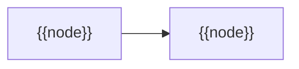

# Chapter note skeleton

Fill every `{{…}}`, delete the `<!-- … -->` comments, drop a section only if it has nothing to say.
`chapters/01 Introduction.md` shows the intended depth (150-250 lines for a 20-30 page chapter;
case-study notes are shorter).

````markdown
---
title: "{{chapter or sub-chapter title, as printed}}"
parent: "[[Sutton & Barto - Reinforcement learning, an introduction (2nd ed draft)]]"
type: book-chapter
chapter: {{number}}
section_range: "{{e.g. 3.1-3.5; omit for a whole chapter}}"
authors:
  - Richard S. Sutton
  - Andrew G. Barto
venue: "Book, Reinforcement Learning: An Introduction, 2nd edition (draft), Chapter {{n}}"
pdf: "https://web.stanford.edu/class/psych209/Readings/SuttonBartoIPRLBook2ndEd.pdf"
tags:
  - book
  - reinforcement-learning
  - chapter
created: {{YYYY-MM-DD}}
---
# {{Short title}} (Sutton & Barto, Chapter {{n}}{{ part a/b}})

> [!abstract] TL;DR
> {{1-3 sentences: what the chapter's methods do and the general conclusion; at most one number.}}

## Problem

- **{{What is estimated or decided}}**: {{and why earlier approaches fall short.}}
- **{{Key difficulty}}**: {{…}}

## Examples in the chapter

<!-- Only when the chapter has worked or running examples. High-level overview, not details. -->

| Example | Setting / decision | What it demonstrates |
|---------|--------------------|----------------------|
| {{…}} | {{…}} | {{…}} |

## Conceptual framework

- **{{Concept}}**: {{definition in plain words; each new term defined here or linked to its home note.}}

## Approach

1. **{{Method or step}}**: {{concrete mechanism, what it estimates, what it needs.}}
2. {{…}}

### {{Optional subsection per method family}}

- {{…}}

## Math

**Notation.**

| Symbol | Meaning |
|--------|---------|
| ${{symbol}}$ | {{meaning}} |



**{{Descriptive equation label}}:**

$$
{{LaTeX, in the book's notation}}
$$

- {{What it says, why it is there, what it estimates.}}

> [!example] Worked intuition
> {{One tiny numeric example or limiting case; say "Formalized here" if the book gives no arithmetic.}}

## Dataset example

{{One row per …}}; illustrative rows.

| {{column}} | {{column}} | {{column}} |
|------------|------------|------------|
| {{…}} | {{…}} | {{…}} |

- {{Column → symbol in Math; what the method derives from the rows; what is deliberately absent.}}

## Where it matters in practice

### Signs a problem fits

- {{…}}

### What you need to use it

- {{data, reward signal, state observability, model, compute}}

### When not to trust it

- {{conditions under which the method breaks or misleads}}

## Assumptions & limitations

- {{What must hold; what the chapter itself concedes or leaves open.}}
````
