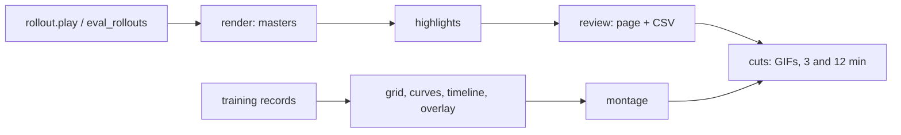

# visualisation

## Responsibility

- Turn rollouts and training records into GIFs and YouTube videos: gameplay highlights and the learning process ([[Visualisation]], [[Visualisation decisions]]).

## Public surface

- Shared: `ffmpeg` (encode, GIF, stacks, audio mix, YouTube checks), `text` (Pillow captions and cards), `rollout` (`Rollout`, `play`, `replay`, policies `RandomPolicy`, `HeuristicPolicy`, `NetworkPolicy`).
- Gameplay: `render_master`, `render_kept`, `detect`, `candidates`, `build_assets`, `write_page`, `short_cut`, `long_cut`, `gif`.
- Learning process: `EvalRun`, `evaluate`, `evaluate_spec`, `load_eval`, `replay_episode` (eval file format: [[Recording training data]]), `build_grid`, `render_curves`, `render_timeline`, `render_overlay`, `sequence`.
- Agent internals: `network_outputs(run, update, obs, actions, dones, greedy, skill, skill_steps)` re-runs a checkpoint's network over a replayed episode for action probabilities `(T, n_actions)` and values `(T,)`, float32, for every registry method; `episode_outputs(run, update, mode, seed)` does it for a stored eval episode (skill extras from the file); `network_family` (`ppo`, `ppo-rnn`, `pqn-rnn`, `skills`) picks the branch from the run's policy, `Q_FAMILIES` are the value-based ones; `value_label` names the overlay's value (`V(s)` or `max Q(s, a)`).
- `charts`: the figure theme of every static figure (`Theme`, `theme`, `rc_params` = seaborn `axes_style` + `plotting_context`, `themed_figure`, `style_axes`, `set_labels`, `set_title`, `heatmap` = `sns.heatmap`, `finish` = legend outside the axes, `settle` = titles wrapped to their panel and the layout fitted so nothing is cropped, `save_png` = PNG only, with `title=`/`description=` it registers the figure's `Caption`; `capture_captions` collects the captions saved inside a block, `register_caption`, `write_captions` keeps `<folder>/captions.csv` (`stem,id,title,description`), `figure_dir(out, budget)` = `<out>/<budget>`; size classes for the paper (`WIDTHS` column 80 mm, double 170 mm, tile 39 mm, included unscaled; `Shape` CURVE 0.62, DOTS 0.45, SQUARE 1.0 of the width, ROWS = `th.pitch_mm` per row plus `ROWS_BASE_MM` up to `MAX_ROWS_MM` = 80 mm, LEGEND; `themed_figure(th, height_mm=None, shape=, rows=)`, `shape_height_mm`, and for tiles that must line up `label_inset_mm` + `add_panel` with exact insets in mm); applied per figure through `rc_context`, never as global state), and the dark chart frame (`figure`, `style`, `frame`, `ema`, `SURFACE`, `INK`, `MUTED`, `GRID`, `SERIES`, `SEQ`) and, for the comparison figures, `METHOD_COLORS` (video, dark) and `METHOD_COLORS_LIGHT` (report) keyed by every registry name (the three controls three greys, every colour at least 3:1 against its surface) with the light theme's `SURFACE_LIGHT`, `INK_LIGHT`, `INK2_LIGHT`, `MUTED_LIGHT` and `GRID_LIGHT`; heat-map ramps `SEQUENTIAL_LIGHT/DARK` and `DIVERGING_LIGHT/DARK` (no method colour).
- Every step runs as `python -m wut_murl_craftax.visualisation.<step>` (`make vis STEP=<step> ARGS=...`).

## Data flow

- In: rollout files (seed, key scheme, actions) and [[training]] run folders.
- Out: lossless masters, review page and CSV, clips, GIFs, final MP4s under `outputs/visualisation/`.

## Invariants

- Replay is deterministic: frames rendered from a rollout file are bit-identical to the original run's.
- The keep/drop CSV is the only source of truth for what gets cut.
- The only HTML is the one static review template.
- `EvalRun.load` builds the trainer with `run_trainer`: a combo run replays the pair it trained with, whatever combo.yaml names now.
- `EvalRun.updates` lists every checkpoint of `index.json`, pruned ones included (their eval files remain); `EvalRun.params` of a pruned one raises `PrunedCheckpointError`. `evaluate` and `evaluate_spec` raise `PrunedCheckpointError` for a pruned checkpoint without an eval file, or skip it with a warning when called with `skip_pruned=True` (CLI `--skip-pruned`).
- `network_outputs` threads the recurrent carry from zeros over the episode (reset after a done); PQN-RNN and the skill network get the previous stored action as last action, the skill network the stored skill one-hot and `steps_in_skill / step_limit` (the run's `timeout_mult`). Value-based methods give max Q and the epsilon-greedy distribution at the checkpoint's `params["eps"]` (one-hot when greedy); primitive-skill steps are one-hot on the stored action. Greedy probabilities' argmax is the stored greedy action up to float near-ties (the sequence re-run and the live one-step acting may round differently): use the stored action as the label, never assert argmax equality on production checkpoints.
- Hook methods and combo re-run through the PPO-RNN or PQN-RNN branch of their base, dyna-q through the skills branch; a new policy class without a family raises `TypeError`.

- `charts.METHOD_COLORS` and `METHOD_COLORS_LIGHT` have the registry's keys, distinct values, the three controls as the only greys and at least 3:1 contrast with their surface (`tests/visualisation/test_charts.py`).

## Known issues

- This Homebrew ffmpeg has no `drawtext` or `subtitles` filters; all text is drawn with Pillow.

## Tests

- [[tests/visualisation/test_charts.py]] (method colours: registry keys, greys, 3:1 contrast), [[tests/visualisation/test_ffmpeg.py]], [[tests/visualisation/test_text.py]], [[tests/visualisation/test_rollout.py]], [[tests/visualisation/test_render.py]], [[tests/visualisation/test_highlights.py]], [[tests/visualisation/test_review.py]], [[tests/visualisation/test_cuts.py]], [[tests/visualisation/test_eval_rollouts.py]], [[tests/visualisation/test_grid.py]], [[tests/visualisation/test_curves.py]], [[tests/visualisation/test_timeline.py]], [[tests/visualisation/test_overlay.py]], [[tests/visualisation/test_montage.py]]
