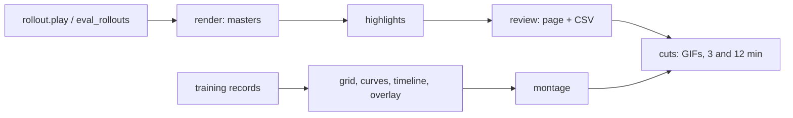

# visualisation

## Responsibility

- Turn rollouts and training records into GIFs and YouTube videos: gameplay highlights and the learning process ([[Visualisation]], [[Visualisation decisions]]).

## Public surface

- Shared: `ffmpeg` (encode, GIF, stacks, audio mix, YouTube checks), `text` (Pillow captions and cards), `rollout` (`Rollout`, `play`, `replay`, policies `RandomPolicy`, `HeuristicPolicy`, `NetworkPolicy`).
- Gameplay: `render_master`, `render_kept`, `detect`, `candidates`, `build_assets`, `write_page`, `short_cut`, `long_cut`, `gif`.
- Learning process: `EvalRun`, `evaluate`, `evaluate_spec`, `load_eval`, `replay_episode` (eval file format: [[Recording training data]]), `build_grid`, `render_curves`, `render_timeline`, `render_overlay`, `sequence`.
- Every step runs as `python -m wut_murl_craftax.visualisation.<step>` (`make vis STEP=<step> ARGS=...`).

## Data flow

- In: rollout files (seed, key scheme, actions) and [[training]] run folders.
- Out: lossless masters, review page and CSV, clips, GIFs, final MP4s under `outputs/visualisation/`.

## Invariants

- Replay is deterministic: frames rendered from a rollout file are bit-identical to the original run's.
- The keep/drop CSV is the only source of truth for what gets cut.
- The only HTML is the one static review template.
- `EvalRun.load` builds the trainer with `run_trainer`: a combo run replays the pair it trained with, whatever combo.yaml names now.

## Known issues

- This Homebrew ffmpeg has no `drawtext` or `subtitles` filters; all text is drawn with Pillow.

## Tests

- [[tests/visualisation/test_ffmpeg.py]], [[tests/visualisation/test_text.py]], [[tests/visualisation/test_rollout.py]], [[tests/visualisation/test_render.py]], [[tests/visualisation/test_highlights.py]], [[tests/visualisation/test_review.py]], [[tests/visualisation/test_cuts.py]], [[tests/visualisation/test_eval_rollouts.py]], [[tests/visualisation/test_grid.py]], [[tests/visualisation/test_curves.py]], [[tests/visualisation/test_timeline.py]], [[tests/visualisation/test_overlay.py]], [[tests/visualisation/test_montage.py]]
