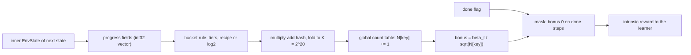
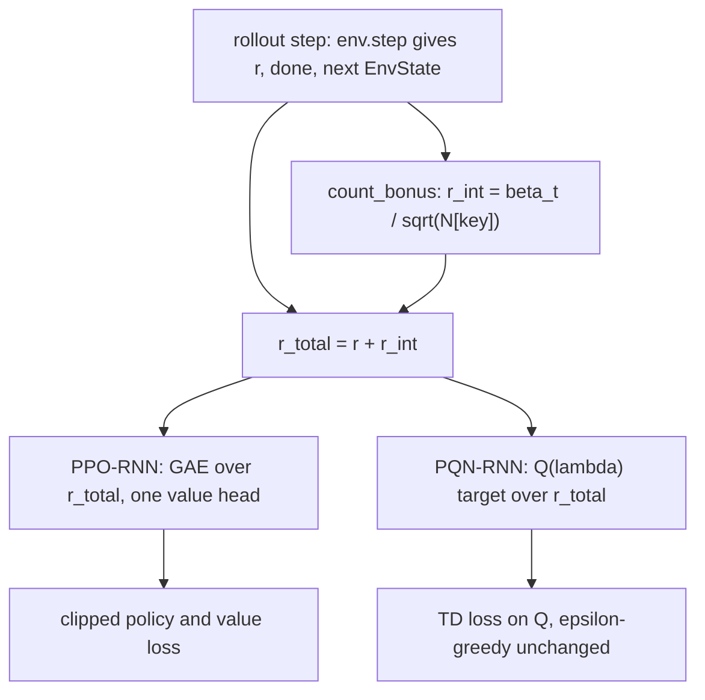

# Count-Based Progress Bonus

An intrinsic reward $r^+_t = \beta_t / \sqrt{N[\phi(s_{t+1})]}$ over a hand-chosen summary $\phi$ of game progress (floor, tools, armour, spells, bucketed inventory), counted globally over all of training and added to the extrinsic reward of a PPO-RNN or PQN-RNN learner. Candidate and novelty check: [[Count-Based Progress Bonus|Count-Based Progress Bonus (candidate)]]. Plan: [[2026-10-20-craftax-method-count-bonus]].

## What we implement

- One bonus module, `training/count_bonus.py`, used by two variants: `count-bonus-ppo-rnn` and `count-bonus-pqn-rnn`.
- The progress key lives in `training/progress_key.py`, shared with [[SMDP Q-Learning over Hand-Defined Skills]] and [[Dyna-Q over a Skill-Level Progress Model]].
- The key is read from the inner Craftax `EnvState`, not decoded from the observation: integers are exact there, while the observation holds `sqrt(n) / 10` ([[Craftax observations and actions]]).
- The bonus is computed for the next state $s_{t+1}$ and is 0 on done steps. Under optimistic resets (`auto_reset=False` envs inside `OptimisticResetVecEnvWrapper`, [[PPO design]]) the state the wrapper returns for a done step is not the terminal state but the start state of a new episode, one of the `envs / 16` worlds generated in that step (envs that finish together may share one); `next_env_state` of a done step therefore says nothing about the finished episode, and the terminal state is never seen. The mask follows the masked bonuses of [[RND (Matthews 2024)]] and [[ICM (Matthews 2024)]].
- Counts are updated inside the rollout scan, every step, before the bonus is read, so $N \ge 1$ and a key seen by 300 envs in the same step is counted 300 times.

## Progress key

Fields from `EnvState` (craftax 1.6.1); every field is an integer, bucketed by the granularity knob ([[Craftax items and inventory]], [[Craftax tools weapons and armour]], [[Craftax floors and progression]]).

| Field | Source | tiers | recipe (default) | log2 |
|---|---|---|---|---|
| Floor | `player_level` | 0-8 | 0-8 | 0-8 |
| Ladder open | `monsters_killed[player_level] >= 8` | 0/1 | 0/1 | 0/1 |
| Pickaxe, sword | `inventory.pickaxe`, `inventory.sword` | 0-4 each | 0-4 each | 0-4 each |
| Bow | `inventory.bow` | 0/1 | 0/1 | 0/1 |
| Armour | `sum(inventory.armour)` | 0-8 | 0-8 | 0-8 |
| Spells | `learned_spells` | 2 bits | 2 bits | 2 bits |
| Enchantments | sword, bow, any armour slot `> 0` | - | 3 bits | 3 bits |
| Wood | `inventory.wood` | - | `min(n, 4)` | `floor(log2(1 + n))` |
| Stone, coal, iron, diamond | `inventory.*` | - | `min(n, 3)` each | `floor(log2(1 + n))` |
| Sapphire, ruby, sapling | `inventory.*` | - | `min(n, 1)` each | `floor(log2(1 + n))` |
| Arrows, torches, books | `inventory.*` | - | `min(n, 1)` each | `floor(log2(1 + n))` |
| Potions | `sum(inventory.potions)` | - | `min(n, 1)` | `floor(log2(1 + n))` |

- Recipe caps are the largest amount one recipe needs ([[Craftax crafting and placing]]): table 2 wood plus one wood tool, iron armour 3 iron and 3 coal, diamond pickaxe and armour 3 diamonds; more never opens a new recipe, so hoarding earns nothing.
- `log2` buckets give 7 levels for 0-99 (0, 1, 2-3, 4-7, 8-15, 16-31, 32-99 capped at 6); it is the candidate note's rule and the "too fine" end of the knob.
- Excluded on purpose: position, map, mobs, daylight, health, food, drink, energy, XP and attributes (scenery or survival state, not progress).
- Craftax-Classic (smoke only): wood, stone, coal, iron, diamond, sapling with the same caps, and one bit per tool (`wood_pickaxe` ... `iron_sword`, counts above 1 stack damage in Classic, [[Craftax-Classic rules]]); no floor field.
- Hash: `h = sum_i f_i * P_i mod 2^32` with fixed odd 32-bit constants `P_i`, then the Knuth multiplicative fold `(h * 2654435761 mod 2^32) >> (32 - 20)` to $[0, 2^{20})$.
- `progress_key.py` also exposes the unhashed field vector, so the skill methods can use an exact key.

## Count table and bonus

- Table: `int32[2^20]` (4 MB), one per run, carried in the train state and checkpointed; 1e9 steps stay below the int32 limit.
- Global counts over all envs and the whole run, never reset: the #Exploration form (Tang et al. 2017) and the optimism of UCB ([[02 Multi-armed bandits]]); per-episode counts would pay the same basic progress in every episode, a dense shaping reward rather than a novelty signal.
- Bonus $r^+ = \beta_t / \sqrt{N}$, like the UCB bonus $c\sqrt{\ln t / N}$ and the Dyna-Q+ bonus $\kappa\sqrt{\tau}$ ([[08a Models, planning, Dyna]]), both shrinking with experience of the state.
- Decay knob: `constant` ($\beta_t = \beta$) or `linear` ($\beta_t = \beta (1 - t/T)$ over the run's budget $T$), so late training optimises only the game reward.
- Collision check: logged occupancy $n/K$; at $n$ occupied slots the expected share of colliding keys is about $n / (2K)$, under 0.5% for 10,000 occupied slots (an estimate of the distinct keys at 1B; the logged count replaces it).

## How the bonus enters each base

- PPO-RNN: `intrinsic_reward_fn` of `PPORNNConfig`; one value head learns $r + r^+$, as ICM and E3B do ([[E3B (Matthews 2024)]]); the RND-style second head is not used, so the two variants share one reward definition.
- PQN-RNN: `intrinsic_reward_fn` of `PQNRNNConfig`; $r + r^+$ replaces $r$ in the backward Q($\lambda$) recursion ([[07b Eligibility-trace control and off-policy]], [[PQN-RNN (Gallici 2025)]]); the bonus is a reward, so the off-policy TD target needs no correction ([[06 Temporal-difference learning]]).
- PQN keeps its control ε-greedy schedule (1.0 to 0.005 over 10% of updates): after the decay the bonus is the only directed exploration, which is the test the PQN paper's §5.2 remark asks for.
- Scoreboard returns, eval returns and every metric of [[2026-10-20-craftax-evaluation-and-metrics]] use the extrinsic reward only.

## Fixed, tuned, prior knowledge

| Kind | Items |
|---|---|
| Tuned (1M, two stages) | β, key granularity, decay |
| Fixed | table size $2^{20}$, global never-reset counts, one value head, done mask, base learner settings of the controls |
| Prior knowledge | the choice of progress fields and the recipe caps (from the game rules); no achievement list, no recipe graph, no reward shaping per item |

- The prior knowledge is a state abstraction, not a behaviour: the agent is never told which key is good, only which keys are rare.
- Results are reported in block A and block D of [[Existing Implementations]] with this prior-knowledge line in the table caption.

## Differences from published versions

- #Exploration hashes the observation (SimHash or a learned autoencoder code); we hash a hand-chosen progress summary.
- RND, ICM and E3B on Craftax score novelty of the full 8268-float observation with a learned network ([[RND (Matthews 2024)]], [[ICM (Matthews 2024)]], [[E3B (Matthews 2024)]]); we use no network.
- Ablation at `final-1m`: the same counts over a 64-bit SimHash of the full observation (`key: simhash`), the matched observation-novelty control that tests the Craftax paper's "the bonus chases scenery" explanation in our own code.
- Published RND and ICM numbers came from code with known bugs (RND intrinsic GAE bootstrapped from the extrinsic head; ICM bonus paid only on termination), and all three bonuses ran on feed-forward PPO, so they are reference numbers, not matched controls.
- [[Bandit-Tuned Exploration]] would pick β per episode by UCB; we tune one β per run and keep the bandit as future work.

## Comparisons

| Comparison | Budget | Reference |
|---|---|---|
| PPO-RNN + bonus against our PPO-RNN control | 1M, 1B | same seeds, [[2026-10-20-craftax-method-ppo-rnn]] |
| PQN-RNN + bonus against our PQN-RNN control | 1M, 1B | same seeds, [[2026-10-20-craftax-method-pqn-rnn]] |
| Bonus gain on PPO-RNN against bonus gain on PQN-RNN | 1M, 1B | does exploration help depend on the learner |
| Progress key against SimHash of the observation | 1M | PPO-RNN variant, 10 seeds |
| Published RND, E3B, ICM | 1M: 2.2% each; 1B: 12.0%, 11.0%, 11.9% | [[Craftax Baselines results]]; PPO-RNN 2.3% and 15.3%, PQN-RNN 16.0% at 1B |
