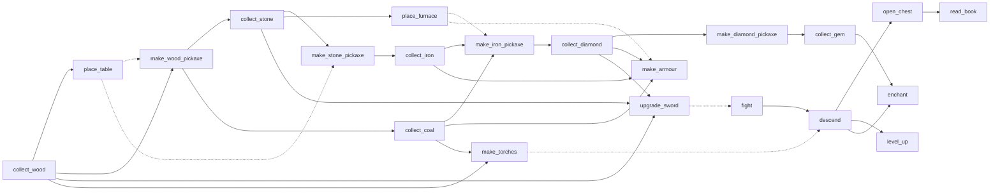

# Craftax skill library

The 25 hand-written options (23 learned skills and 2 one-step primitive options) shared by [[SMDP Q-Learning over Hand-Defined Skills design]] and [[Dyna-Q over a Skill-Level Progress Model design]]: for each, a start condition (initiation set), a success test, a step limit and the game rules it relies on. Module: `src/wut_murl_craftax/training/skills.py`. Plans: [[2026-10-20-craftax-method-smdp-skills]], [[2026-10-20-craftax-method-dyna-q]]. Game rules: [[Game]].

## Access and reward

Every part of a skill reads only the observation the agent receives and the step reward; "privileged" means read from `EnvState` with no counterpart in the observation ([[Craftax observations and actions]]), and it is used for logging only.

| Part | Reads | Source | Used for |
|---|---|---|---|
| Start conditions | floor, inventory, tool levels, stats, XP, attributes, ladder-open flag | observation (`decode_obs`, exact integers after undoing the encoding) | top-level mask (acting) |
| Success tests of collect, craft, place, survival, `descend`, `open_chest`, `enchant` skills | inventory buckets, tool levels, stats, floor, sleeping flag, the facing tile and the 8 tiles around the player, enchantments | observation before and after one step | pseudo-reward and skill end |
| `fight` success | creature channels of the facing tile before an attack and of the 5 x 5 tiles around the player after it; the achievement part of the reward | observation and reward | pseudo-reward and skill end |
| `unlock_any` success | the achievement part of the reward: reward minus 0.1 x the health change, health read from the observation | reward and observation | pseudo-reward and skill end |
| Interruptions | floor, low-stat flags | observation | skill end |
| Test agreement | `EnvState`, the wrapper's `StepEvents` (kills, unlocks) | privileged | logging only (`smdp/skill/<name>/test_agreement`), never acting or reward |

- No part that decides acting, a skill end or a pseudo-reward reads privileged state; the skill methods act on what the agent observes plus its own reward.
- Achievement part of the reward: the reward is the sum of first-unlock weights plus 0.1 x the health change, and the health channel holds health / 10, so the achievement part is $r - (h'_{\text{obs}} - h_{\text{obs}})$; the success tests use the threshold 0.5 (the smallest weight is 1, and float error is far smaller).
- Skill pseudo-reward: 1 on the success step, 0 otherwise and on death ([[#Common rules]]); it trains the skill network only, and no reported score uses it.

## Common rules

- Option = (start condition, policy, termination), as in Sutton, Precup and Singh 1999 ([[SMDP Q-Learning over Hand-Defined Skills]]).
- Start conditions are read from the decoded observation at the decision step (`skills.decode_obs`: `sqrt(n) / 10` counts back to integers by `round(100 x^2)`, levels by `round(4 x)` or `round(2 x)`, floor and stats by `10 x`); the top level samples only among available skills (a mask over the 25 columns of its table).
- `fight` and `unlock_any` are always available, so the mask is never empty.
- Success tests compare the decoded observations before and after one env step, plus the achievement part of the reward; no test reads `EnvState`.
- No test runs across a done step: on a done step the next observation belongs to a new episode (optimistic reset), so the skill ends with reason `episode_end` (death, win or time cap) and pseudo-reward 0.
- The wrapper's `StepEvents` (computed from the pre-reset state, [[2026-10-20-craftax-evaluation-and-metrics]]) are compared with each observation test at every skill end and logged as `smdp/skill/<name>/test_agreement`; they never decide anything.
- A skill ends on the first of: success; step limit `T_max x timeout_mult` reached; episode end (death, win, time cap); floor change (except `descend`); a low-stat flag switching on (except `drink`, `eat`, `sleep`).
- The last two are interruptions: the progress key changed in a way the running skill was not chosen for, so the top level re-decides ("interrupting options" in Sutton, Precup and Singh 1999).
- Skill pseudo-reward $r^o_t$: 1 on the success step, 0 otherwise, also 0 on death; every end is terminal for the skill's return.
- "Next bucket": a collect skill succeeds when the material's progress-key bucket of the observed count rises (`progress_key.bucket`, recipe caps or log2 buckets, the granularity knob of [[Count-Based Progress Bonus design]]), so every successful skill changes the top-level key and the skill graph has no success self-loops.
- A collect skill whose material bucket is already at its cap is unavailable: hoarding has no skill.
- Observation limits, measured by `test_agreement`: on dark floors a tile with light <= 0.05 is blank in the observation, so a place, chest or fight test on an unlit facing tile fails (the skill times out); a creature that steps into an unlit tile right after an attack counts as killed (mobs move at most one tile a step, so the `fight` test looks at the 5 x 5 around the player).

## Skill table

Floors where a resource exists follow [[Craftax blocks and resources#Resource spawn rules per floor]]; recipes and station distance follow [[Craftax crafting and placing]]; tool tiers follow [[Craftax tools weapons and armour]].

### Gathering

| # | Skill | Start condition | Success | Pursues | Rules relied on | `T_max` |
|---|---|---|---|---|---|---|
| 1 | `collect_wood` | floor 0, 6 or 7; wood below cap | wood bucket rises | wood for table, tools, torches | trees, fire trees and ice shrubs give 1 wood per `DO` and disappear ([[Craftax blocks and resources#Mining with DO]]) | 300 |
| 2 | `collect_stone` | pickaxe >= 1; floor 0, 2, 5, 6 or 7; stone below cap | stone bucket rises | stone tools, furnace, bridges | stone and stalagmites need pickaxe 1 | 300 |
| 3 | `collect_coal` | pickaxe >= 1; floor 0, 2, 5 or 6; coal below cap | coal bucket rises | iron tools, armour, torches | coal needs pickaxe 1 | 300 |
| 4 | `collect_iron` | pickaxe >= 2; floor 0, 2 or 5; iron below cap | iron bucket rises | iron tools and armour | iron needs pickaxe 2 | 300 |
| 5 | `collect_diamond` | pickaxe >= 3; floor 0, 2, 5 or 7; diamond below cap | diamond bucket rises | diamond tools and armour | diamond needs pickaxe 3; 0.001 per overworld stone tile, richer on 2 and 5 | 500 |
| 6 | `collect_gem` | pickaxe >= 4; floor 2, 5, 6 or 7 | sapphire or ruby bucket rises | enchanting gems | sapphire and ruby need pickaxe 4 | 500 |

### Stations and crafting

| # | Skill | Start condition | Success | Pursues | Rules relied on | `T_max` |
|---|---|---|---|---|---|---|
| 7 | `place_table` | wood >= 2 | the facing tile in the map view turns into a crafting table | a crafting station | `PLACE_TABLE` costs 2 wood, any non-solid tile without an item | 100 |
| 8 | `place_furnace` | stone >= 1 | the facing tile turns into a furnace while a table is on one of the 8 tiles around the player (map view) | a working iron station | `PLACE_FURNACE` costs 1 stone; iron recipes need table and furnace in the 8 surrounding tiles ([[Craftax crafting and placing#Station distance]]) | 100 |
| 9 | `make_wood_pickaxe` | wood >= 1; pickaxe 0 | pickaxe >= 1 | mining stone and coal | 1 wood at a table | 200 |
| 10 | `make_stone_pickaxe` | wood >= 1, stone >= 1; pickaxe < 2 | pickaxe >= 2 | mining iron | 1 wood, 1 stone at a table | 200 |
| 11 | `make_iron_pickaxe` | wood, stone, iron, coal >= 1; pickaxe < 3 | pickaxe >= 3 | mining diamond | table and furnace | 200 |
| 12 | `make_diamond_pickaxe` | wood >= 1, diamond >= 3; pickaxe < 4 | pickaxe >= 4 | mining gems | 1 wood, 3 diamond at a table; tiers can be skipped | 200 |
| 13 | `upgrade_sword` | ingredients of a sword tier above the held one | sword level rises | melee damage for kills | sword recipes; damage `[1, 2, 3, 5, 8][sword]` ([[Craftax combat#Player melee]]) | 200 |
| 14 | `make_armour` | (iron >= 3 and coal >= 3 and a slot at 0) or (diamond >= 3 and a slot below 2) | sum of the armour channels rises | physical defence 0.1 per level | iron armour needs table and furnace; diamond armour a table | 200 |
| 15 | `make_torches` | wood >= 1, coal >= 1; torches < 99 | torches rise | light on dark floors 2, 5, 7, 8 | 1 wood + 1 coal gives 4 torches ([[Craftax floors and progression#Light on dark floors]]) | 200 |

### Survival

| # | Skill | Start condition | Success | Pursues | Rules relied on | `T_max` |
|---|---|---|---|---|---|---|
| 16 | `drink` | drink < max; floor 0-5 or 7 | drink reaches max | thirst reset, health regeneration | `DO` facing water or a fountain gives +1 ([[Craftax farming and food#Drinking]]) | 200 |
| 17 | `eat` | food < max; floor 0-6 | food rises | hunger reset | `DO` kill of cow, snail or bat +6, ripe plant +4; projectile kills give no food ([[Craftax farming and food#Eating]]) | 300 |
| 18 | `sleep` | energy < max | the sleeping flag turns 0 with energy at max | energy, safe regeneration | +1 energy per 11 steps asleep; melee damage x3.5 while asleep; a hit wakes the player and fails the skill ([[Craftax episode and time#Sleeping]], [[Craftax survival stats]]) | 400 |

### Floors, combat and magic

| # | Skill | Start condition | Success | Pursues | Rules relied on | `T_max` |
|---|---|---|---|---|---|---|
| 19 | `fight` | always | after a `DO` with a melee or ranged creature on the facing tile, no creature of that type is in the 5 x 5 tiles around the player in the next observation (a survivor moves at most one tile); or the achievement part of the reward is > 0 on an attack step (a first `DEFEAT_*`, the necromancer included) | the 8 kills that open the ladder, `DEFEAT_*` | only melee and ranged kills count; hits on the necromancer that do not finish it are not observable as kills ([[Craftax floors and progression#Ladders]], [[Craftax creatures]], [[Craftax boss fight]]) | 300 |
| 20 | `descend` | ladder-open flag of the observation set (8 kills on the floor; floor 0 starts open); floor < 8 | floor rises | `ENTER_*` (3-8 reward), new resources, 1 XP | `DESCEND` on the down ladder | 1000 |
| 21 | `open_chest` | floor 1, 3 or 4 | the facing tile in the map view turns from chest to path | bow (floor 1), books (3, 4), ores, potions | first chest of a floor gives the bow or a book ([[Craftax items and inventory#Chest loot]]) | 500 |
| 22 | `enchant` | floor 3 or 4; mana >= 9; a sapphire (floor 3) or ruby (floor 4); sword > 0 or an armour piece | a sword, bow or armour enchantment channel changes | elemental damage and defence | the player must face the enchantment table; costs 9 mana and 1 gem ([[Craftax magic potions and enchanting#Enchanting]]) | 500 |
| 23 | `unlock_any` | always | the achievement part of the reward is > 0 (a first unlock this episode) | the achievements no skill targets: sapling, plant, stone and torch placing, arrows, bow and spell use, potions | the one-time achievement reward ([[Craftax achievements]]) | 500 |

### Primitive options (one step, no network)

| # | Option | Start condition | Action | Pursues | Rules relied on |
|---|---|---|---|---|---|
| 24 | `read_book` | books >= 1 | `READ_BOOK` | `LEARN_FIREBALL`, `LEARN_ICEBALL` (5 each) | a book teaches a random unknown spell ([[Craftax magic potions and enchanting#Books and spells]]) |
| 25 | `level_up` | XP >= 1 and an attribute < 5 | `LEVEL_UP_*` on the lowest attribute (ties: dexterity, strength, intelligence) | attributes from the 8 floor-entry XP | [[Craftax survival stats#XP and attributes]] |

- Primitive options override the network's action for one step; those steps are masked out of the skill network's loss.
- The tie order for `level_up` is a fixed rule (prior knowledge); the top level still chooses when to spend XP.

## Skill dependency graph

Solid edge: the source skill's success can make the target's start condition true. Dashed edge: the target needs the source's station nearby but not in its start condition.

- Survival skills (`drink`, `eat`, `sleep`) and `unlock_any` have no prerequisite skill and are left out of the graph.
- The top level is not given this graph: it learns which skill pays from which key; Dyna's model learns the graph as observed key transitions.

## Skill network: one shared Q(λ) network

The 23 learned skills are one recurrent Q-network trained like [[PQN-RNN (Gallici 2025)]] (module `training/pqn_rnn.py`, planned in [[2026-10-20-craftax-method-pqn-rnn]]).

- Input: the symbolic observation, the last action one-hot (`ADD_LAST_ACTION`), the skill one-hot (25) and `steps_in_skill / T_max` (so the step limit is part of the state).
- Network: PQN-RNN unchanged (LayerNorm MLP 512, one LSTM layer 512, 43 action values); only the input width grows by 26.
- Reward: the skill pseudo-reward $r^o_t$ replaces the native reward; done: any skill end, so the backward Q($\lambda$) recursion cuts at skill boundaries ([[07b Eligibility-trace control and off-policy]]).
- The LSTM state is carried across skill ends and reset only at episode end: what the agent saw of the map during one skill helps the next.
- Exploration: PQN's ε-greedy schedule per env (1.0 to 0.005 over 10% of updates); γ 0.99 and λ 0.5 from the PQN-RNN control.
- One network for all skills mirrors the shared network RL2 of the elevator case study, which learned faster than one network per car ([[14.4 Elevator dispatching]]).
- Interference risk: if a skill's success rate falls when another skill becomes frequent, the fallback is a per-skill output head (25 x 43 values, selected by the skill id), an ablation not in the base design.

## What the skills need from the progress key

From `training/progress_key.py` (designed in [[Count-Based Progress Bonus design]], API tested in [[2026-10-20-craftax-method-count-bonus]] Task 1):

- `bucket(name, count, granularity) -> int32`: the bucket of one material, applied to counts decoded from the observation; used by the collect skills' "next bucket" test and their cap check.
- `hash_fields(fields, bits) -> int32`: the same multiply-add hash for a field vector of any length, folded to `bits` bits; it hashes the top-level key.
- `skills.key_fields(view, granularity) -> int32[F]` builds the top-level field vector (floor, ladder open, tools, bow, armour, spells, enchantments, bucketed materials) from the decoded observation, in the order of `fields`.
- `fields(state, granularity)` and `unwrap(env_state)` are not used for acting; a test checks `key_fields(decode_obs(obs), g) == fields(unwrap(state), g)` on random states, so the top-level key holds nothing the observation lacks.
- The skill methods append 4 low-stat flags before hashing: food <= 3, drink <= 3, energy <= 3, health <= 3 (about 60-90 awake steps before a stat reaches 0 at dexterity 1, [[Craftax survival stats#Steps per unit]]).
- Granularity values used by the skill methods: `recipe` (default) and `log2`; `tiers` has no material fields, so the collect skills would have no bucket to raise.
- Craftax-Classic: the Classic observation decoder (`n / 10` counts, one bit per tool, no floor) and the Classic subset below.

## Craftax-Classic subset (smoke runs only)

- 16 skills: `collect_wood`, `collect_stone`, `collect_coal`, `collect_iron`, `collect_diamond`, `place_table`, `place_furnace`, `make_wood_pickaxe`, `make_stone_pickaxe`, `make_iron_pickaxe`, `upgrade_sword`, `drink`, `eat`, `sleep`, `fight`, `unlock_any`.
- Classic checks specific tools, not tiers: `collect_stone` and `collect_coal` need the wood pickaxe itself ([[Craftax-Classic rules#Blocks and movement]]).
- Floor conditions, interruptions on floor change and primitive options do not apply; lava ends the episode, which counts as death.
- The Classic observation has creature flags per tile (zombie, cow, skeleton, arrow), so `fight` succeeds when a zombie or skeleton on the facing tile is gone from the 5 x 5 around the player after a `DO`, or on an achievement reward.

## Prior knowledge

What the library tells the agent that the native Craftax interface does not:

| Item | Source in the rules | Effect on learning |
|---|---|---|
| Which subgoals exist (the 25 options) | recipes, ladders, chests, survival counters | decomposes the 100,000-step task into skill decisions |
| Start conditions | recipe ingredients, tool tiers, resource floors | masks useless choices at the top level, like action masking |
| Success tests | inventory, map view and the achievement part of the reward, all as the agent observes them | a dense pseudo-reward per skill for the low level, like reward shaping |
| Interruptions on low stats and floor change | survival counters | forces a re-decision when survival matters |
| Progress-key fields and low-stat flags | inventory and stat rules | a hand-made state abstraction for the top level |
| `level_up` tie order | attribute effects | one fixed micro-decision |

- Not given: the recipe graph or skill order (the top level learns it), the map, potion effects, creature behaviour, and any reward for the top level other than the native one.
- Every primitive game step, inside any skill, counts toward the 1M and 1B budgets; planning backups use no env steps.
- Why the results go in their own block: the Craftax maintainer closed the scoreboard request of [[maskedPPO-GTrXL (Doguhan58 2026)]] because masking plus reward shaping uses "quite extensive prior knowledge"; our start conditions and success tests are the same two kinds of knowledge.
- The elevator dispatchers also built prior knowledge into constraints on the action set, and the book lists it as a limitation ([[14.4 Elevator dispatching]]).
- Other knowledge-using Craftax agents, none comparable by number: [[SCALAR (Zabounidis 2026)]] (LLM-written skills, target-achievement success rates), [[AHC (Zhu 2026)]] (hand-built dependency graph for a curriculum, own eval protocol), [[Rule Learner Planner (dargilboa 2026)]] (no game knowledge, reward-free, Classic).
- Reporting rule: every table and plot puts the two skill methods in a block labelled "uses hand-written skills (game knowledge)", next to the maskedPPO-GTrXL row, never ranked inside block A or block D of [[Existing Implementations]].
