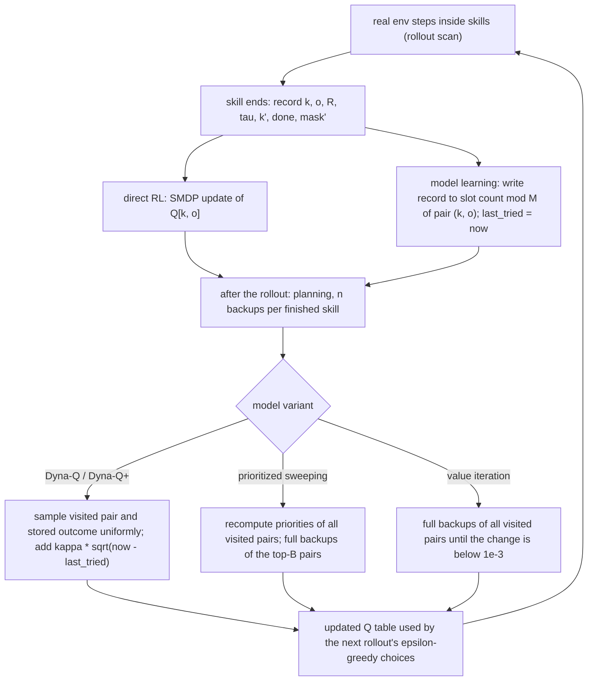

# Dyna-Q over a Skill-Level Progress Model design

[[SMDP Q-Learning over Hand-Defined Skills design]] plus a learned lookup-table model of skill outcomes $(k, o) \mapsto (R, \tau, k', \text{done})$ and the book's planning updates on it: Dyna-Q, Dyna-Q+, prioritized sweeping and value iteration, all at the level of progress keys and skills. Candidate and novelty check: [[Dyna-Q over a Skill-Level Progress Model]]. Plan: [[2026-10-20-craftax-method-dyna-q]]. Module: `src/wut_murl_craftax/training/dyna_q.py`.

## Access and reward

- **Observes and acts:** exactly as `smdp-skills` ([[SMDP Q-Learning over Hand-Defined Skills design#Access and reward]]): the top level sees only the progress key and the start-condition mask and picks among the 25 options.
- The skill network sees the 8268-float observation (Classic 1345), the previous action, the skill one-hot and the step fraction, and picks among the 43 primitive actions.
- No privileged state for acting, as `smdp-skills`: key, mask and every skill end come from the decoded observation and the reward (`unlock_any` from the achievement part of the reward, `fight` from the observed creature or a kill achievement's reward); `EnvState` and `StepEvents` are read for logging only ([[Craftax skill library#Access and reward]]).
- The model adds no new input: it stores only quantities the top level already had, $(R, \gamma^\tau, k', \text{done}, \text{mask}')$ of each finished real skill.
- **Rewarded by:** real updates as `smdp-skills`: the top level on the discounted environment reward over each skill, the skill network on the success pseudo-reward ([[Craftax scoring and evaluation#Reward]]).
- Planning updates: the same SMDP target on modelled outcomes, i.e. stored real returns $R$ of the pair, plus $\kappa\sqrt{t - t^{\text{last}}}$ in Dyna-Q+ ([[#Planning updates]]).
- κ is tuned in {0, 0.003, 0.03} and paid on simulated backups only; real updates never get it.
- **Training objective:** as `smdp-skills`: the top level maximises the expected discounted sum of environment rewards with its tuned γ (0.995 or 0.999 per game step); planning only speeds up learning that value.
- **Evaluated on:** the environment reward only: training-episode return as % of 226; pseudo-rewards and the κ bonus never enter a score.
- **Prior knowledge:** the skill library and progress key of `smdp-skills`; the model itself is learned ([[#Fixed, tuned, prior knowledge]]).

## What we implement

- Registry name `dyna-q`; acting, skills, skill network, progress key and the direct SMDP update are those of `smdp-skills` unchanged ([[Craftax skill library]]).
- Model learning: every finished real skill writes its record into the model; nothing about the screen, terrain or creatures is predicted.
- Planning: after each rollout, $n \times$ (number of skills finished in that rollout) backups on the top-level table, using the same SMDP target as the direct update ([[08a Models, planning, Dyna]]).
- With $n = 0$ the method is `smdp-skills` exactly (a test checks equal tables).
- Planning uses no env steps; its cost shows only in wall-clock and SPS.

## Model

- Pair index: `pair_id[2^20, 25]` (int32, -1 = unvisited) maps a visited $(k, o)$ to a compact slot $p < P = 2^{16}$, assigned in order of first visit; `pair_k[p]`, `pair_o[p]` store the pair.
- Outcomes: $M = 8$ ring slots per pair, arrays `m_R`, `m_disc` ($\gamma^\tau$), `m_next` (key), `m_done`, `m_avail` (start-condition mask of the next state as a 25-bit integer), each `[P, M]`; `count[P]`, `last_tried[P]`.
- A ring of recent outcomes, not counts of every outcome: the skills keep improving, so old outcomes describe an older, worse skill; $M$ trades averaging against recency (a stage-2 knob).
- Stored next-state masks let a planned target take $\max_{o' \in A(s')}$ exactly as the real target does.
- Time for Dyna-Q+ is measured in thousandths of the run's budget (1000 units per run), so a tuned κ transfers from 1M to 1B unchanged.
- Model accuracy (logged): share of real outcomes whose next key is already in the pair's slots.

## Planning updates

Sample backup (Dyna-Q, Dyna-Q+), for a sampled visited pair $p$ and slot $m < \min(\text{count}_p, M)$:

$$y = R_{p,m} + \kappa\sqrt{t - t^{\text{last}}_p} + \gamma^{\tau_{p,m}} (1 - \text{done}_{p,m}) \max_{o' \in A_{p,m}} Q[k'_{p,m}, o']$$

Full backup (prioritized sweeping, value iteration), over the stored outcomes of $p$:

$$y_p = \frac{1}{\min(\text{count}_p, M)} \sum_{m} \Big[R_{p,m} + \kappa\sqrt{t - t^{\text{last}}_p} + \gamma^{\tau_{p,m}} (1 - \text{done}_{p,m}) \max_{o' \in A_{p,m}} Q[k'_{p,m}, o']\Big]$$

- Dyna-Q: $\kappa = 0$, pairs and slots sampled uniformly in batches of 1024, step $Q \leftarrow Q + \alpha\,\overline{(y - Q)}$ with the same duplicate-mean rule as the direct update.
- Dyna-Q+: $\kappa > 0$, the book's bonus on simulated experience only; real updates never get it ([[08a Models, planning, Dyna]]).
- Prioritized sweeping: priority $P_p = |y_p - Q_p|$ is recomputed for every visited pair before each batch (one gather over $P \times M$, cheap in JAX), and the top 1024 pairs with $P_p > \theta = 10^{-4}$ get a full backup with step $\alpha$.
- This replaces the book's predecessor queue: recomputing all priorities finds every predecessor of a changed key without predecessor lists, and full backups are what the book prescribes for stochastic models.
- Value iteration: synchronous full backups of all visited pairs with step 1 until the largest change is below $10^{-3}$ or 50 sweeps; the full-backup end of the planning spectrum ([[04 Dynamic programming]], [[08b Trajectory sampling, search, MCTS]]).

## Fixed, tuned, prior knowledge

| Kind | Items |
|---|---|
| Tuned at 1M, stage 1 | model variant (uniform, prioritized, value iteration), planning backups per finished skill $n$, Dyna-Q+ κ |
| Tuned at 1M, stage 2 | κ and model slots $M$ around the stage-1 best |
| Fixed | every `smdp-skills` knob at its tuned best, $P = 2^{16}$ pairs, batch 1024, θ = $10^{-4}$, VI tolerance $10^{-3}$ and 50 sweeps |
| Prior knowledge | the same skill library and progress key as `smdp-skills`; the model itself is learned from experience, no recipe graph is given |

- Reported in the same "uses hand-written skills" block as `smdp-skills` ([[Craftax skill library#Prior knowledge]]).

## Differences from published versions

- Book Dyna-Q stores one deterministic outcome per state-action pair; we keep $M$ recent outcomes because one key hides the map and the skill's success is random.
- Book planning runs $n$ backups after every real step; we run them after each rollout, scaled by the number of skills finished in it, so planning per real decision matches.
- Book prioritized sweeping keeps a queue and walks predecessors; we recompute all priorities per batch.
- Neural world-model Dyna on Craftax ([[Efficient MBRL (Dedieu 2025)]], [[Simulus (Cohen 2025)]], [[EASimulus (Peng 2026)]]) predicts observations; this model predicts only skill outcomes at the key level.
- SEA on Crafter and [[AHC (Zhu 2026)]] use an achievement graph found by a heuristic or written by hand; here the graph is the learned model and values are planned on the native reward.
- [[Rule Learner Planner (dargilboa 2026)]] learns rules and plans experiments without reward on Craftax-Classic; this planner plans for reward.

## Comparisons

| Comparison | Budget | Note |
|---|---|---|
| Model-free against planning: `smdp-skills` against `dyna-q` | 1M, 1B | same skills, same seeds; the book's maze effect (episodes to near-optimal 25 for $n = 0$, 3 for $n = 50$) predicts the gap is largest at 1M |
| Learning speed | 1M, 1B | env steps to the first and the tenth `COLLECT_DIAMOND` episode, with and without planning |
| Variant sensitivity | 1M tuning | uniform against prioritized against value iteration, κ = 0 against κ > 0 (3 seeds, ranking only) |
| Model-based Craftax-1M references | 1M | [[Simulus (Cohen 2025)]] 6.59%, [[EASimulus (Peng 2026)]] 7.23% (no game knowledge, block D) |
| Flat control | 1M, 1B | PQN-RNN, as for `smdp-skills` ([[2026-10-20-craftax-method-pqn-rnn]]) |
