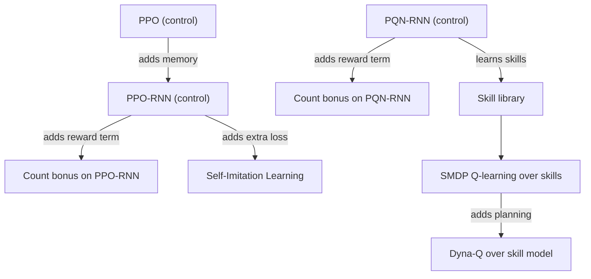

# Methods

The algorithms this project trains on Craftax: three controls and four methods, each with a design note (what exactly we implement and why), its research note and its plan file. Selection: [[Experiment decisions]]; candidates and rejected ideas: [[Candidate Algorithms]].

| Method | Role | Family | Design | Research | Plan |
|---|---|---|---|---|---|
| PPO | control | policy gradient, feed-forward | [[PPO design]] | [[PPO (Matthews 2024)]] | [[2026-10-20-craftax-method-ppo]] |
| PPO-RNN | control, base of add-ons | policy gradient with GRU memory | [[PPO-RNN design]] | [[PPO-RNN (Matthews 2024)]] | [[2026-10-20-craftax-method-ppo-rnn]] |
| PQN-RNN | control, base of add-ons and skills | value-based, Q(lambda) with memory | [[PQN-RNN design]] | [[PQN-RNN (Gallici 2025)]] | [[2026-10-20-craftax-method-pqn-rnn]] |
| Count-Based Progress Bonus | add-on on PPO-RNN and PQN-RNN | exploration bonus | [[Count-Based Progress Bonus design]] | [[Count-Based Progress Bonus]] | [[2026-10-20-craftax-method-count-bonus]] |
| Self-Imitation Learning | add-on on PPO-RNN | imitation of own good episodes | [[Self-Imitation Learning design]] | [[Self-Imitation Learning]] | [[2026-10-20-craftax-method-sil]] |
| SMDP Q-Learning over Hand-Defined Skills | method | hierarchical RL | [[SMDP Q-Learning over Hand-Defined Skills design]] | [[SMDP Q-Learning over Hand-Defined Skills]] | [[2026-10-20-craftax-method-smdp-skills]] |
| Dyna-Q over a Skill-Level Progress Model | method | model-based planning | [[Dyna-Q over a Skill-Level Progress Model design]] | [[Dyna-Q over a Skill-Level Progress Model]] | [[2026-10-20-craftax-method-dyna-q]] |

- Shared by the skill methods: [[Craftax skill library]].
- The progress key (floor, tools, inventory buckets, low-stat flags) is shared by the count bonus and both skill methods: [[Count-Based Progress Bonus design]].

## How the methods relate

## Comparisons the set answers

- Policy gradient vs value-based: PPO-RNN vs PQN-RNN, each with and without the count bonus.
- Base vs add-on: PPO-RNN vs PPO-RNN with the count bonus or with self-imitation.
- Flat vs hierarchical: PQN-RNN vs SMDP Q-learning over skills learned by the same Q(lambda) network.
- Model-free vs planning: SMDP Q-learning vs Dyna-Q on the same skills.
- Prior knowledge: both skill methods use hand-written skills, so they are reported in their own block, next to maskedPPO-GTrXL in [[Existing Implementations]].
- The best two compatible methods are combined at the end ([[2026-10-20-craftax-project]], Phase 3).
