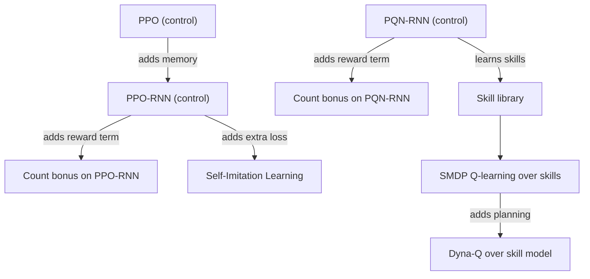

# Methods

The algorithms this project trains on Craftax: three controls and four methods, each with a design note (what exactly we implement and why), its research note and its plan file. Selection: [[Experiment decisions]]; candidates and rejected ideas: [[Candidate Algorithms]].

| Method | Role | Family | Design | Research | Plan |
|---|---|---|---|---|---|
| PPO | control | policy gradient, feed-forward | [[PPO design]] | [[PPO (Matthews 2024)]] | [[2026-10-20-craftax-method-ppo]] |
| PPO-RNN | control, base of add-ons | policy gradient with GRU memory | [[PPO-RNN design]] | [[PPO-RNN (Matthews 2024)]] | [[2026-10-20-craftax-method-ppo-rnn]] |
| PQN-RNN | control, base of add-ons and skills | value-based, Q(lambda) with memory | [[PQN-RNN design]] | [[PQN-RNN (Gallici 2025)]] | [[2026-10-20-craftax-method-pqn-rnn]] |
| Count-Based Progress Bonus | add-on on PPO-RNN and PQN-RNN | exploration bonus | [[Count-Based Progress Bonus design]] | [[Count-Based Progress Bonus]] | [[2026-10-20-craftax-method-count-bonus]] |
| Self-Imitation Learning | add-on on PPO-RNN | imitation of own good episodes | [[Self-Imitation Learning design]] | [[Self-Imitation Learning]] | [[2026-10-20-craftax-method-sil]] |
| SMDP Q-Learning over Hand-Defined Skills | method | hierarchical RL | [[SMDP Q-Learning over Hand-Defined Skills design]] | [[SMDP Q-Learning over Hand-Defined Skills]] | [[2026-10-20-craftax-method-smdp-skills]] |
| Dyna-Q over a Skill-Level Progress Model | method | model-based planning | [[Dyna-Q over a Skill-Level Progress Model design]] | [[Dyna-Q over a Skill-Level Progress Model]] | [[2026-10-20-craftax-method-dyna-q]] |

- Shared by the skill methods: [[Craftax skill library]].
- The progress key (floor, tools, inventory buckets) is shared by the count bonus and both skill methods, which append 4 low-stat flags: [[Count-Based Progress Bonus design]].

## Access and reward at a glance

All methods are evaluated on the same environment reward, so extra reward terms never inflate reported scores. Reward $r$: per achievement unlocked for the first time in the episode its tier weight 1, 3, 5 or 8, plus 0.1 x the health change ([[Craftax scoring and evaluation#Reward]]). Privileged: read from `EnvState`, not from the observation. Details: each design note's "Access and reward".

| Method | Observes | Privileged state used for | Acts on | Training reward | Evaluated on | Prior knowledge |
|---|---|---|---|---|---|---|
| PPO | observation (8268 floats, Classic 1345) | none (logging only) | 43 actions | $r$, γ 0.99 | $r$: training return, % of 226 | none |
| PPO-RNN | observation + GRU memory | none (logging only) | 43 actions | $r$, γ 0.99 | same | none |
| PQN-RNN | observation + previous action + LSTM memory | none (logging only) | 43 actions, ε-greedy | $r$, Q(λ) with γ 0.99, λ 0.5 | same | none |
| Count bonus (on PPO-RNN or PQN-RNN) | as its base | reward only (progress key; its fields are also in the observation) | 43 actions | $r + \beta_t / \sqrt{N[\text{key}]}$, 0 on done steps | same | progress-key design |
| Self-Imitation Learning | as PPO-RNN | choice of training data only (`achievements` picks the stored windows) | 43 actions | $r$, plus an imitation loss on stored windows where the return beat the critic | same | achievement list as slot index |
| SMDP skills | top: progress key + skill mask; skills: observation + previous action + skill id + step fraction + LSTM | acting via skill ends (`fight` kill counter, `unlock_any` achievements) and the skill reward | top: 25 options; skills: 43 actions | top: discounted $r$ over each skill (γ 0.995 or 0.999); skills: 1 on success | same | skills, start conditions, success tests, progress key |
| Dyna-Q skills | as SMDP skills | as SMDP skills | as SMDP skills | as SMDP skills, plus planning backups on stored skill outcomes (+ κ bonus on simulated ones only) | same | as SMDP skills |

## How the methods relate

## Comparisons the set answers

- Policy gradient vs value-based: PPO-RNN vs PQN-RNN, each with and without the count bonus.
- Base vs add-on: PPO-RNN vs PPO-RNN with the count bonus or with self-imitation.
- Flat vs hierarchical: PQN-RNN vs SMDP Q-learning over skills learned by the same Q(lambda) network.
- Model-free vs planning: SMDP Q-learning vs Dyna-Q on the same skills.
- Prior knowledge: both skill methods use hand-written skills, so they are reported in their own block, next to maskedPPO-GTrXL in [[Existing Implementations]].
- The best two compatible methods are combined at the end ([[2026-10-20-craftax-project]], Phase 3).
