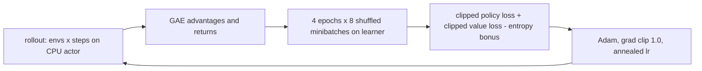

# PPO design

Feed-forward Proximal Policy Optimisation, the first control: the Craftax paper's MLP baseline on Craftax-Symbolic, rerun with our code to reproduce 2.2% (1M) and 11.9% (1B) of the maximum 226 ([[PPO (Matthews 2024)]], [[Craftax Baselines results]]). Its tuned shared settings are the starting point of every PPO-based method. Plan: [[2026-10-20-craftax-method-ppo]].

## What we implement

- Actor-critic with a learned state-value critic ([[11 Policy approximation (actor-critic)]]); the critic's targets are lambda-returns computed as GAE, the forward-view lambda-return of [[07a n-step TD and TD(λ)]] applied to TD errors ([[06 Temporal-difference learning]]).
- Policy loss: the clipped probability ratio with epsilon 0.2; value loss: clipped, `0.5 * max(unclipped, clipped)`; entropy bonus 0.01 ([[Craftax Baselines algorithms and hyperparameters]]).
- Network: separate actor and critic MLPs, each 3 x Dense(512) + tanh, orthogonal init (sqrt 2; heads 0.01 and 1.0).
- Optimiser: Adam (eps 1e-5), global-norm clip 1.0, learning rate linearly annealed to 0 over all updates.
- Data: `num_envs` parallel envs x `num_steps` per rollout, 4 epochs of 8 shuffled minibatches of flattened steps; advantages normalised per minibatch.
- Code: the existing port `src/wut_murl_craftax/training/ppo.py` of Craftax_Baselines `ppo.py` at commit 7ce36fa; rollouts on the CPU actor, updates on the Metal learner ([[Craftax runtime setup]]).

## Decisions

- Two published configurations, set explicitly: Craftax-1M = paper Table 11 (256 envs x 16 steps, lr 3e-4); Craftax-1B = Table 7 (1024 x 64, lr 2e-4). Why: the original code defaults are the 1B config and the README gives no 1M command; our port's defaults are a Classic debugging setup (256 envs, width 256), so no default may leak into a run.
- Activation tanh. Why: Table 7 and 11 list tanh, and `--activation` is parsed but never used in the original, so the published runs used the `ActorCritic` class default, tanh ([[Craftax Baselines reproduction notes]]).
- Max grad norm 1.0. Why: not in the paper tables; the code default is what produced the published numbers.
- Optimistic resets, as the original: `auto_reset=False` envs inside Craftax_Baselines' `OptimisticResetVecEnvWrapper` with reset ratio `min(16, envs)`, vendored at 7ce36fa into `training/wrappers.py` with its MIT notice ([[Craftax API and wrappers]]). Why: the published numbers were produced with them, they are about 2x faster ([[Craftax performance]]), and every control and method shares one reset setup ([[Experiment decisions]]); 7ce36fa includes the fix for Baselines issue #11. Rejected: auto-reset envs (one wrapper fewer, but slower and a deviation from the published setup); they remain only as a debug comparison.
- Score: training-episode return as % of 226 over the last 2% of the budget, the scoreboard metric ([[2026-10-20-craftax-evaluation-and-metrics]], [[Craftax scoring and evaluation]]).
- Light tuning only: Stage 1 = 6 published alternatives one at a time (1B-table shape at 1M, lr 2e-4 and 4e-4, GAE lambda 0.7 and 0.9, entropy 0) plus the published config; Stage 2 = 4 neighbours on the 2 most sensitive numeric knobs. Why: the paper already tuned PPO at both budgets (random search at 1M, App. E.2); the control must stay the published method.
- Tuned = published unless a config beats it by more than the reproduction band half-width h. Why: a 3-seed win inside the noise would make the control a different method without evidence.
- 1B uses Table 7 unchanged. Why: PPO has no method knobs to carry over from 1M ([[Experiment decisions]]); final-1b doubles as the 1B reproduction check.

## Reproduction check

- Acceptance: |our 10-seed mean - published| <= h, h = 0.05 + 2 sqrt(SE_ours^2 + (s_pub / sqrt(10))^2).
- s_pub at 1M: 0.083 percentage points, the per-seed sd of PPO-RNN 1M (last 5 updates per seed) derived from the Simulus per-run data; no PPO 1M spread is published.
- s_pub at 1B: 0.91 percentage points, the largest third-party sd (SimBa rerun, [[PPO (Matthews 2024)]]); other reruns: 0.22 to 0.58.
- Planning bands: 1M 2.08 to 2.32; 1B 11.04 to 12.76.
- Debug order on a fail, cheapest and most likely first: config diff against the tables; metric definition and final window; CPU-only learner (device numerics, [[Craftax on Apple GPU]]); a comparison against auto-reset envs (a check, not a fix); the original `ppo.py` in an isolated environment at 1M. If the original also misses, the gap is environment or version (Craftax 1.6.1 vs the 2024 release, [[Craftax versions and dependencies]]), recorded, and the control stays as is.

## Fixed vs tuned

| Setting | Status |
|---|---|
| Losses, network, optimiser, epochs, minibatches, clip, value coef, gamma, width, activation | fixed (published) |
| Rollout shape, learning rate, GAE lambda, entropy coef | tuned lightly at 1M (published alternatives) |
| Everything at 1B | fixed to Table 7 |

## Prior knowledge

- None about the game beyond the observation and action spaces; the reward is the environment's ([[Craftax observations and actions]], [[Craftax achievements]]).
- Hyperparameters come from the paper's tuning on the same benchmark, which counts as prior tuning effort, not game knowledge.

## Differences from the published version

- MLflow logging and resumable checkpoints instead of W&B and a final-only Orbax save.
- Craftax 1.6.1 and JAX 0.11 instead of the unpinned 2024 stack ([[Craftax Baselines reproduction notes]]).
- Extra logged diagnostics (`clip_frac`, `grad_norm`); the loss values are unchanged.

## What to watch

- At 1M the paper sees progress only on basic achievements; a plateau is expected, not a bug ([[Craftax Baselines results]]).
- At 1B `defeat_zombie` success falls over training; no progress in Advanced or Very Advanced achievements ([[Craftax floors and progression]], [[Game]]).
