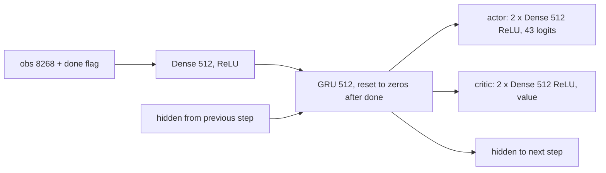

# PPO-RNN design

PPO with a GRU memory, the second control and the strongest Craftax paper baseline: 2.3% (1M) and 15.3% (1B) of the maximum 226 ([[PPO-RNN (Matthews 2024)]], [[Craftax Baselines results]]). It is also the base module that the count-based progress bonus (PPO-RNN variant) and self-imitation learning extend through hooks. Plan: [[2026-10-20-craftax-method-ppo-rnn]].

## Access and reward

- **Observes:** the 8268-float symbolic observation (Classic 1345), as [[PPO design#Access and reward]]: local 9 x 11 map view, inventory, stats, floor and flags.
- Plus its own memory: the GRU hidden state (512 numbers) summarising earlier observations of the episode; the done flag only resets it to zeros.
- Privileged state (not in the observation): none for acting or reward; the step outcomes (`StepEvents`: unlocks, floor, damage, kills, computed from the hidden pre-reset next state) reach the logs, the evaluation and the hooks' `traj.events`; the control's hooks are empty, so nothing reads them for acting or reward.
- **Acts:** one of the 43 primitive actions per step (Classic 17), sampled from the policy's softmax.
- **Rewarded by:** the environment reward only: tier weight 1, 3, 5 or 8 per achievement unlocked for the first time in the episode, plus 0.1 x the health change ([[Craftax scoring and evaluation#Reward]]).
- The hooks are empty in the control, so `r_int = 0`; the entropy bonus 0.01 is a loss term, not a reward.
- **Training objective:** maximise the expected discounted sum of environment rewards with γ = 0.99 (GAE λ 0.8).
- **Evaluated on:** the same environment reward: training-episode return as % of 226 ([[2026-10-20-craftax-evaluation-and-metrics]]).
- **Prior knowledge:** none about the game ([[#Prior knowledge]]).

## What we implement

- The PPO of [[PPO design]] (clipped ratio, clipped value loss, entropy bonus, GAE, Adam with annealed learning rate), unchanged.
- Network as Craftax_Baselines `ppo_rnn.py` `ActorCriticRNN`: Dense(512) + ReLU embedding, GRU(512), then actor 2 x Dense(512) + ReLU + logits and critic 2 x Dense(512) + ReLU + value.
- Memory is the answer to partial observability: the agent sees a 9 x 11 window, so where it has been and what it has stored is not in the observation ([[Craftax observations and actions]]).
- Code: new `src/wut_murl_craftax/training/ppo_rnn.py` (`PPORNNConfig`, `build_network`, `make_trainer`), sharing GAE and the loss math with `training/ppo.py`.

## Decisions

- ReLU throughout. Why: the published 15.3% came from `ppo_rnn.py`, which hard-codes ReLU; `--activation` is parsed but never used, so the paper's "same hyperparameters as PPO" (tanh) never reached the RNN ([[Craftax Baselines reproduction notes]]). tanh is one Stage 1 alternative.
- GRU, not LSTM. Why: the published PPO-RNN uses `nn.GRUCell`; PQN-RNN keeps its own LSTM ([[PQN-RNN design]]).
- Hidden state reset to zeros where the previous step ended an episode. Why: as `ScannedRNN`; memory must not leak across episodes.
- Whole-sequence minibatches: the rollout keeps the hidden state at its start, each minibatch holds whole env sequences and reruns the GRU from it. Why: this is how the original computes log-probs for the ratio; a check that the first-minibatch ratio is exactly 1 catches any mismatch.
- 1M settings = PPO Table 11 (256 envs x 16 steps, lr 3e-4) with the recurrent network. Why: the paper gives no PPO-RNN 1M settings; the Simulus third-party rerun used these and got 2.2% (last 5 updates, derived from its per-run data), close to the published 2.3%.
- 1B settings = Table 7 + ReLU network, unchanged, as `python ppo_rnn.py`. Why: the paper's 1B tuning is the reference ([[Experiment decisions]]).
- Optimistic resets (`auto_reset=False` + `OptimisticResetVecEnvWrapper`, ratio `min(16, envs)`), as [[PPO design]].
- Light tuning: Stage 1 = 7 published alternatives one at a time (Table 7 shape at 1M, 64 x 64 shape, tanh, lr 2e-4 and 4e-4, GAE lambda 0.9, entropy 0) plus the base; Stage 2 = 4 neighbours on the 2 most sensitive numeric knobs; tuned = published unless the winner beats it by more than the band half-width.
- Sequence length 64 is a Stage 1 alternative. Why: at 16 steps the gradient never reaches back more than 16 steps, which may limit what the memory learns; 64 x 64 keeps the batch at 4,096.

## Extension hooks

- One shared contract in `training/hooks.py`, the same for PQN-RNN: `HookFields` is a base class of `PPORNNConfig`, so a method's factory sets the hooks directly (`PPORNNConfig(intrinsic_reward_fn=...)`); the method state lives in the train state and is saved with the whole trainer state (resumable runs).
- `init_state_fn(key, spec) -> state`, once, with `spec = HookSpec(n_envs, obs_dim, n_actions, n_achievements, total_steps)`; each method adapts its own init to it.
- `intrinsic_reward_fn(state, env_state, next_env_state, obs_next, done, t) -> (r_int, state)`: per env step (count updates happen here); `r_int` is added to the reward before GAE; the score keeps the extrinsic reward. On a done step `next_env_state` is already the next episode's start (optimistic reset), so a hook never compares states across a done.
- `observe(state, traj) -> state`: once per rollout, before GAE; `traj` holds `obs`, `actions`, `rewards`, `dones`, `hidden` (the GRU state each action was chosen from, float16) and `events` (a `StepEvents` per step, including `unlocked`).
- `extra_loss_fn(params, state, key) -> (loss, (state, metrics))` with `extra_steps = K` optimizer steps after the PPO epochs; `extra_steps` is declared in `HookFields` only.
- `env_wrapper_fn` (observation or action wrappers), `metrics_fn` (returns fully qualified names such as `count/...` or `sil/...`, logged unchanged); `build_network(cfg, n_actions, obs_dim)` is public so an add-on loss can apply the network.
- Users: [[2026-10-20-craftax-method-count-bonus]] (`intrinsic_reward_fn`), [[2026-10-20-craftax-method-sil]] (`observe`, `extra_loss_fn`, `extra_steps`).
- Why hooks and not subclasses: one recurrent PPO implementation, add-ons as pure functions inside `jit`, and a bit-identity test proves that zero hooks leave the control unchanged.
- Why extra steps after the epochs, not a term inside the PPO loss: self-imitation learning samples from its own buffer at its own batch size, and the PPO loss of the control stays untouched.

## Reproduction check

- Band: h = 0.05 + 2 sqrt(SE_ours^2 + (s_pub / sqrt(10))^2), SE_ours over our n seeds (10 at 1M, 3 at 1B), as [[PPO design]].
- 1M: s_pub 0.083 percentage points (Simulus per-run data, 10 seeds); planning band 2.18 to 2.42.
- 1B: s_pub 0.35 (largest third-party spread, Singh et al. 2026, type not stated); with our 3 seeds the planning band is 14.79 to 15.81 (indicative). Third-party reruns with separate evaluation report 16.2-16.4%, which is a different protocol ([[PPO-RNN (Matthews 2024)]]).
- Debug order on a fail: first make sure the PPO control passes; then the recompute check, the hidden reset and the sequence minibatching; then the original `ppo_rnn.py` at 1M in an isolated environment.

## Device verification

Recompute check on Craftax-Symbolic (8268 inputs, 8 envs, 4 seeds x 2 minibatches, sequences of 8, 16 and 64 steps): the largest absolute gap between the rollout's log-probs and values and the sequence rerun from the stored start hidden. The rollout runs on the CPU actor; the rerun on the learner.

| Learner | Max log-prob gap | Max value gap | Bound |
|---|---|---|---|
| CPU (`JAX_PLATFORMS=cpu`) | 4.8e-7 | 0 | 1e-5 |
| Metal (`JAX_PLATFORMS=metal,cpu`, laptop profile) | 7.2e-7 | 1.76e-6 | 1e-5 |
| CUDA, A100 40 GB (TF32, `cuda.yaml`, 1B config: 1,024 envs x 64 steps, 3 updates; EDEN, 2026-10-31) | 5.5e-5 | 4.8e-4 | 1e-4 |

Metal stays below 1e-5, so no looser bound is needed; the first-minibatch ratio rule keeps its 1e-3 limit in the abort rule. On the A100 the log-prob gap (the quantity the script bounds, at 1e-4) is 5.5e-5 and `ppo/ratio_first_mb` stays within 1e-7 of 1; the value gap is larger because values are not bounded in the ratio. `cuda.yaml` therefore no longer lists `ppo/ratio_first_mb` as unmeasured.

## Fixed vs tuned

| Setting | Status |
|---|---|
| Losses, optimiser, epochs, minibatches, clip, value coef, gamma, widths, GRU, hidden reset | fixed (published) |
| Rollout shape, activation, learning rate, GAE lambda, entropy coef | tuned lightly at 1M |
| Everything at 1B | fixed to Table 7 + ReLU network |

## Prior knowledge

- None about the game; the same reward and observation as [[PPO design]].
- The memory is generic; nothing in it is specific to Craftax.

## Differences from the published version

- MLflow and resumable checkpoints instead of W&B.
- 1M settings chosen by us (no published PPO-RNN 1M table).
- Hooks in the training loop; inactive in the control.
- Craftax 1.6.1 and JAX 0.11 instead of the unpinned 2024 stack.

## What to watch

- The paper's signature: more dungeon entries than PPO, drives the score; `defeat_zombie` success falls most for PPO-RNN; `eat_plant` ignored ([[Craftax Baselines results]], [[Craftax farming and food]], [[Craftax floors and progression]]).
- No progress into the Gnomish Mines, even at 10B steps ([[Game]]).
- The late rise of the 1B curve comes from the learning-rate decay, not from late learning.

## Obstacles to watch

Handed to [[2026-10-20-craftax-training-analysis]]. A non-finite loss aborts a run (one retry from `state/`, then a bug); a first-minibatch ratio off 1 by more than 1e-3 ends it for good (`abort/guard`: the recompute is wrong and a retry repeats it); the flags below are tags `flag/<name>` set from the method's `abort:` block and never stop a run. The PPO flags (`kl_high`, `entropy_collapse`, `value_failure`) apply unchanged ([[PPO design#Obstacles to watch]]).

| Obstacle | Where it shows | Signal |
|---|---|---|
| Recompute error | the sequence rerun from the stored start hidden does not reproduce the rollout | `ppo/ratio_first_mb` outside 0.999 to 1.001 (abort); the device check measured 7.2e-7 |
| Hidden-state saturation | GRU units pinned at their limits, so the memory carries nothing new | `rnn/hidden_saturation` > 0.9 for 5% of the budget in a row (`flag/hidden_saturation`); also `rnn/hidden_norm` |
| Plateau at 1M | score flat after the basic achievements; expected ([[Craftax Baselines results]]) | `train/score_pct`, `train/ach/*` |
| Skill forgetting | `defeat_zombie` success falls over training, though least for PPO-RNN in the paper | `train/ach/defeat_zombie` |
| `eat_plant` never unlocked | the sapling-to-ripe-plant chain is ignored ([[Craftax farming and food]]) | `train/ach/eat_plant` |
| Dungeon entry | the expected signature: floor 1 reached more often than with PPO; a rate no higher than PPO's means the memory adds nothing | `train/funnel/floor_*` ([[Craftax floors and progression]]) |
| Gnomish Mines not reached | no progress below the first dungeon floors, even at 10B steps ([[Game]]) | `train/funnel/floor_*`, `train/funnel/depth_*` |
