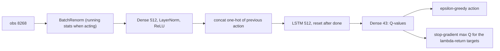

# PQN-RNN design

Recurrent Parallelised Q-Network, the third control and the only value-based one: online Q(lambda)-learning on the batch just collected from many parallel envs, with no replay buffer and no target network; 16.0% of the maximum 226 on Craftax-1B ([[PQN-RNN (Gallici 2025)]]). It is the base module of the count-based progress bonus (PQN variant) and of the skill methods. Plan: [[2026-10-20-craftax-method-pqn-rnn]].

## Access and reward

- **Observes:** the 8268-float symbolic observation (Classic 1345), as [[PPO design#Access and reward]]: local 9 x 11 map view, inventory, stats, floor and flags.
- Plus the previous action as a one-hot (43) and its own memory, the LSTM state (512 numbers), reset to zeros after a done.
- Privileged state (not in the observation): none for acting or reward; the step outcomes (`StepEvents`, computed from the hidden pre-reset next state) reach the logs, the evaluation and the hooks' `traj.events`; the control's hooks are empty, so nothing reads them for acting or reward.
- **Acts:** one of the 43 primitive actions per step (Classic 17), ε-greedy on the Q-values: ε from 1.0 to 0.005 over the first 10% of updates.
- **Rewarded by:** the environment reward only (scale 1.0): tier weight 1, 3, 5 or 8 per achievement unlocked for the first time in the episode, plus 0.1 x the health change ([[Craftax scoring and evaluation#Reward]]).
- **Training objective:** learn the action values of the greedy policy, i.e. maximise the expected discounted sum of environment rewards with γ = 0.99; λ = 0.5 only mixes the n-step targets.
- **Evaluated on:** the same environment reward: training-episode return as % of 226, episodes played with the current ε ([[2026-10-20-craftax-evaluation-and-metrics]]).
- **Prior knowledge:** none about the game ([[#Prior knowledge]]).

## What we implement

- Q-learning ([[06 Temporal-difference learning]]) with function approximation ([[09b Control with approximation, bootstrapping]]), lambda-returns as targets ([[07a n-step TD and TD(λ)]]) and epsilon-greedy behaviour.
- A port of `purejaxql/pqn_rnn_craftax.py` and `config/alg/pqn_rnn_craftax.yaml` at commit 47af6d7 (Apache-2.0), with the BatchRenorm module `utils/batch_renorm.py`.
- Network: BatchRenorm on the 8268 inputs, Dense(512) + LayerNorm + ReLU, the previous action as a one-hot appended, LSTM(512) reset on done, Dense(43) Q-values.
- Update: per rollout, 4 epochs x 4 minibatches of whole env sequences; each minibatch reruns the network from the stored start hidden, computes targets from the stop-gradient Q-values of the same pass, and minimises `0.5 * (Q(s_t, a_t) - G_t)^2`; RAdam, gradient clip 0.5, learning rate decayed linearly to about 0.
- Code: new `src/wut_murl_craftax/training/pqn_rnn.py` (`PQNRNNConfig`, `build_network`, `q_lambda_targets`, `learn`, `make_trainer`) and `training/batch_renorm.py`; nothing is shared with `training/ppo.py` except the env setup in `training/wrappers.py`.

## Decisions

- Normalisation: BatchRenorm on the input and LayerNorm in the hidden layer, as the repo YAML (`NORM_INPUT: True`, `NORM_TYPE: layer_norm`). Why: in the code `NORM_INPUT` always applies BatchRenorm to the input and `NORM_TYPE` only picks the hidden-layer norm, so the repo setting is exactly the variant the paper calls best (BatchNorm on the input, LayerNorm in the rest, Section 5.5, Fig. 6b), and the scoreboard entry links this repo. Paper Table 4's `batch_norm` may name the input norm; that reading is ours, not stated. Stage 1 tests the literal Table 4 setting (BatchRenorm in the hidden layer too) and a LayerNorm-only network at 1M; 1B keeps the repo setting because normalisation is a shared setting, not a method knob.
- Q(lambda) targets are the uncut lambda-return with greedy bootstraps, `G_t = r_t + gamma (1 - d_t) ((1 - lambda) max Q(s_{t+1}) + lambda G_{t+1})` (Peng and Williams style). Why: this is what purejaxql computes; Watkins's Q(lambda) would cut the return at every exploratory action ([[07b Eligibility-trace control and off-policy]]), which with epsilon near 1 early in training would make it almost one-step.
- The open purejaxql bug (issue #12): the MLP scripts seed the reverse scan's `next_q` with Q(s_T) where Q(s_{T-1}) is needed, which corrupts every earlier target. `pqn_rnn_craftax.py` is not affected (it re-seeds before the scan; read at 47af6d7, also stated in the issue thread). How we avoid it in any case: our scan carries only `G_{t+1}`, seeded with `G_{T-1} = max Q(s_{T-1})`, and reads `max Q(s_{t+1})` from a shifted array, so no second carry exists to seed wrongly; a test compares every target with an explicit forward-view sum of n-step returns, including the issue's own example.
- The last step of each rollout only bootstraps; it gets no target. Why: as the repo; the true next state of step T-1 is the first step of the next rollout.
- No target network and no replay buffer. Why: that is the method; the paper proves LayerNorm (+ l2) makes TD convergent even off-policy, and its replay-buffer comparison gave the same final score at 6x the time.
- LSTM and the previous action as input. Why: published configuration (`ADD_LAST_ACTION: True`); PPO-RNN keeps its GRU, so the two controls differ in memory cell as published.
- Epsilon 1.0 to 0.005 over 10% of the updates, one epsilon for all envs. Why: repo setting; issue #11 confirms the shared epsilon is by design.
- 1M base: the repo settings with PPO's 1M rollout shape (256 envs x 16 steps, 244 updates). Why: the repo shape (1024 x 128) gives only 7 updates at 1M and the epsilon decay would end inside the first update; the 1M PPO table found many workers with short rollouts best.
- 1B: the repo YAML unchanged. Why: the published 16.0% used it; no 1B tuning ([[Experiment decisions]]).
- Optimistic resets (`auto_reset=False` + `OptimisticResetVecEnvWrapper`, ratio `min(16, envs)`; the repo's `USE_OPTIMISTIC_RESETS: True`, `OPTIMISTIC_RESET_RATIO: 16`) and the repo's random warm-up rollout: `MEMORY_WINDOW + NUM_STEPS` uniform-random steps (16 at 1M, 128 at 1B) before the first update, outside the step budget. Why: both are what produced the published 16.0%, and every control shares one reset setup ([[Experiment decisions]]); with `MEMORY_WINDOW: 0` the warm-up transitions are replaced before the first update, so the warm-up only moves the initial env and LSTM states, and it runs once in `init`, never on resume.
- Evaluation: greedy mode = argmax (the repo's `EPS_TEST: 0`); stochastic mode = epsilon-greedy at the current epsilon; the scoreboard score is the training episodes, as for the PPO controls ([[2026-10-20-craftax-evaluation-and-metrics]]).

## Extension hooks

- The same contract as PPO-RNN (`training/hooks.py`, [[PPO-RNN design]]); `HookFields` is a base class of `PQNRNNConfig`: `init_state_fn(key, spec)`, `intrinsic_reward_fn(state, env_state, next_env_state, obs_next, done, t) -> (r_int, state)`, `observe(state, traj) -> state` per rollout, `extra_loss_fn(params, state, key) -> (loss, (state, metrics))` with `extra_steps = K` optimizer steps after the Q epochs, `env_wrapper_fn`, `metrics_fn` (fully qualified names); the method state is part of the trainer state and saved with it.
- `traj` is the shared `Traj`: `obs`, `actions`, `rewards`, `dones`, `hidden` (the LSTM `(c, h)` each action was chosen from, float16), `events` (`StepEvents` per step) and `extra` (`r_int`, `q_vals`, `last_actions`).
- `r_int` is added to the reward before the Q(lambda) targets.
- For the skill methods ([[2026-10-20-craftax-method-smdp-skills]], [[2026-10-20-craftax-method-dyna-q]]): `PQNRNNConfig.extra_obs_dim` widens the network input for extra features (a skill one-hot); `build_network(cfg, n_actions, obs_dim)` is the public constructor; `q_lambda_targets` works on its own; `learn(train_state, traj, key, loss_mask=None)` is the learner update, callable from another rollout, and the mask drops transitions from the TD loss.
- Why a mask and not a separate loss: one TD loss implementation; masked steps still feed the recurrent state and the targets, they only give no gradient.
- The count bonus ([[2026-10-20-craftax-method-count-bonus]]) uses `intrinsic_reward_fn` inside the Q(lambda) reward.
- Epsilon fields stay in `PQNRNNConfig`, so a method can replace epsilon-greedy (for example a count bonus with `eps_start = eps_finish = 0`).
- Skill methods change the action space through `env_wrapper_fn`; the network sizes its input and output from the wrapped env.

## Reproduction check

- 1B: |our 3-seed mean - 16.0| <= h, h = 0.05 + 2 sqrt(SE_ours^2 + (s_pub / sqrt(10))^2), SE_ours over our 3 `final-1b` seeds, s_pub 1.31 percentage points (Auto-Craftax PyTorch PQN-LSTM port, the only published spread); planning band 14.23 to 17.77 (indicative).
- 1M: no published number; our base against the original script with the same overrides, 3 seeds each, within 2 standard errors of the difference.
- Debug order on a fail: target test and config diff; BatchRenorm warm-up and running statistics; a comparison against auto-reset envs (a check); CPU-only learner.

## Device verification

Q recompute check on Craftax-Symbolic (8268 inputs, 8 envs, 4 seeds, rollouts of 8, 16 and 128 steps): the largest absolute gap between the rollout's Q-values and the inference-mode rerun from the stored float32 start carry, the learner's reset flags and the recorded last actions. The rollout runs on the CPU actor; the rerun on the learner.

| Learner | Max Q gap | Bound |
|---|---|---|
| CPU (`JAX_PLATFORMS=cpu`) | 0 | 1e-5 |
| Metal (`JAX_PLATFORMS=metal,cpu`, laptop profile) | 1.01e-6 | 1e-5 |

Metal stays below 1e-5, so no looser bound is needed.

## Fixed vs tuned

| Setting | Status |
|---|---|
| Loss, target form, optimiser, grad clip, epochs, minibatches, gamma, widths, LSTM, last-action input, reward scale | fixed (published) |
| Rollout shape, learning rate, lambda, epsilon decay, normalisation | tuned lightly at 1M |
| Everything at 1B | fixed to the repo YAML |

## Prior knowledge

- None about the game; reward and observation as the PPO controls ([[Craftax observations and actions]], [[Game]]).
- The previous action as input is generic, not Craftax-specific.

## Differences from the published version

- Our own Q(lambda) target code (same values as the RNN script, structured so issue #12 cannot occur).
- MLflow and resumable checkpoints instead of W&B and safetensors.
- 1M settings chosen by us (PQN has no published 1M result).
- Achievement metrics always logged (the repo default `LOG_ACHIEVEMENTS: False`).
- Craftax 1.6.1 and JAX 0.11.

## What to watch

- Exploration after epsilon reaches 0.005: the PQN paper calls epsilon-greedy "too simple" for hard exploration; compare floors reached with PPO-RNN ([[Craftax floors and progression]]).
- Q-value growth beyond the maximum return (226 plus a small health term): bootstrapping without a target network is the classic instability ([[09b Control with approximation, bootstrapping]], [[Craftax scoring and evaluation]]).
- At 1M, BatchRenorm statistics are still warming up for a quarter of training.

## Obstacles to watch

Handed to [[2026-10-20-craftax-training-analysis]]. A non-finite loss aborts a run (one retry from `state/`, then a bug); a mean max-Q above 300 ends it for good (`abort/guard`: no episode returns more than the 226 achievement points plus a small health term, so the Q-values have diverged, and a retry repeats it); the flags below are tags `flag/<name>` set from the method's `abort:` block and never stop a run.

| Obstacle | Where it shows | Signal |
|---|---|---|
| Exploration failure | once epsilon reaches its floor of 0.005 the policy is almost greedy, and epsilon-greedy is "too simple" for hard exploration (PQN paper); compare the dungeon-entry rate with PPO-RNN ([[Craftax floors and progression]]) | `pqn/epsilon`, `pqn/greedy_share`, `train/funnel/floor_*`, `train/ach/*` |
| Value failure | bootstrapping with no target network: Q-values grow past any possible return ([[09b Control with approximation, bootstrapping]], [[Craftax scoring and evaluation]]) | `pqn/q_max_mean` > 300 (abort); `pqn/td_loss` above 10 x its running median for 3 updates (`flag/td_spike`); also `pqn/q_taken_mean`, `pqn/target_mean` |
| Q-values that do not separate actions | the greedy action is arbitrary, so the policy cannot improve | `pqn/action_gap` < 1e-3 for 3 updates once epsilon is at its floor (`flag/action_gap_flat`) |
| Numerical failure | a non-finite TD loss, or input statistics that collapse: the input BatchRenorm's running variance of a feature near 0 (a feature that never varies) and a warm-up that covers a quarter of a 1M run | non-finite `pqn/td_loss` (abort); `pqn/bn_var_min` < 1e-6 (`flag/bn_var_low`); `pqn/bn_warm`; `pqn/grad_norm` |
| Plateau at 1M | score flat after the basic achievements; no published 1M number to compare with | `train/score_pct`, `train/ach/*` |
| Skill forgetting | achievements unlocked early stop being repeated | `train/ach/*` over training |
| Survival failure | episodes end early from low food, drink or energy; epsilon-greedy episodes are the training episodes behind the score | `train/length`, `train/death/*` |
