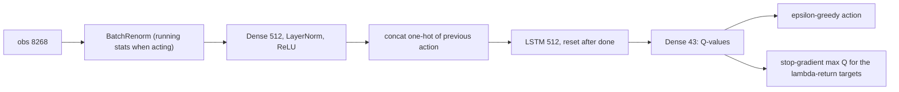

# PQN-RNN design

Recurrent Parallelised Q-Network, the third control and the only value-based one: online Q(lambda)-learning on the batch just collected from many parallel envs, with no replay buffer and no target network; 16.0% of the maximum 226 on Craftax-1B ([[PQN-RNN (Gallici 2025)]]). It is the base module of the count-based progress bonus (PQN variant) and of the skill methods. Plan: [[2026-10-20-craftax-method-pqn-rnn]].

## What we implement

- Q-learning ([[06 Temporal-difference learning]]) with function approximation ([[09b Control with approximation, bootstrapping]]), lambda-returns as targets ([[07a n-step TD and TD(λ)]]) and epsilon-greedy behaviour.
- A port of `purejaxql/pqn_rnn_craftax.py` and `config/alg/pqn_rnn_craftax.yaml` at commit 47af6d7 (Apache-2.0), with the BatchRenorm module `utils/batch_renorm.py`.
- Network: BatchRenorm on the 8268 inputs, Dense(512) + LayerNorm + ReLU, the previous action as a one-hot appended, LSTM(512) reset on done, Dense(43) Q-values.
- Update: per rollout, 4 epochs x 4 minibatches of whole env sequences; each minibatch reruns the network from the stored start hidden, computes targets from the stop-gradient Q-values of the same pass, and minimises `0.5 * (Q(s_t, a_t) - G_t)^2`; RAdam, gradient clip 0.5, learning rate decayed linearly to about 0.
- Code: new `src/wut_murl_craftax/training/pqn_rnn.py` (`PQNRNNConfig`, `q_lambda_targets`, `make_trainer`) and `training/batch_renorm.py`.

## Decisions

- Normalisation: BatchRenorm on the input and LayerNorm in the hidden layer, as the repo YAML (`NORM_INPUT: True`, `NORM_TYPE: layer_norm`). Why: in the code `NORM_INPUT` always applies BatchRenorm to the input and `NORM_TYPE` only picks the hidden-layer norm, so the repo setting is exactly the variant the paper calls best (BatchNorm on the input, LayerNorm in the rest, Section 5.5, Fig. 6b), and the scoreboard entry links this repo. Paper Table 4's `batch_norm` may name the input norm; that reading is ours, not stated. Stage 1 tests the literal Table 4 setting (BatchRenorm in the hidden layer too) and a LayerNorm-only network at 1M; 1B keeps the repo setting because normalisation is a shared setting, not a method knob.
- Q(lambda) targets are the uncut lambda-return with greedy bootstraps, `G_t = r_t + gamma (1 - d_t) ((1 - lambda) max Q(s_{t+1}) + lambda G_{t+1})` (Peng and Williams style). Why: this is what purejaxql computes; Watkins's Q(lambda) would cut the return at every exploratory action ([[07b Eligibility-trace control and off-policy]]), which with epsilon near 1 early in training would make it almost one-step.
- The open purejaxql bug (issue #12): the MLP scripts seed the reverse scan's `next_q` with Q(s_T) where Q(s_{T-1}) is needed, which corrupts every earlier target. `pqn_rnn_craftax.py` is not affected (it re-seeds before the scan; read at 47af6d7, also stated in the issue thread). How we avoid it in any case: our scan carries only `G_{t+1}`, seeded with `G_{T-1} = max Q(s_{T-1})`, and reads `max Q(s_{t+1})` from a shifted array, so no second carry exists to seed wrongly; a test compares every target with an explicit forward-view sum of n-step returns, including the issue's own example.
- The last step of each rollout only bootstraps; it gets no target. Why: as the repo; the true next state of step T-1 is the first step of the next rollout.
- No target network and no replay buffer. Why: that is the method; the paper proves LayerNorm (+ l2) makes TD convergent even off-policy, and its replay-buffer comparison gave the same final score at 6x the time.
- LSTM and the previous action as input. Why: published configuration (`ADD_LAST_ACTION: True`); PPO-RNN keeps its GRU, so the two controls differ in memory cell as published.
- Epsilon 1.0 to 0.005 over 10% of the updates, one epsilon for all envs. Why: repo setting; issue #11 confirms the shared epsilon is by design.
- 1M base: the repo settings with PPO's 1M rollout shape (256 envs x 16 steps, 244 updates). Why: the repo shape (1024 x 128) gives only 7 updates at 1M and the epsilon decay would end inside the first update; the 1M PPO table found many workers with short rollouts best.
- 1B: the repo YAML unchanged. Why: the published 16.0% used it; no 1B tuning ([[Experiment decisions]]).
- Auto-reset envs and no random warm-up rollout. Why: as the PPO controls; the repo's warm-up transitions are replaced before the first update (`MEMORY_WINDOW: 0`), so skipping it changes only the initial env states.
- Evaluation: greedy mode = argmax (the repo's `EPS_TEST: 0`); stochastic mode = epsilon-greedy at the current epsilon; the scoreboard score is the training episodes, as for the PPO controls ([[2026-10-20-craftax-evaluation-and-metrics]]).

## Extension hooks

- The same contract as PPO-RNN (`training/hooks.py`, [[PPO-RNN design]]), as fields of `PQNRNNConfig`: `intrinsic_reward_fn(state, env_state, next_env_state, obs_next, done, t) -> (r_int, state)`, `observe(state, traj) -> state` per rollout, `extra_loss_fn(params, state, key) -> (loss, (state, metrics))` with `extra_steps = K` optimizer steps after the Q epochs, plus `init_state_fn`, `env_wrapper_fn`, `metrics_fn`; the method state is part of the train state and checkpointed.
- `r_int` is added to the reward before the Q(lambda) targets.
- For the skill methods ([[2026-10-20-craftax-method-smdp-skills]], [[2026-10-20-craftax-method-dyna-q]]): `PQNRNNConfig.extra_obs_dim` widens the network input for extra features (a skill one-hot); `make_network` is the public constructor; `q_lambda_targets` works on its own; `learn(train_state, traj, key, loss_mask=None)` is the learner update, callable from another rollout, and the mask drops transitions from the TD loss.
- Why a mask and not a separate loss: one TD loss implementation; masked steps still feed the recurrent state and the targets, they only give no gradient.
- The count bonus ([[2026-10-20-craftax-method-count-bonus]]) uses `intrinsic_reward_fn` inside the Q(lambda) reward.
- Epsilon fields stay in `PQNRNNConfig`, so a method can replace epsilon-greedy (for example a count bonus with `eps_start = eps_finish = 0`).
- Skill methods change the action space through `env_wrapper_fn`; the network sizes its input and output from the wrapped env.

## Reproduction check

- 1B: |our 10-seed mean - 16.0| <= h, h = 0.05 + 2 sqrt(SE_ours^2 + (s_pub / sqrt(10))^2), s_pub 1.31 percentage points (Auto-Craftax PyTorch PQN-LSTM port, the only published spread); planning band 14.78 to 17.22.
- 1M: no published number; our base against the original script with the same overrides, 3 seeds each, within 2 standard errors of the difference.
- Debug order on a fail: target test and config diff; BatchRenorm warm-up and running statistics; optimistic resets and the warm-up rollout; CPU-only learner.

## Fixed vs tuned

| Setting | Status |
|---|---|
| Loss, target form, optimiser, grad clip, epochs, minibatches, gamma, widths, LSTM, last-action input, reward scale | fixed (published) |
| Rollout shape, learning rate, lambda, epsilon decay, normalisation | tuned lightly at 1M |
| Everything at 1B | fixed to the repo YAML |

## Prior knowledge

- None about the game; reward and observation as the PPO controls ([[Craftax observations and actions]], [[Game]]).
- The previous action as input is generic, not Craftax-specific.

## Differences from the published version

- Our own Q(lambda) target code (same values as the RNN script, structured so issue #12 cannot occur).
- Auto-reset instead of optimistic resets; no warm-up rollout; MLflow and resumable checkpoints instead of W&B and safetensors.
- 1M settings chosen by us (PQN has no published 1M result).
- Achievement metrics always logged (the repo default `LOG_ACHIEVEMENTS: False`).
- Craftax 1.6.1 and JAX 0.11.

## What to watch

- Exploration after epsilon reaches 0.005: the PQN paper calls epsilon-greedy "too simple" for hard exploration; compare floors reached with PPO-RNN ([[Craftax floors and progression]]).
- Q-value growth beyond the maximum return (226 plus a small health term): bootstrapping without a target network is the classic instability ([[09b Control with approximation, bootstrapping]], [[Craftax scoring and evaluation]]).
- At 1M, BatchRenorm statistics are still warming up for a quarter of training.
