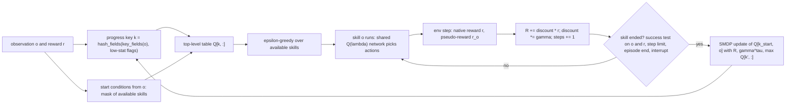

# SMDP Q-Learning over Hand-Defined Skills design

A two-level value-based agent: a table $Q[k, o]$ over hashed progress keys $k$ and the 25 options $o$ of the [[Craftax skill library]] learns with semi-Markov Q-learning on the native reward, while one shared recurrent Q($\lambda$) network learns all skills on their success pseudo-rewards. Candidate and novelty check: [[SMDP Q-Learning over Hand-Defined Skills]]. Plan: [[2026-10-20-craftax-method-smdp-skills]]. Module: `src/wut_murl_craftax/training/smdp.py`.

## Access and reward

Two learners with different inputs and rewards; which state each skill test reads: [[Craftax skill library#Access and reward]].

- **Observes, top level:** only the hashed progress key $k$ (progress fields plus 4 low-stat flags: food, drink, energy, health <= 3) and the mask of skills whose start condition holds; never the raw observation.
- Key and mask are decoded from the observation (`skills.decode_obs`, `skills.key_fields`), not read from `EnvState`; a test checks that the decoded key equals the privileged progress fields, so the top level sees nothing the observation lacks.
- **Observes, skill network:** the 8268-float observation (Classic 1345), the previous action one-hot (43), the running skill as a one-hot (25) and `steps_in_skill / T_max`, plus an LSTM state kept across skills.
- Skill ends (success tests, step limits, interruptions) read only the observation and the reward: `unlock_any` succeeds when the achievement part of the reward is > 0 (reward minus 0.1 x the health change, health from the observation); `fight` succeeds when a hostile creature on the facing tile is gone after the agent's attack or a kill achievement's reward arrives ([[Craftax skill library#Access and reward]]).
- Privileged state (`EnvState`, the wrapper's `StepEvents`) is used for logging only: `smdp/skill/<name>/test_agreement` compares each observation test with the event-based one; it never decides a skill end, a pseudo-reward or a choice.
- **Acts:** the top level picks one of the 25 options, ε-greedy over the available ones, each time its env's skill ends.
- While a learned skill runs, the skill network picks one of the 43 primitive actions per step (ε-greedy as PQN-RNN); `read_book` and `level_up` issue one fixed action.
- **Rewarded by, top level:** the environment reward summed over the skill's τ steps, $R = \sum_{i=0}^{\tau-1} \gamma^i r_{t+i}$ ([[Craftax scoring and evaluation#Reward]]), target $R + \gamma^\tau (1 - \text{done}) \max_{o'} Q[k', o']$ ([[#Top-level update]]).
- The top-level γ is per game step, tuned in {0.995, 0.999}, so a long skill is discounted more.
- **Rewarded by, skill network:** the pseudo-reward $r^o_t$ = 1 on the step the skill's success test passes, else 0 (also 0 on death and on any done step, where no test runs across the reset); every skill end is terminal; γ = 0.99, λ = 0.5.
- The skill network never receives the environment reward as input or training reward; the success tests read it only to detect unlocks and kills.
- **Training objective:** the top level maximises the expected discounted sum of environment rewards with its tuned γ; each skill maximises $0.99^{\text{steps to success}}$, i.e. succeed fast.
- **Evaluated on:** the environment reward only: training-episode return as % of 226; the pseudo-rewards never enter a score.
- **Prior knowledge:** the skills, their start conditions, success tests, step limits and interruptions, the `level_up` rule, the observation decoding, and the progress-key fields with low-stat flags ([[Craftax skill library#Prior knowledge]]).

## What we implement

- Registry name `smdp-skills`; both levels learn action values, no PPO anywhere.
- Top level: tabular SMDP Q-learning, the backup of the elevator case study ([[14.4 Elevator dispatching]]) with the discounted sum in place of the integral and max in place of min (rewards, not costs).
- Low level: the shared skill network of the [[Craftax skill library]], trained by the PQN-RNN learner ([[PQN-RNN (Gallici 2025)]], [[2026-10-20-craftax-method-pqn-rnn]]).
- Progress key: the progress fields decoded from the observation (`skills.key_fields`, bucketed by `progress_key.bucket`) plus 4 low-stat flags, hashed by `progress_key.hash_fields` to $2^{20}$ rows ([[Count-Based Progress Bonus design]]).
- Everything is vectorised over envs in JAX: each env runs its own skill and decides at its own time; the table lives in the rollout `scan` carry and is updated every env step for the envs whose skill just ended.

## Top-level update

Per env, when its skill ends after $\tau$ steps in key $k'$:

$$R = \sum_{i=0}^{\tau-1} \gamma^{i} r_{t+i}, \qquad y = R + \gamma^{\tau}\,(1 - \text{done}) \max_{o' \in A(s')} Q[k', o'], \qquad Q[k, o] \leftarrow Q[k, o] + \alpha\,\overline{(y - Q[k, o])}$$

- $r$ is the native step reward (achievements plus 0.1 x health change, [[Craftax scoring and evaluation]]), so the top level optimises the benchmark objective.
- $\gamma$ is a per-game-step discount, so a long skill is discounted more: $\gamma^\tau$ is the variable discount of the SMDP ([[06 Temporal-difference learning]], [[14.4 Elevator dispatching]]).
- $A(s')$ is the start-condition mask at the new state; the max ignores skills that cannot start there.
- done = death, win or the 100,000-step cap: the time cap is terminal as in the rest of the project ([[Craftax episode and time#Episode end]]).
- The bar is the mean over all envs that end the same $(k, o)$ in the same env step: a plain scatter-add would apply 300 simultaneous updates as one step 300 times too large.
- The accumulator keeps `disc` $= \gamma^\tau$ as a running product, so $R$ needs no power at the end.
- Interrupted skills (low-stat flag, floor change) are updated like any other ending; their next key differs from what the skill aimed at.
- Optimistic initial value $q_{\text{init}} = 10$ for every entry, so each skill is tried at each new key ([[02 Multi-armed bandits]]).
- ε-greedy at the top level: linear from 1.0 to 0.05 over a tuned fraction of the budget; the ε = 1 phase is the warm-up with a uniform random top level that the candidate note proposes.

## Fixed, tuned, prior knowledge

| Kind | Items |
|---|---|
| Tuned at 1M (two stages) | top-level α, top-level γ, ε decay fraction, skill timeout multiplier, key granularity |
| Fixed | table rows $2^{20}$, $q_{\text{init}} = 10$, ε end 0.05, low-stat threshold 3, skill death reward 0, the skill network's settings from the PQN-RNN control |
| Prior knowledge | the skill library: options, start conditions, success tests, interruptions, `level_up` rule, observation decoding; the progress-key fields ([[Craftax skill library#Prior knowledge]]) |

- Results are reported apart from blocks A and D of [[Existing Implementations]], in the "uses hand-written skills" block ([[Craftax skill library#Prior knowledge]]).

## Differences from published versions

- Sutton, Precup and Singh 1999 and the elevator dispatchers use one decision process; here every env is an independent decision process and the table update is batched per env step.
- h-DQN (Kulkarni et al. 2016) uses a DQN meta-controller and a replay buffer; our top level is a table and nothing is replayed.
- SEA on Crafter uses a rule-based meta-controller; [[SCALAR (Zabounidis 2026)]] uses a STRIPS planner over LLM-written operators and PPO options; our top level learns its choices from the native reward.
- [[Achievement Skill Options]] is the PPO version (PPO top level, PPO options); ours is value-based at both levels.
- [[Multitask Preplay (Carvalho 2025)]] trains goal-conditioned Q($\lambda$) on Craftax but with the true simulator as model and no top-level learner.

## Ablations

| Ablation | Change | Question |
|---|---|---|
| Random top level | ε = 1 for the whole run (masked) | does the learned top level beat a random choice among available skills |
| Monte Carlo top level | $y$ = discounted return to episode end from per-env records, no bootstrap ([[05a Monte Carlo prediction and control]]) | what bootstrapping adds |
| No low-stat flags | flags removed from the key and no low-stat interruption | does the top level learn survival timing from the flags |

## Comparisons

| Comparison | Budget | Note |
|---|---|---|
| Flat against hierarchical: PQN-RNN control against `smdp-skills` | 1M, 1B | same learner code for the skills, same seeds; the gap includes the value of the game knowledge in the library |
| Model-free against planning: `smdp-skills` against `dyna-q` | 1M, 1B | same skills, same seeds; [[Dyna-Q over a Skill-Level Progress Model design]] with $n = 0$ is this method |
| Knowledge-using agents | 1B | [[maskedPPO-GTrXL (Doguhan58 2026)]] 33.8% (best run, not a mean); [[SCALAR (Zabounidis 2026)]] and [[AHC (Zhu 2026)]] under other metrics or protocols |
| Achievement chain | 1M, 1B | `MAKE_STONE_PICKAXE`, `MAKE_IRON_PICKAXE`, `COLLECT_DIAMOND`, `ENTER_DUNGEON`, `ENTER_GNOMISH_MINES` ([[Craftax achievements]]) |
