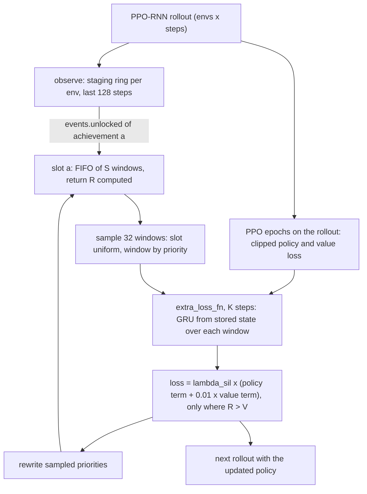

# Self-Imitation Learning design

PPO-RNN plus a replay buffer of the steps that led to each achievement unlock and an extra loss that imitates a stored action only where the return that followed it beat the critic, $(R - V)_+ > 0$ (Oh et al. 2018). Candidate and novelty check: [[Self-Imitation Learning|Self-Imitation Learning (candidate)]]. Plan: [[2026-10-20-craftax-method-sil]].

## Access and reward

- **Observes:** for acting, exactly what PPO-RNN observes ([[PPO-RNN design#Access and reward]]): the 8268-float observation (Classic 1345) and the GRU state.
- Unlock flags `events.unlocked` (a `StepEvents` field the wrapper computes from `EnvState.achievements` of the pre-reset next state, [[2026-10-20-craftax-method-ppo]] Task 2): privileged (not in the observation); used only to detect a new unlock and choose its slot, i.e. which past steps are trained on (training-data selection), never for acting or reward.
- The stored windows hold the same observations, actions, environment rewards and GRU states the agent produced itself; nothing else.
- **Acts:** the 43 primitive actions (Classic 17), sampled from the PPO-RNN policy.
- **Rewarded by:** the environment reward only ([[Craftax scoring and evaluation#Reward]]); SIL adds no reward term but an extra loss.
- Imitation target: the return $R_j = \sum_{k=j}^{t} \gamma^{k-j} r_k$ of each stored step $j$, environment rewards up to the unlock at step $t$, γ = 0.99, cut there and not bootstrapped.
- Extra loss, K steps after each PPO update: $\lambda_{\text{sil}}$ x mean of $-\log \pi(a_j \mid s_j)\,(R_j - V(s_j))_+ + \tfrac{0.01}{2}\,((R_j - V(s_j))_+)^2$ ([[#Loss and update]]).
- $(x)_+ = \max(x, 0)$: only stored actions whose return beat the critic's estimate are imitated, and the critic is only pushed up.
- **Training objective:** maximise the expected discounted sum of environment rewards with γ = 0.99, while also raising the probability of own past actions that did better than expected.
- **Evaluated on:** the environment reward only: training-episode return as % of 226; the SIL loss never enters a score.
- **Prior knowledge:** the achievement list as slot index, part of the env state and the reward definition ([[#Fixed, tuned, prior knowledge]]).
- An unlock on an episode's last step (`DEFEAT_NECROMANCER` on a win) is seen: the wrapper computes `events.unlocked` before the optimistic reset swaps in a new episode, so no state is compared across a done step.
- The hook's `traj` carries `events` and the per-step GRU state `hidden` (`float16`) ([[2026-10-20-craftax-method-ppo-rnn]] Task 1), so SIL needs nothing beyond the hook contract.

## What we implement

- `training/sil.py` provides the buffer and four hooks of the shared contract in `training/hooks.py` ([[2026-10-20-craftax-method-ppo-rnn]] Task 1), given to `PPORNNConfig`; base learner unchanged:
  - `init_state_fn(key, spec)`: sizes the slots and the staging ring from `HookSpec` (`n_envs`, `n_achievements`, `obs_dim`);
  - `observe(state, traj)`: once per rollout, writes the rollout into the staging ring and inserts the windows of new unlocks;
  - `extra_loss_fn` with `extra_steps = K`: the SIL loss after the PPO epochs;
  - `metrics_fn`: `sil/...` names.
- Trigger: a new unlock of achievement $a$ in env $i$ at step $t$, read as `traj.events.unlocked[t, i, a]` (the `info` value is non-zero only on the done step, [[Craftax Baselines benchmark protocol]], so it is not used).
- Stored unit: a window of the last $L_w = 128$ steps of env $i$ ending at $t$, with observations, actions, rewards, done flags and the GRU state at the window start.
- Steps of the window before the current episode's start are masked out.
- Return per step $j$ of the window: $R_j = \sum_{k=j}^{t} \gamma^{k-j} r_k$, truncated at the unlock and not bootstrapped; computed once, at insertion.
- Windows of consecutive achievements tile the crafting chain: the iron-pickaxe window covers the last crafting moves, the collect-iron and place-furnace windows cover the steps before ([[Craftax crafting and placing]]).

## Buffer layout

- Default: one slot per achievement (67 in Craftax, 22 in Craftax-Classic), each a FIFO ring of $S$ windows; sampling picks a slot uniformly among non-empty slots, then a window in it by priority.
- Ablation (`layout: single`): one FIFO buffer of the same total capacity ($67 S$ windows), window sampled by priority over the whole buffer.
- Why slots: basic achievements unlock in almost every episode and would fill one shared buffer; slots give `ENTER_DUNGEON` or `FIND_BOW` the same sampling share as `COLLECT_WOOD` ([[Craftax achievements]]).
- One episode can add at most one window per slot, because each achievement unlocks once per episode; this caps an episode's share without an extra rule.
- Priority of a window: mean over its valid steps of $(R_j - V(s_j))_+$, plus 0.01; new windows get the current maximum; priorities of sampled windows are rewritten with the advantages of the SIL step (prioritized replay, Schaul et al. 2016, exponent α = 0.6).
- Importance-sampling weights of prioritized replay are not used: SIL imitates only better-than-expected actions, so the sampling bias is part of the method.
- Insertion cap: at most 64 new windows per update (`jnp.nonzero(..., size=64)`), so shapes stay static; the overflow count is logged.

## Memory

| Item | Size per unit | 1M setting (256 envs) | 1B setting (1024 envs) |
|---|---|---|---|
| Stored step: map view as `uint8` (8,217 one-hot or binary channels), 51 tail floats `float32`, action, reward, done, return, mask | 8,432 B | | |
| Staging ring per env: 128 steps + GRU state per step (`traj.hidden`, `float16`, 1,024 B) | 1.21 MB | 310 MB | 1.24 GB |
| Window in the buffer: 128 steps + GRU state at the start | 1.08 MB | | |
| Buffer, S = 2 / 8 / 16 windows per slot (67 slots) | | 145 MB / 579 MB / 1.16 GB | same |

- The map view compresses losslessly to `uint8` because block, item and creature channels are one-hot and the light channel is binary ([[Craftax observations and actions]]); the tail (inventory `sqrt(n)/10`, stats, enchantments up to 2.1) stays `float32`.
- The staging ring is written once per rollout (one `dynamic_update_slice` of the rollout block), not per step, so the large array never sits in the scan carry.
- The SIL attempt in [[Auto-Craftax PPO-GRU (Creus Castanyer 2026)]] crashed with CUDA out-of-memory (buffer layout not reported); here the largest grid point (S = 16) needs about 2.4 GB at 1B, staging included, and the size is computed, logged and checked against `memory_limit_bytes` of the machine profile (`configs/profiles/laptop.yaml`, `cuda.yaml`) before the first rollout.

## Loss and update

$$L_{\text{sil}} = \lambda_{\text{sil}} \cdot \frac{1}{|J|} \sum_{j \in J} \Big[ -\log \pi(a_j \mid s_j)\, \operatorname{sg}\big((R_j - V(s_j))_+\big) + \tfrac{\beta_v}{2}\, \big((R_j - V(s_j))_+\big)^2 \Big]$$

- $J$: valid steps of the 32 sampled windows (4,096 steps, the size of one 1M PPO batch); sg: stop-gradient.
- $\beta_v = 0.01$, the candidate note's value weight; $\lambda_{\text{sil}}$ (weight against the PPO loss) and $K$ (SIL steps per PPO update) are tuned.
- The value term only pushes $V$ up toward returns it underestimated, the lower-bound reading of SIL in the paper.
- The GRU runs from the stored start state with the stored done resets; the state is stale (from an older policy), the R2D2 "stored state" choice without burn-in.
- SIL steps use the PPO-RNN Adam optimizer, learning-rate schedule and gradient clipping, after the PPO epochs of each update.
- Off-policy without importance ratios ([[05b Off-policy Monte Carlo]]): stored actions came from older policies; the $(\cdot)_+$ gate replaces the correction, as in the paper.
- Book roots: Monte Carlo returns ([[05a Monte Carlo prediction and control]]) and the actor-critic split of policy and critic ([[11 Policy approximation (actor-critic)]]).

## Fixed, tuned, prior knowledge

| Kind | Items |
|---|---|
| Tuned (1M, two stages) | $\lambda_{\text{sil}}$, windows per slot $S$, SIL steps per update $K$ |
| Fixed | window 128, $\beta_v$ 0.01, SIL batch 32 windows, α 0.6, insertion cap 64, per-slot FIFO, truncated returns, PPO-RNN control settings |
| Ablated at `final-1m` | per-achievement slots against one shared buffer |
| Prior knowledge | the achievement list as slot index, read from `events.unlocked` (part of the env state and the reward definition, no extra game knowledge) |

## Differences from published versions

- Oh et al. store whole episodes with Monte Carlo returns; we store 128-step windows ending at an unlock, with returns truncated there (Craftax episodes run up to 100,000 steps, [[Craftax episode and time]]).
- The paper samples transitions for feed-forward A2C and PPO; we sample windows for a GRU policy.
- Per-achievement slots are new here; no SIL result on Craftax or Craftax-Classic is published ([[Existing Implementations]]).
- Candidate note order (feed-forward PPO first) is skipped: PPO-RNN directly, debugged on Craftax-Classic in `smoke`.

## Comparisons

| Comparison | Budget | Reference |
|---|---|---|
| PPO-RNN + SIL against our PPO-RNN control | 1M, 1B | same seeds, [[2026-10-20-craftax-method-ppo-rnn]] |
| Per-achievement slots against one buffer | 1M | 10 seeds each |
| Published PPO-RNN, PPO-GTrXL | 1M: 2.3%; 1B: 15.3%, 18.3% | [[PPO-RNN (Matthews 2024)]], [[PPO-GTrXL (Hamon 2024)]] |
| Rare achievements and forgetting | 1M, 1B | `MAKE_IRON_PICKAXE`, `ENTER_DUNGEON`, `ENTER_GNOMISH_MINES` success up; `DEFEAT_ZOMBIE` not down ([[Craftax Baselines results]]) |
