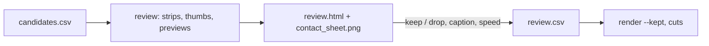

# Highlight review workflow

Automatic ranking from [[Highlight detection]], then one reviewer picks clips on one static page and downloads `review.csv`; every later step reads only that CSV ([[Assembling the 3 and 12 minute cuts]]).



## Steps

1. Build the review material next to the CSV:

   ```bash
   uv run python -m wut_murl_craftax.visualisation.review outputs/visualisation/review/candidates.csv
   ```

   Per candidate, from its 16 px master (`build_assets`): a 4-frame strip (start, mid, peak, end), the peak thumbnail and an exact-frame 2x preview MP4:

   ```text
   select='eq(n,start)+eq(n,mid)+eq(n,peak)+eq(n,end)',scale=iw*2:ih*2:flags=neighbor,tile=4x1:padding=4:color=white
   trim=start_frame=start:end_frame=end+1,setpts=PTS-STARTPTS,scale=iw*2:ih*2:flags=neighbor,format=yuv420p
   ```

2. `contact_sheet.png` (`contact_sheet`, Pillow): peak thumbnails 6 per row with id, score, type, caption, rollout and time range.

3. `review.html` (`write_page`): a copy of the one static template shipped in the package, `src/wut_murl_craftax/visualisation/review_template.html`, with the candidates embedded once as JSON; the browser builds one row per candidate (strip, events, preview `<video>` with the peak as poster, editable caption, speed 0.5 to 8, keep / drop), shows kept count and kept seconds (seconds / speed), and offers "Keep top 10" and "Download review.csv"; choices persist in `localStorage`.

4. Open it over HTTP so the previews play:

   ```bash
   uv run python -m http.server 8765 --bind 127.0.0.1 --directory outputs/visualisation/review
   ```

5. Mark keep / drop, fix captions, set speeds, press "Download review.csv" and save it next to `candidates.csv`. The CSV is the source of truth: `read_rows`, `write_rows` and `kept` (rows with `keep == keep`, in score order) are what `render --kept` and `cuts` use. Without a browser, edit the `keep`, `caption` and `speed` columns in any spreadsheet.

Columns (`review.COLUMNS`; new ones go at the end): `id, keep, score, type, caption, rollout, game, policy, label, start, end, peak, seconds, speed, events`.

## Results

| Measurement | Result |
|---|---|
| Strips + thumbnails + preview MP4s, 60 candidates (first scripts) | 33.2 s; 7.0 MB, 2.1 MB and 29 MB; contact sheet 2160 x 4700 px, 2.2 MB |
| Same with the package, 30 candidates (repo smoke test) | 26 s including page and contact sheet; 3.7 MB, 1.1 MB, 12 MB; contact sheet 1.1 MB |
| `review_template.html` / generated `review.html` | 4,186 bytes / 18,862 bytes for 30 candidates, no external scripts |
| Browser test of the package page (Claude Browser pane, served on 127.0.0.1) | "Keep top 10", drop c002, speed 2 and a new caption on c001: header 9 kept, 115.0 s; the "Download review.csv" Blob had 31 lines (header + 30), 9 `keep`, 1 `drop`, the new caption, speed 2 and the `label` column |
| CSV round trip (`test_csv_round_trip_and_kept`) | captions with commas and quotes survive write and read; `kept` returns only `keep` rows |

## Pitfalls

- The Claude Browser pane shows a `file://` page only as a static snapshot (no clicks, no video); serve it over HTTP.
- `trim=start_frame/end_frame` is frame-exact but decodes from frame 0; fine for masters of a few thousand frames; for 100,000-step episodes input seeking (`-ss` before `-i`) is the faster option, not tested here.
- The CSV is the contract between steps: never rename columns; add new ones at the end.
- JSON inside `<script>` must not contain `</`: `write_page` escapes it as `<\/`.

## Not tested

- Hosting the page as a shared artifact for remote review.
