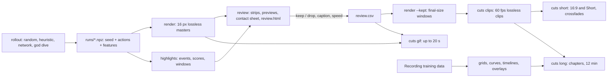

# Visualisation

Turning Craftax gameplay and training runs into YouTube videos and GIFs with the `wut_murl_craftax.visualisation` package: Python (JAX + Pillow) runs Craftax and draws frames and text overlays; ffmpeg does all encoding, cutting, stacking, audio and assembly. Game background: [[Craftax]], [[Game]]. Choices made with the user: [[Visualisation decisions]].

## Goals

- YouTube: a 3-minute cut as a 16:9 video and as a vertical Short (at most 180 s), a 12-minute 16:9 cut, GIFs of at most 20 s; 1080p by default, 2160p optional.
- One video per length covering both games: Craftax is the main subject, Craftax-Classic a short warm-up.
- Content: achievement unlocks, fights with several enemies at once, breakthroughs after a long stretch without a new achievement, floor changes, deaths, the boss.
- Footage: the trained agent plus early checkpoints, a random policy, a scripted agent and a god-mode dive, each labelled on screen.
- Audio: voice-over over ducked music, loudness normalised to -14 LUFS; a silent track when none is given.
- Selection: automatic detection and ranking, then one reviewer keeps or drops candidates on one static page; the CSV is the source of truth.
- Tooling: ffmpeg CLI only for video work (no Manim, no manual editor); every regular step is package code with a `main(argv)`.

## Pipeline

All commands are `uv run python -m wut_murl_craftax.visualisation.<module> ...`; outputs default to `outputs/visualisation/` (git-ignored).

## Notes

| Note | What it covers | Author |
|---|---|---|
| [[Rendering Craftax frames]] | rollout record, policies, replay, renderers and tile sizes, lossless masters, final-size windows | gameplay |
| [[Highlight detection]] | events from per-step features, scoring, clip windows, merging, ranking | gameplay |
| [[Highlight review workflow]] | thumbnails, preview clips, contact sheet, the static review page, `review.csv` | gameplay |
| [[Encoding GIFs and YouTube videos]] | YouTube upload settings and checks, final-encode quality, audio mix, captions as PNG overlays, GIF palette options | gameplay |
| [[Assembling the 3 and 12 minute cuts]] | clips (speed, freeze-frame, captions), cards, crossfades, concat, grids, throughput | gameplay |
| [[Recording training data]] | what a training run saves so training graphics can be drawn later | training |
| [[Checkpoint comparison grid]] | one eval seed played by several checkpoints side by side | training |
| [[Animated training curves]] | score and per-achievement curves growing over training | training |
| [[Achievement timeline]] | per-achievement success-rate heatmap over training | training |
| [[Agent internals overlay]] | observation, action distribution and value next to the game frame | training |

## Shared modules

| Module | Used for |
|---|---|
| `ffmpeg` | argument-list wrappers: `run`, `probe`, `duration`, `count_frames`, `read_frames`, `FrameWriter`, `youtube_args`, `write_gif`, `overlay_filter`, `stack_filter`, `concat`, `xfade`, `mux_audio`, `integrated_loudness`, `check_youtube` |
| `text` | Pillow `caption_panel`, `banner`, `title_card`, `label_bar`, `text_strip` |
| `rollout` | `Game`, `game_for`, `keys`, `Policy` with `RandomPolicy`, `HeuristicPolicy`, `NetworkPolicy`, `Rollout` (save, load), `play`, `replay` |

## Recommended setup

- Record seed + actions + per-step features (8.5 KB for a 2,047-step episode), never states (Craftax `EnvState` is 273 KB per step); replay is exact.
- Detection, review and GIFs from 16 px lossless masters (`libx264rgb -qp 0`, 15.5 MB per 1000 Craftax frames).
- Final clips from kept windows re-rendered at 16 px x the layout factor (Craftax 80 px, Classic 112 px for 1920 x 1080): sharp HUD, no further scaling.
- 60 fps output, H.264 High CRF 12 slow, BT.709, closed GOP 30, 2 B-frames, faststart, no edit list, AAC stereo 48 kHz.
- GIFs at x3 nearest-neighbour, one frame per game step at 10 fps, `palettegen=stats_mode=full` + `paletteuse=dither=none`.

## Tested

| Item | Key numbers |
|---|---|
| Renderer speed (scan step+render, 16 px) | Craftax 1,123 fps, Classic 3,466 fps; 64 px 81 and 252 fps |
| 23 test rollouts to masters | 14,986 frames in 90.7 s incl. compiles; replay features identical 23 of 23 |
| Detection | 473 events, 81 merged candidates in 1.9 s |
| 3 min cut, landscape / vertical / landscape sharp-HUD | 171.4 s each; 93.8 / 91.7 / 140.3 MB |
| 12 min cut | 712.7 s, 431.8 MB, 230.1 s to encode |
| YouTube checks (`ffmpeg.check_youtube`) | High profile, yuv420p, BT.709, 60 fps, GOP 30, 2 B-frames, AAC 48 kHz stereo, moov first, no `elst` |
| GIF, 20 s | 2.0 to 2.9 MB at x3, encoded in 0.4 to 0.5 s |
| Grids and side by side | 2 x 2 (60 s) in 17.7 s, 4 x 2 (30 s) in 12.0 s, Craftax next to Classic (30 s) in 16.5 s |
| Package port against the first scripts | same actions and features for Classic and Craftax heuristic seed 1 (390 and 769 steps); re-rendered masters bit-identical (923 and 1,501 frames); the 60 candidates identical in every column but one displayed score (11.93 vs 11.92) |
| Package tests (`tests/visualisation/test_{ffmpeg,text,rollout,render,highlights,review,cuts}.py`) | 38 passed in 45 s |
| Repo smoke test | 7 rollouts, 7,939 frames rendered in 30.7 s, 30 candidates, review material in 26 s, 29 windows re-rendered in 155 s, 172.9 s 16:9 cut (136.7 MB) and 173.0 s Short with tone voice + music at -14.0 LUFS (102.2 MB), GIF 17.2 s / 5.75 MB |

## Not tested

- Uploading to YouTube and how it processes 1080p vs 2160p uploads (a 2160p clip encodes at 1.2 x the 1080p size).
- Any trained agent: `NetworkPolicy` ran only with random weights.
- Boss-fight events: no test episode damaged the necromancer.
- Real voice-over and music files: the audio mix was tested with generated sine tones.
- ffmpeg `drawtext` or `subtitles` (missing from the installed ffmpeg); Pillow overlays are used instead.
- YouTube chapters, animated WebP, HEVC/AV1 uploads.

## Open questions

- Which checkpoints go into the final cuts, and how many seconds of early-checkpoint footage?
- Who records the voice-over, and which music (licence) goes under it?
