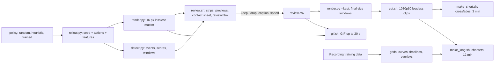

# Visualisation

Turning Craftax gameplay and training runs into YouTube videos and GIFs: Python (JAX + Pillow) only runs Craftax and draws frames and text overlays; ffmpeg does all encoding, cutting, stacking and assembly. Game background: [[Craftax]], [[Game]].

## Goals

- YouTube: a short cut of about 3 minutes and a long cut of about 12 minutes; GIFs of at most 20 s.
- Content: the game view at interesting moments: achievement unlocks, fights with several enemies at once, breakthroughs after a long stretch without a new achievement, floor changes, deaths, the boss.
- Selection: automatic detection and ranking, then a person keeps or drops candidates from a short ranked list; the cut step reads only that decision.
- Tooling: ffmpeg CLI for video work, no Manim, no manual editor; every recommended option tested with recorded commands, runtimes and sizes.
- Training-process graphics (checkpoints, curves, achievements over training, agent internals) next to the gameplay.
- A trained policy replaces the test policies without changing the pipeline.

## Pipeline

## Notes

| Note | What it covers | Author |
|---|---|---|
| [[Rendering Craftax frames]] | renderers and tile sizes, render speed, seed + actions replay, lossless masters, 1080p upscaling | gameplay |
| [[Highlight detection]] | events from per-step features, scoring, clip windows, merging, ranking | gameplay |
| [[Highlight review workflow]] | thumbnails, preview clips, contact sheet, review page, `review.csv` | gameplay |
| [[Encoding GIFs and YouTube videos]] | YouTube upload settings and checks, final-encode quality, captions as PNG overlays, GIF palette options | gameplay |
| [[Assembling the 3 and 12 minute cuts]] | clip cutting (speed, freeze-frame, captions), cards, crossfades, concat, grids, throughput | gameplay |
| [[Recording training data]] | what a training run saves so training graphics can be drawn later | training |
| [[Checkpoint comparison grid]] | one eval seed played by several checkpoints side by side | training |
| [[Animated training curves]] | score and per-achievement curves growing over training | training |
| [[Achievement timeline]] | per-achievement success-rate heatmap over training | training |
| [[Agent internals overlay]] | observation, action distribution and value next to the game frame | training |

## Recommended setup

- Record seed + actions + per-step features (8.5 KB for a 2,047-step episode), never states (Craftax `EnvState` is 273 KB per step); replay is exact.
- Detection, review and GIFs from a 16 px lossless master (`libx264rgb -qp 0`, 15.5 MB per 1000 Craftax frames).
- Final clips from kept windows re-rendered at 16 px x the layout factor (Craftax 80 px, Classic 112 px for 1920 x 1080): sharp HUD, no further scaling.
- 60 fps output, H.264 High CRF 12 slow, BT.709, closed GOP 30, 2 B-frames, faststart, no edit list, silent AAC stereo 48 kHz.
- Landscape 1920 x 1080 for the 12-minute cut; vertical 1080 x 1920 under 180 s if the 3-minute cut should be a YouTube Short.
- GIFs at x3 nearest-neighbour, one frame per game step at 10 fps, `palettegen=stats_mode=full` + `paletteuse=dither=none`.

## Tested

| Item | Key numbers |
|---|---|
| Renderer speed (scan step+render, 16 px) | Craftax 1,123 fps, Classic 3,466 fps; 64 px 81 and 252 fps |
| 23 test rollouts to masters | 14,986 frames in 90.7 s incl. compiles; replay features identical 23 of 23 |
| Detection | 473 events, 81 merged candidates in 1.9 s |
| Review material, 60 candidates | 33.2 s; review page tested in a browser (keep, drop, speed, CSV download) |
| 3 min cut, landscape / vertical / landscape sharp-HUD | 171.4 s each; 93.8 / 91.7 / 140.3 MB |
| 12 min cut | 712.7 s, 431.8 MB, 230.1 s to encode |
| YouTube checks (ffprobe) | High profile, yuv420p, BT.709, 60 fps, GOP 30, `IBBP`, AAC 48 kHz stereo, moov first, no `elst` |
| GIF, 20 s | 2.0 to 2.9 MB at x3, encoded in 0.4 to 0.5 s |
| Grids and side by side | 2 x 2 (60 s) in 17.7 s, 4 x 2 (30 s) in 12.0 s, Craftax next to Classic (30 s) in 16.5 s |

## Not tested

- Uploading to YouTube and how it processes 1080p vs 2160p uploads (a 2160p clip encodes at 1.2 x the 1080p size).
- Any trained agent: the `NetworkPolicy` template ran only with random weights.
- Boss-fight events: no test episode damaged the necromancer.
- Text with ffmpeg `drawtext` or `subtitles` (missing from the installed ffmpeg); Pillow overlays used instead.
- Music, voice-over, YouTube chapters, animated WebP, HEVC/AV1 uploads, multi-reviewer voting.
- Rendering on GPUs or cluster nodes.

## Open questions

- Is the 3-minute video a YouTube Short (vertical or square, at most 180 s) or a regular 16:9 video? Both were produced.
- 1080p or 2160p uploads for the final videos?
- Which policies and checkpoints go into the final cuts, and should random-policy and god-mode footage appear at all?
- Music or narration, and from which source (licence)?
- Who reviews the candidates, and is one reviewer enough?
- Should Craftax and Craftax-Classic share one video or get separate ones?
