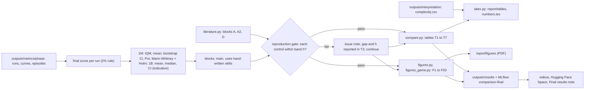

# Craftax comparison and results implementation plan

Status: ready

> **For agentic workers:** REQUIRED SUB-SKILL: Use superpowers:subagent-driven-development (recommended) or superpowers:executing-plans to implement this plan task-by-task. Steps use checkbox (`- [ ]`) syntax for tracking.

**Goal:** the final results of every method in [[2026-10-20-craftax-project]] against the three controls (PPO, PPO-RNN, PQN-RNN) and against [[Existing Implementations]], in two blocks (main and "uses hand-written skills"), over every metric family of [[2026-10-20-craftax-evaluation-and-metrics]], as a fixed set of figures and tables that the report, the videos and the Hugging Face Space reuse unchanged.

**Architecture:** `analysis/literature.py` holds the comparable published numbers; `analysis/compare.py` builds the result tables and runs the statistical tests from `evaluation.stats`; `analysis/figures.py` (core and stability figures) and `analysis/figures_game.py` (in-game figures) draw one function per figure; `analysis/latex.py` writes the report tables and number macros. Inputs are `outputs/metrics/<phase>/` from the export of the four final phases `final-1m final-1b combo-1m combo-1b` and the tuning phases `tune-coarse tune-fine`, plus `outputs/interpretation/<budget>/complexity.csv` (so interpretation Task 6 runs before Task 6 here); outputs go to `outputs/results/` (`figures/` as PDF and PNG, `tables/` as CSV and LaTeX) and are logged as artifacts of run `comparison-final` in MLflow experiment `analysis`.

**Tech Stack:** pandas, numpy, scipy, matplotlib (Agg, the dark palette of `visualisation.charts` for video, a light variant for the report), MLflow, `wut_murl_craftax.evaluation`.

From exported runs to the report, the videos and the Space:

## Comparison rules

- Final score of a run (decided, [[Experiment decisions]]): mean training-episode return as % of 226 over the last 2% of the budget, widened to at least 100 episodes ([[2026-10-20-craftax-evaluation-and-metrics]]); T1 reports the fixed-seed evaluation of the final checkpoint (stochastic and greedy) alongside it.
- "Method" includes the combination of the two best compatible methods ([[Experiment decisions]]), chosen after both `final-1m` and `final-1b`; it gets its own row, colour and radar, from phases `combo-1m` and `combo-1b`.
- Two blocks in every table, figure and test family: the main block (`count-bonus-ppo-rnn`, `count-bonus-pqn-rnn`, `sil`) and the "uses hand-written skills" block (`smdp-skills`, `dyna-q`; their prior knowledge sets them apart, [[Craftax skill library]]). The combination goes into the skill block if its pair contains a skill method, else into the main block. The three controls are the reference rows of both blocks. A method is never ranked against a method of the other block.
- Our runs are compared with each other only within one benchmark (1M or 1B) and one score kind (training-episode score, stochastic eval, greedy eval).
- Training-episode score vs block A (1B) and block D (1M) of [[Existing Implementations]]; stochastic fixed-seed eval vs block A2; blocks A3, B, B2, C, C2, C3 and E to I are never compared.
- Reproduction gate (reported, never blocking): each control (PPO, PPO-RNN, PQN-RNN) against its published value per benchmark (`configs/reference/published_scores.yaml`) with the band half-width h of `evaluation.reproduction.band` ([[2026-10-20-craftax-method-ppo]] Task 4; computed with our n seeds, so the 3-seed 1B band is wider and the 1B gate indicative); PQN-RNN has a published 1B value only, its 1M check is the reference-code comparison of [[2026-10-20-craftax-method-pqn-rnn]]. A pass is noted in T2; a fail opens an issue note in `knowledge/issues/` and reports the gap (our mean minus published) and h in T2, the results note and the report, and the comparison continues with our control as the base ([[Craftax Baselines results]], [[Craftax known issues]]).
- Every published number keeps its source note link, its spread kind (sd, s.e. or none) and its seed count; nothing is recomputed from figures.
- Hardware numbers are compared only within one `profile`; wall-clock numbers from the literature are shown as context, never ranked.
- Each method gets the same colour in every figure, video and the Space (`METHOD_COLORS`, the three controls in three greys, order from [[2026-10-20-craftax-project]]).

## Statistical tests

- Every family below is computed per block (main, uses hand-written skills); the three controls enter both blocks as references.
- Seeds: 10 per method at Craftax-1M, 3 at Craftax-1B ([[Experiment decisions]], 2026-10-21); 1B comparisons are indicative and every 1B table and figure says so.
- Main claim per method at 1M: IQM and mean with stratified bootstrap 95% CIs over 10 seeds; at 1B: mean and median with 95% CIs over 3 seeds (stratified bootstrap and t-based, `evaluation.stats.t_ci`); with 3 seeds the IQM equals the median, so no IQM at 1B.
- Pairwise against each control at 1M: probability of improvement with CI; two-sided Mann-Whitney U; Holm-Bonferroni over all (method, control) pairs of one block, so each block is one Holm family. At 1B: difference of means with its CI only, no p-value (3 against 3 seeds cannot reach 0.05).
- Pairwise between methods at 1M: probability-of-improvement matrix with CIs within one block; no significance stars, no cross-block cells.
- Aggregate: IQM of pooled normalised scores at 1M with stratified bootstrap, per block; no pooling with 1B.
- Against literature: our CI above, containing or below the published value.
- In-game families: per-method medians with bootstrap CIs over seeds (each seed contributes its episode-level median, so episodes never count as independent samples).
- Order agreement: Kendall tau-b with a permutation test (10,000 permutations) per method pair.

## Figures

| ID | Figure | Data | File | Used in |
|---|---|---|---|---|
| F1 | Learning curves: % of max vs env steps, mean and 95% band, the three controls dashed in grey; 1M and 1B panels | `curves` | `curves_score.pdf` | report, video, Space |
| F2 | Interval plot: IQM and mean with CIs per method at 1M, mean and median with CIs at 1B (panel marked indicative); the skill block below a separator with its own heading, controls repeated in it | `runs` | `aggregate.pdf` | report, Space |
| F3 | Probability-of-improvement matrix with CIs at 1M, one panel per block (methods and the three controls of that block) | `runs` | `poi_matrix.pdf` | report |
| F4 | Per-seed final scores (dot plot) with literature values as marks | `runs`, literature | `seed_spread.pdf` | Space |
| F5 | Per-achievement success heatmap: methods x 67 achievements, grouped by tier and floor | `episodes` | `success_heatmap.pdf` | Space, video |
| F6 | First-unlock race: achievements on y in ladder order, median first-unlock env steps on a log x axis per method, IQR whiskers, winner marked; wall-clock variant | `curves` (`first_unlock/*`) | `race_steps.pdf`, `race_wall.pdf` | report, video, Space |
| F7 | Achievement order graph per method (nodes by mean rank on x and tier on y, edges after transitive reduction) and Kendall tau matrix | `episodes` | `order_<method>.pdf`, `order_agreement.pdf` | video, Space |
| F8 | Progress funnel at the final checkpoint (tech ladder and floors) and the funnel over training | `episodes`, `curves` | `funnel.pdf`, `funnel_training.pdf` | report, video, Space |
| F9 | Deaths and stalls: cause-of-death stacked bars; stall-length CCDF; escape rate | `episodes` | `deaths.pdf`, `stalls.pdf` | Space |
| F10 | Speedrun splits: box plots of steps to each milestone, share reaching it as text | `episodes` | `splits.pdf` | Space |
| F11 | Exploration coverage per floor; new tiles per 100 steps over the episode | `episodes` | `coverage.pdf` | Space |
| F12 | Survival management: share of steps with low and zero stats; stat value at eat, drink, sleep | `episodes` | `survival.pdf` | Space |
| F13 | Combat profile: kills per creature type heatmap; damage dealt vs taken; fights per episode | `episodes` | `combat.pdf` | Space |
| F14 | Action usage: methods x actions heatmap; entropy and wasted share bars | `episodes`, `curves` | `actions.pdf` | Space |
| F15 | Resource efficiency: gathered vs used per resource; steps per achievement; wood-to-diamond time | `episodes` | `resources.pdf` | Space |
| F16 | Advanced-mechanics adoption over training | `curves` | `advanced.pdf` | Space |
| F17 | Playstyle radars, one per method, per benchmark, shared axes | `episodes` | `radar_<budget>.pdf` | report, video, Space |
| F18 | Hyperparameter sensitivity at Craftax-1M (coarse and fine grids): config scores `r_c` per method (strip plot) and `S_h` bars with the noise floor | tuning `runs` | `sensitivity.pdf` | Space |
| F19 | Stability: max drawdown per run, drops and collapses per method | `curves` | `stability.pdf` | Space |
| F20 | Hardware: steady SPS, wall-clock, compile time, peak memory, utilisation, steps per joule per profile | `runs` | `hardware.pdf` | Space |

## Tables

| ID | Table | File | Used in |
|---|---|---|---|
| T1 | Main results: per benchmark and method, seeds, mean +- s.e., IQM [95% CI] at 1M or median and mean [95% CI] at 1B, stochastic and greedy eval, PoI vs each of the three controls [CI] and Holm-adjusted p (Holm within the block) at 1M only, 1B rows marked indicative; main block, then the "uses hand-written skills" block under its own heading, controls on top of both | `main.csv`, `main.tex` | report, Space |
| T2 | Literature: our methods and controls beside block A, A2 and D rows, with protocol, seeds and spread kind; reproduction-gate result per control (pass, or gap and h) | `literature.csv`, `literature.tex` | report, Space |
| T3 | Stability: seed sd, CV, max drawdown median, runs with drops, runs with collapse | `stability.csv` | report (merged into T5), Space |
| T4 | Hardware per profile: steady SPS, overall SPS, wall-clock, compile time, peak memory, steps per joule | `hardware.csv` | report (merged into T5), Space |
| T5 | Report table combining T3 and T4 headline columns | `stability_hardware.tex` | report |
| T6 | In-game summary: one row per method, one headline column per family (race wins, deepest floor share, top death cause, coverage, wasted share, adoption) | `game_summary.csv`, `game_summary.tex` | report, Space |
| T7 | Sensitivity: per method best config, configs tried, robust share, the two most sensitive hyperparameters with `S_h` | `sensitivity.csv` | Space, report text |

---

### Task 1: Literature reference table

**Files:**
- Create: `configs/literature/existing_implementations.csv`, `src/wut_murl_craftax/analysis/literature.py`
- Test: `tests/analysis/test_literature.py`

- [ ] **Step 1: Copy** the rows of blocks A, A2 and D from [[Existing Implementations]] into the CSV (columns `block, implementation, note, env, observation, budget, protocol, score_pct, spread, spread_kind, seeds`), one row per table row, values exactly as written in the note.
- [ ] **Step 2: Write the failing tests**: `comparable_rows(score_kind, budget)` maps training score at 1B to block A, at 1M to block D, stochastic eval at 1B to block A2; it raises for any other block or score kind; every `note` value names an existing file in `research/Existing Implementations/`.
- [ ] **Step 3: Implement** `load_literature()` and `comparable_rows`.
- [ ] **Step 4: Run** `uv run pytest tests/analysis/test_literature.py -q`.

### Task 2: Result tables and tests

**Files:**
- Create: `src/wut_murl_craftax/analysis/compare.py`
- Test: `tests/analysis/test_compare.py`

- [ ] **Step 1: Write the failing tests** on the analysis fixture: `block_of(method, combo_pair)` returns `skills` for `smdp-skills`, `dyna-q` and a combination whose pair contains either, `main` otherwise; T1 has one row per (benchmark, block, method) with every column and the three controls in both blocks; the Holm correction covers exactly the 1M (method, control) pairs of one block and the two blocks are separate families; 1B rows carry mean, median and CIs but no IQM, PoI or p-value; the PoI matrix has no cross-block cell; `reproduction_gate` uses `evaluation.reproduction.band`, returns pass or (gap, h) per control and benchmark and never raises on a fail; T2 never mixes literature blocks; T6 picks the race winner by the rule of the metrics plan.
- [ ] **Step 2: Implement** `SKILL_METHODS`, `block_of`, `main_table`, `literature_table`, `stability_table`, `hardware_table`, `game_summary_table`, `sensitivity_table`, `reproduction_gate`.
- [ ] **Step 3: Run** `uv run pytest tests/analysis/test_compare.py -q`.

### Task 3: Core figures

**Files:**
- Create: `src/wut_murl_craftax/analysis/figures.py`
- Test: `tests/analysis/test_figures.py`

- [ ] **Step 1: Write the failing tests**: each of F1 to F5 and F18 to F20 on the fixture writes a PDF and a PNG, returns its `Figure`, has the expected axis labels, uses `METHOD_COLORS` (three distinct greys for the controls), F2 and F3 show the two blocks separately, and each renders in both themes (`theme="report"` light, `theme="video"` dark).
- [ ] **Step 2: Implement** one function per figure; report figures are sized for one Interspeech column (80 mm: 170 mm text width minus the 10 mm column gap, halved) with fonts >= 7 pt; video figures for 1920 x 1080.
- [ ] **Step 3: Run** `uv run pytest tests/analysis/test_figures.py -q`.

### Task 4: In-game figures

**Files:**
- Create: `src/wut_murl_craftax/analysis/figures_game.py`
- Test: `tests/analysis/test_figures_game.py`

- [ ] **Step 1: Write the failing tests**: F6 to F17 on the fixture as in Task 3; the order-graph transitive reduction removes `a -> c` when `a -> b -> c` exist; radar axes are min-max scaled per benchmark over all methods and controls; funnel shares never increase with depth; `race(..., upto=t)` draws only first unlocks before env step `t` (frames of the race GIF of [[2026-10-20-craftax-visualisation-production]]).
- [ ] **Step 2: Implement** the figures; the order graph is drawn with matplotlib only (no graph library): x = mean normalised rank, y = tier, edges as arrows.
- [ ] **Step 3: Run** `uv run pytest tests/analysis/test_figures_game.py -q`.

### Task 5: LaTeX tables and number macros

**Files:**
- Create: `src/wut_murl_craftax/analysis/latex.py`
- Test: `tests/analysis/test_latex.py`

- [ ] **Step 1: Write the failing tests**: tables render as `tabular` with booktabs rules (`report/Interspeech.cls` loads `booktabs`), method names are escaped, the best value per column is bold; `numbers.tex` defines one `\newcommand` per reported number (for example `\scoreOneB<Method>`), including the complexity numbers of `outputs/interpretation/<budget>/complexity.csv` (a clear error names interpretation Task 6 when the file is missing), and every macro used in `report/report.tex` is defined.
- [ ] **Step 2: Implement** `write_tables(out_dir)` (to `report/tables/`) and `write_numbers(path)` (to `report/numbers.tex`); figures for the report are copied to `report/figures/` as PDF.
- [ ] **Step 3: Run** `uv run pytest tests/analysis/test_latex.py -q`.

### Task 6: Run the comparison

**Files:**
- Create: `src/wut_murl_craftax/analysis/results.py` (CLI)
- Test: `tests/analysis/test_results_cli.py`

Runs after [[2026-10-20-craftax-interpretation-and-ruleset]] Task 6 (Phase 4 order): the LaTeX export reads `outputs/interpretation/<budget>/complexity.csv`.

- [ ] **Step 1: Write the failing test** in `tests/analysis/test_results_cli.py`: the CLI on the fixture (phases `final-1m final-1b combo-1m combo-1b`, tuning `tune-coarse tune-fine`, a fixture `complexity.csv`) writes every figure and table of the lists above, both blocks included, and logs `outputs/results/` to a temporary MLflow store as run `comparison-final`; a failing reproduction gate still writes everything.
- [ ] **Step 2: Implement** `uv run python -m wut_murl_craftax.analysis.results --phases <phase> [<phase> ...] --tuning <phase> [<phase> ...] --out outputs/results`.
- [ ] **Step 3: Run** `uv run pytest tests/analysis/test_results_cli.py -q`; check that `outputs/interpretation/1m/complexity.csv` and `outputs/interpretation/1b/complexity.csv` exist; then `uv run python -m wut_murl_craftax.analysis.results --phases final-1m final-1b combo-1m combo-1b --tuning tune-coarse tune-fine --out outputs/results`. Read the reproduction gate first: on a fail, open the issue note, tell the user the gap and h, and continue.
- [ ] **Step 4: Check** 3 random cells of T1 and 3 points of F1 against the MLflow UI (`make mlflow`).

### Task 7: Results note

**Files:**
- Create: `knowledge/results/Final results.md` (template `knowledge/_templates/concept.md`, `domain: analysis`, `parent: "[[2026-10-20-craftax-project]]"`)
- Modify: `knowledge/architecture/analysis.md` (add the modules of this plan, bump `updated`)

- [ ] **Step 1: Write** the note: T1 (both blocks), T2 and T6 as Markdown tables, the reproduction-gate outcome per control (pass, or the gap and h, with the issue note link), the sensitivity summary (T7) in one bullet per method, the figure index (ID, file, one-line takeaway).
- [ ] **Step 2: Link** each method's `knowledge/results/<Method> training analysis.md` from its row.
- [ ] **Step 3: Run** `make knowledge` and `make check`.
