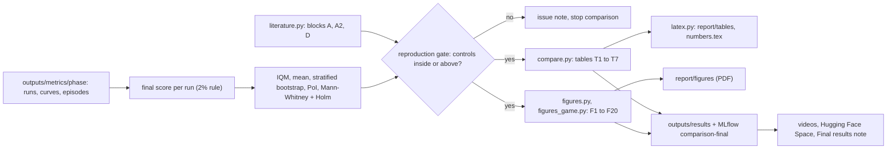

# Craftax comparison and results implementation plan

Status: draft

> **For agentic workers:** REQUIRED SUB-SKILL: Use superpowers:subagent-driven-development (recommended) or superpowers:executing-plans to implement this plan task-by-task. Steps use checkbox (`- [ ]`) syntax for tracking.

**Goal:** the final results of every method in [[2026-10-20-craftax-project]] against the two controls and against [[Existing Implementations]], over every metric family of [[2026-10-20-craftax-evaluation-and-metrics]], as a fixed set of figures and tables that the report, the videos and the Hugging Face Space reuse unchanged.

**Architecture:** `analysis/literature.py` holds the comparable published numbers; `analysis/compare.py` builds the result tables and runs the statistical tests from `evaluation.stats`; `analysis/figures.py` (core and stability figures) and `analysis/figures_game.py` (in-game figures) draw one function per figure; `analysis/latex.py` writes the report tables and number macros. Inputs are `outputs/metrics/<phase>/` from the export; outputs go to `outputs/results/` (`figures/` as PDF and PNG, `tables/` as CSV and LaTeX) and are logged as artifacts of run `comparison-final` in MLflow experiment `analysis`.

**Tech Stack:** pandas, numpy, scipy, matplotlib (Agg, the dark palette of `visualisation.charts` for video, a light variant for the report), MLflow, `wut_murl_craftax.evaluation`.

From exported runs to the report, the videos and the Space:

## Comparison rules

- "Method" includes the combination of the two best compatible methods ([[Experiment decisions]]); it gets its own row, colour and radar.
- Our runs are compared with each other only within one benchmark (1M or 1B) and one score kind (training-episode score, stochastic eval, greedy eval).
- Training-episode score vs block A (1B) and block D (1M) of [[Existing Implementations]]; stochastic fixed-seed eval vs block A2; blocks A3, B, B2, C, C2, C3 and E to I are never compared.
- Reproduction gate: our PPO and PPO-RNN controls must land inside or above the scoreboard values of their rows in blocks A and D within our 95% CI; if not, open an issue note in `knowledge/issues/` and stop the method comparison until it is explained ([[Craftax Baselines results]], [[Craftax known issues]]).
- Every published number keeps its source note link, its spread kind (sd, s.e. or none) and its seed count; nothing is recomputed from figures.
- Hardware numbers are compared only within one `profile`; wall-clock numbers from the literature are shown as context, never ranked.
- Each method gets the same colour in every figure, video and the Space (`METHOD_COLORS`, controls in two greys, order from [[2026-10-20-craftax-project]]).

## Statistical tests

- Main claim per method and benchmark: IQM and mean with stratified bootstrap 95% CIs over 10 seeds.
- Pairwise against each control: probability of improvement with CI; two-sided Mann-Whitney U; Holm-Bonferroni over all (method, control, benchmark) pairs of the main table.
- Pairwise between methods: probability-of-improvement matrix with CIs; no significance stars.
- Aggregate over both benchmarks: IQM of pooled normalised scores with stratified bootstrap.
- Against literature: our CI above, containing or below the published value.
- In-game families: per-method medians with bootstrap CIs over seeds (each seed contributes its episode-level median, so episodes never count as independent samples).
- Order agreement: Kendall tau-b with a permutation test (10,000 permutations) per method pair.

## Figures

| ID | Figure | Data | File | Used in |
|---|---|---|---|---|
| F1 | Learning curves: % of max vs env steps, mean and 95% band, controls dashed; 1M and 1B panels | `curves` | `curves_score.pdf` | report, video, Space |
| F2 | Aggregate interval plot: IQM and mean with CIs per method, both benchmarks | `runs` | `aggregate.pdf` | report, Space |
| F3 | Probability-of-improvement matrix with CIs | `runs` | `poi_matrix.pdf` | report |
| F4 | Per-seed final scores (dot plot) with literature values as marks | `runs`, literature | `seed_spread.pdf` | Space |
| F5 | Per-achievement success heatmap: methods x 67 achievements, grouped by tier and floor | `episodes` | `success_heatmap.pdf` | Space, video |
| F6 | First-unlock race: achievements on y in ladder order, median first-unlock env steps on a log x axis per method, IQR whiskers, winner marked; wall-clock variant | `curves` (`first_unlock/*`) | `race_steps.pdf`, `race_wall.pdf` | report, video, Space |
| F7 | Achievement order graph per method (nodes by mean rank on x and tier on y, edges after transitive reduction) and Kendall tau matrix | `episodes` | `order_<method>.pdf`, `order_agreement.pdf` | video, Space |
| F8 | Progress funnel at the final checkpoint (tech ladder and floors) and the funnel over training | `episodes`, `curves` | `funnel.pdf`, `funnel_training.pdf` | report, video, Space |
| F9 | Deaths and stalls: cause-of-death stacked bars; stall-length CCDF; escape rate | `episodes` | `deaths.pdf`, `stalls.pdf` | Space |
| F10 | Speedrun splits: box plots of steps to each milestone, share reaching it as text | `episodes` | `splits.pdf` | Space |
| F11 | Exploration coverage per floor; new tiles per 100 steps over the episode | `episodes` | `coverage.pdf` | Space |
| F12 | Survival management: share of steps with low and zero stats; stat value at eat, drink, sleep | `episodes` | `survival.pdf` | Space |
| F13 | Combat profile: kills per creature type heatmap; damage dealt vs taken; fights per episode | `episodes` | `combat.pdf` | Space |
| F14 | Action usage: methods x actions heatmap; entropy and wasted share bars | `episodes`, `curves` | `actions.pdf` | Space |
| F15 | Resource efficiency: gathered vs used per resource; steps per achievement; wood-to-diamond time | `episodes` | `resources.pdf` | Space |
| F16 | Advanced-mechanics adoption over training | `curves` | `advanced.pdf` | Space |
| F17 | Playstyle radars, one per method, per benchmark, shared axes | `episodes` | `radar_<budget>.pdf` | report, video, Space |
| F18 | Hyperparameter sensitivity at Craftax-1M (coarse and fine grids): config scores `r_c` per method (strip plot) and `S_h` bars with the noise floor | tuning `runs` | `sensitivity.pdf` | Space |
| F19 | Stability: max drawdown per run, drops and collapses per method | `curves` | `stability.pdf` | Space |
| F20 | Hardware: steady SPS, wall-clock, compile time, peak memory, utilisation, steps per joule per profile | `runs` | `hardware.pdf` | Space |

## Tables

| ID | Table | File | Used in |
|---|---|---|---|
| T1 | Main results: per benchmark and method, seeds, mean +- s.e., IQM [95% CI], stochastic and greedy eval, PoI vs each control [CI], Holm-adjusted p | `main.csv`, `main.tex` | report, Space |
| T2 | Literature: our methods and controls beside block A, A2 and D rows, with protocol, seeds and spread kind | `literature.csv`, `literature.tex` | report, Space |
| T3 | Stability: seed sd, CV, max drawdown median, runs with drops, runs with collapse | `stability.csv` | report (merged into T5), Space |
| T4 | Hardware per profile: steady SPS, overall SPS, wall-clock, compile time, peak memory, steps per joule | `hardware.csv` | report (merged into T5), Space |
| T5 | Report table combining T3 and T4 headline columns | `stability_hardware.tex` | report |
| T6 | In-game summary: one row per method, one headline column per family (race wins, deepest floor share, top death cause, coverage, wasted share, adoption) | `game_summary.csv`, `game_summary.tex` | report, Space |
| T7 | Sensitivity: per method best config, configs tried, robust share, the two most sensitive hyperparameters with `S_h` | `sensitivity.csv` | Space, report text |

---

### Task 1: Literature reference table

**Files:**
- Create: `configs/literature/existing_implementations.csv`, `src/wut_murl_craftax/analysis/literature.py`
- Test: `tests/analysis/test_literature.py`

- [ ] **Step 1: Copy** the rows of blocks A, A2 and D from [[Existing Implementations]] into the CSV (columns `block, implementation, note, env, observation, budget, protocol, score_pct, spread, spread_kind, seeds`), one row per table row, values exactly as written in the note.
- [ ] **Step 2: Write the failing tests**: `comparable_rows(score_kind, budget)` maps training score at 1B to block A, at 1M to block D, stochastic eval at 1B to block A2; it raises for any other block or score kind; every `note` value names an existing file in `research/Existing Implementations/`.
- [ ] **Step 3: Implement** `load_literature()` and `comparable_rows`.
- [ ] **Step 4: Run** `uv run pytest tests/analysis/test_literature.py -q`.

### Task 2: Result tables and tests

**Files:**
- Create: `src/wut_murl_craftax/analysis/compare.py`
- Test: `tests/analysis/test_compare.py`

- [ ] **Step 1: Write the failing tests** on the analysis fixture: T1 has one row per (benchmark, method) with every column; the Holm correction covers exactly the pairs in T1; the reproduction gate flags a control whose CI lies below its literature value; T2 never mixes blocks; T6 picks the race winner by the rule of the metrics plan.
- [ ] **Step 2: Implement** `main_table`, `literature_table`, `stability_table`, `hardware_table`, `game_summary_table`, `sensitivity_table`, `reproduction_gate`.
- [ ] **Step 3: Run** `uv run pytest tests/analysis/test_compare.py -q`.

### Task 3: Core figures

**Files:**
- Create: `src/wut_murl_craftax/analysis/figures.py`
- Test: `tests/analysis/test_figures.py`

- [ ] **Step 1: Write the failing tests**: each of F1 to F5 and F18 to F20 on the fixture writes a PDF and a PNG, returns its `Figure`, has the expected axis labels, uses `METHOD_COLORS`, and renders in both themes (`theme="report"` light, `theme="video"` dark).
- [ ] **Step 2: Implement** one function per figure; report figures are sized for one Interspeech column (80 mm: 170 mm text width minus the 10 mm column gap, halved) with fonts >= 7 pt; video figures for 1920 x 1080.
- [ ] **Step 3: Run** `uv run pytest tests/analysis/test_figures.py -q`.

### Task 4: In-game figures

**Files:**
- Create: `src/wut_murl_craftax/analysis/figures_game.py`
- Test: `tests/analysis/test_figures_game.py`

- [ ] **Step 1: Write the failing tests**: F6 to F17 on the fixture as in Task 3; the order-graph transitive reduction removes `a -> c` when `a -> b -> c` exist; radar axes are min-max scaled per benchmark over all methods and controls; funnel shares never increase with depth.
- [ ] **Step 2: Implement** the figures; the order graph is drawn with matplotlib only (no graph library): x = mean normalised rank, y = tier, edges as arrows.
- [ ] **Step 3: Run** `uv run pytest tests/analysis/test_figures_game.py -q`.

### Task 5: LaTeX tables and number macros

**Files:**
- Create: `src/wut_murl_craftax/analysis/latex.py`
- Test: `tests/analysis/test_latex.py`

- [ ] **Step 1: Write the failing tests**: tables render as `tabular` with booktabs rules (`report/Interspeech.cls` loads `booktabs`), method names are escaped, the best value per column is bold; `numbers.tex` defines one `\newcommand` per reported number (for example `\scoreOneB<Method>`), including the complexity numbers of `outputs/interpretation/<budget>/complexity.csv`, and every macro used in `report/report.tex` is defined.
- [ ] **Step 2: Implement** `write_tables(out_dir)` (to `report/tables/`) and `write_numbers(path)` (to `report/numbers.tex`); figures for the report are copied to `report/figures/` as PDF.
- [ ] **Step 3: Run** `uv run pytest tests/analysis/test_latex.py -q`.

### Task 6: Run the comparison

**Files:**
- Create: `src/wut_murl_craftax/analysis/results.py` (CLI)

- [ ] **Step 1: Write the failing test** in `tests/analysis/test_results_cli.py`: the CLI on the fixture writes every figure and table of the lists above and logs `outputs/results/` to a temporary MLflow store as run `comparison-final`.
- [ ] **Step 2: Implement** `uv run python -m wut_murl_craftax.analysis.results --phases <final 1M phase> <final 1B phase> --tuning <tuning phases> --out outputs/results`.
- [ ] **Step 3: Run** it on the real exports; check the reproduction gate first; stop and report to the user if it fails.
- [ ] **Step 4: Check** 3 random cells of T1 and 3 points of F1 against the MLflow UI (`make mlflow`).

### Task 7: Results note

**Files:**
- Create: `knowledge/results/Final results.md` (template `knowledge/_templates/concept.md`, `domain: analysis`, `parent: "[[2026-10-20-craftax-project]]"`)
- Modify: `knowledge/architecture/analysis.md` (add the modules of this plan, bump `updated`)

- [ ] **Step 1: Write** the note: T1, T2 and T6 as Markdown tables, the reproduction-gate outcome, the sensitivity summary (T7) in one bullet per method, the figure index (ID, file, one-line takeaway).
- [ ] **Step 2: Link** each method's `knowledge/results/<Method> training analysis.md` from its row.
- [ ] **Step 3: Run** `make knowledge` and `make check`.
