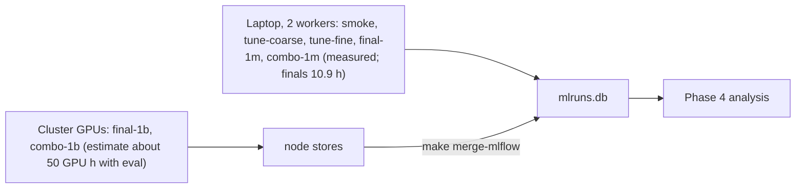

# Craftax compute budget

Status: ready

> **For agentic workers:** REQUIRED SUB-SKILL: Use superpowers:subagent-driven-development (recommended) or superpowers:executing-plans to implement this plan task-by-task. Steps use checkbox (`- [ ]`) syntax for tracking.

**Goal:** know how many runs each phase holds and how long training and evaluation take on the Apple M4 Pro laptop and on a CUDA GPU, and keep the numbers current as real throughput is measured.

**Architecture:** training totals are sums of the per-method tables in each method plan (steps per second x an overhead factor; laptop hours include 1 minute of compilation per run, GPU hours exclude it); evaluation time is added per method as eval steps per run (all its eval checkpoints) / the method's steps per second; training and evaluation are shown separately. Since 2026-10-23 the tuning phases (`tune-coarse`, `tune-fine`, Phase 0 and four of five Phase 1 methods) are measured wall-clock from MLflow; `final-1m`, `combo-1m`, `final-1b` and the Dyna-Q tuning are estimates recomputed from those measurements. Every table says which of the two it holds.

**Tech Stack:** MLflow (measured steps/s per run), the method plans of [[2026-10-20-craftax-project]].

---

## Throughput assumptions

| Quantity | Value | Source |
|---|---|---|
| PPO on Craftax-Symbolic, 1024 envs, end to end, one CPU device | 2,068 steps/s (0.3M steps incl. compile) | measured 2026-10-20 |
| Rollout with an MLP policy, 8 CPU shards | 4,212 steps/s (one shard 2,917) | measured, [[Craftax CPU vs GPU performance]] |
| PPO planning value, 8 CPU shards | 3,000 steps/s | estimate |
| PPO on Craftax-Classic-Symbolic, `published-1m` shape (256 envs x 16 steps), CPU actor on 8 shards + Metal learner, training only (compile excluded) | 14,000 steps/s in the runner (median of `train/sps`: 13,800 and 14,000 over the 2 `smoke` runs); 15,300 steps/s in a standalone chunk-timed loop (7 runs, 13,900 to 16,100) | measured 2026-10-21, Classic, laptop |
| PPO compile, Classic, fresh process | 6.3 to 7.5 s (the runner's `compile_s` reads 3.2 to 3.5 s in `smoke`: the second run reused the first run's jit cache and the resumed run measured only its last segment); the 1-minute convention below is the Symbolic estimate | measured 2026-10-21, Classic, laptop |
| PPO end to end, Classic, 200k steps | 8,200 and 9,300 steps/s (train wall-clock with compile and state saves, no eval) | measured 2026-10-21, Classic, laptop |
| Step events (`info["events"]`) in the PPO step | not measurable: 15,300 steps/s with them against 15,200 with them replaced by zeros (6 and 7 alternating runs, noise 5%); compile +0.7 s | measured 2026-10-21, Classic, laptop |
| PPO-RNN on Craftax-Classic-Symbolic, `published-1m` shape (256 envs x 16 steps), CPU actor on 8 shards + Metal learner, training only (compile excluded) | 6,400 steps/s in the runner (median of `train/sps`: 6,399 and 6,310 over the 2 `smoke` runs), 0.45 x PPO's 14,000 | measured 2026-10-21, Classic, laptop, while the PPO `tune-coarse` queue shared the CPU (a lower bound) |
| PPO-RNN end to end, Classic, 200k steps (196,608 steps) | 5,270 steps/s (37.3 s train wall-clock with compile and state saves, no eval); compile 3.1 and 3.4 s (`compile_s`, warm jit cache) | measured 2026-10-21, Classic, laptop, shared CPU as above |
| PQN-RNN on Craftax-Classic-Symbolic, `base` shape (256 envs x 16 steps), CPU actor on 8 shards + Metal learner, training only (compile excluded) | 9,800 steps/s in the runner (median of `train/sps`: 9,525 and 10,116 over the 2 `smoke` runs; 9,875 and 9,944 in two 1M diagnostic runs), 0.70 x PPO's 14,000 | measured 2026-10-21, Classic, laptop, while the PPO `tune-coarse` queue shared the CPU (a lower bound) |
| PQN-RNN end to end, Classic, 200k steps (196,608 steps) | 8,130 and 8,550 steps/s (24.2 and 23.0 s train wall-clock with compile and state saves, no eval); compile 3.3 and 3.0 s (`compile_s`, warm jit cache) | measured 2026-10-21, Classic, laptop, shared CPU as above |
| Phase 1 methods on Craftax-Classic-Symbolic, 200k-step `smoke` configs (256 envs x 16 steps), CPU actor on 8 shards + Metal learner, one queue worker on an idle machine, training only (`train/sps`, compile excluded); each method against its control rerun in the same session | PPO-RNN control 6,325 steps/s; count bonus PPO-RNN 5,884 (0.93 x, overhead 1.08; plan 1.05); PQN-RNN control 9,561; count bonus PQN-RNN 8,460 (0.88 x, overhead 1.13; plan 1.05); SIL 5,160 (0.82 x PPO-RNN, overhead 1.23; plan 1.3); SMDP skills 8,664 (0.91 x PQN-RNN, overhead 1.10; plan 1.1); Dyna-Q 8,583 uniform n 5, 8,584 prioritized n 5, 8,336 value iteration (0.87 to 0.90 x PQN-RNN, overhead 1.11 to 1.15; plan 1.15) | measured 2026-10-22, Classic, laptop, one seed each (noise about 5%) |
| Peak process RSS (`peak_rss_mb`), same runs | PPO-RNN 1,735 MB; count bonus PPO-RNN 2,274; PQN-RNN 1,645; count bonus PQN-RNN 2,401; SIL 2,297; SMDP skills 1,900; Dyna-Q 2,248 to 2,419 | measured 2026-10-22, Classic, laptop |
| SMDP skills on Craftax-Symbolic, `base`, 1M steps | 4,913 steps/s, peak RSS 3,078 MB, against 3,959 steps/s and 3,479 MB for the PQN-RNN control `base` run alone the same way (SMDP is not slower on Craftax; cause not investigated, possibly the short episodes of its early policy); Classic 1M: 9,210 steps/s, 1,899 MB | measured 2026-10-22, laptop, one seed, idle machine |
| Dyna-Q planning share of an update (`dyna/plan_wall_share`), Classic 200k | uniform n 5: 0.0005 (0.2 ms of planning per update); prioritized n 5, kappa 0.003: 0.0046; value iteration: 0.020 with 7 to 9 sweeps (`dyna/vi_sweeps`) per update | measured 2026-10-22, Classic, laptop |
| `smdp/pairs_tried` at the end of the smdp-skills `base` config (sizes Dyna's `model_pairs` 2^16 = 65,536) | 157 (200k Classic, base), 134 (200k Classic, random top level), 1,852 (1M Classic), 253 (1M Craftax) | measured 2026-10-22, one seed each |
| SMDP per-skill test agreement (`smdp/skill/<name>/test_agreement`), the 2 Classic 200k `smoke` runs | 1.0 for all 25 skills at the last update of both runs; the mean over updates is 1.0 except `sleep` 0.94 in one run (most tests are near-vacuous this early) | measured 2026-10-22, read from MLflow |
| PPO-RNN and PQN-RNN planning value | 2,400 steps/s (0.8 x PPO); superseded for Craftax by the measured rows below | estimate |
| Craftax-Symbolic 1M, tuned (published or base) config of the controls, one queue worker, train wall-clock with compile and state saves, no eval (median over the runs) | PPO 4,364 steps/s (10 runs of `e06ac6db`, 3.8 min); PPO-RNN 2,930 (10 runs of `b3ce95c4`, 5.7 min); PQN-RNN 3,830 (3 runs of `10cbfc16`, 4.4 min); the planning values 3,000 and 2,400 were 45%, 22% and 60% too low for them | measured 2026-10-21 and 22, laptop, [[2026-10-20-craftax-method-ppo]] etc. |
| Craftax-Symbolic 1M, tuned config of the Phase 1 methods, two workers, per worker (median of 3 to 12 runs) | count-bonus PQN-RNN 2,158 steps/s (7.7 min); SIL 1,603 (10.4 min); SMDP skills 2,937 (5.7 min); count-bonus PPO-RNN 1,828 (9.1 min, median of the stage-2 runs) | measured 2026-10-23, laptop |
| Slowdown per run with 2 workers against 1, same shape | PPO 1.54 x (4.49 to 6.92 min, `845b73b4` against its stage-2 configs), PPO-RNN 1.52 x (8.20 to 12.49 min, `04e6b687` against its stage-2 configs), PQN-RNN 1.31 x (5.2 to 6.8 min, ledger R57); throughput of 2 workers 1.30 x, 1.31 x, 1.53 x | measured 2026-10-22, laptop |
| CPU rollouts with metal updates | +4-5% end to end for a 256-wide MLP | measured |
| Authors' RTX 4090, PPO 1B | about 1 hour (266,961 steps/s end to end) | [[Craftax performance]] |

- Per-method overhead factors (estimates, from each method's design): PPO 1.0, PPO-RNN and PQN-RNN 1.25 over PPO, count bonus 1.05 over its base, self-imitation 1.3, SMDP skills 1.1, Dyna-Q 1.15, combination 1.3 (as self-imitation).
- Hours convention: laptop hours per run include the 1-minute compile; GPU hours per run exclude it, in this file and in every method plan.

## Evaluation assumptions

Evaluation follows [[2026-10-20-craftax-infrastructure]] Task 5 and the "Evaluation cost" rule of [[2026-10-20-craftax-evaluation-and-metrics]]: 64 fixed seeds x 2 modes (stochastic, greedy) = 128 episodes per checkpoint, in 1,000-step chunks until the last episode ends.

| Quantity | Value | Note |
|---|---|---|
| Eval checkpoints per run | tuning and smoke (`smoke`, `tune-coarse`, `tune-fine`): 1 (final); finals (`final-1m`, `final-1b`, `combo-1m`, `combo-1b`): 13 (update 0 + 11 log-spaced + the last, `checkpoint_schedule`) | |
| Longest eval episode L, rounded up to the chunk | 1,000 steps at 1M and on Classic (measured at 1M, see below); 8,000 steps averaged over the 13 checkpoints of a 1B run | estimate for 1B |
| Eval steps per run | tuning and smoke: 128 x 1,000 = 128,000; `final-1m`, `combo-1m`: 13 x 128,000 = 1,664,000; `final-1b`, `combo-1b`: 13 x 128 x 8,000 = 13,312,000 | |
| Measured, Classic, laptop (2026-10-21) | 128 episodes (64 seeds x 2 modes) = 128,000 steps per checkpoint, as above: the 1,000-step chunk is never exceeded (longest eval episode 393 steps; about 18,900 steps actually played per checkpoint); steady state 0.9 s per mode, about 70,000 steps/s of the 64,000 padded (about 11,000 on the steps actually played, greedy), plus 2.6 s once per run (the `EvalRun` jit load); eval runs as 2 batches of 64 seeds on 8 CPU shards, not one 128-env batch | measured |
| Measured, Craftax-Symbolic 1M, final checkpoints of the control `tune-coarse` and `tune-fine` runs (2026-10-22) | eval steps per checkpoint: median 128,000 for PPO (37 runs), PPO-RNN (43) and PQN-RNN (42); maximum 256,000, 256,000 and 192,000; above 128,000 in 14%, 16% and 2% of runs (median longest stochastic episode 630, 604 and 440 steps) | measured, read from the eval files |
| Measured eval wall-clock per checkpoint, Craftax-Symbolic 1M, tuning runs (last eval file minus `metrics.npz` modification time, so the one-time `EvalRun` jit load is included; the eval time is not logged as a metric) | 1 worker: 15 s (PPO, PPO-RNN, PQN-RNN), 2 workers: 18 to 22 s (all 7 methods; median 19 s); that is about 8,500 padded steps/s with 1 worker and 6,600 with 2 (128,000 padded steps per checkpoint), 2.2 to 3.5 x the planning values | measured 2026-10-23, laptop |
| Eval throughput used below | 8,500 steps/s (1 worker, all methods; the 1B cluster runs are costed at the same rate, because the GPU eval rate of a 128-env batch is not measured); the 13 checkpoints of a `final-1m` run cost about 3.5 min with 1 worker (13 x 17 s, 4.3 min with 2) | measured rate, estimate for the finals |

## Runs per phase

Seeds: 3 per config in tuning, 10 in `final-1m` and `combo-1m`, 3 in `final-1b` and `combo-1b` ([[Experiment decisions]], 2026-10-21).

| Method | `smoke` | `tune-coarse` | `tune-fine` | `final-1m` | `final-1b` | `combo-1m` | `combo-1b` | Runs |
|---|---|---|---|---|---|---|---|---|
| [[2026-10-20-craftax-method-ppo]] | 2 | 28 (7 configs, published config at 10 seeds) | 12 | 10 | 3 | - | - | 55 |
| [[2026-10-20-craftax-method-ppo-rnn]] | 2 | 31 (8 configs) | 12 | 10 | 3 | - | - | 58 |
| [[2026-10-20-craftax-method-pqn-rnn]] | 2 | 30 (10 configs) | 12 | 10 | 3 | - | - | 57 |
| [[2026-10-20-craftax-method-count-bonus]], 2 variants | 4 | 144 (24 configs each) | 30 | 30 (incl. SimHash ablation) | 6 | - | - | 214 |
| [[2026-10-20-craftax-method-sil]] | 2 | 54 (18 configs) | 24 | 20 (incl. buffer ablation) | 3 | - | - | 103 |
| [[2026-10-20-craftax-method-smdp-skills]] | 2 | 144 (48 configs) | 24 | 40 (incl. 3 ablations) | 3 | - | - | 213 |
| [[2026-10-20-craftax-method-dyna-q]] | 2 | 63 (21 configs) | 24 | 20 (incl. kappa ablation) | 3 | - | - | 112 |
| Combination of the best two (Phase 3) | - | - | - | - | - | 10 | 3 | 13 |
| **Total** | 16 | 494 | 138 | 140 | 24 | 10 | 3 | **825** |

- The [[2026-10-20-craftax-method-pqn-rnn]] 1M reference-code check adds 3 runs of the original script outside the queue (about 0.4 laptop hours, counted in the PQN-RNN row below, no fixed-seed evaluation).

## Laptop time

Run minutes are queue-run wall-clock: process start to the last eval file (compile, training, state saves, the one fixed-seed evaluation of a tuning run). A run's MLflow `end_time` is not used (the runner stamps it in a batch when a phase closes). Runs resumed after an out-of-memory failure are left out of the medians; "runs/h" is 60 (1 worker) or 120 (2 workers) over the median minutes.

### Measured 2026-10-23: tuning (`tune-coarse` + `tune-fine`, Craftax-Symbolic 1M, 3 seeds per config)

| Method | Runs finished (coarse + fine) | Min per run, 1 worker | Min per run, 2 workers | Runs/h, 2 workers | Run-hours | Wall-clock coarse | Wall-clock fine |
|---|---|---|---|---|---|---|---|
| PPO | 28 + 9 (3 more reused) | 4.3 (26 runs) | 6.9 (9) | 17.3 | 3.0 | Wed 21 16:23 to 19:51 (3.5 h) | Thu 22 01:46 to 02:19 (0.5 h) |
| PPO-RNN | 31 + 12 | 6.0 (28) | 12.5 (12) | 9.6 | 5.6 | Wed 21 19:51 to Thu 22 01:20 (5.5 h) | Thu 22 02:20 to 03:36 (1.3 h) |
| PQN-RNN | 30 + 12 | 5.2 (12) | 6.8 (14 + 12) | 17.6 | 4.4 | Wed 21 22:54 to Thu 22 01:40 (2.8 h) | Thu 22 03:37 to 04:19 (0.7 h) |
| Count bonus, PPO-RNN variant | 72 + 12 | - | 8.6 (37) | 14.0 | 12.2 | Thu 22 06:02 to 14:56 (8.9 h) | Fri 23 08:32 to 09:30 (1.0 h) |
| Count bonus, PQN-RNN variant | 72 + 12 | - | 8.2 (5) | 14.6 | 11.5 | Thu 22 09:15 to 19:34 (10.3 h) | Fri 23 09:30 to 10:22 (0.9 h) |
| Self-imitation | 54 + 12 | - | 11.2 (54) | 10.8 | 12.2 | Thu 22 19:46 to Fri 23 00:59 (5.2 h) | Fri 23 10:25 to 11:31 (1.1 h) |
| SMDP skills | 144 + 21 (3 more reused) | - | 6.2 (144) | 19.4 | 16.8 | Fri 23 01:03 to 08:30 (7.5 h) | Fri 23 11:32 to 12:36 (1.1 h) |
| Dyna-Q | running since Fri 23 15:43 (63 + 24 runs) | - | not yet | - | - | - | - |

- Measured eval per checkpoint (tuning runs, 1 final checkpoint): 15 s with 1 worker, 19 s median with 2 workers; it is inside the run minutes.
- Run-hours = runs x median minutes (1 and 2 worker periods separately), so the wall-clock of a phase at 2 workers is about half of them; the wall-clock columns are first start to last eval end and include out-of-memory retries and pauses (the count-bonus coarse cascade of Thu 22 12:10, the session gaps of Fri 23).
- Phase 0 (3 controls): 122 runs, 13.0 run-hours, Wed 21 16:23 to Thu 22 04:19 (11.9 h wall-clock, 1 worker until Thu 22 00:06, then 2). Estimate was about 18 h sequential (17.8 h training + eval).
- Phase 1 (4 methods, 399 runs): 52.7 run-hours, Thu 22 06:02 to Fri 23 12:36 (30.5 h wall-clock with gaps). Estimate for those four methods was about 68 h sequential (26.8 + 14.6 + 26.9).
- 2 workers: 1.30 x (PPO), 1.31 x (PPO-RNN) and 1.53 x (PQN-RNN) the throughput of 1 (Throughput assumptions); mean about 1.4 x.

### Estimates for what has not run (2 workers, 13 eval checkpoints in a `final-1m` run)

Per-run minutes: the tuned config's measured minutes (controls: the 1-worker median times the slowdown of the method's matched measurement; Phase 1 methods: measured at 2 workers; Dyna-Q: PQN-RNN 6.4 x 1.15, the planned overhead; Classic measured 1.11 to 1.15) plus 12 further checkpoints x 17 s = 3.4 min.

| Method | `final-1m` runs | Measured tuned-config min (2 workers) | + 12 checkpoints | Min per run | Wall-clock h |
|---|---|---|---|---|---|
| PPO | 10 | 6.2 | 3.4 | 9.6 | 0.8 |
| PPO-RNN | 10 | 9.1 | 3.4 | 12.5 | 1.0 |
| PQN-RNN | 10 | 6.4 | 3.4 | 9.8 | 0.8 |
| Count bonus, 2 variants | 30 | 8.9 (9.5 PPO-RNN, 8.3 PQN-RNN) | 3.4 | 12.3 | 3.1 |
| Self-imitation | 20 | 10.8 | 3.4 | 14.2 | 2.4 |
| SMDP skills | 40 | 6.1 | 3.4 | 9.5 | 3.2 |
| Dyna-Q (estimate, not measured) | 20 | 7.4 | 3.4 | 10.8 | 1.8 |
| **`final-1m`** | **140** | | | | **13.1 (10.7 runs/h; 8.8 training + 4.3 evaluation); measured 9.7 (Fri 23 21:41 to Sat 24 07:23, 14.4 runs/h)** |
| `combo-1m` (SIL-like 10.8 + 3.4 = 14.2 min, overhead 1.3) | 10 | 10.8 | 3.4 | 14.2 | 1.2; measured 1.2 (Sat 24 07:24 to 08:35) |
| Dyna-Q tuning remaining (63 coarse + 24 fine, 7.4 min per run, no 13 checkpoints) | 87 | 7.4 | - | 7.4 | 5.4 (ran Fri 23 15:43 to 20:33, 4.8 h) |

- The estimate before the measurements was 21.7 h training + 31.9 h evaluation sequential for the 1M finals (53.6 h) and 4.2 h for `combo-1m`: the 13-checkpoint evaluation was planned at the training rate (9 min per run) and measures 3.7 min, and PPO, PPO-RNN and PQN-RNN train faster than planned.
- Add about 10% to `final-1m` for out-of-memory retries (the cleanup pass of `run_workers.sh`): about 14 h, 0.6 days, with `combo-1m` about 15 h.
- Measured 2026-10-24: `final-1m` 9.7 h and `combo-1m` 1.2 h wall-clock with 2 workers, 10.9 h together, no out-of-memory retries. 38 of the 140 `final-1m` runs were tuning runs of a tuned config, joined by run name, which only added their 12 missing checkpoint evaluations; per-run minutes of the finals are not measured yet.
- Laptop 1B (`final-1b`, `combo-1b`; estimate): the 1M rates of the tuned configs applied to 1B steps, one run at a time; the Phase 1 methods' rates are the 2-worker per-worker rates x 1.46 (mean measured slowdown) to get 1 worker; eval at 8,500 steps/s. Memory at the 1B shape is in 1B job resources below (6 to 8 GB of GPU memory at 1,024 envs x 64 steps for the PPO family, not the 36 GB this line once quoted; none needs more, Dyna-Q peaks at 20.7 GB).

| Method | Steps/s (1 worker) | Hours per 1B run | 3 seeds, training | Eval h per run | 3 seeds, training + eval |
|---|---|---|---|---|---|
| PPO | 4,364 (measured) | 63.7 | 191.0 | 0.43 | 192.3 |
| PPO-RNN | 2,930 (measured) | 94.8 | 284.4 | 0.43 | 285.7 |
| PQN-RNN | 3,830 (measured) | 72.5 | 217.6 | 0.43 | 218.9 |
| Count bonus, PPO-RNN variant | 2,668 (2-worker 1,828 x 1.46) | 104.1 | 312.3 | 0.43 | 313.6 |
| Count bonus, PQN-RNN variant | 3,151 (2,158 x 1.46) | 88.2 | 264.5 | 0.43 | 265.8 |
| Self-imitation | 2,340 (1,603 x 1.46) | 118.7 | 356.1 | 0.43 | 357.4 |
| SMDP skills | 4,288 (2,937 x 1.46) | 64.8 | 194.3 | 0.43 | 195.6 |
| Dyna-Q (not measured) | 3,389 (PQN-RNN / 1.13, Classic overhead) | 82.0 | 245.9 | 0.43 | 247.2 |
| Combination (`combo-1b`, as SIL) | 2,340 | 118.7 | 356.1 | 0.43 | 357.4 |
| **`final-1b`** (8 methods, 24 runs) | | | **2,066.1** | | **2,076.5** |
| **`combo-1b`** | | | **356.1** | | **357.4** |

- 1B on the laptop: about 2,077 h (87 days) for `final-1b` and 357 h for `combo-1b`; before the measurements 2,970 laptop hours for `final-1b` (training only, the CUDA estimate below is unchanged).

## 1B finals on a CUDA GPU (authors' hardware, estimates)

Training hours per run exclude the 1-minute compile and are the unchanged estimates (authors' 266,961 steps/s divided by the overhead factor). Eval hours per run are 13 checkpoints x 128 episodes x 8,000 steps = 13,312,000 steps at the measured laptop eval rate of 8,500 steps/s (Evaluation assumptions): 0.43 h, instead of 1.23 to 2.00 h at the planning rate; the 8,000-step episode length at 1B stays an estimate.

| Method | Training hours per run | Eval hours per run | 3 seeds, training + eval |
|---|---|---|---|
| PPO | 1.04 | 0.43 | 4.4 |
| PPO-RNN, PQN-RNN | 1.30 each | 0.43 | 5.2 each |
| Count bonus | 1.37 per variant | 0.43 | 10.8 for both |
| Self-imitation | 1.69 | 0.43 | 6.4 |
| SMDP skills | 1.43 | 0.43 | 5.6 |
| Dyna-Q | 1.50 | 0.43 | 5.8 |
| Combination (`combo-1b`) | 1.69 | 0.43 | 6.4 |
| **Total** | | | **about 50 GPU hours** (38.0 training + 11.7 eval; was 83) |

- `final-1b` is about 43 GPU hours (33.0 training + 10.4 eval) and `combo-1b` about 6 (5.1 + 1.3).
- Seeds are independent runs: with k GPUs the 1B wall-clock is about 50 / k hours.

## Mix of machines



- Same run names everywhere, so any phase can move between laptop and cluster ([[Experiment decisions]]).

### Task 1: Replace estimates with measurements

**Files:**
- Modify: this file, the "Runs and laptop time estimate" table of each method plan

- [x] **Step 1:** after [[2026-10-20-craftax-infrastructure]] Task 7 and each method's smoke task, read each method's mean steps/s and eval steps per checkpoint (longest of the 128 eval episodes) from the `smoke` runs (`make status PHASE=smoke`, then the runs in `make mlflow`). (done 2026-10-23: measured steps/s and eval per checkpoint from the `smoke` and tuning runs, 5766500; see the note below the steps)
- [x] **Step 2:** recompute every table with the measured values (laptop hours with compile, GPU hours without); mark them "measured". (done 2026-10-24: the 1M tables carry measured values (5766500; `final-1m` 9.7 h and `combo-1m` 1.2 h measured 2026-10-24); the 1B tables stay estimates until Step 3b)
- [x] **Step 3:** after `tune-coarse` of each method, recheck its overhead factor against the PPO-RNN or PQN-RNN base and the eval episode length at its final checkpoint. (done 2026-10-23: the 1M part: overhead factors and eval episode length rechecked after tuning, 5766500, 6023167; the 1B eval assumption is Step 3b)
- [ ] **Step 3b:** after the first `final-1b` run, replace the 1B eval assumptions with its measured eval time and the 1B estimate tables with measured values.
- Note 2026-10-23: Steps 1 to 3 are done for what has run (tuning of the three controls and four Phase 1 methods; see "Laptop time"): run minutes, 2-worker throughput, eval per checkpoint and Craftax steps/s are measured; the `final-1m`, `combo-1m` and 1B numbers are recomputed estimates. Still open: Dyna-Q tuning (running), the first `final-1m` run times (replace the "Estimates" table), the first `final-1b` eval time.

## 1B storage

Only what a later step reads is kept and copied back (measured on the 1M store, 2026-10-28: `state/` was 232 GB of 457 GB and is read only to resume or repair a run).

| Item | 1B policy | Size per run | Copied back |
|---|---|---|---|
| `ckpt/` (13 checkpoints + `index.json`) | all kept: 3 seeds only, and the best seed and case updates are unknown until the 1B analysis | 0.34-0.50 GB | yes |
| `state/` | one file, replaced every `checkpoint_every` updates; deleted when the run closes FINISHED with a complete evaluation and no lost checkpoint (`drop_state_on_finish: true` in `configs/profiles/cuda.yaml`); kept for killed, failed and unevaluated runs, which resume on the cluster | 0 after the finish; 0.45-1.8 GB (twice while its `.tmp` is written) while running; dyna-q 6.4 GB at its 1B tables (measured on 8 envs: 2^24 rows, 2^25 pairs), smdp-skills 0.2 GB | never |
| `eval/`, `metrics.npz`, `episodes.npz`, `extras.npz`, `config.json`, reproducibility report | kept | about 0.05-0.17 GB | yes |
| `*.tmp`, `owner.json` | transient | 0 | never |
| node DB `mlruns-node-<i>.db` and `.array.json` | kept | about 25 MB per run | yes |

Expected: about 0.4-0.65 GB per finished 1B run, about 11-18 GB for the 27 runs plus 0.7 GB of node DBs; the cluster disk holds that plus one live `state/` per running node (up to 3.6 GB; a dyna-q node 13 GB while its `.tmp` is written). A dyna-q run adds the skill graph (43 B per visited pair per checkpoint) and the sparse table (130 B per visited row) to its `ckpt/` and `eval/`: about 1.1 GB in all at the 90th-percentile projection of the 1M runs, 3.0 GB at the largest, not 0.4-0.65 GB.

### Task 2: 1B storage

**Files:**
- Modify: this file (measured sizes)

- [ ] **Step 1:** start the first `final-1b` array without `SEED_FROM` (no 1B run exists in the main store, so seeding would only read the 1M store, about 20 GB of `mlruns/` after the prune plus the 17 GB `mlruns.db`, for nothing); seed a later rerun only from a store holding just the 1B runs ([[2026-10-20-craftax-infrastructure]] Task 6 Step 5).
- [ ] **Step 1b:** watch the guarded table counts, which still grow faster than linearly at 1M ([[Experiment decisions]], 2026-10-29): once the first `final-1b` dyna-q, smdp-skills, count-bonus and combo runs pass 5-10 % of the budget, run `uv run python scripts/cluster/project_guards.py --tracking-uri sqlite:///<node>.db`. It fits `smdp/keys_visited`, `dyna/pairs_visited` and `count/distinct_keys` against env steps on log-log axes (from 10 % of the steps so far), projects them to 1e9 and exits 2 when one is above 0.7 of its guard (`smdp/table_full` at a quarter of the rows, `dyna/model_full` at the last pair, `count/table_full`). A linear check misses it: a count at 3 % of its guard at 10 % of the budget still overflows with a slope above 1.
  - If it exits 2, resize that entry in its method YAML (`budgets.1b`: dyna-q `log2_rows` and `model_pairs`, count-bonus `log2_k`; device memory first: 6.7 GB of tables at 2^24 rows and 2^25 pairs). The resize changes the config hash, so every seed of the entry restarts under a new run name: stop the old runs (they keep their old name, are not in the phase any more and stay out of the analysis and of `select_pair`), start all 3 seeds of the entry again from scratch. Seeds that already finished under the old table are not mixed in, so an entry never holds two table sizes.
  - Without a resize, a seed that later trips a guard ends FAILED with `abort/guard` and is restarted by the same rule.
- [ ] **Step 2:** copy back only finished runs: after `make status PHASE=final-1b` on the cluster shows them finished, `rsync -a --exclude state/ --exclude '*.tmp' --exclude owner.json node-stores/ <laptop>:node-stores/`, then `make merge-mlflow SRC=node-stores/mlruns-node-<i>.db` per node. The merge refuses an unfinished node run without `state/` (it would restart from update 0 beside its checkpoints): such runs stay on the cluster and resume there.
- [ ] **Step 3:** measure the first finished run's synced size (and that of the first finished dyna-q and smdp-skills runs, which carry the skill graph and the sparse table) (`du -sh` of its artifact folder) and replace the 0.4-0.65 GB estimate above; check that its `state/` is gone and its `ckpt/` has 13 files.
- [ ] **Step 4 (optional, after the 1B training analysis and the video footage are fixed):** `uv run python -m wut_murl_craftax.orchestration.prune --phases final-1b combo-1b` (dry run; `--apply` deletes) keeps the final checkpoint, the case updates and the best and median seeds by `final_score` plus the best seed by `eval_stochastic_score` of each 1B unit, about 6 GB less; not needed for the disk.

## 1B job resources

What each `final-1b` and `combo-1b` run needs on a cluster node, one row per method entry (3 seeds each, 27 runs). Measured on the laptop CPU backend at the 1B configs, extrapolated to 1,024 envs; GPU numbers are replaced by the first-node measurements (Task 3).

Method, with the status of each number:

- **State S** (measured, exact): shape-only `jax.eval_shape` of the trainer's `init` at 1,024 envs; live arrays at 8 to 512 envs agree (0.29 MB per env on top of the fixed part).
- **Update program** (measured on CPU, extrapolated to GPU): XLA's buffer analysis (`memory_analysis`: arguments, outputs, temp) of the jitted update compiled for the 1,024-env shape, without allocating it. The temp bytes are linear in envs (PQN-RNN 12.71 MB per env at 128, 256, 512 and 1,024). A GPU compile can fuse differently; not measured.
- **What the runner also holds** (since `perf/dyna-q-memory`, 2026-10-29; live buffers measured at 8 envs, before and after): only the live state and the 50-update metrics of a chunk (5 MB per update at 64 steps, 10 MB at 128). The init state and the state loaded on a resume are dropped before the first chunk, and `train_chunk` updates the carry (SMDP, Dyna-Q), the model (Dyna-Q) and the resident method state (SIL, combo) in place (donated) instead of copying them. Before, the runner held the init state for the whole run (+S), the restored one after a resume (+S), and the copy (the column below); outputs are bit-identical.
- **Resident-set growth** (measured): the runner's chunk, record and state-save steps at 8, 32, 128, 256, 512 envs on the CPU, fitted a + b x envs and read at 1,024. It counts touched pages only (zero-filled tables are not resident), so it is a cross-check of the program analysis, not the request.
- The 1M store logs no `peak_device_mb` (Metal and CPU keep no counters), so the GPU table has no 1M check; its `peak_rss_mb` of the tuned final configs (laptop, 256 envs x 16 steps, one process) is ppo 6.3, ppo-rnn 3.5, pqn-rnn 3.5, count-bonus-ppo-rnn 4.7, count-bonus-pqn-rnn 4.5, sil 5.7, smdp-skills 3.0, dyna-q 3.5 GB, combo 6.1 to 6.5 GB.
- The "1,024 envs x 64 steps needs more than 36 GB" remark has no source in [[2026-10-20-craftax-infrastructure]]; the rollout batch is 65,536 x 8,268 x 4 B = 2.17 GB, and 36 GB is the Metal ceiling of the laptop (`METALJAX_MEM_SYS_MB`).

### GPU memory (1,024 envs, GB)

| Entry | Steps per update | State S | Update program | Copy in `train_chunk` | Peak, fresh start | Peak, after a resume | CPU resident set at 1,024 envs (fit) | VRAM request | Card |
|---|---|---|---|---|---|---|---|---|---|
| ppo | 65,536 | 0.43 | 4.75 | 0 | 5.9 | 5.9 | 10.3 | 11 | 24 GB |
| ppo-rnn | 65,536 | 0.40 | 6.51 | 0 | 7.6 | 7.6 | 11.8 | 13 | 24 GB |
| pqn-rnn | 131,072 | 0.40 | 13.03 | 0 | 14.3 | 14.3 | 15.5 | 19 | 24 GB |
| count-bonus-ppo-rnn | 65,536 | 0.52 | 6.51 | 0 | 7.8 | 7.8 | 9.1 | 11 | 24 GB |
| count-bonus-pqn-rnn | 131,072 | 0.51 | 13.03 | 0 | 14.6 | 14.6 | 14.1 | 20 | 24 GB |
| sil | 65,536 | 1.78 | 6.65 | 0 (was 1.38) | 10.4 | 10.4 | 18.9 | 21 | 24 GB |
| smdp-skills | 131,072 | 0.53 | 13.22 | 0 (was 0.45) | 14.2 | 14.2 | 14.1 | 19 | 24 GB |
| dyna-q | 131,072 | 7.02 | 13.22 | 0 (was 6.95) | 20.7 | 20.7 | not fitted (live arrays) | 27 | 40 GB |
| combo | 65,536 | 1.90 | 6.65 | 0 (was 1.50) | 10.7 | 10.7 | 19.0 | 21 | 24 GB |

- Peak = live S + update program + 50 updates of metrics, the same after a resume (the old peaks less the init state, the restored state and the copy). Update program = XLA temp plus new outputs; for SMDP and Dyna-Q the learner's rollout batch (4.43 GB, argument) plus its temp (8.71 GB); Dyna-Q's rollout program peaks lower. Before the first chunk a resume briefly holds the init and the loaded state (2 S), and a Dyna-Q checkpoint save adds up to 4.3 GB (measured on the CPU backend): both under the peak.
- Request = the larger of the peak after a resume and the fitted resident set above idle, times 1.25, plus 1 GB (CUDA context, cuDNN and cuBLAS workspaces, allocator fragmentation). The resident-set fit was measured before the change (an upper bound now, not refitted), so it still sets the ppo, ppo-rnn, sil and combo requests.
- Dyna-Q's tables are 6.4 GiB of its 7.02 GB (2^24 rows, 2^25 pairs, measured at 8 and 64 envs: 6,397 and 6,413 MB). Peak 20.7 GB fresh or resumed (was 34.7 and 41.7), request 27 GB: a 32 or 40 GB card. A 24 GB card holds the peak with 3.3 GB to spare, under the 25 % + 1 GB margin; Task 3 Step 1 decides whether that is enough.
- Knobs that would lower Dyna-Q further (none applied): `model_pairs` 2^25 to 2^24 saves about 2.2 GB but is the guard sized in [[Experiment decisions]]; envs x `num_steps` halves the 13 GB learner term.
- `peak_device_mb` (peak bytes in use) is what a run logs; JAX preallocates 75 % of a card per process unless `XLA_PYTHON_CLIENT_PREALLOCATE=false` or `XLA_PYTHON_CLIENT_MEM_FRACTION` is set (neither is in `run_array.sh` or `cuda.yaml`), so `nvidia-smi` shows the pool, not the peak.

### Host RAM, cores and disk

| Entry | Host RAM peak (GB) | Host RAM request | CPU cores | Disk while running (GB) | Synced per finished run (GB) |
|---|---|---|---|---|---|
| ppo | 5.4 | 12 GB | 4 | 1.8 | 0.4-0.65 |
| ppo-rnn | 5.0 | 12 GB | 4 | 1.6 | 0.4-0.65 |
| pqn-rnn | 5.2 | 12 GB | 4 | 1.6 | 0.4-0.65 |
| count-bonus-ppo-rnn | 5.5 | 12 GB | 4 | 1.9 | 0.4-0.65 |
| count-bonus-pqn-rnn | 5.6 | 12 GB | 4 | 1.9 | 0.4-0.65 |
| sil | 7.3 | 16 GB | 4 | 4.4 | 0.4-0.65 |
| smdp-skills | 5.8 | 12 GB | 4 | 4.6 | 1.1-3.0 |
| dyna-q | 13.9 (19 on a resume) | 32 GB | 4 | 17.5 | 1.1-3.0 |
| combo | 7.9 | 16 GB | 4 | 4.6 | 0.4-0.65 |

- Host RAM peak = process after compile (2.3 to 3.8 GB measured at 8 envs on the CPU backend, plus 1.5 GB assumed for the CUDA libraries) + queue parent 0.5 GB (0.3 measured) + 50 updates of host metrics (0.25 or 0.5 GB) + the `state/` save, which copies every leaf to the host (`save_state` builds all arrays first: S plus the largest leaf, 1.7 GB for Dyna-Q). On the CPU backend that copy is a view, so the laptop does not show it. A resume reads `state/` into host memory (S) before it goes to the device. Eval adds at most 0.9 GB (measured 0.4 to 0.9 GB over a 1M-length rollout; 124 B per step per seed, 0.8 GB at the 100,000-step cap). Requests are about 2 x the peak.
- Cores: `cuda.yaml` has `host_devices: 1` and `device_roles: gpu`, so nothing shards over CPU threads; one Python thread dispatches the updates, and the host work per update (recording, metric windows) is 3 to 16 ms at 512 envs, under 2 s per 50-update chunk against 12 to 31 s of GPU time. The rest is the first compile (XLA parallelism), the MLflow sampler and the CUDA runtime threads. 4 cores per job; `OMP_NUM_THREADS` is set to 1 only by `make`, not by `run_array.sh`.
- Disk while running = `state/` twice (the `.tmp` copy while it is written) + `ckpt/` (13 x 25 to 36 MB, measured per checkpoint) + `eval/`, logs, node DB and compile cache (about 0.5 GB; the CPU cache of every shape tried here is 251 MB) + for the skill methods the skill graph and sparse tables (1.1 to 3.0 GB, from the readiness projection). The environment (`uv sync --all-groups` with `jax[cuda12]`) is not counted (not measured on Linux).
- All 27 runs at once would need about 120 GB across nodes (3 x 35.3 + 3 x 4.6); on 8 nodes the largest is a Dyna-Q node, 17.5 GB plus the finished runs it holds (up to 9 GB): 60 GB of node-local scratch is enough. Synced outputs of the 27 runs: 15 to 32 GB plus 0.7 GB of node DBs.

### Time per run (GPU hours; estimate, GPU rate unmeasured)

| Entry | Training (this file's CUDA table) | `state/` saves | Compile | Eval | Run | Time limit | GPU hours, 3 seeds |
|---|---|---|---|---|---|---|---|
| ppo | 1.04 | 0.06 | 0.03 | 0.43 | 1.56 | 4:00 | 4.7 |
| ppo-rnn | 1.30 | 0.06 | 0.03 | 0.43 | 1.82 | 4:00 | 5.5 |
| pqn-rnn | 1.30 | 0.03 | 0.03 | 0.43 | 1.79 | 4:00 | 5.4 |
| count-bonus-ppo-rnn | 1.37 | 0.07 | 0.03 | 0.43 | 1.90 | 4:00 | 5.7 |
| count-bonus-pqn-rnn | 1.37 | 0.04 | 0.03 | 0.43 | 1.87 | 4:00 | 5.6 |
| sil | 1.69 | 0.18 | 0.03 | 0.43 | 2.33 | 5:00 | 7.0 |
| smdp-skills | 1.43 | 0.04 | 0.03 | 0.43 | 1.93 | 4:00 | 5.8 |
| dyna-q | 1.50 | 0.33 | 0.03 | 0.43 | 2.29 | 5:00 | 6.9 |
| combo | 1.69 | 0.19 | 0.03 | 0.43 | 2.34 | 5:00 | 7.0 |
| **`final-1b` + `combo-1b`** | | | | | | | **53.5 (46.5 + 7.0)** |

- Training and eval hours are the CUDA table above (authors' 266,961 steps/s divided by the overhead factor; eval at the laptop rate). `state/` saves = (updates / 50 + 12 checkpoint-aligned chunks) x (S / 1 GB/s + 0.3 s); the 1 GB/s end to end is an assumption (the laptop wrote Dyna-Q's 6.4 GiB in 1.2 to 1.4 s idle and 5 to 6 s under a load of 30). They and the compile add 8 % to the 50 GPU hours of the CUDA table; the host-side recording per chunk is below 2 s and not added.
- The GPU eval rate is unmeasured: 26 passes (13 checkpoints x 2 modes) of 64 seeds in 1,000-step chunks until the last episode ends. At an assumed 0.5 to 1.5 ms per step on a 64-env scan the pass takes 12 s at 8,000 steps and 150 s at the 100,000-step cap, so eval is 0.1 to 1.1 h per run against the 0.43 h used.
- The time limit is about 2 x the run estimate (GPU class and eval length are the unknowns). A run that reaches the limit is stopped by `--signal=B:TERM@600`, saves `state/` and resumes when the same command is submitted again (after a resume the peak of the GPU table applies).
- Jobs per GPU: one. By memory alone a 24 GB card holds one job (two entries of 11 to 13 GB plus two CUDA contexts do not fit); a 40 GB card two of ppo, ppo-rnn and count-bonus-ppo-rnn; a 48 GB card two of the 19 to 21 GB entries; an 80 GB card three of them. Jobs on one GPU share its compute, so no wall-clock gain is expected, and each needs `XLA_PYTHON_CLIENT_PREALLOCATE=false`.

### Request lines

One submission per entry, each with its own `STORE_DIR` (3 seeds, array 0-2, one run per task; node DBs `mlruns-node-<i>.db` would collide between entries otherwise). `--method` takes the registry name; the card class is the "Card" column of the GPU table (GRES names are site-specific).

```
STORE_DIR=node-stores/ppo sbatch --array=0-2 --gres=gpu:1 --cpus-per-task=4 --mem=12G --time=04:00:00 scripts/cluster/run_array.sh final-1b --method ppo                      # 24 GB card
STORE_DIR=node-stores/ppo-rnn sbatch --array=0-2 --gres=gpu:1 --cpus-per-task=4 --mem=12G --time=04:00:00 scripts/cluster/run_array.sh final-1b --method ppo-rnn           # 24 GB card
STORE_DIR=node-stores/pqn-rnn sbatch --array=0-2 --gres=gpu:1 --cpus-per-task=4 --mem=12G --time=04:00:00 scripts/cluster/run_array.sh final-1b --method pqn-rnn           # 24 GB card
STORE_DIR=node-stores/count-bonus-ppo-rnn sbatch --array=0-2 --gres=gpu:1 --cpus-per-task=4 --mem=12G --time=04:00:00 scripts/cluster/run_array.sh final-1b --method count-bonus-ppo-rnn   # 24 GB card
STORE_DIR=node-stores/count-bonus-pqn-rnn sbatch --array=0-2 --gres=gpu:1 --cpus-per-task=4 --mem=12G --time=04:00:00 scripts/cluster/run_array.sh final-1b --method count-bonus-pqn-rnn   # 24 GB card
STORE_DIR=node-stores/sil sbatch --array=0-2 --gres=gpu:1 --cpus-per-task=4 --mem=16G --time=05:00:00 scripts/cluster/run_array.sh final-1b --method sil                      # 24 GB card
STORE_DIR=node-stores/smdp-skills sbatch --array=0-2 --gres=gpu:1 --cpus-per-task=4 --mem=12G --time=04:00:00 scripts/cluster/run_array.sh final-1b --method smdp-skills   # 24 GB card
STORE_DIR=node-stores/dyna-q sbatch --array=0-2 --gres=gpu:1 --cpus-per-task=4 --mem=32G --time=05:00:00 scripts/cluster/run_array.sh final-1b --method dyna-q                # 40 GB card (32 GB suffices)
STORE_DIR=node-stores/combo sbatch --array=0-2 --gres=gpu:1 --cpus-per-task=4 --mem=16G --time=05:00:00 scripts/cluster/run_array.sh combo-1b                                   # 24 GB card
```

- Totals: 27 runs, 53.5 GPU hours estimated (117 charged at the time limits), 24 GB cards for 24 runs and a 40 GB card (32 GB suffices) for the 3 Dyna-Q runs.

### Task 3: 1B job resources

**Files:**
- Modify: this file (replace the extrapolated numbers above with the first-node measurements)

- [ ] **Step 1:** on the first GPU node, run one seed of every entry for 2 to 3 chunks (`peak_device_mb` and `peak_rss_mb` are logged per chunk); replace the "Peak, fresh start" column and the 1.25 x factor. Run it once with `XLA_PYTHON_CLIENT_PREALLOCATE=false` so the card's allocator pool does not hide the peak.
- [ ] **Step 2:** kill a Dyna-Q and a SIL run after 2 chunks and resume them; read the device peak (expected as a fresh start: 20.7 and 10.4 GB) and the host peak of the resume (expected 19 GB for Dyna-Q). With Step 1 it decides whether a 24 GB card is enough for Dyna-Q.
- [ ] **Step 3:** read the chunk wall time and the `state/` save time of each entry at 1,024 envs (largest for SIL, SMDP, Dyna-Q); they replace the 1 GB/s save rate and, with the steady steps per second, the authors' rate divided by the overhead factor. All must stay far under the 600 s stop grace.
- [ ] **Step 4:** time the first checkpoint evaluation on the GPU (26 passes) and record the longest 1B eval episode; they replace the 0.43 h and the 8,000-step assumption (Task 1 Step 3b).
- [ ] **Step 5:** `sacct -o JobID,MaxRSS,TotalCPU,Elapsed,AllocCPUS` of the first runs: replaces the host RAM peak and the 4 cores; `du -sh` of the node store while a run trains and after it finishes: replaces the disk columns (with Task 2 Step 3).
- [ ] **Step 6:** if the time limits are too short or too long by more than 1.5 x, change them in the request lines; the runner resumes whatever the limit cut.
