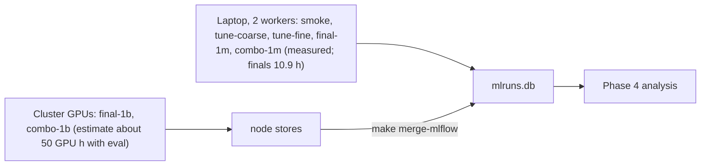

# Craftax compute budget

Status: ready

> **For agentic workers:** REQUIRED SUB-SKILL: Use superpowers:subagent-driven-development (recommended) or superpowers:executing-plans to implement this plan task-by-task. Steps use checkbox (`- [ ]`) syntax for tracking.

**Goal:** know how many runs each phase holds and how long training and evaluation take on the Apple M4 Pro laptop and on a CUDA GPU, and keep the numbers current as real throughput is measured.

**Architecture:** training totals are sums of the per-method tables in each method plan (steps per second x an overhead factor; laptop hours include 1 minute of compilation per run, GPU hours exclude it); evaluation time is added per method as eval steps per run (all its eval checkpoints) / the method's steps per second; training and evaluation are shown separately. Since 2026-10-23 the tuning phases (`tune-coarse`, `tune-fine`, Phase 0 and four of five Phase 1 methods) are measured wall-clock from MLflow; `final-1m`, `combo-1m`, `final-1b` and the Dyna-Q tuning are estimates recomputed from those measurements. Every table says which of the two it holds.

**Tech Stack:** MLflow (measured steps/s per run), the method plans of [[2026-10-20-craftax-project]].

---

## Throughput assumptions

| Quantity | Value | Source |
|---|---|---|
| PPO on Craftax-Symbolic, 1024 envs, end to end, one CPU device | 2,068 steps/s (0.3M steps incl. compile) | measured 2026-10-20 |
| Rollout with an MLP policy, 8 CPU shards | 4,212 steps/s (one shard 2,917) | measured, [[Craftax CPU vs GPU performance]] |
| PPO planning value, 8 CPU shards | 3,000 steps/s | estimate |
| PPO on Craftax-Classic-Symbolic, `published-1m` shape (256 envs x 16 steps), CPU actor on 8 shards + Metal learner, training only (compile excluded) | 14,000 steps/s in the runner (median of `train/sps`: 13,800 and 14,000 over the 2 `smoke` runs); 15,300 steps/s in a standalone chunk-timed loop (7 runs, 13,900 to 16,100) | measured 2026-10-21, Classic, laptop |
| PPO compile, Classic, fresh process | 6.3 to 7.5 s (the runner's `compile_s` reads 3.2 to 3.5 s in `smoke`: the second run reused the first run's jit cache and the resumed run measured only its last segment); the 1-minute convention below is the Symbolic estimate | measured 2026-10-21, Classic, laptop |
| PPO end to end, Classic, 200k steps | 8,200 and 9,300 steps/s (train wall-clock with compile and state saves, no eval) | measured 2026-10-21, Classic, laptop |
| Step events (`info["events"]`) in the PPO step | not measurable: 15,300 steps/s with them against 15,200 with them replaced by zeros (6 and 7 alternating runs, noise 5%); compile +0.7 s | measured 2026-10-21, Classic, laptop |
| PPO-RNN on Craftax-Classic-Symbolic, `published-1m` shape (256 envs x 16 steps), CPU actor on 8 shards + Metal learner, training only (compile excluded) | 6,400 steps/s in the runner (median of `train/sps`: 6,399 and 6,310 over the 2 `smoke` runs), 0.45 x PPO's 14,000 | measured 2026-10-21, Classic, laptop, while the PPO `tune-coarse` queue shared the CPU (a lower bound) |
| PPO-RNN end to end, Classic, 200k steps (196,608 steps) | 5,270 steps/s (37.3 s train wall-clock with compile and state saves, no eval); compile 3.1 and 3.4 s (`compile_s`, warm jit cache) | measured 2026-10-21, Classic, laptop, shared CPU as above |
| PQN-RNN on Craftax-Classic-Symbolic, `base` shape (256 envs x 16 steps), CPU actor on 8 shards + Metal learner, training only (compile excluded) | 9,800 steps/s in the runner (median of `train/sps`: 9,525 and 10,116 over the 2 `smoke` runs; 9,875 and 9,944 in two 1M diagnostic runs), 0.70 x PPO's 14,000 | measured 2026-10-21, Classic, laptop, while the PPO `tune-coarse` queue shared the CPU (a lower bound) |
| PQN-RNN end to end, Classic, 200k steps (196,608 steps) | 8,130 and 8,550 steps/s (24.2 and 23.0 s train wall-clock with compile and state saves, no eval); compile 3.3 and 3.0 s (`compile_s`, warm jit cache) | measured 2026-10-21, Classic, laptop, shared CPU as above |
| Phase 1 methods on Craftax-Classic-Symbolic, 200k-step `smoke` configs (256 envs x 16 steps), CPU actor on 8 shards + Metal learner, one queue worker on an idle machine, training only (`train/sps`, compile excluded); each method against its control rerun in the same session | PPO-RNN control 6,325 steps/s; count bonus PPO-RNN 5,884 (0.93 x, overhead 1.08; plan 1.05); PQN-RNN control 9,561; count bonus PQN-RNN 8,460 (0.88 x, overhead 1.13; plan 1.05); SIL 5,160 (0.82 x PPO-RNN, overhead 1.23; plan 1.3); SMDP skills 8,664 (0.91 x PQN-RNN, overhead 1.10; plan 1.1); Dyna-Q 8,583 uniform n 5, 8,584 prioritized n 5, 8,336 value iteration (0.87 to 0.90 x PQN-RNN, overhead 1.11 to 1.15; plan 1.15) | measured 2026-10-22, Classic, laptop, one seed each (noise about 5%) |
| Peak process RSS (`peak_rss_mb`), same runs | PPO-RNN 1,735 MB; count bonus PPO-RNN 2,274; PQN-RNN 1,645; count bonus PQN-RNN 2,401; SIL 2,297; SMDP skills 1,900; Dyna-Q 2,248 to 2,419 | measured 2026-10-22, Classic, laptop |
| SMDP skills on Craftax-Symbolic, `base`, 1M steps | 4,913 steps/s, peak RSS 3,078 MB, against 3,959 steps/s and 3,479 MB for the PQN-RNN control `base` run alone the same way (SMDP is not slower on Craftax; cause not investigated, possibly the short episodes of its early policy); Classic 1M: 9,210 steps/s, 1,899 MB | measured 2026-10-22, laptop, one seed, idle machine |
| Dyna-Q planning share of an update (`dyna/plan_wall_share`), Classic 200k | uniform n 5: 0.0005 (0.2 ms of planning per update); prioritized n 5, kappa 0.003: 0.0046; value iteration: 0.020 with 7 to 9 sweeps (`dyna/vi_sweeps`) per update | measured 2026-10-22, Classic, laptop |
| `smdp/pairs_tried` at the end of the smdp-skills `base` config (sizes Dyna's `model_pairs` 2^16 = 65,536) | 157 (200k Classic, base), 134 (200k Classic, random top level), 1,852 (1M Classic), 253 (1M Craftax) | measured 2026-10-22, one seed each |
| SMDP per-skill test agreement (`smdp/skill/<name>/test_agreement`), the 2 Classic 200k `smoke` runs | 1.0 for all 25 skills at the last update of both runs; the mean over updates is 1.0 except `sleep` 0.94 in one run (most tests are near-vacuous this early) | measured 2026-10-22, read from MLflow |
| PPO-RNN and PQN-RNN planning value | 2,400 steps/s (0.8 x PPO); superseded for Craftax by the measured rows below | estimate |
| Craftax-Symbolic 1M, tuned (published or base) config of the controls, one queue worker, train wall-clock with compile and state saves, no eval (median over the runs) | PPO 4,364 steps/s (10 runs of `e06ac6db`, 3.8 min); PPO-RNN 2,930 (10 runs of `b3ce95c4`, 5.7 min); PQN-RNN 3,830 (3 runs of `10cbfc16`, 4.4 min); the planning values 3,000 and 2,400 were 45%, 22% and 60% too low for them | measured 2026-10-21 and 22, laptop, [[2026-10-20-craftax-method-ppo]] etc. |
| Craftax-Symbolic 1M, tuned config of the Phase 1 methods, two workers, per worker (median of 3 to 12 runs) | count-bonus PQN-RNN 2,158 steps/s (7.7 min); SIL 1,603 (10.4 min); SMDP skills 2,937 (5.7 min); count-bonus PPO-RNN 1,828 (9.1 min, median of the stage-2 runs) | measured 2026-10-23, laptop |
| Slowdown per run with 2 workers against 1, same shape | PPO 1.54 x (4.49 to 6.92 min, `845b73b4` against its stage-2 configs), PPO-RNN 1.52 x (8.20 to 12.49 min, `04e6b687` against its stage-2 configs), PQN-RNN 1.31 x (5.2 to 6.8 min, ledger R57); throughput of 2 workers 1.30 x, 1.31 x, 1.53 x | measured 2026-10-22, laptop |
| CPU rollouts with metal updates | +4-5% end to end for a 256-wide MLP | measured |
| Authors' RTX 4090, PPO 1B | about 1 hour (266,961 steps/s end to end) | [[Craftax performance]] |

- Per-method overhead factors (estimates, from each method's design): PPO 1.0, PPO-RNN and PQN-RNN 1.25 over PPO, count bonus 1.05 over its base, self-imitation 1.3, SMDP skills 1.1, Dyna-Q 1.15, combination 1.3 (as self-imitation).
- Hours convention: laptop hours per run include the 1-minute compile; GPU hours per run exclude it, in this file and in every method plan.

## Evaluation assumptions

Evaluation follows [[2026-10-20-craftax-infrastructure]] Task 5 and the "Evaluation cost" rule of [[2026-10-20-craftax-evaluation-and-metrics]]: 64 fixed seeds x 2 modes (stochastic, greedy) = 128 episodes per checkpoint, in 1,000-step chunks until the last episode ends.

| Quantity | Value | Note |
|---|---|---|
| Eval checkpoints per run | tuning and smoke (`smoke`, `tune-coarse`, `tune-fine`): 1 (final); finals (`final-1m`, `final-1b`, `combo-1m`, `combo-1b`): 13 (update 0 + 11 log-spaced + the last, `checkpoint_schedule`) | |
| Longest eval episode L, rounded up to the chunk | 1,000 steps at 1M and on Classic (measured at 1M, see below); 8,000 steps averaged over the 13 checkpoints of a 1B run | estimate for 1B |
| Eval steps per run | tuning and smoke: 128 x 1,000 = 128,000; `final-1m`, `combo-1m`: 13 x 128,000 = 1,664,000; `final-1b`, `combo-1b`: 13 x 128 x 8,000 = 13,312,000 | |
| Measured, Classic, laptop (2026-10-21) | 128 episodes (64 seeds x 2 modes) = 128,000 steps per checkpoint, as above: the 1,000-step chunk is never exceeded (longest eval episode 393 steps; about 18,900 steps actually played per checkpoint); steady state 0.9 s per mode, about 70,000 steps/s of the 64,000 padded (about 11,000 on the steps actually played, greedy), plus 2.6 s once per run (the `EvalRun` jit load); eval runs as 2 batches of 64 seeds on 8 CPU shards, not one 128-env batch | measured |
| Measured, Craftax-Symbolic 1M, final checkpoints of the control `tune-coarse` and `tune-fine` runs (2026-10-22) | eval steps per checkpoint: median 128,000 for PPO (37 runs), PPO-RNN (43) and PQN-RNN (42); maximum 256,000, 256,000 and 192,000; above 128,000 in 14%, 16% and 2% of runs (median longest stochastic episode 630, 604 and 440 steps) | measured, read from the eval files |
| Measured eval wall-clock per checkpoint, Craftax-Symbolic 1M, tuning runs (last eval file minus `metrics.npz` modification time, so the one-time `EvalRun` jit load is included; the eval time is not logged as a metric) | 1 worker: 15 s (PPO, PPO-RNN, PQN-RNN), 2 workers: 18 to 22 s (all 7 methods; median 19 s); that is about 8,500 padded steps/s with 1 worker and 6,600 with 2 (128,000 padded steps per checkpoint), 2.2 to 3.5 x the planning values | measured 2026-10-23, laptop |
| Eval throughput used below | 8,500 steps/s (1 worker, all methods; the 1B cluster runs are costed at the same rate, because the GPU eval rate of a 128-env batch is not measured); the 13 checkpoints of a `final-1m` run cost about 3.5 min with 1 worker (13 x 17 s, 4.3 min with 2) | measured rate, estimate for the finals |

## Runs per phase

Seeds: 3 per config in tuning, 10 in `final-1m` and `combo-1m`, 3 in `final-1b` and `combo-1b` ([[Experiment decisions]], 2026-10-21).

| Method | `smoke` | `tune-coarse` | `tune-fine` | `final-1m` | `final-1b` | `combo-1m` | `combo-1b` | Runs |
|---|---|---|---|---|---|---|---|---|
| [[2026-10-20-craftax-method-ppo]] | 2 | 28 (7 configs, published config at 10 seeds) | 12 | 10 | 3 | - | - | 55 |
| [[2026-10-20-craftax-method-ppo-rnn]] | 2 | 31 (8 configs) | 12 | 10 | 3 | - | - | 58 |
| [[2026-10-20-craftax-method-pqn-rnn]] | 2 | 30 (10 configs) | 12 | 10 | 3 | - | - | 57 |
| [[2026-10-20-craftax-method-count-bonus]], 2 variants | 4 | 144 (24 configs each) | 30 | 30 (incl. SimHash ablation) | 6 | - | - | 214 |
| [[2026-10-20-craftax-method-sil]] | 2 | 54 (18 configs) | 24 | 20 (incl. buffer ablation) | 3 | - | - | 103 |
| [[2026-10-20-craftax-method-smdp-skills]] | 2 | 144 (48 configs) | 24 | 40 (incl. 3 ablations) | 3 | - | - | 213 |
| [[2026-10-20-craftax-method-dyna-q]] | 2 | 63 (21 configs) | 24 | 20 (incl. kappa ablation) | 3 | - | - | 112 |
| Combination of the best two (Phase 3) | - | - | - | - | - | 10 | 3 | 13 |
| **Total** | 16 | 494 | 138 | 140 | 24 | 10 | 3 | **825** |

- The [[2026-10-20-craftax-method-pqn-rnn]] 1M reference-code check adds 3 runs of the original script outside the queue (about 0.4 laptop hours, counted in the PQN-RNN row below, no fixed-seed evaluation).

## Laptop time

Run minutes are queue-run wall-clock: process start to the last eval file (compile, training, state saves, the one fixed-seed evaluation of a tuning run). A run's MLflow `end_time` is not used (the runner stamps it in a batch when a phase closes). Runs resumed after an out-of-memory failure are left out of the medians; "runs/h" is 60 (1 worker) or 120 (2 workers) over the median minutes.

### Measured 2026-10-23: tuning (`tune-coarse` + `tune-fine`, Craftax-Symbolic 1M, 3 seeds per config)

| Method | Runs finished (coarse + fine) | Min per run, 1 worker | Min per run, 2 workers | Runs/h, 2 workers | Run-hours | Wall-clock coarse | Wall-clock fine |
|---|---|---|---|---|---|---|---|
| PPO | 28 + 9 (3 more reused) | 4.3 (26 runs) | 6.9 (9) | 17.3 | 3.0 | Wed 21 16:23 to 19:51 (3.5 h) | Thu 22 01:46 to 02:19 (0.5 h) |
| PPO-RNN | 31 + 12 | 6.0 (28) | 12.5 (12) | 9.6 | 5.6 | Wed 21 19:51 to Thu 22 01:20 (5.5 h) | Thu 22 02:20 to 03:36 (1.3 h) |
| PQN-RNN | 30 + 12 | 5.2 (12) | 6.8 (14 + 12) | 17.6 | 4.4 | Wed 21 22:54 to Thu 22 01:40 (2.8 h) | Thu 22 03:37 to 04:19 (0.7 h) |
| Count bonus, PPO-RNN variant | 72 + 12 | - | 8.6 (37) | 14.0 | 12.2 | Thu 22 06:02 to 14:56 (8.9 h) | Fri 23 08:32 to 09:30 (1.0 h) |
| Count bonus, PQN-RNN variant | 72 + 12 | - | 8.2 (5) | 14.6 | 11.5 | Thu 22 09:15 to 19:34 (10.3 h) | Fri 23 09:30 to 10:22 (0.9 h) |
| Self-imitation | 54 + 12 | - | 11.2 (54) | 10.8 | 12.2 | Thu 22 19:46 to Fri 23 00:59 (5.2 h) | Fri 23 10:25 to 11:31 (1.1 h) |
| SMDP skills | 144 + 21 (3 more reused) | - | 6.2 (144) | 19.4 | 16.8 | Fri 23 01:03 to 08:30 (7.5 h) | Fri 23 11:32 to 12:36 (1.1 h) |
| Dyna-Q | running since Fri 23 15:43 (63 + 24 runs) | - | not yet | - | - | - | - |

- Measured eval per checkpoint (tuning runs, 1 final checkpoint): 15 s with 1 worker, 19 s median with 2 workers; it is inside the run minutes.
- Run-hours = runs x median minutes (1 and 2 worker periods separately), so the wall-clock of a phase at 2 workers is about half of them; the wall-clock columns are first start to last eval end and include out-of-memory retries and pauses (the count-bonus coarse cascade of Thu 22 12:10, the session gaps of Fri 23).
- Phase 0 (3 controls): 122 runs, 13.0 run-hours, Wed 21 16:23 to Thu 22 04:19 (11.9 h wall-clock, 1 worker until Thu 22 00:06, then 2). Estimate was about 18 h sequential (17.8 h training + eval).
- Phase 1 (4 methods, 399 runs): 52.7 run-hours, Thu 22 06:02 to Fri 23 12:36 (30.5 h wall-clock with gaps). Estimate for those four methods was about 68 h sequential (26.8 + 14.6 + 26.9).
- 2 workers: 1.30 x (PPO), 1.31 x (PPO-RNN) and 1.53 x (PQN-RNN) the throughput of 1 (Throughput assumptions); mean about 1.4 x.

### Estimates for what has not run (2 workers, 13 eval checkpoints in a `final-1m` run)

Per-run minutes: the tuned config's measured minutes (controls: the 1-worker median times the slowdown of the method's matched measurement; Phase 1 methods: measured at 2 workers; Dyna-Q: PQN-RNN 6.4 x 1.15, the planned overhead; Classic measured 1.11 to 1.15) plus 12 further checkpoints x 17 s = 3.4 min.

| Method | `final-1m` runs | Measured tuned-config min (2 workers) | + 12 checkpoints | Min per run | Wall-clock h |
|---|---|---|---|---|---|
| PPO | 10 | 6.2 | 3.4 | 9.6 | 0.8 |
| PPO-RNN | 10 | 9.1 | 3.4 | 12.5 | 1.0 |
| PQN-RNN | 10 | 6.4 | 3.4 | 9.8 | 0.8 |
| Count bonus, 2 variants | 30 | 8.9 (9.5 PPO-RNN, 8.3 PQN-RNN) | 3.4 | 12.3 | 3.1 |
| Self-imitation | 20 | 10.8 | 3.4 | 14.2 | 2.4 |
| SMDP skills | 40 | 6.1 | 3.4 | 9.5 | 3.2 |
| Dyna-Q (estimate, not measured) | 20 | 7.4 | 3.4 | 10.8 | 1.8 |
| **`final-1m`** | **140** | | | | **13.1 (10.7 runs/h; 8.8 training + 4.3 evaluation); measured 9.7 (Fri 23 21:41 to Sat 24 07:23, 14.4 runs/h)** |
| `combo-1m` (SIL-like 10.8 + 3.4 = 14.2 min, overhead 1.3) | 10 | 10.8 | 3.4 | 14.2 | 1.2; measured 1.2 (Sat 24 07:24 to 08:35) |
| Dyna-Q tuning remaining (63 coarse + 24 fine, 7.4 min per run, no 13 checkpoints) | 87 | 7.4 | - | 7.4 | 5.4 (ran Fri 23 15:43 to 20:33, 4.8 h) |

- The estimate before the measurements was 21.7 h training + 31.9 h evaluation sequential for the 1M finals (53.6 h) and 4.2 h for `combo-1m`: the 13-checkpoint evaluation was planned at the training rate (9 min per run) and measures 3.7 min, and PPO, PPO-RNN and PQN-RNN train faster than planned.
- Add about 10% to `final-1m` for out-of-memory retries (the cleanup pass of `run_workers.sh`): about 14 h, 0.6 days, with `combo-1m` about 15 h.
- Measured 2026-10-24: `final-1m` 9.7 h and `combo-1m` 1.2 h wall-clock with 2 workers, 10.9 h together, no out-of-memory retries. 38 of the 140 `final-1m` runs were tuning runs of a tuned config, joined by run name, which only added their 12 missing checkpoint evaluations; per-run minutes of the finals are not measured yet.
- Laptop 1B (`final-1b`, `combo-1b`; estimate): the 1M rates of the tuned configs applied to 1B steps, one run at a time; the Phase 1 methods' rates are the 2-worker per-worker rates x 1.46 (mean measured slowdown) to get 1 worker; eval at 8,500 steps/s. Memory at the 1B rollout shape (1,024 envs x 64 steps needs more than 36 GB, [[2026-10-20-craftax-infrastructure]]) is not covered.

| Method | Steps/s (1 worker) | Hours per 1B run | 3 seeds, training | Eval h per run | 3 seeds, training + eval |
|---|---|---|---|---|---|
| PPO | 4,364 (measured) | 63.7 | 191.0 | 0.43 | 192.3 |
| PPO-RNN | 2,930 (measured) | 94.8 | 284.4 | 0.43 | 285.7 |
| PQN-RNN | 3,830 (measured) | 72.5 | 217.6 | 0.43 | 218.9 |
| Count bonus, PPO-RNN variant | 2,668 (2-worker 1,828 x 1.46) | 104.1 | 312.3 | 0.43 | 313.6 |
| Count bonus, PQN-RNN variant | 3,151 (2,158 x 1.46) | 88.2 | 264.5 | 0.43 | 265.8 |
| Self-imitation | 2,340 (1,603 x 1.46) | 118.7 | 356.1 | 0.43 | 357.4 |
| SMDP skills | 4,288 (2,937 x 1.46) | 64.8 | 194.3 | 0.43 | 195.6 |
| Dyna-Q (not measured) | 3,389 (PQN-RNN / 1.13, Classic overhead) | 82.0 | 245.9 | 0.43 | 247.2 |
| Combination (`combo-1b`, as SIL) | 2,340 | 118.7 | 356.1 | 0.43 | 357.4 |
| **`final-1b`** (8 methods, 24 runs) | | | **2,066.1** | | **2,076.5** |
| **`combo-1b`** | | | **356.1** | | **357.4** |

- 1B on the laptop: about 2,077 h (87 days) for `final-1b` and 357 h for `combo-1b`; before the measurements 2,970 laptop hours for `final-1b` (training only, the CUDA estimate below is unchanged).

## 1B finals on a CUDA GPU (authors' hardware, estimates)

Training hours per run exclude the 1-minute compile and are the unchanged estimates (authors' 266,961 steps/s divided by the overhead factor). Eval hours per run are 13 checkpoints x 128 episodes x 8,000 steps = 13,312,000 steps at the measured laptop eval rate of 8,500 steps/s (Evaluation assumptions): 0.43 h, instead of 1.23 to 2.00 h at the planning rate; the 8,000-step episode length at 1B stays an estimate.

| Method | Training hours per run | Eval hours per run | 3 seeds, training + eval |
|---|---|---|---|
| PPO | 1.04 | 0.43 | 4.4 |
| PPO-RNN, PQN-RNN | 1.30 each | 0.43 | 5.2 each |
| Count bonus | 1.37 per variant | 0.43 | 10.8 for both |
| Self-imitation | 1.69 | 0.43 | 6.4 |
| SMDP skills | 1.43 | 0.43 | 5.6 |
| Dyna-Q | 1.50 | 0.43 | 5.8 |
| Combination (`combo-1b`) | 1.69 | 0.43 | 6.4 |
| **Total** | | | **about 50 GPU hours** (38.0 training + 11.7 eval; was 83) |

- `final-1b` is about 43 GPU hours (33.0 training + 10.4 eval) and `combo-1b` about 6 (5.1 + 1.3).
- Seeds are independent runs: with k GPUs the 1B wall-clock is about 50 / k hours.

## Mix of machines

- Same run names everywhere, so any phase can move between laptop and cluster ([[Experiment decisions]]).

### Task 1: Replace estimates with measurements

**Files:**
- Modify: this file, the "Runs and laptop time estimate" table of each method plan

- [x] **Step 1:** after [[2026-10-20-craftax-infrastructure]] Task 7 and each method's smoke task, read each method's mean steps/s and eval steps per checkpoint (longest of the 128 eval episodes) from the `smoke` runs (`make status PHASE=smoke`, then the runs in `make mlflow`). (done 2026-10-23: measured steps/s and eval per checkpoint from the `smoke` and tuning runs, 5766500; see the note below the steps)
- [x] **Step 2:** recompute every table with the measured values (laptop hours with compile, GPU hours without); mark them "measured". (done 2026-10-24: the 1M tables carry measured values (5766500; `final-1m` 9.7 h and `combo-1m` 1.2 h measured 2026-10-24); the 1B tables stay estimates until Step 3b)
- [x] **Step 3:** after `tune-coarse` of each method, recheck its overhead factor against the PPO-RNN or PQN-RNN base and the eval episode length at its final checkpoint. (done 2026-10-23: the 1M part: overhead factors and eval episode length rechecked after tuning, 5766500, 6023167; the 1B eval assumption is Step 3b)
- [ ] **Step 3b:** after the first `final-1b` run, replace the 1B eval assumptions with its measured eval time and the 1B estimate tables with measured values.
- Note 2026-10-23: Steps 1 to 3 are done for what has run (tuning of the three controls and four Phase 1 methods; see "Laptop time"): run minutes, 2-worker throughput, eval per checkpoint and Craftax steps/s are measured; the `final-1m`, `combo-1m` and 1B numbers are recomputed estimates. Still open: Dyna-Q tuning (running), the first `final-1m` run times (replace the "Estimates" table), the first `final-1b` eval time.

## 1B storage

Only what a later step reads is kept and copied back (measured on the 1M store, 2026-10-28: `state/` was 232 GB of 457 GB and is read only to resume or repair a run).

| Item | 1B policy | Size per run | Copied back |
|---|---|---|---|
| `ckpt/` (13 checkpoints + `index.json`) | all kept: 3 seeds only, and the best seed and case updates are unknown until the 1B analysis | 0.34-0.50 GB | yes |
| `state/` | one file, replaced every `checkpoint_every` updates; deleted when the run closes FINISHED with a complete evaluation and no lost checkpoint (`drop_state_on_finish: true` in `configs/profiles/cuda.yaml`); kept for killed, failed and unevaluated runs, which resume on the cluster | 0 after the finish; 0.45-1.8 GB (twice while its `.tmp` is written) while running | never |
| `eval/`, `metrics.npz`, `episodes.npz`, `extras.npz`, `config.json`, reproducibility report | kept | about 0.05-0.17 GB | yes |
| `*.tmp`, `owner.json` | transient | 0 | never |
| node DB `mlruns-node-<i>.db` and `.array.json` | kept | about 25 MB per run | yes |

Expected: about 0.4-0.65 GB per finished 1B run, about 11-18 GB for the 27 runs plus 0.7 GB of node DBs; the cluster disk holds that plus one live `state/` (up to 3.6 GB) per running node.

### Task 2: 1B storage

**Files:**
- Modify: this file (measured sizes)

- [ ] **Step 1:** start the first `final-1b` array without `SEED_FROM` (no 1B run exists in the main store, so seeding would only read the 1M store, about 20 GB of `mlruns/` after the prune plus the 17 GB `mlruns.db`, for nothing); seed a later rerun only from a store holding just the 1B runs ([[2026-10-20-craftax-infrastructure]] Task 6 Step 5).
- [ ] **Step 2:** copy back only finished runs: after `make status PHASE=final-1b` on the cluster shows them finished, `rsync -a --exclude state/ --exclude '*.tmp' --exclude owner.json node-stores/ <laptop>:node-stores/`, then `make merge-mlflow SRC=node-stores/mlruns-node-<i>.db` per node. The merge refuses an unfinished node run without `state/` (it would restart from update 0 beside its checkpoints): such runs stay on the cluster and resume there.
- [ ] **Step 3:** measure the first finished run's synced size (`du -sh` of its artifact folder) and replace the 0.4-0.65 GB estimate above; check that its `state/` is gone and its `ckpt/` has 13 files.
- [ ] **Step 4 (optional, after the 1B training analysis and the video footage are fixed):** `uv run python -m wut_murl_craftax.orchestration.prune --phases final-1b combo-1b` (dry run; `--apply` deletes) keeps the final checkpoint, the case updates and the best and median seeds by `final_score` plus the best seed by `eval_stochastic_score` of each 1B unit, about 6 GB less; not needed for the disk.
