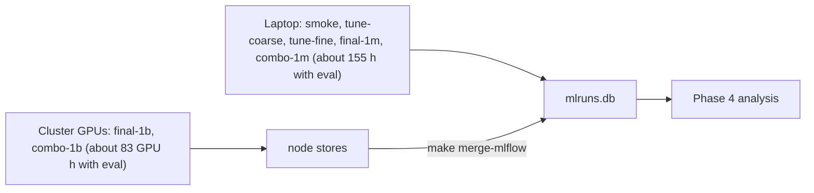

# Craftax compute budget

Status: ready

> **For agentic workers:** REQUIRED SUB-SKILL: Use superpowers:subagent-driven-development (recommended) or superpowers:executing-plans to implement this plan task-by-task. Steps use checkbox (`- [ ]`) syntax for tracking.

**Goal:** know how many runs each phase holds and how long training and evaluation take on the Apple M4 Pro laptop and on a CUDA GPU, and keep the numbers current as real throughput is measured.

**Architecture:** training totals are sums of the per-method tables in each method plan (steps per second x an overhead factor; laptop hours include 1 minute of compilation per run, GPU hours exclude it); evaluation time is added per method as eval steps per run (all its eval checkpoints) / the method's steps per second; training and evaluation are shown separately. All numbers are estimates until [[2026-10-20-craftax-infrastructure]] Task 7 and each method's smoke task measure real throughput.

**Tech Stack:** MLflow (measured steps/s per run), the method plans of [[2026-10-20-craftax-project]].

---

## Throughput assumptions

| Quantity | Value | Source |
|---|---|---|
| PPO on Craftax-Symbolic, 1024 envs, end to end, one CPU device | 2,068 steps/s (0.3M steps incl. compile) | measured 2026-10-20 |
| Rollout with an MLP policy, 8 CPU shards | 4,212 steps/s (one shard 2,917) | measured, [[Craftax CPU vs GPU performance]] |
| PPO planning value, 8 CPU shards | 3,000 steps/s | estimate |
| PPO on Craftax-Classic-Symbolic, `published-1m` shape (256 envs x 16 steps), CPU actor on 8 shards + Metal learner, training only (compile excluded) | 14,000 steps/s in the runner (median of `train/sps`: 13,800 and 14,000 over the 2 `smoke` runs); 15,300 steps/s in a standalone chunk-timed loop (7 runs, 13,900 to 16,100) | measured 2026-10-21, Classic, laptop |
| PPO compile, Classic, fresh process | 6.3 to 7.5 s (the runner's `compile_s` reads 3.2 to 3.5 s in `smoke`: the second run reused the first run's jit cache and the resumed run measured only its last segment); the 1-minute convention below is the Symbolic estimate | measured 2026-10-21, Classic, laptop |
| PPO end to end, Classic, 200k steps | 8,200 and 9,300 steps/s (train wall-clock with compile and state saves, no eval) | measured 2026-10-21, Classic, laptop |
| Step events (`info["events"]`) in the PPO step | not measurable: 15,300 steps/s with them against 15,200 with them replaced by zeros (6 and 7 alternating runs, noise 5%); compile +0.7 s | measured 2026-10-21, Classic, laptop |
| PPO-RNN and PQN-RNN planning value | 2,400 steps/s (0.8 x PPO) | estimate |
| CPU rollouts with metal updates | +4-5% end to end for a 256-wide MLP | measured |
| Authors' RTX 4090, PPO 1B | about 1 hour (266,961 steps/s end to end) | [[Craftax performance]] |

- Per-method overhead factors (estimates, from each method's design): PPO 1.0, PPO-RNN and PQN-RNN 1.25 over PPO, count bonus 1.05 over its base, self-imitation 1.3, SMDP skills 1.1, Dyna-Q 1.15, combination 1.3 (as self-imitation).
- Hours convention: laptop hours per run include the 1-minute compile; GPU hours per run exclude it, in this file and in every method plan.

## Evaluation assumptions

Evaluation follows [[2026-10-20-craftax-infrastructure]] Task 5 and the "Evaluation cost" rule of [[2026-10-20-craftax-evaluation-and-metrics]]: 64 fixed seeds x 2 modes (stochastic, greedy) = 128 episodes per checkpoint, in 1,000-step chunks until the last episode ends.

| Quantity | Value | Note |
|---|---|---|
| Eval checkpoints per run | tuning and smoke (`smoke`, `tune-coarse`, `tune-fine`): 1 (final); finals (`final-1m`, `final-1b`, `combo-1m`, `combo-1b`): 13 (update 0 + 11 log-spaced + the last, `checkpoint_schedule`) | |
| Longest eval episode L, rounded up to the chunk | 1,000 steps at 1M and on Classic; 8,000 steps averaged over the 13 checkpoints of a 1B run | estimate |
| Eval steps per run | tuning and smoke: 128 x 1,000 = 128,000; `final-1m`, `combo-1m`: 13 x 128,000 = 1,664,000; `final-1b`, `combo-1b`: 13 x 128 x 8,000 = 13,312,000 | |
| Measured, Classic, laptop (2026-10-21) | 128 episodes (64 seeds x 2 modes) = 128,000 steps per checkpoint, as above: the 1,000-step chunk is never exceeded (longest eval episode 393 steps; about 18,900 steps actually played per checkpoint); steady state 0.9 s per mode, about 70,000 steps/s of the 64,000 padded (about 11,000 on the steps actually played, greedy), plus 2.6 s once per run (the `EvalRun` jit load); eval runs as 2 batches of 64 seeds on 8 CPU shards, not one 128-env batch | measured |
| Eval throughput | the method's training planning throughput on the laptop (both modes as one 128-env batch); cluster runs are costed at the same laptop rate, because the GPU eval rate of a 128-env batch is not measured | estimate, conservative on the cluster |

## Runs per phase

Seeds: 3 per config in tuning, 10 in `final-1m` and `combo-1m`, 3 in `final-1b` and `combo-1b` ([[Experiment decisions]], 2026-10-21).

| Method | `smoke` | `tune-coarse` | `tune-fine` | `final-1m` | `final-1b` | `combo-1m` | `combo-1b` | Runs |
|---|---|---|---|---|---|---|---|---|
| [[2026-10-20-craftax-method-ppo]] | 2 | 28 (7 configs, published config at 10 seeds) | 12 | 10 | 3 | - | - | 55 |
| [[2026-10-20-craftax-method-ppo-rnn]] | 2 | 31 (8 configs) | 12 | 10 | 3 | - | - | 58 |
| [[2026-10-20-craftax-method-pqn-rnn]] | 2 | 30 (10 configs) | 12 | 10 | 3 | - | - | 57 |
| [[2026-10-20-craftax-method-count-bonus]], 2 variants | 4 | 144 (24 configs each) | 30 | 30 (incl. SimHash ablation) | 6 | - | - | 214 |
| [[2026-10-20-craftax-method-sil]] | 2 | 54 (18 configs) | 24 | 20 (incl. buffer ablation) | 3 | - | - | 103 |
| [[2026-10-20-craftax-method-smdp-skills]] | 2 | 144 (48 configs) | 24 | 40 (incl. 3 ablations) | 3 | - | - | 213 |
| [[2026-10-20-craftax-method-dyna-q]] | 2 | 63 (21 configs) | 24 | 20 (incl. kappa ablation) | 3 | - | - | 112 |
| Combination of the best two (Phase 3) | - | - | - | - | - | 10 | 3 | 13 |
| **Total** | 16 | 494 | 138 | 140 | 24 | 10 | 3 | **825** |

- The [[2026-10-20-craftax-method-pqn-rnn]] 1M reference-code check adds 3 runs of the original script outside the queue (about 0.4 laptop hours, counted in the PQN-RNN row below, no fixed-seed evaluation).

## Laptop time (sequential, hours, estimates)

Sums of the method plans' tables (training, with compile) and evaluation bullets. The "1M finals" and "1B finals" columns hold `final-1m` and `final-1b`; for the combination row they hold `combo-1m` and `combo-1b`.

| Method | Training: `smoke` + tuning | Training: 1M finals | Training: 1B finals | Eval: `smoke` + tuning | Eval: 1M finals | Eval: 1B finals | Total |
|---|---|---|---|---|---|---|---|
| PPO | 4.4 | 1.1 | 277.8 | 0.5 | 1.5 | 3.7 | 289.1 |
| PPO-RNN | 5.7 | 1.3 | 347.3 | 0.6 | 1.9 | 4.6 | 361.5 |
| PQN-RNN (incl. 0.4 reference-code check) | 6.0 | 1.3 | 347.3 | 0.6 | 1.9 | 4.6 | 361.8 |
| Count bonus, 2 variants | 24.1 | 4.1 | 729.3 | 2.7 | 6.1 | 9.7 | 776.1 |
| Self-imitation | 13.1 | 3.3 | 451.4 | 1.5 | 5.0 | 6.0 | 480.4 |
| SMDP skills | 24.2 | 5.8 | 382.0 | 2.7 | 8.5 | 5.1 | 428.3 |
| Dyna-Q | 13.1 | 3.0 | 399.4 | 1.5 | 4.4 | 5.3 | 426.7 |
| Combination (`combo-1m`, `combo-1b`; overhead 1.3, estimate) | - | 1.7 | 451.4 | - | 2.5 | 6.0 | 461.6 |
| **Total** | **90.7** | **21.7** | **3,385.9** | **10.2** | **31.9** | **45.1** | **3,585.4** |

- Totals are summed before rounding, so a column of rounded rows can differ from its total by 0.1.
- Everything at 1M (smoke, tuning, `final-1m`, `combo-1m`) is about 154.5 laptop hours (about 6.4 days): 112.4 h training and 42.1 h evaluation.
- Evaluation at 1M is dominated by the 13 checkpoints of each 1M final run (1,664,000 eval steps against 1M training steps); a tuning run adds 128,000 eval steps.
- One 1B run is about 93 hours (PPO) to 150 hours (self-imitation, combination) of training on the laptop, plus 1.2 (PPO) to 2.0 hours (self-imitation, combination) of evaluation.

## 1B finals on a CUDA GPU (authors' hardware, estimates)

Training hours per run exclude the 1-minute compile; eval hours are counted at the laptop rate (Evaluation assumptions).

| Method | Training hours per run | Eval hours per run | 3 seeds, training + eval |
|---|---|---|---|
| PPO | 1.04 | 1.23 | 6.8 |
| PPO-RNN, PQN-RNN | 1.30 each | 1.54 each | 8.5 each |
| Count bonus | 1.37 per variant | 1.62 per variant | 17.9 for both |
| Self-imitation | 1.69 | 2.00 | 11.1 |
| SMDP skills | 1.43 | 1.69 | 9.4 |
| Dyna-Q | 1.50 | 1.77 | 9.8 |
| Combination (`combo-1b`) | 1.69 | 2.00 | 11.1 |
| **Total** | | | **about 83 GPU hours** (38.0 training + 45.1 eval) |

- `final-1b` is about 72 GPU hours (33.0 training + 39.1 eval) and `combo-1b` about 11 (5.1 + 6.0).
- Seeds are independent runs: with k GPUs the 1B wall-clock is about 83 / k hours.

## Mix of machines

- Same run names everywhere, so any phase can move between laptop and cluster ([[Experiment decisions]]).

### Task 1: Replace estimates with measurements

**Files:**
- Modify: this file, the "Runs and laptop time estimate" table of each method plan

- [ ] **Step 1:** after [[2026-10-20-craftax-infrastructure]] Task 7 and each method's smoke task, read each method's mean steps/s and eval steps per checkpoint (longest of the 128 eval episodes) from the `smoke` runs (`make status PHASE=smoke`, then the runs in `make mlflow`).
- [ ] **Step 2:** recompute every table with the measured values (laptop hours with compile, GPU hours without); mark them "measured".
- [ ] **Step 3:** after `tune-coarse` of each method, recheck its overhead factor against the PPO-RNN or PQN-RNN base and the eval episode length at its final checkpoint; after the first `final-1b` run, replace the 1B eval assumptions with its measured eval time.
