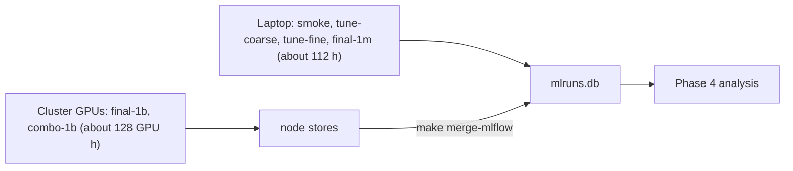

# Craftax compute budget

Status: draft

> **For agentic workers:** REQUIRED SUB-SKILL: Use superpowers:subagent-driven-development (recommended) or superpowers:executing-plans to implement this plan task-by-task. Steps use checkbox (`- [ ]`) syntax for tracking.

**Goal:** know how many runs each phase holds and how long they take on the Apple M4 Pro laptop and on a CUDA GPU, and keep the numbers current as real throughput is measured.

**Architecture:** totals are sums of the per-method tables in each method plan; each table uses steps per second x an overhead factor + 1 minute of compilation per run. All numbers are estimates until [[2026-10-20-craftax-infrastructure]] Task 7 measures real throughput.

**Tech Stack:** MLflow (measured steps/s per run), the method plans of [[2026-10-20-craftax-project]].

---

## Throughput assumptions

| Quantity | Value | Source |
|---|---|---|
| PPO on Craftax-Symbolic, 1024 envs, end to end, one CPU device | 2,068 steps/s (0.3M steps incl. compile) | measured 2026-10-20 |
| Rollout with an MLP policy, 8 CPU shards | 4,212 steps/s (one shard 2,917) | measured, [[Craftax CPU vs GPU performance]] |
| PPO planning value, 8 CPU shards | 3,000 steps/s | estimate |
| PPO-RNN and PQN-RNN planning value | 2,400 steps/s (0.8 x PPO) | estimate |
| CPU rollouts with metal updates | +4-5% end to end for a 256-wide MLP | measured |
| Authors' RTX 4090, PPO 1B | about 1 hour (266,961 steps/s end to end) | [[Craftax performance]] |

- Per-method overhead factors (estimates, from each method's design): PPO 1.0, PPO-RNN and PQN-RNN 1.25 over PPO, count bonus 1.05 over its base, self-imitation 1.3, SMDP skills 1.1, Dyna-Q 1.15.

## Runs per phase

| Method | `smoke` | `tune-coarse` | `tune-fine` | `final-1m` | `final-1b` | Runs |
|---|---|---|---|---|---|---|
| [[2026-10-20-craftax-method-ppo]] | 2 | 28 (7 configs, published config at 10 seeds) | 12 | 10 | 10 | 62 |
| [[2026-10-20-craftax-method-ppo-rnn]] | 2 | 31 (8 configs) | 12 | 10 | 10 | 65 |
| [[2026-10-20-craftax-method-pqn-rnn]] | 2 | 30 (10 configs) | 12 | 10 | 10 | 64 |
| [[2026-10-20-craftax-method-count-bonus]], 2 variants | 4 | 144 (24 configs each) | 30 | 30 (incl. SimHash ablation) | 20 | 228 |
| [[2026-10-20-craftax-method-sil]] | 2 | 54 (18 configs) | 24 | 20 (incl. buffer ablation) | 10 | 110 |
| [[2026-10-20-craftax-method-smdp-skills]] | 2 | 144 (48 configs) | 24 | 40 (incl. 3 ablations) | 10 | 220 |
| [[2026-10-20-craftax-method-dyna-q]] | 2 | 63 (21 configs) | 24 | 20 (incl. kappa ablation) | 10 | 119 |
| Combination of the best two (Phase 3) | - | - | - | 10 | 10 | 20 |
| **Total** | 16 | 494 | 138 | 150 | 90 | **888** |

## Laptop time (sequential, hours, estimates)

| Method | Up to `final-1m` | `final-1b` | Total |
|---|---|---|---|
| PPO | 5.5 | 926.1 | 931.6 |
| PPO-RNN | 7.0 | 1,157.6 | 1,164.6 |
| PQN-RNN | 6.9 | 1,157.6 | 1,164.5 |
| Count bonus, 2 variants | 28.3 | 2,430.8 | 2,459.1 |
| Self-imitation | 16.4 | 1,504.8 | 1,521.2 |
| SMDP skills | 30.0 | 1,273.3 | 1,303.3 |
| Dyna-Q | 16.1 | 1,331.2 | 1,347.3 |
| Combination (overhead 1.3, estimate) | 1.7 | 1,504.8 | 1,506.5 |
| **Total** | **111.9** (about 4.7 days) | **11,286** (about 470 days) | **11,398** |

- Everything up to and including `final-1m` (all tuning and 1M finals) is about 112 laptop hours.
- One 1B run is about 93 hours (PPO) to 150 hours (combination) on the laptop.

## 1B finals on a CUDA GPU (authors' hardware, estimates)

| Method | Hours per run | 10 seeds |
|---|---|---|
| PPO | 1.04 | 10.4 |
| PPO-RNN, PQN-RNN | 1.30 each | 13.0 each |
| Count bonus | 1.38 per variant | 27.6 for both |
| Self-imitation | 1.71 | 17.1 |
| SMDP skills | 1.45 | 14.5 |
| Dyna-Q | 1.51 | 15.1 |
| Combination | about 1.7 | about 17 |
| **Total** | | **about 128 GPU hours** |

- Seeds are independent runs: with k GPUs the 1B wall-clock is about 128 / k hours.

## Mix of machines

- Same run names everywhere, so any phase can move between laptop and cluster ([[Experiment decisions]]).

### Task 1: Replace estimates with measurements

**Files:**
- Modify: this file, the "Runs and laptop time estimate" table of each method plan

- [ ] **Step 1:** after [[2026-10-20-craftax-infrastructure]] Task 7, read each method's mean steps/s from the `smoke` runs in MLflow (`make status PHASE=smoke`).
- [ ] **Step 2:** recompute every table with the measured values; mark them "measured".
- [ ] **Step 3:** after `tune-coarse` of each method, recheck its overhead factor against the PPO-RNN or PQN-RNN base.
