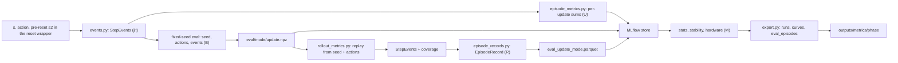

# Craftax evaluation and metrics implementation plan

Status: ready

> **For agentic workers:** REQUIRED SUB-SKILL: Use superpowers:subagent-driven-development (recommended) or superpowers:executing-plans to implement this plan task-by-task. Steps use checkbox (`- [ ]`) syntax for tracking.

**Goal:** every number the project reports (scoreboard score, learning stability, hardware usage and twelve in-game metric families) has one definition below, one implementation in `src/wut_murl_craftax/evaluation/`, a test, and reaches MLflow and `outputs/metrics/` in the same way for every method in [[2026-10-20-craftax-project]].

**Architecture:** three layers. (1) `evaluation/events.py` defines the `StepEvents` fields and `step_events(game, s, action, s2)`, which turns an env state, the action and the next state into a fixed-size record inside `jit`, for Craftax and Craftax-Classic; the optimistic-reset wrapper (`training/wrappers.py`, [[2026-10-20-craftax-method-ppo]] Task 2) calls it on the pre-reset next state of every step and returns it in `info["events"]`, so an unlock on a done step is never lost and nothing compares states across a done step. (2) `evaluation/episode_metrics.py` (created by Task 4 of [[2026-10-20-craftax-infrastructure]] for the score and achievements) sums the cheap events online per training update (Task 3 adds the other families); the fixed-seed evaluation of infrastructure Task 5 (`visualisation/eval_rollouts.py`, the only eval module) stores seed, actions and events per episode; `evaluation/rollout_metrics.py` replays those episodes offline and computes every family, including the expensive ones (order, coverage, cause of death). (3) `evaluation/stats.py`, `stability.py`, `hardware.py` and `export.py` read the MLflow store and write tidy tables for [[2026-10-20-craftax-comparison-and-results]]. Reward and benchmark facts: [[Craftax scoring and evaluation]], [[Craftax Baselines benchmark protocol]]; game rules: [[Game]].

**Tech Stack:** JAX 0.11, craftax 1.6.1, numpy, pandas + pyarrow (parquet), scipy (Mann-Whitney U, trimmed mean), MLflow (SQLite store), mlflow-sysmetrics, existing `visualisation.rollout` (replay) and `visualisation.eval_rollouts` (stored eval episodes, reworked by infrastructure Task 5), `training.wrappers` (`info["events"]`).

Data flow from env states to tables (letters U, E, R, M as in "Metric definitions"):

## Evaluation protocol

- Benchmarks: Craftax-1M and Craftax-1B, both on `Craftax-Symbolic-v1`, budget = env steps summed over all parallel envs.
- Craftax-Classic (`Craftax-Classic-Symbolic-v1`, max reward 22) is for debugging and the video warm-up only; it never shares a results table with Craftax.
- Scoreboard metric: training-episode return as % of 226 (returns of episodes played by the stochastic training policy, health term included).
- Per-update score: mean return of the training episodes that finished in that update, as % of 226.
- Final score of a run (decided, [[Experiment decisions]]): mean training-episode return as % of 226 over the episodes that finished in the last 2% of the budget (1B: last 20M steps; 1M: last 20k steps), widened backwards until at least 100 episodes are included; the fixed-seed evaluation of the final checkpoint (both modes) is reported alongside it, never in its place.
- Fixed-seed evaluation: 64 eval seeds `10000` to `10063`, the same for every checkpoint, method and benchmark.
- Eval keys follow [[Recording training data]] (`fold_in` scheme); envs use `auto_reset=False`; each episode runs until it ends (death, boss win or the 100,000-step cap; 10,000 on Classic).
- Two eval modes: stochastic (action sampled with key `fold_in(k_act, t)`) and greedy (argmax of the policy); the policy of any method (feed-forward, recurrent, PQN, two-level skill policy) comes from `METHODS[cfg["method"]]` through `Policy.init_carry` and `Policy.step` ([[2026-10-20-craftax-infrastructure]] Tasks 3 and 5), and every eval file is labelled with its method.
- Run until done: a jitted scan of 1,000 steps per chunk over all seeds, repeated until every seed's episode has ended (at most the cap); no episode is cut.
- Eval schedule: tuning runs (`smoke`, `tune-coarse`, `tune-fine`) evaluate their final checkpoint only; final runs (`final-1m`, `final-1b`, `combo-1m`, `combo-1b`) evaluate every log-spaced checkpoint of [[Recording training data]] (13 per run: update 0, 11 log-spaced updates and the last update); both modes each time.
- Stored per (checkpoint, mode) in `eval/<mode>/<update>.npz`: seeds, actions (padded with -1 after the end), the per-step `StepEvents` and the episode lengths only; observations, action probabilities, values and states are rebuilt by replaying seed + actions, never stored (an observation is 8268 float16 values, about 16.5 kB per step, against about 40 bytes of actions and events).
- Held-out seeds `20000` to `20063` are reserved for [[2026-10-20-craftax-interpretation-and-ruleset]] and never used for selection.
- Tuning: at Craftax-1M, coarse grid then fine grid, 3 seeds per config, ranked by final score ([[Experiment decisions]]; run counts in [[2026-10-20-craftax-compute-budget]]).
- Finals: 10 seeds per method at Craftax-1M (`final-1m`, `combo-1m`) and 3 seeds at Craftax-1B (`final-1b`, `combo-1b`; [[Experiment decisions]], 2026-10-21); the three controls (PPO, PPO-RNN, PQN-RNN), every method and the combination of the two best methods (`combo-1m`, `combo-1b`) run through the same runner, eval and export; each method is compared against its base control.
- Literature comparisons stay inside one block of [[Existing Implementations]]: training-episode score against block A (1B) and block D (1M); stochastic fixed-seed eval against block A2.
- Every table gives raw return beside % of 226 and the Craftax version (1.6.1, [[Craftax versions and dependencies]]).

## Evaluation cost

Eval time is part of the budget ([[2026-10-20-craftax-compute-budget]]); all values are estimates until the smoke phase measures them.

- Eval steps of one checkpoint = 64 seeds x 2 modes x L, where L is the longest episode among them rounded up to the 1,000-step chunk; planning values: L = 1,000 at 1M and on Classic (agents of 1M runs and of early checkpoints die within a few hundred steps), L = 8,000 averaged over the 13 checkpoints of a 1B run.
- Eval steps per run: tuning and smoke runs 128 x 1,000 = 128,000; `final-1m` 13 x 128,000 = 1,664,000; `final-1b` 13 x 128 x 8,000 = 13,312,000.
- Eval hours = eval steps per run (which already counts its checkpoints) / steps per second, at the method's training planning throughput (both modes run as one 128-env batch); cluster runs are costed at the laptop rate (GPU eval throughput of a 128-env batch not measured).
- Every method plan lists its eval hours under its run table; controls: PPO 5.7 h (2.0 h up to `final-1m`, 1.23 h per `final-1b` run); PPO-RNN 7.2 h and PQN-RNN 7.2 h (2.6 h up to `final-1m`, 1.54 h per `final-1b` run each); totals in [[2026-10-20-craftax-compute-budget]].
- Risk: a greedy policy that survives without progress plays to the 100,000-step cap; one such seed makes that checkpoint cost 128 x 100,000 = 12.8M steps (about 1.2 h at 3,000 steps/s).

## Statistics protocol

- Unit: one run (method, benchmark, seed) contributes one final score.
- Seeds: 10 at Craftax-1M, 3 at Craftax-1B; 1B comparisons are indicative, and probability-of-improvement and Holm-corrected significance claims are made at 1M only.
- Point estimates at 1M: mean with standard error over seeds (the scoreboard convention) and IQM, the mean of the middle 50% of runs (`scipy.stats.trim_mean(x, 0.25)`).
- Point estimates at 1B: mean with standard error and median (with 3 seeds the IQM equals the median, so no IQM is reported).
- Confidence intervals: stratified bootstrap, 10,000 resamples, seeds resampled with replacement inside each (method, benchmark) stratum, percentile 95% interval, bootstrap seed 0; at 1B (3 seeds) the t-based 95% interval of the mean is reported beside it, because a bootstrap over 3 values has at most 10 distinct resamples.
- Aggregate: IQM of the pooled normalised scores at 1M, resampled per stratum; no aggregate across the two benchmarks, since 1B has only 3 seeds.
- Probability of improvement at 1M: `P(X > Y) = 1/(n m) * sum_i sum_j [1(x_i > y_j) + 0.5 * 1(x_i = y_j)]`; CI from the same stratified bootstrap; at 1B the 3 x 3 comparison counts are shown as context, without CI.
- Significance at 1M: two-sided Mann-Whitney U per (method, control) pair, Holm-Bonferroni over every pair in one table, alpha 0.05 (with 3 seeds per side a two-sided Mann-Whitney U cannot reach 0.05, so no test is run at 1B); methods that use hand-written skills form their own block with its own Holm family ([[2026-10-20-craftax-comparison-and-results]]).
- Literature values without a spread: report whether our 95% CI lies above, contains or lies below the published number; no p-value.
- Tuning runs (3 seeds) give rankings and sensitivity only, never significance claims.
- Learning curves: on a common env-step grid (200 points, log-spaced for the first 5%), mean and 95% bootstrap band over seeds; IQM curve as the robust variant.
- Method follows Agarwal et al. 2021, "Deep reinforcement learning at the edge of the statistical precipice" (bibliography entry in [[2026-10-20-craftax-report]]).

## Metric definitions

When: **U** = online per training update (inside the trainer, from `events.py`); **E** = per fixed-seed eval, from the stored eval arrays; **R** = offline from replayed eval episodes (`rollout_metrics.py`); **M** = from the MLflow store after the run.

State notation: `s` before the action, `s2` after it (in training the pre-reset next state, taken inside the reset wrapper before a done env is replaced), field names of the Craftax `EnvState`; the Classic adapter maps `zombies`, `skeletons`, `cows`, `arrows` onto the same slots and fixes the floor at 0.

### Shared step events (`events.py`)

| Event | Definition | Source fields |
|---|---|---|
| Unlock of achievement `a` | `s2.achievements[a] & ~s.achievements[a]` | `achievements` |
| Floor | `s2.player_level` | `player_level` |
| Health change | `s2.player_health - s.player_health` (the reward is the tier weights of the unlocks plus 0.1 x this) | `player_health` |
| Health loss | `max(0, s.player_health - s2.player_health)` | `player_health` |
| Needs drain | the `player_recover` counter crossed its lower threshold this step and health fell by 1 ([[Craftax survival stats]]) | `player_recover`, `player_food`, `player_drink`, `player_energy` |
| Combat damage taken | health loss minus needs drain, clipped at 0 | as above |
| Damage source | adjacent melee mob, else adjacent enemy projectile, else lava under the player (Classic), else unknown; creature from `type_id` | `melee_mobs`, `ranged_mobs`, `mob_projectiles`, `map`, `player_position` |
| Kill of creature type `k` | a mob slot on the player's floor with `mask` 1 in `s`, 0 in `s2` and `health <= 0`; despawns (health > 0) excluded; passive kills counted apart | `melee_mobs`, `ranged_mobs`, `passive_mobs` |
| Damage dealt | sum over mob slots on the player's floor of `max(0, s.health - s2.health)` | mob arrays |
| Projectile damage | damage dealt to a mob hit by a player projectile this step | `player_projectiles` |
| Eat, drink, sleep start | `player_food` rose; `player_drink` rose; `is_sleeping` rising edge | intrinsics |
| Stat low, stat zero | food, drink or energy `<= 2`; `== 0` in `s2` | intrinsics |
| Forced NOOP | `s.is_sleeping` or `s.is_resting` (the game replaces the action, [[Craftax action effects]]) | flags |
| Effective action | a digest of position, direction, inventory, the map and item map of the player's floor, mob health on the floor, player projectiles, floor, learned spells, enchantments, XP, attributes, food, drink, sleeping and resting differs between `s` and `s2` | as listed |
| Wasted action | not effective, not `NOOP`, not forced | as above |
| Hostiles on screen, close | melee + ranged mobs + enemy projectiles inside the 9 x 11 view (7 x 9 Classic); hostiles within 2 tiles ([[Highlight detection]]) | mob arrays, `player_position` |

Deviations of `evaluation/events.py` (2026-10-21, justified by the state the game leaves):

- Damage source: lava under the player is ranked before any hit (Classic sets health to 0 on lava).
- Damage dealt: a killed slot counts its remaining health, so overkill is excluded.
- Kill: a live slot dead in `s2` or refilled by a spawn in the same step (jumped more than one tile, or gained health); slots at despawn distance (14, never on the boss floor) are excluded. Replaces the `health <= 0` test: a spawn can refill a killed slot in the same step, and a despawn also clears a slot.
- Projectile damage: damage dealt to a slot off the `DO` target tile, so melee hits are not counted.
- Effective action: only rises of food, drink and energy, a fall of mana and newly fired player projectiles count as stat changes.
- `kills` counts hostile (melee and ranged) creatures only; `passive_kills` counts the rest.
- Achievements are indexed by the enum's `.value`.

### Scoreboard and basics

| Metric | Definition | Source | When |
|---|---|---|---|
| Score | return / 226 x 100 (Classic: / 22) | rewards | U, E |
| Final score | rule in the protocol above | per-update returns | M |
| Success rate per achievement | % of finished episodes that unlocked it, same semantics as `Achievements/<name>` | `achievements` at episode end | U, E |
| Achievements per episode | count of unlocked achievements at episode end | `achievements` | U, E |
| Achievement reward share | sum of tier rewards of unlocked achievements / return | `achievements`, rewards | U, E |
| Crafter score (Classic only) | `exp(mean_a log(1 + s_a)) - 1` over success rates `s_a` in % | success rates | M |

### Learning stability

| Metric | Definition | Source | When |
|---|---|---|---|
| Seed spread | sd, IQR and range of final scores across seeds; coefficient of variation sd / mean | final scores | M |
| IQM with 95% CI (1M), median and mean with 95% CI (1B) | statistics protocol | final scores | M |
| Probability of improvement | statistics protocol, each method against each control and each other method | final scores | M |
| Smoothed curve `c_t` | rolling median of the per-update score over a window of 1% of the budget | per-update score | M |
| Drawdown | `d_t = (m_t - c_t) / m_t` with `m_t = max over u <= t of c_u`, only where `m_t >= 1` (% of max) | `c_t` | M |
| Drop | maximal interval with `d_t >= 0.2` lasting at least 2% of the budget; count per run | `d_t` | M |
| Collapse | `d_t >= 0.5` at some `t` and the final `c_T < 0.9 m_T`; reported as the share of runs | `d_t` | M |
| Recovery time | env steps from the start of a drop until `d_t < 0.05` | `d_t` | M |
| Within-run dispersion | IQR of the first differences of `c_t` | `c_t` | M |
| Config score `r_c` | mean final score of config `c` over its 3 seeds / best config mean | tuning runs | M |
| Robust share | share of configs with `r_c >= 0.9` | `r_c` | M |
| Sensitivity of hyperparameter `h` | `S_h = max_v mean(r_c : h = v) - min_v mean(r_c : h = v)` | `r_c` | M |
| Noise floor | mean within-config seed sd / best config mean; `S_h` below it reads "insensitive" | tuning runs | M |

### Hardware usage

Compared only between runs with the same `profile` tag (profiles loaded by `orchestration/profiles.py`, [[2026-10-20-craftax-infrastructure]] Tasks 2 and 6).

| Metric | Definition | Source | When |
|---|---|---|---|
| Wall-clock | cumulative `wall_s` at the last update, summed across resume segments by the runner | `wall_s` | U, M |
| Steady SPS | env steps from update 10 to the last update / `wall_s` between them | `env_steps`, `wall_s` | U |
| Overall SPS | budget / wall-clock, including compilation, evaluation and checkpoints | as above | M |
| Compile time | `wall_s` at the first finished update minus the median update time | `wall_s` per update | U |
| Eval time | total seconds spent in fixed-seed evaluation | runner timer | U |
| CPU and GPU utilisation | mean and p95 of the mlflow-sysmetrics utilisation series | `system/*` metrics | M |
| Memory | peak host RSS (`psutil`) and peak device memory series | `system/*`, runner | U, M |
| Steps per joule | budget / energy, energy = trapezoid integral of every logged power series over the run; "n.m." when no power series exists | `system/*power*` | M |
| Device | tags `profile`, `device_kind`, `actor_device`, `learner_device` (never host names) | runner tags | M |

### In-game metric families

| Family | Definition | Source fields | When |
|---|---|---|---|
| First-unlock race | per run and achievement: env steps and `wall_s` of the first update in which any training env unlocks it; per method: median over seeds and k of n seeds that unlocked it; winner = lowest median among methods with k >= n / 2 (5 of 10 at 1M, 2 of 3 at 1B), one winner in env steps and one in wall-clock (same profile only) | unlock events of all training envs | U |
| Achievement order graph | per episode the unlock step `u(a)`; `P(a before b)` = share of episodes with both unlocked where `u(a) < u(b)`; nodes = achievements unlocked in >= 5% of episodes; edge `a -> b` when `P >= 0.9` and both co-occur in >= 20 episodes, drawn after transitive reduction; normalised rank `rho(a) = (rank - 1) / (n_unlocked - 1)`; built per eval checkpoint (over training) and for the final checkpoint per run and method | unlock events | R |
| Order agreement | Kendall tau-b between two methods' mean `rho` on shared nodes; Jaccard index of their edge sets; training order = achievements sorted by first-unlock env steps | order graphs, race | M |
| Progress funnel | share of episodes with tech depth >= k on the ladder wood, table, wood pickaxe, stone, stone pickaxe, furnace, iron, iron pickaxe, diamond, diamond pickaxe (Classic stops at diamond); share with max floor >= f for f = 0 to 8 ([[Craftax floors and progression]]) | `achievements` at episode end, max `player_level` | U, E |
| End type | death (`player_health <= 0`), timeout (100,000 steps; 10,000 Classic), budget cut (training only, excluded) | `player_health`, `timestep` | U, E |
| Cause of death | source with the largest health loss in the last 20 steps: starvation, dehydration or exhaustion (needs drain, split by which stat is 0), melee or projectile by creature type, lava (Classic), unknown | step events | U (counts), R (records) |
| Stall | gap of >= 300 steps between consecutive unlocks, or from the episode start to the first unlock | unlock events | U (count per episode), R (records) |
| Stall record | length, floor, stats and inventory at the start, ending (unlock, death, timeout), the achievement that ended it, actions histogram inside the stall | step events | R |
| Speedrun splits | steps from the episode start to the first unlock of each funnel milestone and of each `ENTER_*` achievement; median and IQR over episodes that reached it, plus the share that reached it | unlock events | R |
| Exploration coverage | `seen_f` = tiles of floor `f` inside the view window with `light_map > 0.05` at some step; coverage = `|seen_f|` / map tiles (48 x 48 Craftax, `static_params.map_size` Classic) | `player_position`, `player_level`, `light_map` | R |
| New tiles per 100 steps | `100 * delta |seen| / delta t` over consecutive 100-step windows | coverage state | R |
| Revisit rate | share of steps whose `player_position` was already visited on that floor in the episode; plus unique positions visited | `player_position`, `player_level` | R |
| Survival management | per stat (food, drink, energy): share of alive steps low and zero; mean stat value at each eat, drink and sleep start; steps between consecutive drinks and meals | intrinsics, `is_sleeping` | U (shares), R (timing) |
| Close calls | health `<= 2` while the episode continues for >= 50 more steps; recovered when health later reaches >= 5 | `player_health` | U, R |
| Combat profile | kills per creature type per episode and per 1000 steps; damage dealt and taken per episode | step events | U |
| Fights | maximal runs of steps with >= 2 hostiles on screen and >= 1 within 2 tiles, gaps under 5 steps bridged: count, max enemies, damage taken, outcome (survived, died inside the fight) | step events | R |
| Ranged combat | effective `SHOOT_ARROW`, `CAST_FIREBALL`, `CAST_ICEBALL` per episode; projectile damage / damage dealt | actions, step events | R |
| Action usage | histogram over alive, non-forced steps (43 actions; 17 Classic); empirical entropy `H = -sum p log p` in nats; wasted share; `NOOP` share; forced-`NOOP` share; the policy's own entropy comes from the training metrics (`ppo/entropy`, `train/action_entropy`), not from eval files | actions, effective flag | U, E |
| Resource efficiency | gathered = sum of positive inventory increments of wood, stone, coal, iron, diamond, sapphire, ruby, sapling; used = sum of decrements; use ratio = used / gathered; steps per achievement = alive steps / unlocked achievements | `inventory` | R |
| Wasted crafts | crafting or placing actions that consumed resources without raising a tool, armour or item level beyond what was owned, plus tables placed with another table within crafting distance ([[Craftax crafting and placing]]) | `inventory`, `map` | R |
| Wood-to-diamond time | steps from the first `COLLECT_WOOD` to the first `COLLECT_DIAMOND`, episodes reaching diamond | unlock events | R |
| Advanced mechanics | per episode use counts and adoption (share of episodes with >= 1 use) of spells cast, books read, potions drunk per colour, sword, armour and bow enchantments, arrows made and shot, attribute level-ups ([[Craftax magic potions and enchanting]]); over training from the achievements `CAST_FIREBALL`, `CAST_ICEBALL`, `LEARN_FIREBALL`, `LEARN_ICEBALL`, `DRINK_POTION`, `ENCHANT_SWORD`, `ENCHANT_ARMOUR`, `MAKE_ARROW`, `FIRE_BOW` | actions, effective flag, `achievements` | U (achievements), R (counts) |
| Playstyle radar | one radar per method and benchmark from final-checkpoint stochastic eval episodes, 8 axes: Explorer = mean coverage of visited floors; Survivor = 1 - share of steps with any stat zero; Fighter = kills per 1000 steps; Crafter = mean tech depth; Diver = mean max floor; Efficient = achievements per 1000 steps; Mage = mean adoption of advanced mechanics; Precise = 1 - wasted share; each axis min-max scaled over all methods and controls of that benchmark | the families above | M |

---

Order with the other plans: Tasks 1-2 right after infrastructure Tasks 1-3 (the reset wrapper of [[2026-10-20-craftax-method-ppo]] Task 2 calls `step_events`); Task 3 after infrastructure Task 4 (Phase 0, online metrics); Tasks 4-11 can follow in Phase 4.

### Task 1: Milestones and game tables

**Files:**
- Create: `src/wut_murl_craftax/evaluation/milestones.py`
- Test: `tests/evaluation/test_milestones.py`

- [ ] **Step 1: Write the failing tests**: the Craftax tech ladder has 10 entries and the Classic ladder 9; every ladder name exists in that game's `Achievement` enum (index by `.value`, [[Rendering Craftax frames]] pitfall); tier rewards sum to 226; 9 floor names with their `ENTER_*` achievements; creature names per (class, `type_id`) match [[Craftax observations and actions]]; the radar axis list has 8 names.
- [ ] **Step 2: Implement** `TECH_LADDER`, `FLOORS`, `CREATURES`, `HOSTILE_CLASSES`, `ADVANCED_ACTIONS`, `RADAR_AXES` and `ladder(game)`.
- [ ] **Step 3: Run** `uv run pytest tests/evaluation/test_milestones.py -q`; expected: pass.

### Task 2: Per-step events for both games

**Files:**
- Create: `src/wut_murl_craftax/evaluation/events.py`
- Test: `tests/evaluation/test_events.py`

- [ ] **Step 1: Write the failing tests** on hand-edited states (pattern of the runtime checks in [[Game]]): one unlock bit after `PLACE_TABLE` with 2 wood; the same unlock on a step that also ends the episode (timestep at the cap) is still reported, because `step_events` only sees `s` and the terminal `s2`; floor 0 -> 1 after `DESCEND` on an open ladder; a starvation health loss counted as needs drain, not combat; a zombie hit counted as melee damage from type zombie; a skeleton killed by an arrow counted as a kill of type skeleton with projectile damage; eat, drink and sleep-start flags; walking into stone while already facing it is wasted, turning towards it is effective; any action while sleeping is a forced `NOOP`; Classic lava under the player is the damage source.
- [ ] **Step 2: Write the failing test**: `jax.vmap(step_events)` over 8 envs equals a Python loop over the same 8 envs.
- [ ] **Step 3: Implement** `StepEvents` (a `flax.struct` dataclass of fixed-size arrays, the one definition every user reads; the wrapper of [[2026-10-20-craftax-method-ppo]] Task 2 fills it) and `step_events(game, s, action, s2)` with one adapter per game. Fields (per env step):

| Field | Type | Meaning (table "Shared step events") |
|---|---|---|
| `unlocked` | bool[n_achievements] (67; Classic 22) | achievements unlocked by this step |
| `floor` | int8 | `s2.player_level` |
| `health_delta` | float32 | health change; with `unlocked` it rebuilds the reward |
| `health_loss`, `drain`, `combat_damage` | float16, bool, float16 | loss, needs drain, combat part |
| `damage_source` | int8 | source id (`CREATURES` of Task 1, lava, unknown) |
| `kills` | int8[len(CREATURES)] | kills per creature type; `passive_kills` int8 apart |
| `damage_dealt`, `projectile_damage` | float16 | as the table |
| `ate`, `drank`, `slept` | bool | eat, drink, sleep start |
| `stat_low`, `stat_zero` | bool[3] | food, drink, energy |
| `forced`, `effective` | bool | forced `NOOP`, effective action |
| `hostiles_on_screen`, `hostiles_close` | int8 | counts in the view, within 2 tiles |

Coverage needs `light_map` and positions, so it is computed in replay (Task 5), not stored in `StepEvents`.
- [ ] **Step 4: Run** `uv run pytest tests/evaluation/test_events.py -q`.

### Task 3: Online accumulation per update

**Files:**
- Modify: `src/wut_murl_craftax/evaluation/episode_metrics.py` (created by Task 4 of [[2026-10-20-craftax-infrastructure]])
- Test: `tests/evaluation/test_episode_metrics.py`

Infrastructure Task 4 logs the score and the achievements from the wrapper's `info["events"]`; this task adds every other online family from the same events.

- [ ] **Step 1: Write the failing tests** with a synthetic `StepEvents` stream over 3 envs and 2 episode ends: per-episode accumulators reset at `done`; per-update means count only finished episodes; a kill, an unlock and a health loss on the done step itself are counted in the episode that ended; the first-unlock vector keeps the earliest env step and never moves later; the summary keys equal `METRIC_KEYS`.
- [ ] **Step 2: Implement** the accumulators inside the rollout `scan`, reading only `info["events"]` and `done` (never two env states across a done), and the per-update summary; MLflow names: `train/score_pct`, `train/return`, `train/ach/<name>`, `train/funnel/depth_<k>`, `train/funnel/floor_<f>`, `train/end/<type>`, `train/death/<cause>`, `train/stalls_per_episode`, `train/survival/<stat>_{low,zero}`, `train/close_calls`, `train/kills/<creature>`, `train/damage_{dealt,taken}`, `train/action/<name>`, `train/action_entropy`, `train/wasted_share`, `train/adv/<mechanic>`.
- [ ] **Step 3: Implement** first unlocks as metrics `first_unlock/<name>` (step = env steps) and `first_unlock_wall/<name>` (value = `wall_s`), logged once per achievement.
- [ ] **Step 4: Measure** steady SPS with and without the accumulators on Craftax-Symbolic, 1024 envs, 20 updates, laptop profile; log `metrics_overhead_pct`; write the measured number under this task.
- [ ] **Step 5: Run** `uv run pytest tests/evaluation/test_episode_metrics.py -q`, then `make tests`.

### Task 4: Episode records from an event stream

**Files:**
- Create: `src/wut_murl_craftax/evaluation/episode_records.py`
- Test: `tests/evaluation/test_episode_records.py`

- [ ] **Step 1: Write the failing tests** on synthetic numpy event, action and trace arrays: end type death vs timeout; cause of death picks the largest loss over the last 20 steps and splits needs drain by the zero stat; a 400-step gap ended by an unlock is one escaped stall with the right ending achievement; speedrun splits equal the unlock steps; fights bridge gaps under 5 steps; gathered and used totals; a pickaxe crafted when a better one is owned counts as a wasted craft; wood-to-diamond time.
- [ ] **Step 2: Implement** `EpisodeRecord` (one dataclass, one row of the eval-episode table plus nested stall, fight and unlock lists) and `episode_record(events, actions, trace) -> EpisodeRecord` in plain numpy; `trace` holds the per-step state fields that replay rebuilds (inventory, intrinsics, health, position, floor, crafting-table positions near the player), since the stored eval files hold only actions and events.
- [ ] **Step 3: Run** `uv run pytest tests/evaluation/test_episode_records.py -q`.

### Task 5: Exploration coverage

**Files:**
- Create: `src/wut_murl_craftax/evaluation/coverage.py`
- Test: `tests/evaluation/test_coverage.py`

- [ ] **Step 1: Write the failing tests**: 10 steps right on an open overworld add exactly 10 new view columns; tiles with `light_map <= 0.05` on a dark floor are not counted; returning to a visited position raises the revisit count; coverage per floor is in [0, 1]; Classic uses its own map size.
- [ ] **Step 2: Implement** a jittable seen-mask update `(seen[floor, x, y], s2) -> seen` and `coverage_summary(seen, positions, floors)`.
- [ ] **Step 3: Run** `uv run pytest tests/evaluation/test_coverage.py -q`.

### Task 6: Offline metrics from stored eval episodes

**Files:**
- Create: `src/wut_murl_craftax/evaluation/rollout_metrics.py`
- Test: `tests/evaluation/test_rollout_metrics.py`

- [ ] **Step 1: Write the failing tests**: a Classic episode stored by `visualisation.eval_rollouts.evaluate` (infrastructure Task 5) and replayed from seed + actions gives `StepEvents` identical to the stored ones (a mismatch raises, naming run, update, mode and seed); the eval-episode table has the column schema `EPISODE_COLUMNS` and a `method` column; one row per (run, update, mode, seed).
- [ ] **Step 2: Implement** replay of `<run>/eval/<mode>/<update>.npz` in chunks of 256 steps (the `visualisation.rollout.replay` path, actions until each episode's `length`), the stored events checked against the replayed ones, the `trace` of Task 4 taken from the replayed states, coverage and records per episode, written to `outputs/metrics/<run>/eval_<update>_<mode>.parquet`.
- [ ] **Step 3: Implement** MLflow logging: the parquet files as artifacts under `eval_tables/`, per-mode summaries as `eval/<mode>/<metric>` with step = env steps of the checkpoint.
- [ ] **Step 4: Implement** the CLI `uv run python -m wut_murl_craftax.evaluation.rollout_metrics --run <run name> [--updates all|<u,...>] [--mode stochastic|greedy|both]`; it skips (run, update, mode) tables that already exist, so it is resumable.
- [ ] **Step 5: Run** `uv run pytest tests/evaluation/test_rollout_metrics.py -q`.

### Task 7: Statistics

**Files:**
- Create: `src/wut_murl_craftax/evaluation/stats.py`
- Modify: `pyproject.toml` (`uv add scipy pyarrow`, each with a justification comment)
- Test: `tests/evaluation/test_stats.py`

- [ ] **Step 1: Write the failing tests**: `iqm([1, ..., 8]) == 4.5`; probability of improvement is 0.5 for identical samples and 1.0 for disjoint ones; bootstrap CIs contain the point estimate and are identical for the same bootstrap seed; stratified resampling never mixes strata; Holm-Bonferroni on `[0.01, 0.04, 0.03]` gives `[0.03, 0.06, 0.06]`; Mann-Whitney matches `scipy.stats.mannwhitneyu` on a fixed case; `t_ci([10, 11, 12])` equals the t-based 95% interval 11 +- 2.484 (t 4.303 x s.e. 0.577).
- [ ] **Step 2: Implement** `iqm`, `mean_se`, `stratified_bootstrap_ci(scores_by_stratum, statistic, n=10_000, seed=0)`, `probability_of_improvement`, `mann_whitney_holm`, `t_ci`, `seed_spread`, `curve_band`.
- [ ] **Step 3: Run** `uv run pytest tests/evaluation/test_stats.py -q`.

### Task 8: Stability and hyperparameter sensitivity

**Files:**
- Create: `src/wut_murl_craftax/evaluation/stability.py`
- Test: `tests/evaluation/test_stability.py`

- [ ] **Step 1: Write the failing tests** on synthetic curves: a 60% fall that never recovers is one collapse; a 25% dip lasting 3% of the budget is one drop and no collapse; noise of 5% without dips gives no drop; recovery time of a known dip; on a toy 2 x 3 grid where only `lr` matters, `S_lr` is large and `S_other` is below the noise floor.
- [ ] **Step 2: Implement** `smoothed(curve, window_frac=0.01)`, `drawdowns`, `drops`, `collapsed`, `recovery_times`, `dispersion`, `sensitivity(tuning_table) -> DataFrame`.
- [ ] **Step 3: Run** `uv run pytest tests/evaluation/test_stability.py -q`.

### Task 9: Hardware summaries

**Files:**
- Create: `src/wut_murl_craftax/evaluation/hardware.py`
- Test: `tests/evaluation/test_hardware.py`

- [ ] **Step 1: Write the failing tests** on a temporary SQLite MLflow store with fake series: steady SPS, compile time, wall-clock across 2 resume segments, a constant 100 W for 10 s integrates to 1000 J, a run without power series gives NaN steps per joule.
- [ ] **Step 2: Run** the smoke phase ([[2026-10-20-craftax-infrastructure]], Task 7) on the laptop and on one cluster node, then `uv run python -m wut_murl_craftax.evaluation.hardware --list-keys --run <smoke run>`; write the logged `system/*` keys into `HARDWARE_KEYS` per profile.
- [ ] **Step 3: Implement** `hardware_summary(run) -> dict` for every hardware metric above.
- [ ] **Step 4: Run** `uv run pytest tests/evaluation/test_hardware.py -q`.

### Task 10: Export to tidy tables

**Files:**
- Create: `src/wut_murl_craftax/evaluation/export.py`
- Test: `tests/evaluation/test_export.py`

- [ ] **Step 1: Write the failing tests** on a temporary store with 2 methods x 2 seeds: `runs.parquet` has one row per run with the runner tags (`method`, `budget`, `phases`, `seed`, `config_hash`, `profile`), final score by the 2% rule, final eval scores per mode and the hardware summary; `curves.parquet` is long format (run, env_steps, metric, value); `eval_episodes.parquet` concatenates the Task 6 tables.
- [ ] **Step 2: Implement** `export_phase(phase, out_dir)` and the CLI `uv run python -m wut_murl_craftax.evaluation.export --phase <phase> --out outputs/metrics/<phase>`; CSV copies beside every parquet file.
- [ ] **Step 3: Implement** MLflow logging of the exported folder as artifacts of run `export-<phase>` in experiment `analysis`; runs belong to a phase by the MLflow tag `phases` ([[2026-10-20-craftax-infrastructure]] Task 2), so a run reused by a later phase is exported with each phase that lists it.
- [ ] **Step 4: Run** `uv run pytest tests/evaluation/test_export.py -q`.
- [ ] **Step 5: Run** after Phase 3, for each phase: `for p in tune-coarse tune-fine final-1m final-1b combo-1m combo-1b; do uv run python -m wut_murl_craftax.evaluation.export --phase $p --out outputs/metrics/$p; done`; `outputs/metrics/<phase>/runs.parquet` lists the three controls in every final phase.

### Task 11: End-to-end check on the smoke phase

**Files:**
- Create: `knowledge/architecture/evaluation.md` (template `knowledge/_templates/module.md`)

- [ ] **Step 1: Run** `make queue PHASE=smoke`, then `uv run python -m wut_murl_craftax.evaluation.rollout_metrics --run <each smoke run> --mode both`, then `uv run python -m wut_murl_craftax.evaluation.export --phase smoke --out outputs/metrics/smoke`.
- [ ] **Step 2: Check** in `make mlflow` that every metric name of Task 3 and every `eval/<mode>/` summary exists for every smoke run; check that `runs.parquet` has no empty column.
- [ ] **Step 3: Write** the module note (responsibility, public surface, metric names) and run `make knowledge`.
- [ ] **Step 4: Run** `make check`.
