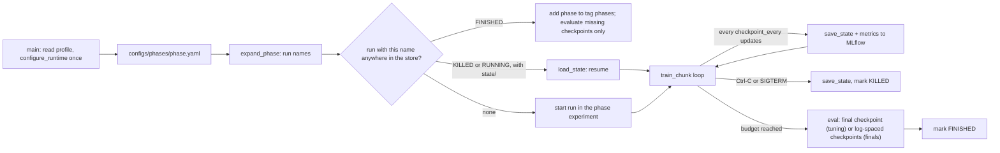

# Craftax experiment infrastructure implementation plan

Status: in progress

> **For agentic workers:** REQUIRED SUB-SKILL: Use superpowers:subagent-driven-development (recommended) or superpowers:executing-plans to implement this plan task-by-task. Steps use checkbox (`- [ ]`) syntax for tracking.

**Goal:** one command runs any slice of the experiment grid on the laptop or a cluster node, logs everything to MLflow, and can be stopped at any moment and resumed later without losing or repeating work.

**Architecture:** a run is one (registry entry, config, budget, seed) named `<registry-name>-<budget>-<confighash8>-s<seed>`. YAML files declare each method's base config and grid (`configs/methods/<slug>.yaml`) and each phase's slice (`configs/phases/<phase>.yaml`); `orchestration/queue.py` expands a phase into runs; `orchestration/runner.py` reads the machine profile, calls `configure_runtime` once, looks each run name up across the whole MLflow store, resumes it from its full saved state or starts it, evaluates it and logs to the store. The run directory is the MLflow artifact directory of the run: `config.json`, `metrics.npz`, `episodes.npz`, `ckpt/` (log-spaced params-only checkpoints for eval and video), `state/` (full resume state), `eval/`. A run belongs to every phase that lists it (MLflow tag `phases`); each phase is also an MLflow experiment for browsing. MLflow settings come from `configs/experiment.yaml` (`ExperimentConfig`). Design decisions: [[Experiment decisions]].

**Tech Stack:** JAX 0.11, craftax 1.6.1, flax, optax, MLflow (SQLite store), mlflow-sysmetrics, PyYAML, existing `wut_murl_craftax.orchestration` (runtime, tracking, reproducibility), `wut_murl_craftax.config` (`ExperimentConfig`, `MLflowTrackingConfig`), `training/checkpoints.py`, `visualisation/eval_rollouts.py`.

---

Order with the other plans: Tasks 1-3, then [[2026-10-20-craftax-evaluation-and-metrics]] Tasks 1-2 (`evaluation/milestones.py`, `evaluation/events.py`), then [[2026-10-20-craftax-method-ppo]] Task 2 (`training/wrappers.py`, which calls `step_events`), then Tasks 4-7.

### Task 1: Run identity and queue expansion

**Files:**
- Create: `src/wut_murl_craftax/orchestration/queue.py`, `configs/methods/ppo.yaml` (base and the two smoke configs; [[2026-10-20-craftax-method-ppo]] Task 1 writes the full file), `configs/phases/smoke.yaml`
- Test: `tests/orchestration/test_queue.py`, fixtures in `tests/orchestration/fixtures/`

- [x] **Step 1: Write the failing tests**:
  - a phase YAML with 2 configs x 2 seeds expands to 4 `RunSpec`s; run names `<registry-name>-<budget>-<confighash8>-s<seed>` are stable across processes (checked in a subprocess);
  - a method YAML has the top-level keys `base:` (may say `base_from: <slug>.tuned`), `budgets:` (optional, per-budget overrides such as `budgets: {1b: {...}}`), `grid: {coarse: [...], fine: {rule: ..., knobs: [...]}}`, `abort:` (optional) and `tuned:`; a grid entry overrides only its keys; any other top-level key, or an unknown key inside a block, fails loudly;
  - `base_from: ppo.tuned` resolves to the `tuned:` block of `ppo.yaml` plus the method's own keys and fails when `tuned` is null;
  - at budget `1b` a config resolves as `base`, then `tuned`, then `budgets.1b`, and `base_from` brings the base control's config resolved for the same budget, so a method's 1B run starts from the control's `budgets.1b` settings and keeps its own method knobs;
  - `expand_fine(slug, results)` applies the `grid.fine` rule to a fixture of stage-1 mean scores deterministically;
  - `mark_tuned(slug, config_hash8)` writes the `tuned:` block of the YAML and sets the MLflow tag `best=true` on that config's runs (always both; for a slug with two registry entries, such as `count-bonus`, the hash selects the entry through its runs' names and fills that entry's part of `tuned:`); the CLI flag `--mark-tuned <slug> <hash8>` calls it and needs no `--phase`;
  - a phase entry `count-bonus-ppo-rnn: {config: count-bonus}` is selected by `--method count-bonus-ppo-rnn` and by `--method count-bonus` (all registry entries of the slug);
  - `--dry-run` prints one line per run name and starts nothing.
- [x] **Step 2: Implement** `RunSpec` (frozen dataclass: registry name, config slug, budget, env, seed, config dict, config hash, phase, eval mode `final` or `log_spaced`) and `expand_phase(path) -> list[RunSpec]`; hook callables are excluded from the config hash.
- [x] **Step 3: Implement** `base_from` (the only implementation; [[2026-10-20-craftax-method-ppo]] Task 1 tests it on `ppo.yaml`), `expand_fine` (stage-2 configs are generated from the rule and the stage-1 results of the runs tagged `tune-coarse`, never written by hand) and `mark_tuned` (the last tuning step of every method calls it).
- [x] **Step 4: Implement** the CLI `uv run python -m wut_murl_craftax.orchestration.queue --phase configs/phases/<phase>.yaml [--method <registry-name or config slug>] [--dry-run] [--expand-fine <slug>]` and `uv run python -m wut_murl_craftax.orchestration.queue --mark-tuned <slug> <hash8>`; `--expand-fine <slug>` prints the generated stage-2 configs; without `--dry-run` the CLI hands the specs to the runner of Task 2; `--mark-tuned` calls `mark_tuned` and prints the YAML diff. Method plans call the queue through `make queue` (Task 6) and mark the tuned config with `--mark-tuned`.
- [x] **Step 5: Run** `uv run pytest tests/orchestration/test_queue.py -q`; expected: pass.

### Task 2: Resumable runner, run directory and MLflow bookkeeping

**Files:**
- Create: `src/wut_murl_craftax/orchestration/runner.py`, `src/wut_murl_craftax/orchestration/profiles.py` (`Profile`, `load_profile`; the profile files come in Task 6)
- Modify: `src/wut_murl_craftax/training/checkpoints.py` (`save_state`, `load_state`), `src/wut_murl_craftax/orchestration/tracking.py` (resume by run id; tags `phases`, `method`, `budget`, `seed`, `config_hash`), `src/wut_murl_craftax/orchestration/queue.py` (execution flags), `configs/experiment.yaml` (experiment name `craftax`, overridden per phase; `run_name: null`, set by the queue)
- Test: `tests/orchestration/test_runner.py`, `tests/training/test_checkpoints.py`

- [x] **Step 1: Write the failing tests** in `tests/training/test_checkpoints.py`: `save_state(run_dir, state)` / `load_state(run_dir, like)` round-trip a pytree with params, optax state, env states, typed PRNG keys, BatchRenorm statistics and numpy episode accumulators bit for bit; a save killed half-way leaves the previous state loadable (temp file + rename); the log-spaced `ckpt/` functions are unchanged.
- [x] **Step 2: Write the failing tests** in `tests/orchestration/test_runner.py` with a fake 3-update trainer:
  - a FINISHED run is skipped;
  - a run interrupted after update 2 resumes at update 3 and ends with the same params, optimizer state, RNG keys, method state, `metrics.npz` and `episodes.npz` as an uninterrupted run;
  - SIGINT writes `state/` and marks the MLflow run `KILLED`;
  - the run directory is the run's MLflow artifact directory and holds `config.json`, `metrics.npz`, `episodes.npz`, `ckpt/`, `state/`, `eval/`;
  - a run name that already exists in another phase's experiment is found (lookup across all experiments), not duplicated, and its tag `phases` becomes `tune-coarse,final-1m`;
  - two workers with `--worker-index 0/1 --num-workers 2` never take the same run;
  - `main` calls `configure_runtime(host_devices=profile.host_devices)` once before any JAX use (subprocess: `len(jax.devices("cpu")) == profile.host_devices`);
  - the tracker is built from `configs/experiment.yaml` through `ExperimentConfig` with `mlflow.experiment_name` set to the phase name.
- [x] **Step 3: Implement** `save_state` / `load_state` for the whole trainer state pytree (params, optimizer state, env states, RNG keys, method state, BatchRenorm statistics, `RunLog` and episode accumulators) under `state/`, written every `checkpoint_every` updates and on SIGINT/SIGTERM; `ckpt/` keeps the log-spaced params-only checkpoints for eval and video.
- [x] **Step 4: Implement** `runner.main(specs, profile, worker_index, num_workers, max_runs)`: load the profile; call `configure_runtime(host_devices=profile.host_devices)` once; load `configs/experiment.yaml` with `load_experiment_config` and build the tracker with `build_mlflow_tracker`, the experiment name overridden by the phase; for each spec of this worker look the name up across the store (`mlflow.search_runs(search_all_experiments=True, filter_string="tags.mlflow.runName = '<name>'")`): FINISHED -> add the phase to `phases`, evaluate missing checkpoints (Task 5), skip training; KILLED or RUNNING with `state/` -> `load_state` and continue; none -> start in the phase's experiment with all tags. A run is FINISHED only after training and its evaluation.
- [x] **Step 5: Add** the execution flags to the queue CLI: `--profile configs/profiles/<name>.yaml` (default laptop), `--max-runs N`, `--worker-index i --num-workers k`.
- [x] **Step 6: Run** `uv run pytest tests/orchestration/test_runner.py tests/training/test_checkpoints.py -q`; expected: pass.

### Task 3: Trainer interface shared by every method

**Files:**
- Create: `src/wut_murl_craftax/training/interface.py`
- Modify: `src/wut_murl_craftax/training/ppo.py` (from the visualisation port)
- Test: `tests/training/test_interface.py`

- [x] **Step 1: Write the failing tests**: every registered method exposes `init(config, key) -> state`, `train_chunk(state, n_updates) -> (state, metrics)` and `policy(state) -> Policy` with `Policy.init_carry(n)` and `Policy.step(params, carry, obs, key, greedy) -> (action, carry)`; the state is one pytree that `save_state` round-trips; 2 updates run on Craftax-Classic; in a subprocess started with `configure_runtime(host_devices=2)` the env state leaves are sharded over the `envs` axis of `env_mesh()`.
- [x] **Step 2: Implement** a registry `METHODS: dict[str, TrainerFactory]`; PPO is the first entry; each method file of [[2026-10-20-craftax-project]] adds one. (done 2026-10-21; the runner injects the budget as `steps` into the config given to `init`, see Experiment decisions)
- [x] **Step 3: Implement** device use in PPO: never call `configure_runtime` (the runner does, Task 2); take actor and learner from `device_roles()` (CPU env shards with the metal learner on Apple GPU, all-GPU on CUDA; [[Craftax runtime setup]]); when `len(jax.devices("cpu")) > 1` shard the env batch with `env_mesh()` and `shard_envs()`. PPO-RNN and PQN-RNN repeat this step in their plans.
- [x] **Step 4: Run** `uv run pytest tests/training/test_interface.py -q`; expected: pass.

### Task 4: Score and achievements logged during training

Needs `training/wrappers.py` ([[2026-10-20-craftax-method-ppo]] Task 2), which returns a `StepEvents` per transition computed from the pre-reset next state, and `evaluation/events.py` ([[2026-10-20-craftax-evaluation-and-metrics]] Task 2), which defines its fields. This task logs the score and achievements only; [[2026-10-20-craftax-evaluation-and-metrics]] Tasks 1-3 add the other families.

**Files:**
- Create: `src/wut_murl_craftax/evaluation/episode_metrics.py`
- Modify: `src/wut_murl_craftax/training/ppo.py` (log the summaries per update)
- Test: `tests/evaluation/test_episode_metrics.py`

- [x] **Step 1: Write the failing tests** on a scripted 200-step Craftax-Classic episode run through the wrapper, with an achievement unlocked on the done step: the unlock is counted (from `events.unlocked`; comparing the states before and after the done step would miss it); per-update return as % of 226 or of 22; per-achievement success rate over finished episodes; episode return, length and first-unlock env step.
- [x] **Step 2: Implement** per-step accumulation from the `StepEvents` of each transition and per-episode aggregation, all inside `jit`; nothing reads `env_state` across a done step.
- [x] **Step 3: Log** per update to MLflow: return, per-achievement success, losses, entropy, SPS, wall-clock, compile time; per run: peak memory, device roles, host name; system metrics via `mlflow-sysmetrics`.
- [x] **Step 4: Run** `uv run pytest tests/evaluation/test_episode_metrics.py -q`; expected: pass.

### Task 5: Fixed-seed evaluation and replayable rollouts

**Files:**
- Modify: `src/wut_murl_craftax/visualisation/eval_rollouts.py` (the only eval module), `src/wut_murl_craftax/visualisation/overlay.py` (it read `probs`, `value` and `obs` from the old eval files), `src/wut_murl_craftax/orchestration/runner.py` (evaluate before FINISHED)
- Test: `tests/visualisation/test_eval_rollouts.py`, `tests/visualisation/test_overlay.py`

- [x] **Step 1: Write the failing tests**: (done 2026-10-21; eval files also carry the provenance keys `method` and `devices`, see Experiment decisions)
  - evaluating the same checkpoint twice gives identical returns, actions and events;
  - `EvalRun.load` opens a PPO run and a fake recurrent registry entry through `METHODS[cfg["method"]]` (the carry is threaded through the steps) and labels the rollouts with the method;
  - the chunked scan stops after the chunk in which the last seed finished, and no stored episode is cut;
  - the stored file holds `seeds`, `actions`, `events` and `length` only, plus a method's declared per-step extras (the running skill id and skill-step count of two-level policies); no `obs`, `probs`, `value`;
  - replaying seed + actions rebuilds the observations and the same events, and `load_eval` keeps its signature;
  - a run of a tuning phase (`smoke`, `tune-coarse`, `tune-fine`) evaluates its final checkpoint only, a run of a final phase (`final-1m`, `final-1b`, `combo-1m`, `combo-1b`) every log-spaced checkpoint;
  - an interrupted evaluation skips the (update, mode) files already written;
  - in `test_overlay.py`: the agent-internals overlay of a PPO run renders from the new file: it replays seed + actions to rebuild the observations and rewards, and re-runs the PPO network on the replayed observations for the action probabilities and the value (equal to the network outputs at those observations to 1e-6).
- [x] **Step 2: Implement** `EvalRun.load` building the policy from `METHODS[cfg["method"]]` through `Policy.init_carry` / `Policy.step` (feed-forward, recurrent, PQN and two-level skill policies); the eval env goes through the same wrapper, so its events are the training events. `Policy.step` returns no action probabilities or values; tools that show them (the agent-internals overlay, the distillation dataset) re-run the network on the replayed observations ([[2026-10-20-craftax-visualisation-production]] Task 5).
- [x] **Step 3: Implement** `evaluate(run_dir, updates, mode)`: 64 fixed seeds `10000` to `10063`, stochastic and greedy mode; a jitted scan of 1,000 steps per chunk, repeated until every seed is done (at most the 100,000-step cap, 10,000 on Classic); store seed, actions (padded with -1 after done), per-step `StepEvents` and lengths in `eval/<mode>/<update>.npz` (replayable for [[2026-10-20-craftax-visualisation-production]]).
- [x] **Step 4: Wire** it into the runner: after training, the final checkpoint (tuning phases) or all log-spaced checkpoints (final phases), both modes; summaries to MLflow as `eval/<mode>/return` at the checkpoint's env step.
- [x] **Step 5: Implement** the overlay change for PPO: `overlay._Episode.load` reads `load_eval(run.dir, update, greedy)`, rebuilds observations and rewards by replay, and gets probabilities and values from `eval_rollouts.network_outputs(run, update, obs, actions, dones, greedy)`, which re-runs the PPO network (`training.ppo.make_network`, `policy_value`) on the replayed observations; [[2026-10-20-craftax-visualisation-production]] Task 5 extends `network_outputs` to every registry method.
- [x] **Step 6: Run** `uv run pytest tests/visualisation/test_eval_rollouts.py tests/visualisation/test_overlay.py -q`; expected: pass.

### Task 6: Laptop and cluster profiles, make targets

**Files:**
- Create: `configs/profiles/laptop.yaml`, `configs/profiles/cuda.yaml`, `scripts/cluster/run_array.sh`
- Modify: `src/wut_murl_craftax/orchestration/profiles.py` (validation), `Makefile` (targets `queue`, `status`, `merge-mlflow`), `.env.example`
- Test: `tests/orchestration/test_profiles.py`

- [x] **Step 1: Write the failing tests**: `laptop.yaml` has `host_devices: 8`, device-role mode `cpu-actor` (metal learner when present) and `memory_limit_bytes`; `cuda.yaml` has `host_devices: 1`, mode `gpu` (actor and learner on the GPU) and `memory_limit_bytes`; a missing key fails loudly; both profiles resolve the same run names; `make -n queue PHASE=tune-coarse METHOD=count-bonus` calls the queue CLI with `--method count-bonus`, which selects `count-bonus-ppo-rnn` and `count-bonus-pqn-rnn`; `make -n queue PHASE=tune-fine METHOD=ppo FINE=ppo` adds `--expand-fine ppo`, and `DRY_RUN=1` adds `--dry-run`; `status` counts only the runs whose tag `phases` contains the phase.
- [x] **Step 2: Implement** profiles as runtime settings only (never hyperparameters), so a run is identical wherever it executes; `memory_limit_bytes` is read by methods with large buffers ([[2026-10-20-craftax-method-sil]]); `run_array.sh` maps a scheduler array index to `--worker-index` (Slurm example, scheduler-agnostic flags). (done 2026-10-21; the laptop profile sets `JAX_PLATFORMS=metal,cpu` unless already set, see Experiment decisions)
- [x] **Step 3: Implement** `make queue PHASE=<phase> [METHOD=<slug>] [FINE=<slug>] [DRY_RUN=1] [PROFILE=laptop]` (calls `uv run python -m wut_murl_craftax.orchestration.queue --phase configs/phases/$(PHASE).yaml --profile configs/profiles/$(PROFILE).yaml [--method $(METHOD)] [--expand-fine $(FINE)] [--dry-run]`; tune-fine always runs as `make queue PHASE=tune-fine METHOD=<slug> FINE=<slug>`), `make status PHASE=<phase>` (pending / running / finished / killed per run, filtered by the tag `phases`) and `make merge-mlflow SRC=<store>` (copies runs and their artifact directories from a node's store into the main `mlruns.db` without duplicates; run names are the key, `phases` tags are merged).
- [x] **Step 4: Run** `uv run pytest tests/orchestration/test_profiles.py -q`; expected: pass.
- [ ] **Step 5: Before the first cluster phase** (Phase 0 review I5, M11, M12; ctrl-metrics review):
  - Copy the main `mlruns.db` with its `mlruns/` to the cluster and pass it read-only as `SEED_FROM=<copy>/mlruns.db` to `scripts/cluster/run_array.sh`: each node then reuses and resumes the runs of its share. Rerun an array with the same size, or merge its stores first.
  - Exception, the 1B phases (`final-1b`, `combo-1b`): start the first array without `SEED_FROM`. No 1B run is in the main store (1B names differ from 1M names), so seeding would only read the 1M store (about 20 GB of `mlruns/` after the prune, plus the 17 GB `mlruns.db`) for nothing; seed a rerun after a merge only from a store holding just the 1B runs ([[2026-10-20-craftax-compute-budget]] 1B storage).
  - On one GPU node: `uv sync --all-groups`, then `uv run python scripts/cluster/check_recompute.py` (cuda profile, 1B config, 3 updates; it fails loudly without a GPU). Record the largest log-prob and value gaps in the "Device verification" table of [[PPO-RNN design]].
  - Exit 0 (gaps below 1e-4, a tenth of the 1e-3 guard band): remove `ppo/ratio_first_mb` from `unmeasured_limits` in `configs/profiles/cuda.yaml`. That also makes the bound permanent for `count-bonus-ppo-rnn` and SIL, which the script does not measure (other shapes). Exit 2 (over the bound; exit 1 is a crash): rerun with `--precision highest`; if that passes, pinning the matmul precision on CUDA is a decision for [[Experiment decisions]]; until then hits stay retried once.
  - After the array: copy back only what is needed, `rsync -a --exclude state/ --exclude '*.tmp' --exclude owner.json node-stores/ <laptop>:node-stores/` (`cuda.yaml` sets `drop_state_on_finish: true`, so a finished run has no `state/` left; an unfinished one keeps it on the cluster to resume), then `make merge-mlflow SRC=node-stores/mlruns-node-<i>.db` per node; reused runs bring back their new eval files and `eval/*` points. The merge refuses unfinished node runs without `state/`. Expected about 0.4-0.65 GB per finished 1B run.

### Task 7: Smoke phase end to end

**Files:**
- Modify: `configs/phases/smoke.yaml` (PPO, Craftax-Classic, 2 configs x 1 seed, 200k steps, as [[2026-10-20-craftax-method-ppo]] Task 3)

- [x] **Step 1: Run** `make queue PHASE=smoke METHOD=ppo`, stop it with Ctrl-C in the middle of a run, run it again; expected: the interrupted run resumes from `state/`, finished runs are skipped, `make status PHASE=smoke` shows 2 finished.
- [x] **Step 2: Check** in `make mlflow` that every metric of Task 4 and the eval files of Task 5 are present, that each run directory holds `config.json`, `metrics.npz`, `episodes.npz`, `ckpt/`, `state/`, `eval/`, and that the resumed run's `metrics.npz` has no missing or repeated update.
- [x] **Step 3: Record** the measured PPO steps/s and eval steps per checkpoint in [[2026-10-20-craftax-compute-budget]]; the other families record theirs in their own smoke tasks.
