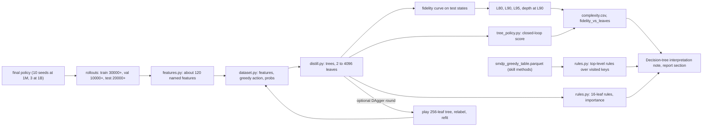

# Craftax interpretation and decision ruleset implementation plan

Status: ready

> **For agentic workers:** REQUIRED SUB-SKILL: Use superpowers:subagent-driven-development (recommended) or superpowers:executing-plans to implement this plan task-by-task. Steps use checkbox (`- [ ]`) syntax for tracking.

**Goal:** measure how complex the final decision ruleset of each method in [[2026-10-20-craftax-project]] is, by distilling every final policy into decision trees of growing size, and turn the trees into a plain-language account of each method's strategy for the report.

**Architecture:** a new package `src/wut_murl_craftax/interpretation/`: `features.py` decodes the symbolic observation into about 120 named, human-readable features; `dataset.py` collects (features, network action) pairs from fixed-seed rollouts of a final policy; `distill.py` fits a grid of trees and computes fidelity curves; `tree_policy.py` plays a tree as a policy for closed-loop fidelity; `rules.py` extracts rules and feature importance, and for the two-level skill policies (`smdp-skills`, `dyna-q`, and the combination when it contains one) also the top-level rules from the greedy table. Final policies come from the four final phases `final-1m final-1b combo-1m combo-1b`, loaded through `visualisation.eval_rollouts.EvalRun.load` (a `Policy` with `init_carry`/`step` for feed-forward, recurrent, PQN and two-level skill policies). Outputs go to `outputs/interpretation/<budget>/<method>/` and are logged as artifacts of run `distill-<budget>-<method>` in MLflow experiment `analysis`. Observation layout: [[Craftax observations and actions]].

**Tech Stack:** scikit-learn (`DecisionTreeClassifier`, `export_text`, `permutation_importance`), numpy, pandas, matplotlib, JAX for rollouts through the trainer interface of [[2026-10-20-craftax-infrastructure]] (`policy(state) -> Policy`).

Distillation loop per final seed:

## Feature set

From the Craftax symbolic observation (8268 values); Classic uses the matching subset of its 1345 values.

| Group | Features | Decoding |
|---|---|---|
| Intrinsics | health, food, drink, energy, mana, xp, dexterity, strength, intelligence | value x 10 |
| Inventory | wood, stone, coal, iron, diamond, sapphire, ruby, sapling, torches, arrows | count = round((value x 10)^2) |
| Equipment | books, pickaxe level, sword level, sword enchantment, bow enchantment, bow, 4 armour levels, any armour enchantment | inverse of the encodings in [[Craftax observations and actions]] |
| Potions | 6 potion counts | as inventory |
| Flags | light level, sleeping, resting, learned fireball, learned iceball, floor, ladder open, boss vulnerable | floor = value x 10 |
| Facing | direction (4 values), block type of the facing tile, creature on the facing tile | map channels at the tile next to the centre |
| Nearest targets | for tree, water, stone, coal, iron, diamond, sapphire, ruby, crafting table, furnace, lava, chest, ripe plant, down ladder, up ladder, fire and ice enchantment tables: Manhattan distance to the nearest visible tile (sentinel 10 in Craftax, 8 in Classic when none: one above the largest in-view distance) and the signs of its row and column offset | block and item channels, visibility channel |
| Creatures | visible melee, ranged, passive and enemy-projectile counts; nearest hostile distance and offset signs; hostile adjacent; nearest passive distance | creature channels |
| Neighbours | walkable flag of the 4 adjacent tiles | block channels |
| Memory proxies (recurrent policies only, reported apart) | previous action, steps since the last unlock | computed along the rollout, not in the observation |
| Current skill (two-level skill policies only, reported apart) | one-hot of the skill the top level is running (25 values) and steps since that skill started | the policy carry, not in the observation |

## Fidelity and tree sizes

- Target label: the network's greedy action at each visited state; recurrent policies carry their hidden state along the rollout.
- Two-level skill policies (`smdp-skills`, `dyna-q`, a combination containing one): the label is the primitive action the full policy takes (top level, then the skill network), and the current skill is a feature (table above); the closed-loop tree replaces only the skill network, the method's top level and skill termination stay. The top level is reported separately: each visited key of the final checkpoint's `smdp_greedy_table.parquet` (visited key, decoded fields, greedy skill, value; eval extras of [[2026-10-20-craftax-method-smdp-skills]]) is one rule; reported are the number of visited keys, the number of distinct greedy skills, a tree over the decoded key fields predicting the greedy skill (its L90 over keys) and the 10 highest-value rules in words.
- State distribution: states visited by the stochastic policy (the behaviour that is scored).
- Training states: 256 episodes on seeds `30000` to `30255`, at most 2,000 states sampled uniformly per episode.
- Validation states (tree-size choice): the 64 eval seeds `10000` to `10063`.
- Test states: the 64 held-out seeds `20000` to `20063`; whole episodes are held out, so no state of a test episode is seen in fitting.
- Top-1 fidelity: share of test states where the tree's action equals the network's greedy action.
- Expected fidelity: mean of `pi(tree action | s)` over test states (agreement with the stochastic policy).
- Closed-loop fidelity: the tree played greedily on the 64 held-out seeds; its score (% of max) divided by the network's greedy score on the same seeds.
- Tree grid: `max_leaf_nodes` in 2, 4, 8, ..., 4096 (12 sizes) and `max_depth` in 2, 4, 6, 8, 10, 12, 16, 20, unlimited; `min_samples_leaf=5`, `criterion="gini"`, `random_state=0`.
- Complexity: L90 = smallest grid `max_leaf_nodes` with test top-1 fidelity >= 0.9 (reported as "> 4096" when never reached); L80 and L95 likewise; depth at L90.
- Per method: every final seed distilled (10 at 1M, 3 at 1B); median and IQR of L90 over seeds at 1M, median and range at 1B; rules shown for the seed with the median final score.
- One DAgger round: play the 256-leaf tree on the training seeds, label its states with the network, refit on the union; both versions reported (Ross et al. 2011; VIPER, Bastani et al. 2018).

## What each tree is asked

- Which 10 features matter most (permutation importance on test states)?
- What does the 16-leaf tree say, rule by rule, in plain words?
- Which conditions lead to each key action: `DO`, `SLEEP`, `PLACE_TABLE`, crafting actions, `DESCEND`, spells, potions?
- Does each rule match a game mechanic ([[Craftax survival stats]], [[Craftax action effects]], [[Craftax crafting and placing]]) or is it surprising?
- Where does the tree fail: test confusion by action group and the floors with the lowest fidelity?
- Is a higher-scoring policy more complex: Spearman correlation between final score and L90 over all distilled seeds, methods and controls?
- For the skill methods: which skill does the top level pick in which progress situation, and how many top-level rules does it use?

---

### Task 1: Feature decoding

**Files:**
- Create: `src/wut_murl_craftax/interpretation/__init__.py`, `src/wut_murl_craftax/interpretation/features.py`
- Modify: `pyproject.toml` (`uv add scikit-learn` with a justification comment)
- Test: `tests/interpretation/test_features.py`

- [x] **Step 1: Write the failing tests**: on `env.reset` observations of both games the decoded intrinsics equal the state's values and inventory counts round-trip; a hand-edited state with a tree 3 tiles left of the player gives distance 3 and column sign -1; an invisible tile is ignored; `len(FEATURES[game]) == featurize(obs, game).shape[-1]`; featurising 10,000 observations is vectorised (no Python loop over states). (done 2026-10-24: 6b2dc56, 1eb33ab, 96f7612; `tests/interpretation/test_features.py`)
- [x] **Step 2: Implement** `FEATURES: dict[GameKind, list[str]]` and `featurize(obs, game) -> np.ndarray` in numpy. (done 2026-10-24: 6b2dc56, 1eb33ab)
- [x] **Step 3: Run** `uv run pytest tests/interpretation/test_features.py -q`. (done 2026-10-24: 6b2dc56, 1eb33ab, 96f7612; `tests/interpretation/test_features.py`)

### Task 2: Distillation dataset

**Files:**
- Create: `src/wut_murl_craftax/interpretation/dataset.py`
- Test: `tests/interpretation/test_dataset.py`

- [x] **Step 1: Write the failing tests**: the training, validation and test seed sets are disjoint and constant; two collections from the same policy and seeds are identical; per-episode subsampling keeps at most 2,000 states; a recurrent toy policy's labels depend on its carried hidden state; a toy two-level policy (2 skills, each a fixed primitive action) gets the primitive action as label and the current-skill one-hot as features. (done 2026-10-24: 8c0113b, 9ae8a08; `tests/interpretation/test_dataset.py`)
- [x] **Step 2: Implement** `collect(policy, game, seeds, max_states_per_episode) -> Dataset` (features, greedy primitive action, action probabilities from `visualisation.eval_rollouts.network_outputs` on the visited observations, because `Policy.step` returns only the action and the carry ([[2026-10-20-craftax-visualisation-production]] Task 5), episode id, floor, memory proxies, current skill for two-level policies), saved as `outputs/interpretation/<budget>/<method>/<run>/<split>.npz`. (done 2026-10-24: 8c0113b, 9ae8a08)
- [x] **Step 3: Run** `uv run pytest tests/interpretation/test_dataset.py -q`. (done 2026-10-24: 8c0113b, 9ae8a08; `tests/interpretation/test_dataset.py`)

### Task 3: Tree grid and fidelity curves

**Files:**
- Create: `src/wut_murl_craftax/interpretation/distill.py`
- Test: `tests/interpretation/test_distill.py`

- [x] **Step 1: Write the failing tests** with a synthetic policy defined by a known 8-leaf rule over 5 features: top-1 fidelity is 1.0 from 8 leaves on, L90 <= 8, expected fidelity equals top-1 for a one-hot policy, and the curve never needs more than the grid. (done 2026-10-24: 6816420, 9a75251; `tests/interpretation/test_distill.py`)
- [x] **Step 2: Implement** `fit_grid(train, val) -> list[FittedTree]`, `fidelity(tree, test) -> dict` (top-1, expected), `complexity(curve) -> dict` (L80, L90, L95, depth at L90). (done 2026-10-24: 6816420, 9a75251)
- [x] **Step 3: Run** `uv run pytest tests/interpretation/test_distill.py -q`. (done 2026-10-24: 6816420, 9a75251; `tests/interpretation/test_distill.py`)

### Task 4: Tree policy and closed-loop fidelity

**Files:**
- Create: `src/wut_murl_craftax/interpretation/tree_policy.py`
- Test: `tests/interpretation/test_tree_policy.py`

- [x] **Step 1: Write the failing tests**: `TreePolicy(tree, game)` returns the tree's action for `env.get_obs(state)`; it satisfies the `Policy` protocol (`init_carry`, `step`) used by `visualisation.eval_rollouts`; a 4-leaf tree plays 100 Classic steps through `visualisation.rollout.play`; `TreePolicy(tree, game, top_level=policy)` on the toy two-level policy keeps the top level's skill choices and replaces only the primitive actions. (done 2026-10-24: c8c3e55, ff64631; `tests/interpretation/test_tree_policy.py`)
- [x] **Step 2: Implement** `TreePolicy` (with optional `top_level` for skill methods) and `closed_loop(tree, game, seeds) -> scores` reusing the eval keys of [[Recording training data]]. (done 2026-10-24: c8c3e55, ff64631)
- [x] **Step 3: Run** `uv run pytest tests/interpretation/test_tree_policy.py -q`. (done 2026-10-24: c8c3e55, ff64631; `tests/interpretation/test_tree_policy.py`)

### Task 5: Rules and importance

**Files:**
- Create: `src/wut_murl_craftax/interpretation/rules.py`
- Test: `tests/interpretation/test_rules.py`

- [x] **Step 1: Write the failing tests** on the synthetic 8-leaf policy: `rules_text` lists 8 leaves with feature names and thresholds in decoded units; `paths_to(tree, action)` returns every condition chain ending in that action; permutation importance ranks the 5 rule features above the others. (done 2026-10-25: b81c509, b593f6b; `tests/interpretation/test_rules.py`)
- [x] **Step 2: Write the failing test** for the top level: on a fixture `smdp_greedy_table.parquet` of 40 keys whose greedy skill is a 4-leaf rule over 2 decoded fields, `top_level_rules(table)` reports 40 rules, the 4 distinct skills, a key-to-skill tree with L90 <= 4 and the 10 highest-value rules in words. (done 2026-10-25: b81c509, b593f6b)
- [x] **Step 3: Implement** `rules_text`, `paths_to`, `importance(tree, test)`, `failure_breakdown(tree, test)` (confusion by action group, fidelity per floor) and `top_level_rules(table)`. (done 2026-10-25: b81c509, b593f6b)
- [x] **Step 4: Run** `uv run pytest tests/interpretation/test_rules.py -q`. (done 2026-10-25: b81c509, b593f6b; `tests/interpretation/test_rules.py`)

### Task 6: Distil every final policy

**Files:**
- Create: `src/wut_murl_craftax/interpretation/run.py` (CLI)
- Test: `tests/interpretation/test_run_cli.py`

Runs before [[2026-10-20-craftax-comparison-and-results]] Task 6 (Phase 4 order): its LaTeX export reads `outputs/interpretation/<budget>/complexity.csv` written in Step 4.

- [x] **Step 1: Write the failing test** in `tests/interpretation/test_run_cli.py`: on a 2-update Classic PPO run the CLI writes `curve.csv`, `complexity.json`, `rules_16.txt`, `importance.csv`, `closed_loop.csv` and `fidelity_vs_leaves.png`, and logs them under `distill-<budget>-<method>` in a temporary MLflow store; on a 2-update Classic `smdp-skills` run it also writes `top_level_rules.txt` and `top_level.json`. (done 2026-10-28: 541d1d6; `tests/interpretation/test_run_cli.py`)
- [x] **Step 2: Implement** `uv run python -m wut_murl_craftax.interpretation.run --phases <phase> [<phase> ...] --method <method|all> [--dagger] --out outputs/interpretation`; runs are grouped by their `budget` tag into `outputs/interpretation/<budget>/`; resumable per run (skips finished outputs). (done 2026-10-28: 541d1d6 (adds the DAgger relabelling step))
- [x] **Step 3: Run** `uv run pytest tests/interpretation/test_run_cli.py -q`, then `uv run python -m wut_murl_craftax.interpretation.run --phases final-1m combo-1m --method all --out outputs/interpretation` and the same with `--dagger` (all methods, the combination and the three controls). (done 2026-10-28: 1M only: `--phases final-1m combo-1m --refs tuned --dagger`, 90 policies (9 methods x 10 tuned seeds), 0 failed, finished 2026-10-28 17:57 (ledger); the 1B phases are Step 3b)
- [ ] **Step 3b: Run** the same for `final-1b` and `combo-1b` once they exist, with `--dagger`; then rewrite the 1B `complexity.csv` and `fidelity_vs_leaves_1b` (Step 4).
- [x] **Step 4: Write** the per-method comparison table `outputs/interpretation/<budget>/complexity.csv` (method, median L90 [IQR], fidelity at 16, 64 and 256 leaves, closed-loop ratio of the 256-leaf tree, Spearman of score vs L90; for skill methods also the top-level key count and key-to-skill L90) and the figure `fidelity_vs_leaves_<budget>.pdf` (log2 x axis, one line per method, dashed 0.9); copy the figure to `outputs/results/figures/` for [[2026-10-20-craftax-comparison-and-results]]. (done 2026-10-28: 1M: `outputs/interpretation/1m/complexity.csv` (27 rows) with the R106 columns (1355a02), the score-vs-L90 Spearman replaced by score vs fidelity at 256 leaves because L90 is above 4096 for nearly every fit; the figure is `fidelity_vs_leaves_1m.pdf`, PNG copy in `outputs/results/figures/1m/`)

### Task 7: Interpretation write-up

**Files:**
- Create: `knowledge/results/Decision-tree interpretation.md` (template `knowledge/_templates/concept.md`, `domain: interpretation`, `parent: "[[2026-10-20-craftax-project]]"`), `knowledge/architecture/interpretation.md` (template `module.md`)

- [x] **Step 1: Write** one section per method answering the questions under "What each tree is asked", with the 16-leaf rules rewritten as 5 to 10 plain-language bullets, each marked "matches mechanic" or "surprising". (done 2026-10-28: at 1M: one section per method in [[Decision-tree interpretation]], e6c1cbf, 68ab4fb)
- [x] **Step 2: Write** for each skill method a separate "Top level" subsection: the number of top-level rules, the key-to-skill tree and the 10 highest-value rules in words, kept apart from the primitive-action results. (done 2026-10-28: `### Top level` under SMDP skills and Dyna-Q)
- [x] **Step 3: Write** the cross-method section: the complexity table, the score-vs-L90 correlation, what recurrent methods lose without memory features and what the memory proxies recover. (done 2026-10-28: `## Cross-method`; score vs L90 replaced by R106 (see Task 6 Step 4))
- [x] **Step 4: Draft** the report's interpretation section (about 0.4 page, [[2026-10-20-craftax-report]]): one figure (fidelity vs leaves), one sentence per method on its strategy, the complexity result; numbers through `report/numbers.tex` macros. (done 2026-10-28: `## Report draft (section 6, about 0.4 page)` inside the note, by ruling R87; `report/` itself stays Phase 5)
- [x] **Step 5: Run** `make knowledge` and `make check`. (done 2026-10-28: vault check green after the fact-check fixes 68ab4fb; full suite 2289 passed on 2026-10-28 (ledger))
- [ ] **Step 6 (1B): Repeat** Steps 1 to 5 for the 1B policies after Task 6 Step 3b (a 1B section in [[Decision-tree interpretation]]).
