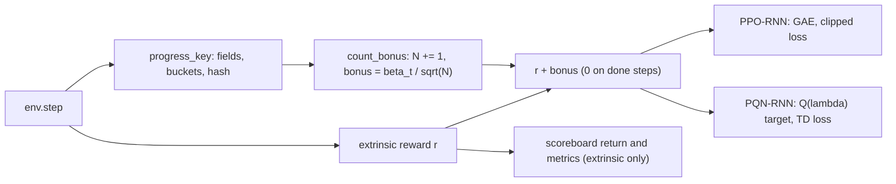

# Count-Based Progress Bonus implementation plan

Status: draft

> **For agentic workers:** REQUIRED SUB-SKILL: Use superpowers:subagent-driven-development (recommended) or superpowers:executing-plans to implement this plan task-by-task. Steps use checkbox (`- [ ]`) syntax for tracking.

**Goal:** add the intrinsic reward $\beta_t/\sqrt{N[\phi(s')]}$ over a progress key to PPO-RNN and to PQN-RNN, tune it at Craftax-1M, and run both variants at 1M and 1B against their own bases and the published RND, ICM and E3B numbers.

**Architecture:** `training/progress_key.py` turns the inner Craftax `EnvState` into a bucketed integer field vector and a hashed key; `training/count_bonus.py` keeps a global `int32[2^20]` count table in the train state and returns the bonus through the `intrinsic_reward_fn` hook of `PPORNNConfig` ([[2026-10-20-craftax-method-ppo-rnn]]) and `PQNRNNConfig` ([[2026-10-20-craftax-method-pqn-rnn]]); two registry entries, `count-bonus-ppo-rnn` and `count-bonus-pqn-rnn`, share one config file. Design decisions: [[Count-Based Progress Bonus design]].

**Tech Stack:** JAX 0.11, craftax 1.6.1, flax, optax, MLflow, the runner and queue of [[2026-10-20-craftax-infrastructure]].

---

## Design

- Key: floor, ladder-open flag, pickaxe, sword, bow, armour sum, spells, enchantment bits and recipe-capped material counts, read from `EnvState`; scenery (map, position, mobs, daylight, survival stats) is excluded.
- Counts: one global table per run, never reset, updated every rollout step before the bonus is read; bonus 0 on done steps.
- PPO-RNN variant: GAE over $r + r^+$ with the control's single value head; PQN-RNN variant: $r + r^+$ inside the Q($\lambda$) target, ε-greedy schedule unchanged.
- Tuned: β, key granularity (tiers, recipe, log2), β decay (constant, linear to 0); everything else is the tuned control.
- Ablation: counts over a SimHash of the full observation (PPO-RNN variant, `final-1m`), the matched observation-novelty control.
- Decisions, key table and diagrams: [[Count-Based Progress Bonus design]].

## Hyperparameter grid

Stage 1 (coarse, both variants, Craftax-1M, 3 seeds):

| Knob | Values | Why |
|---|---|---|
| β | 0.01, 0.03, 0.1, 0.3 | half-decade steps around the candidate note's 0.01-0.1; at 0.3, about three first visits pay as much as one basic achievement (reward 1) |
| Key granularity | tiers, recipe, log2 | too coarse to too fine, the main risk named in [[Count-Based Progress Bonus|the candidate note]] |
| β decay | constant, linear to 0 | tests whether the bonus should vanish before the end of the budget |

- Configs: 4 x 3 x 2 = 24 per variant; 72 runs per variant, 144 for both.

Stage 2 (fine, both variants, 3 seeds):

- β: best stage-1 β x {0.5, 1, 2}.
- Second knob: the categorical knob (granularity or decay) whose stage-1 config means spread more; values: its best and runner-up.
- Configs: 3 x 2 = 6, of which the stage-1 best config is reused by run name; 5 new configs, 15 runs per variant.
- Selection: highest mean final score over 3 seeds ([[2026-10-20-craftax-evaluation-and-metrics]]); ties go to the coarser key.

Fixed settings, PPO-RNN variant (the tuned PPO-RNN control; Craftax paper Table 11 at 1M, Table 7 at 1B, [[Craftax Baselines algorithms and hyperparameters]]):

| Setting | 1M | 1B |
|---|---|---|
| Envs x steps per rollout | 256 x 16 | 1024 x 64 |
| Learning rate (linear anneal) | 3e-4 | 2e-4 |
| Epochs / minibatches | 4 / 8 | 4 / 8 |
| γ / GAE λ | 0.99 / 0.8 | 0.99 / 0.8 |
| Clip / value coef / entropy | 0.2 / 0.5 / 0.01 | 0.2 / 0.5 / 0.01 |
| Max grad norm | 1.0 | 1.0 |
| Network | Dense 512, GRU 512, 2 x Dense 512 heads (ReLU) | same |

Fixed settings, PQN-RNN variant (the PQN-RNN control; [[PQN-RNN (Gallici 2025)]] Table 4 at 1B; at 1M the control's tuned 1M values of `PQNRNNConfig`):

| Setting | 1B |
|---|---|
| Envs x steps per update | 1024 x 128 |
| ε start / finish / decay fraction | 1.0 / 0.005 / 0.1 |
| Epochs / minibatches | 4 / 4 |
| Learning rate (linear decay) | 3e-4 |
| γ / λ | 0.99 / 0.5 |
| Max grad norm / reward scale | 0.5 / 1.0 |
| Network | 512 hidden, 1 layer + 1 recurrent layer, LayerNorm, last action as input |

Fixed method settings (both variants):

| Setting | Value |
|---|---|
| Table size $K$ | $2^{20}$ (`int32`, 4 MB) |
| Count scope | global over envs, never reset |
| Bonus target | next state, 0 on done steps |
| Value heads (PPO-RNN) | one, on $r + r^+$ |
| 1B finals | best 1M method knobs; linear decay runs over the 1B budget |

## Runs and laptop time estimate

- Throughput: PPO-RNN and PQN-RNN 2,400 steps/s (shared assumption), Craftax-Classic RNN 8,000 steps/s (0.8 x 10,000).
- Overhead factor 1.05 (estimate): one hash of about 20 integer fields, one gather and one scatter-add into a 4 MB table per env step, no network; small against the Craftax step and the GRU.
- Method throughput: 2,286 steps/s on Craftax, 7,619 steps/s on Craftax-Classic; +1 min compile per run.

PPO-RNN variant (`count-bonus-ppo-rnn`):

| Phase | Configs | Seeds | Steps per run | Runs | Est. steps/s | Est. hours (laptop, sequential) |
|---|---|---|---|---|---|---|
| `smoke` (Classic) | 2 | 1 | 200k | 2 | 7,619 | 0.05 |
| `tune-coarse` | 24 | 3 | 1M | 72 | 2,286 | 9.95 |
| `tune-fine` | 5 new | 3 | 1M | 15 | 2,286 | 2.07 |
| `final-1m` (best + SimHash ablation) | 2 | 10 | 1M | 20 | 2,286 | 2.76 |
| `final-1b` | 1 | 10 | 1B | 10 | 2,286 | 1,215.4 |
| Total | | | | 119 | | 1,230.2 |

PQN-RNN variant (`count-bonus-pqn-rnn`):

| Phase | Configs | Seeds | Steps per run | Runs | Est. steps/s | Est. hours (laptop, sequential) |
|---|---|---|---|---|---|---|
| `smoke` (Classic) | 2 | 1 | 200k | 2 | 7,619 | 0.05 |
| `tune-coarse` | 24 | 3 | 1M | 72 | 2,286 | 9.95 |
| `tune-fine` | 5 new | 3 | 1M | 15 | 2,286 | 2.07 |
| `final-1m` | 1 | 10 | 1M | 10 | 2,286 | 1.38 |
| `final-1b` | 1 | 10 | 1B | 10 | 2,286 | 1,215.4 |
| Total | | | | 109 | | 1,228.8 |

- Both variants: 228 runs, 2,459.1 laptop hours (estimate).
- One 1M run: 0.138 h; one 1B run: 121.5 h.
- 1B on a CUDA cluster GPU (authors' hardware, estimate): 266,961 x 0.8 (RNN) / 1.05 = 203,399 steps/s, 1.38 h per run, 13.8 h for 10 seeds per variant, 27.6 h for both.
- Measured throughput replaces these numbers in [[2026-10-20-craftax-compute-budget]] after the smoke phase.

### Task 1: Progress key

**Files:**
- Create: `src/wut_murl_craftax/training/progress_key.py`
- Test: `tests/training/test_progress_key.py`

- [ ] **Step 1: Write the failing tests** on states from `env.reset` edited with `.replace(...)`: `progress_fields(state, "recipe")` returns the field vector of the key table in [[Count-Based Progress Bonus design]]; wood 0, 1, 4, 9 give buckets 0, 1, 4, 4; `log2` buckets of 0, 1, 2, 3, 99 are 0, 1, 1, 2, 6; two states that differ only in `map`, `player_position`, mobs, `light_level` or `player_health` give the same key; a pickaxe or floor change gives a different key; `ladder_open` is 1 exactly when `monsters_killed[floor] >= 8`; keys lie in `[0, 2^20)`; the function is `jit`- and `vmap`-compatible; a Craftax-Classic state gives the Classic field vector; `unwrap(state)` reaches the inner `EnvState` through the log and auto-reset wrappers.
- [ ] **Step 2: Implement** `unwrap`, `progress_fields(state, granularity) -> int32[F]`, `hash_key(fields, log2_k=20) -> uint32` (multiply-add over odd constants, Knuth fold) and `simhash_key(obs, proj, log2_k=20)` (sign of a fixed Gaussian projection to 64 bits, folded with the same hash).
- [ ] **Step 3: Run** `uv run pytest tests/training/test_progress_key.py -q`; expected: all pass.

### Task 2: Count table and bonus

**Files:**
- Create: `src/wut_murl_craftax/training/count_bonus.py`
- Test: `tests/training/test_count_bonus.py`

- [ ] **Step 1: Write the failing tests**: with 2 envs and a scripted 3-step key sequence `[[a, a], [b, a], [a, done]]`, counts and bonuses equal the hand-computed values (`N[a]` 2, 3, then the done step adds nothing and pays 0; bonus of the second env at step 2 is $\beta/\sqrt{3}$); linear decay at $t = T/2$ halves β; β = 0 returns zeros; repeated calls with the same inputs give identical tables (determinism); the table stays `int32`; occupancy and distinct-key metrics match a NumPy reference.
- [ ] **Step 2: Implement** `CountBonusConfig` (beta, granularity, decay, log2_k, key: `progress|simhash`), `init(cfg, key) -> CountState` (table, step counter, SimHash projection) and `intrinsic_reward(state, env_state, next_env_state, obs_next, done, t) -> (r_int, state)` matching the `intrinsic_reward_fn` contract of [[2026-10-20-craftax-method-ppo-rnn]].
- [ ] **Step 3: Run** `uv run pytest tests/training/test_count_bonus.py -q`.

### Task 3: Both variants in the trainer registry

**Files:**
- Modify: `src/wut_murl_craftax/training/interface.py` (entries `count-bonus-ppo-rnn`, `count-bonus-pqn-rnn`)
- Create: `configs/methods/count-bonus.yaml` (variants `ppo-rnn`, `pqn-rnn`; base config; `grid_stage1`; `grid_stage2` rule)
- Test: `tests/training/test_count_bonus_variants.py`

- [ ] **Step 1: Write the failing tests**: with β = 0 each variant reproduces its base trainer's parameters bit for bit after 2 updates on Craftax-Classic (same seed); with β > 0 the PPO-RNN GAE target equals a hand-computed GAE over $r + r^+$ on a 3-step, 1-env example (γ 0.99, λ 0.8); the PQN-RNN Q($\lambda$) target equals a hand-computed one over $r + r^+$ (λ 0.5); the count table is in the checkpoint and a resumed run continues the same counts; both entries pass the interface test of [[2026-10-20-craftax-infrastructure]] Task 3.
- [ ] **Step 2: Implement** the factories: `PPORNNConfig(intrinsic_reward_fn=...)` and `PQNRNNConfig(intrinsic_reward_fn=...)`, method state in the train state, extrinsic reward kept separately for returns and metrics.
- [ ] **Step 3: Write** `configs/methods/count-bonus.yaml` with the grids above; `uv run python -m wut_murl_craftax.orchestration.queue --phase configs/phases/tune-coarse.yaml --method count-bonus --dry-run` lists 144 runs.
- [ ] **Step 4: Run** `make tests`.

### Task 4: Method metrics

**Files:**
- Modify: `src/wut_murl_craftax/training/count_bonus.py`
- Test: `tests/training/test_count_bonus.py`

- [ ] **Step 1: Write the failing test**: one update logs every metric below with the right shapes; distinct keys never decrease.
- [ ] **Step 2: Implement** per-update logging beyond [[2026-10-20-craftax-evaluation-and-metrics]]: `count/distinct_keys`, `count/new_keys`, `count/occupancy`, `count/collision_est` ($n/2K$), `count/beta_t`, `count/r_int_mean`, `count/r_int_share` (intrinsic over total return of finished episodes), `count/r_int_by_floor` (mean bonus per floor), `count/max_key_floor`; per checkpoint an artifact `count_top_keys.json` (the 50 most and 50 least visited occupied keys with their decoded fields, from a side table of fields per slot written on first visit).
- [ ] **Step 3: Run** `uv run pytest tests/training/test_count_bonus.py -q`.

### Task 5: Smoke run

**Files:**
- Modify: `configs/phases/smoke.yaml` (count-bonus: config A β 0.1, recipe, constant; config B β 0.03, log2, linear; 1 seed, 200k steps, Craftax-Classic)

- [ ] **Step 1: Run** `make queue PHASE=smoke METHOD=count-bonus`; expected: 4 runs (2 per variant) finish, `count/distinct_keys` grows, no NaN.
- [ ] **Step 2: Interrupt** one run with Ctrl-C and rerun the command; expected: it resumes with the same count table (distinct keys continue from the checkpoint value).
- [ ] **Step 3: Record** measured steps/s per variant in [[2026-10-20-craftax-compute-budget]].

### Task 6: Coarse tuning

- [ ] **Step 1: Run** `make queue PHASE=tune-coarse METHOD=count-bonus` (144 runs, resumable; one variant only with `METHOD=count-bonus-ppo-rnn` or `METHOD=count-bonus-pqn-rnn`).
- [ ] **Step 2: Check** `make status PHASE=tune-coarse`; expected: 144 finished.
- [ ] **Step 3: Write** the per-variant stage-1 table (config, mean final score, sd, distinct keys at 1M) into this plan under a new section `## Results`, and pick the stage-2 knobs by the rule above.

### Task 7: Fine tuning

- [ ] **Step 1: Fill** `grid_stage2` in `configs/methods/count-bonus.yaml` from Task 6.
- [ ] **Step 2: Run** `make queue PHASE=tune-fine METHOD=count-bonus` (30 new runs).
- [ ] **Step 3: Tag** the best config per variant `best=true` in MLflow and record it in `## Results` and [[Experiment decisions]].

### Task 8: Final 1M

- [ ] **Step 1: Run** `make queue PHASE=final-1m METHOD=count-bonus` (best config per variant x 10 seeds, plus `key: simhash` with the PPO-RNN variant's best β, decay and the same seeds: 30 runs).
- [ ] **Step 2: Check** that the PPO-RNN and PQN-RNN control finals exist with the same seeds ([[2026-10-20-craftax-method-ppo-rnn]], [[2026-10-20-craftax-method-pqn-rnn]]); comparisons and statistics follow [[2026-10-20-craftax-comparison-and-results]].

### Task 9: Final 1B

- [ ] **Step 1: Run** `make queue PHASE=final-1b METHOD=count-bonus` (best 1M knobs on the 1B base settings, 10 seeds per variant, 20 runs; laptop or `scripts/cluster/run_array.sh`).
- [ ] **Step 2: Merge** node stores with `make merge-mlflow SRC=<store>`; `make status PHASE=final-1b` shows 20 finished for this method.

### Task 10: Analysis hooks and abort rules

**Files:**
- Modify: `src/wut_murl_craftax/training/count_bonus.py` (guards), `src/wut_murl_craftax/analysis/obstacles.py` (method detectors, from [[2026-10-20-craftax-training-analysis]])
- Test: `tests/training/test_count_bonus.py`, `tests/analysis/test_obstacles.py`

- [ ] **Step 1: Write the failing tests**: a NaN bonus aborts the run with status `FAILED` and a tag `abort=nan`; occupancy above 0.25 aborts with `abort=table_full`; each detector below fires on a synthetic series and stays silent on a clean one.
- [ ] **Step 2: Implement** the abort rules: NaN or inf in reward, loss or parameters; occupancy > 0.25 (collisions above about 12%); counts are never decremented (an assertion on the table minimum).
- [ ] **Step 3: Implement** the detectors for [[2026-10-20-craftax-training-analysis]]:
  - Bonus distraction: `count/r_int_share` > 0.5 after 20% of the budget while the extrinsic score is flat (drawdown definition of [[2026-10-20-craftax-evaluation-and-metrics]]).
  - Hoarding or key cycling: the repeated-cycle check on eval actions plus inventory counts at recipe caps for > 50% of eval steps (log2 keys only).
  - Bonus starvation: `count/new_keys` = 0 for 10% of the budget while floors 2 and deeper are never reached.
  - Early-race slowdown: first-unlock steps of basic achievements later than the base control's by more than 2x.
  - PQN-RNN only: Q-value magnitude above the largest observed return by 2x (overestimation from the non-stationary bonus).
- [ ] **Step 4: Run** `make tests`.

## Risks

- Key too coarse (nothing new after the overworld) or too fine (every state new): the granularity knob spans both ends; `count/distinct_keys` shows which.
- Hoarding: log2 buckets pay for 99 wood; recipe caps remove this, and the detector flags it.
- β mis-scaled across budgets: at 1B common keys reach counts of 1e8, so the bonus vanishes on them and stays only on rare keys; linear decay is in the grid, no 1B retuning by design ([[Experiment decisions]]).
- Hash collisions: 4 MB table, occupancy logged, abort at 0.25.
- Hook mismatch with the base plans: the contract (`intrinsic_reward_fn` receives both `EnvState`s, the next observation, done and the step) is tested in Task 3; any change in [[2026-10-20-craftax-method-ppo-rnn]] or [[2026-10-20-craftax-method-pqn-rnn]] updates this plan in the same change.
- PQN off-policy targets with a non-stationary reward: the bonus changes slowly (global counts), and the PQN LayerNorm stability argument does not depend on the reward ([[PQN-RNN (Gallici 2025)]]).
- Literature comparison is not matched (feed-forward PPO, bugged RND and ICM code): the SimHash ablation is the matched control; published numbers are reported as reference only.
