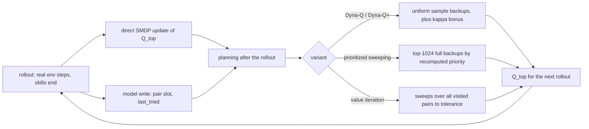

# Dyna-Q over a Skill-Level Progress Model implementation plan

Status: draft

> **For agentic workers:** REQUIRED SUB-SKILL: Use superpowers:subagent-driven-development (recommended) or superpowers:executing-plans to implement this plan task-by-task. Steps use checkbox (`- [ ]`) syntax for tracking.

**Goal:** add the book's Dyna-Q planning to the SMDP skill agent: a lookup-table model of skill outcomes over progress keys, learned from real skill runs, and planning backups on the top-level table (Dyna-Q, Dyna-Q+, prioritized sweeping, value iteration); tune it at Craftax-1M on top of the tuned `smdp-skills`, run it at 1M and 1B, and compare planning against model-free on the same skills and seeds.

**Architecture:** `training/dyna_q.py` holds the model (pair index `[2^20, 25]`, $P = 2^{16}$ visited pairs, $M$ ring slots of $(R, \gamma^\tau, k', \text{done}, \text{mask}')$ per pair), the four planning variants and a trainer that wraps the `smdp-skills` trainer ([[2026-10-20-craftax-method-smdp-skills]]): the rollout writes every finished skill to the model, and after each rollout a planning step updates `Q_top` before the next rollout. Registry entry `dyna-q`. Design decisions: [[Dyna-Q over a Skill-Level Progress Model design]], [[Craftax skill library]].

**Tech Stack:** JAX 0.11 (`jax.lax.fori_loop`, `jax.lax.top_k`), craftax 1.6.1, flax, optax, MLflow, the runner and queue of [[2026-10-20-craftax-infrastructure]].

---

## Design

- Model learning: each real skill end writes $(R, \gamma^\tau, k', \text{done}, \text{mask}')$ to slot `count mod M` of its pair; `last_tried` is the time in thousandths of the run's budget.
- Planning per rollout: $n \times$ (skills finished in the rollout) backups in batches of 1024, with the SMDP target of `smdp-skills` and the duplicate-mean rule; $n = 0$ is `smdp-skills` exactly.
- Variants: uniform sample backups with Dyna-Q+ bonus $\kappa\sqrt{t - t^{\text{last}}}$ (κ = 0 is Dyna-Q); prioritized sweeping by recomputed full-backup priorities; value iteration to convergence over the visited pairs ([[08a Models, planning, Dyna]], [[04 Dynamic programming]]).
- All `smdp-skills` knobs are fixed at its tuned best; only the planning knobs are tuned here.
- Same skills, same prior knowledge, same separate reporting block as `smdp-skills` ([[Craftax skill library#Prior knowledge]]).

## Hyperparameter grid

Stage 1 (coarse, Craftax-1M, 3 seeds; starts after [[2026-10-20-craftax-method-smdp-skills]] Task 8):

| Knob | Values | Why |
|---|---|---|
| Model variant | uniform, prioritized sweeping, value iteration | sample backups, focused backups and full backups, the planning spectrum of Chapter 8 |
| Planning backups per finished real skill $n$ (uniform and prioritized only) | 1, 5, 20 | the candidate range 1-20; the book's maze gained most from 0 to 5 and less from 5 to 50 |
| Dyna-Q+ κ | 0, 0.003, 0.03 | κ = 0 is plain Dyna-Q; with time in thousandths of the budget the bonus is at most about 0.1 and 1 reward unit (one basic achievement) |

- Configs: 2 variants x 3 $n$ x 3 κ + value iteration x 3 κ = 21; 63 runs.

Stage 2 (fine, Craftax-1M, 3 seeds):

- κ: best x {0.5, 1, 2}; if the best κ is 0, the values are {0, 0.0015, 0.003}.
- Model slots $M$: 4, 8, 16 (averaging over hidden map situations against staleness of an improving skill).
- Configs: 3 x 3 = 9, the centre is the stage-1 best and is reused by run name; 8 new configs, 24 runs.
- Selection: highest mean final score over 3 seeds; ties go to the cheaper variant (uniform, then prioritized, then value iteration) and the smaller $n$.

Fixed settings:

| Setting | Value | Note |
|---|---|---|
| `smdp-skills` knobs (α, γ, ε decay, timeout multiplier, key granularity) | tuned best of [[2026-10-20-craftax-method-smdp-skills]] | planning is the only change |
| Skill network | the PQN-RNN control's 1M and 1B settings, as in [[2026-10-20-craftax-method-smdp-skills]] | 1B: 1024 x 128, ε 1.0 to 0.005 over 10%, lr 3e-4, γ 0.99, λ 0.5 ([[PQN-RNN (Gallici 2025)]] Table 4) |
| Visited-pair capacity $P$ | $2^{16}$ | abort if reached |
| Model slots $M$ (stage 1) | 8 | candidate range 8-32; stage 2 tests 4 and 16 |
| Planning batch | 1024 pairs | one vectorised gather and scatter per batch |
| Prioritized sweeping threshold θ | $10^{-4}$ | pairs below it are not backed up |
| Value iteration | step 1, tolerance $10^{-3}$, at most 50 sweeps per rollout | full backups of all visited pairs |
| Dyna-Q+ time unit | 1/1000 of the run's budget | κ transfers from 1M to 1B |
| 1B finals | best 1M method knobs on the 1B skill-network settings | no 1B tuning |

## Runs and laptop time estimate

- Throughput: PQN-RNN 2,400 steps/s (shared assumption), Craftax-Classic RNN 8,000 steps/s.
- Overhead factor 1.15 (estimate): the `smdp-skills` factor 1.1 plus planning after each rollout; at 1B a rollout of 131,072 steps ends roughly 900 skills, so $n = 20$ is about 18,000 table backups in 18 batches, and a prioritized or value-iteration pass reads at most $P \times M$ = 524,288 slots per batch or sweep, all small against one PQN-RNN update.
- Method throughput: 2,087 steps/s on Craftax, 6,957 steps/s on Craftax-Classic; +1 min compile per run.

| Phase | Configs | Seeds | Steps per run | Runs | Est. steps/s | Est. hours (laptop, sequential) |
|---|---|---|---|---|---|---|
| `smoke` (Classic) | 2 | 1 | 200k | 2 | 6,957 | 0.05 |
| `tune-coarse` | 21 | 3 | 1M | 63 | 2,087 | 9.44 |
| `tune-fine` | 8 new | 3 | 1M | 24 | 2,087 | 3.59 |
| `final-1m` (best + κ ablation) | 2 | 10 | 1M | 20 | 2,087 | 3.00 |
| `final-1b` | 1 | 10 | 1B | 10 | 2,087 | 1,331.2 |
| Total | | | | 119 | | 1,347.3 |

- One 1M run: 0.150 h; one 1B run: 133.1 h.
- 1B on a CUDA cluster GPU (authors' hardware, estimate): 266,961 x 0.8 (RNN) / 1.15 = 185,712 steps/s, 1.51 h per run, 15.1 h for 10 seeds.
- Measured throughput replaces these numbers in [[2026-10-20-craftax-compute-budget]] after the smoke phase.

### Task 1: Skill-outcome model

**Files:**
- Create: `src/wut_murl_craftax/training/dyna_q.py` (model functions)
- Test: `tests/training/test_dyna_q.py`

- [ ] **Step 1: Write the failing tests**: first visits get pair slots 0, 1, 2 in order and repeated visits reuse their slot; 10 records of one pair with $M = 8$ keep the last 8 in ring order and `count` = 10; two envs writing the same new pair in one step get one pair slot and two outcome slots; `last_tried` holds the time of the latest write; reaching $P$ sets the `full` flag; model accuracy is 1 for a repeated deterministic outcome and 0 for a new next key; all functions `jit` and `vmap` cleanly.
- [ ] **Step 2: Implement** `ModelState` (`pair_id`, `pair_k`, `pair_o`, `n_pairs`, `m_R`, `m_disc`, `m_next`, `m_done`, `m_avail`, `count`, `last_tried`), `init_model(log2_rows, n_skills, P, M)` and `write(model, records, ended, t)`.
- [ ] **Step 3: Run** `uv run pytest tests/training/test_dyna_q.py -q`.

### Task 2: Planning updates

**Files:**
- Modify: `src/wut_murl_craftax/training/dyna_q.py` (planning)
- Test: `tests/training/test_dyna_q.py`

- [ ] **Step 1: Write the failing tests** on toy deterministic chains (one skill per key, τ = 1, reward 1 on reaching the terminal goal, γ 0.95):
  - Book corridor $A \to B \to C \to G$ ([[08a Models, planning, Dyna]], dataset example), α 0.1, all values 0: the real update of $C$ gives 0.1; planning backups of $B$ then $A$ (fixed order) give 0.0095 and 0.00090 (to 5 decimals).
  - Chain $k_0 \to k_4 \to G$ (5 keys), α 1, one real episode: with $n = 0$ only $Q[k_4] = 1$ and $Q[k_0] = 0$; prioritized sweeping with batch 1 and 4 backups gives $Q[k_3], Q[k_2], Q[k_1], Q[k_0] = 0.95, 0.9025, 0.857375, 0.81450625$, in that order: planning carries the value back to the start after one episode, where model-free needs 5 episodes.
  - Value iteration on the same model converges to $0.95^{4-i}$ at key $k_i$ within the tolerance.
  - Full backup over two stored outcomes (R = 1 terminal, R = 0 terminal) gives target 0.5; the mask of the next state is applied in the max.
  - Dyna-Q+: a pair last tried 16 time units ago with κ 0.01 gets +0.04 on its planned target; the direct real update never gets a bonus.
  - $n = 0$: after the same real records the table equals the `smdp-skills` table bit for bit.
  - Uniform planning samples only visited pairs and only filled slots (10,000 draws).
- [ ] **Step 2: Implement** `plan(Q, model, n_backups, variant, kappa, t, key)` with `uniform_batch`, `priorities` (full-backup targets of all visited pairs), `prioritized_batch` (`jax.lax.top_k`, threshold θ) and `value_iteration` (`jax.lax.while_loop` to tolerance or 50 sweeps), all reusing `smdp_update` of `training/smdp.py`.
- [ ] **Step 3: Run** `uv run pytest tests/training/test_dyna_q.py -q`.

### Task 3: Trainer, registry entry and config

**Files:**
- Modify: `src/wut_murl_craftax/training/dyna_q.py` (trainer), `src/wut_murl_craftax/training/interface.py` (entry `dyna-q`)
- Create: `configs/methods/dyna-q.yaml` (base = best `smdp-skills` config, `grid_stage1`, `grid_stage2` rule, `ablations`)
- Test: `tests/training/test_dyna_q_trainer.py`

- [ ] **Step 1: Write the failing tests**: with $n = 0$ two updates on Craftax-Classic give the same `Q_top`, skill-network parameters and metrics as `smdp-skills` with the same seed; with $n > 0$ the env-step counter equals the $n = 0$ run's (planning uses no env steps); the model is in the checkpoint and a resumed run equals an uninterrupted one; the entry passes the interface test of [[2026-10-20-craftax-infrastructure]] Task 3.
- [ ] **Step 2: Implement** the trainer as the `smdp-skills` trainer with two additions: the rollout carry holds `ModelState` and writes records at skill ends; `plan(...)` runs between the rollout and the next one.
- [ ] **Step 3: Write** `configs/methods/dyna-q.yaml`; `uv run python -m wut_murl_craftax.orchestration.queue --phase configs/phases/tune-coarse.yaml --method dyna-q --dry-run` lists 63 runs.
- [ ] **Step 4: Run** `make tests`.

### Task 4: Method metrics

**Files:**
- Modify: `src/wut_murl_craftax/training/dyna_q.py`
- Test: `tests/training/test_dyna_q_trainer.py`

- [ ] **Step 1: Write the failing test**: one update logs every metric below; `dyna/pairs_visited` never decreases; `dyna/model_accuracy` lies in [0, 1].
- [ ] **Step 2: Implement** per-update logging beyond [[2026-10-20-craftax-evaluation-and-metrics]] and the `smdp-skills` metrics: `dyna/pairs_visited`, `dyna/pairs_full_share` (pairs with $M$ outcomes), `dyna/model_accuracy`, `dyna/backups`, `dyna/plan_td_abs`, `dyna/bonus_mean`, `dyna/stale_share` (pairs untried for more than 100 time units), `dyna/ps_above_theta` (prioritized), `dyna/vi_sweeps` and `dyna/vi_residual` (value iteration), `dyna/plan_wall_share` (planning time over update time).
- [ ] **Step 3: Implement** per checkpoint `dyna_model_graph.parquet` (visited pair, decoded key fields, skill, most frequent next key, mean $R$, mean τ, count): the learned skill graph, compared in the write-up with the hand-drawn graph of [[Craftax skill library#Skill dependency graph]].
- [ ] **Step 4: Run** `uv run pytest tests/training/test_dyna_q_trainer.py -q`.

### Task 5: Smoke run

**Files:**
- Modify: `configs/phases/smoke.yaml` (dyna-q: config A uniform, $n = 5$, κ 0; config B prioritized, $n = 5$, κ 0.003; 1 seed, 200k steps, Craftax-Classic; `smdp-skills` knobs at its base config)

- [ ] **Step 1: Run** `make queue PHASE=smoke METHOD=dyna-q`; expected: 2 runs finish, `dyna/pairs_visited` > 0, `dyna/model_accuracy` rises, no NaN.
- [ ] **Step 2: Interrupt** one run with Ctrl-C and rerun the command; expected: it resumes with the same model (equal `dyna/pairs_visited` at the checkpoint).
- [ ] **Step 3: Record** measured steps/s and `dyna/plan_wall_share` in [[2026-10-20-craftax-compute-budget]].

### Task 6: Coarse tuning

- [ ] **Step 1: Set** the base of `configs/methods/dyna-q.yaml` to the `best=true` config of `smdp-skills`.
- [ ] **Step 2: Run** `make queue PHASE=tune-coarse METHOD=dyna-q` (63 runs, resumable); `make status PHASE=tune-coarse` shows 63 finished for this method.
- [ ] **Step 3: Write** the stage-1 table (config, mean final score, sd, pairs visited, model accuracy, planning wall share) into this plan under a new section `## Results`.

### Task 7: Fine tuning

- [ ] **Step 1: Fill** `grid_stage2` in `configs/methods/dyna-q.yaml` from Task 6.
- [ ] **Step 2: Run** `make queue PHASE=tune-fine METHOD=dyna-q` (24 new runs).
- [ ] **Step 3: Tag** the best config `best=true` in MLflow; record it in `## Results` and [[Experiment decisions]].

### Task 8: Final 1M with the κ ablation

- [ ] **Step 1: Run** `make queue PHASE=final-1m METHOD=dyna-q` (best config and the κ ablation, seeds 0-9: 20 runs); the ablation sets κ = 0 if the best κ > 0, else the best nonzero stage-1 κ.
- [ ] **Step 2: Check** that the `smdp-skills` and PQN-RNN finals exist with the same seeds; the model-free against planning comparison, the learning-speed comparison (env steps to the first and tenth `COLLECT_DIAMOND` episode) and the statistics follow [[2026-10-20-craftax-comparison-and-results]], in the skill methods' own block.

### Task 9: Final 1B

- [ ] **Step 1: Run** `make queue PHASE=final-1b METHOD=dyna-q` (best 1M knobs on the 1B skill-network settings, 10 seeds; laptop or `scripts/cluster/run_array.sh`).
- [ ] **Step 2: Merge** node stores with `make merge-mlflow SRC=<store>`; `make status PHASE=final-1b` shows 10 finished for this method.

### Task 10: Analysis hooks and abort rules

**Files:**
- Modify: `src/wut_murl_craftax/training/dyna_q.py` (guards), `src/wut_murl_craftax/analysis/obstacles.py` (method detectors, from [[2026-10-20-craftax-training-analysis]])
- Test: `tests/training/test_dyna_q_trainer.py`, `tests/analysis/test_obstacles.py`

- [ ] **Step 1: Write the failing tests**: a NaN after planning aborts with `abort=nan`; reaching $P$ aborts with `abort=model_full`; an updated `Q_top` entry above 300 aborts with `abort=divergence`; each detector below fires on a synthetic series and stays silent on a clean one.
- [ ] **Step 2: Implement** the abort rules (the `smdp-skills` ones plus `model_full`) and a warning tag `plan_slow` when `dyna/plan_wall_share` > 0.3.
- [ ] **Step 3: Implement** the detectors for [[2026-10-20-craftax-training-analysis]]:
  - Planned-value gap: `smdp/q_start` above 2x the mean return of finished episodes for >= 10% of the budget after the ε decay (the model promises what the skills do not deliver).
  - Stale model: `dyna/model_accuracy` falling by > 0.2 within 10% of the budget (skills or floors changed the outcomes).
  - Bonus-driven re-trying (κ > 0): the share of decisions on pairs with count > 1000 and success rate > 90% rising while the score is flat.
  - No planning effect: `dyna/plan_td_abs` below $10^{-3}$ for >= 20% of the budget (nothing left to propagate; planning equals model-free).
  - The `smdp-skills` detectors of [[2026-10-20-craftax-method-smdp-skills]] Task 11, unchanged.
- [ ] **Step 4: Run** `make tests`.

## Risks

- Key aliasing: one pair hides the map, so its outcomes are random and planned values average them; $M$ slots and full backups model this, the stale-model detector shows when it fails.
- Improving skills make old outcomes wrong: small $M$ and the Dyna-Q+ bonus keep the model recent; $M$ is a stage-2 knob.
- Planning helps only the top level: if skill learning is the bottleneck, `dyna-q` and `smdp-skills` score the same, which answers the model-free against planning question.
- Over-optimism: a large κ makes the agent re-try known skills; κ = 0 is in both grids and in the final ablation.
- Model capacity: $P = 2^{16}$ pairs, `dyna/pairs_visited` logged, abort when full.
- Order dependence: Dyna's tuning waits for `smdp-skills` Task 8; a later change of the `smdp-skills` best config reruns this method's tuning.
