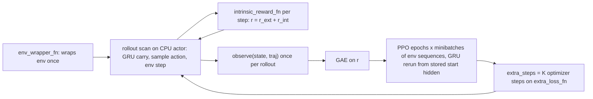
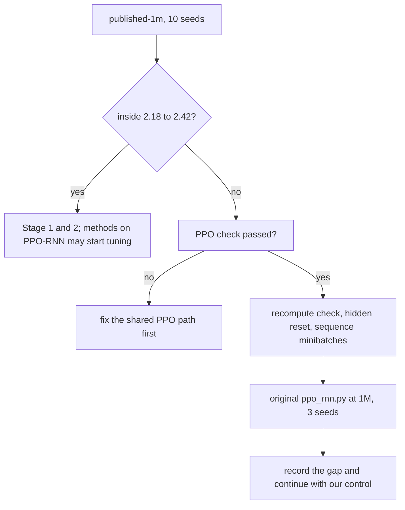

# Craftax PPO-RNN control implementation plan

Status: draft

> **For agentic workers:** REQUIRED SUB-SKILL: Use superpowers:subagent-driven-development (recommended) or superpowers:executing-plans to implement this plan task-by-task. Steps use checkbox (`- [ ]`) syntax for tracking.

**Goal:** a recurrent PPO control that reproduces the published Craftax-Symbolic scores (2.3% at 1M, 15.3% at 1B, [[Craftax Baselines results]]) inside an acceptance band, is lightly tuned at 1M, and is the base module that the count-bonus, self-imitation and skill methods extend through named hooks.

**Architecture:** new module `src/wut_murl_craftax/training/ppo_rnn.py` with `PPORNNConfig`, `ActorCriticRNN` (Dense 512 ReLU, GRU 512 reset on done, actor and critic heads 2 x Dense 512 ReLU) and `make_trainer(cfg)`; it reuses GAE and `ppo_terms` (the loss math) from `training/ppo.py`. Extension points are fields of `PPORNNConfig`, defined once in a new shared `src/wut_murl_craftax/training/hooks.py` (`HookFields`, also mixed into `PQNRNNConfig`): `init_state_fn`, `intrinsic_reward_fn`, `observe`, `extra_loss_fn` (with `extra_steps`), `env_wrapper_fn`, `metrics_fn`; a method sets them in its factory, for example `PPORNNConfig(intrinsic_reward_fn=..., ...)`; the method state they share lives in the train state and is checkpointed. Registry entry `ppo-rnn` in `training/interface.py` ([[2026-10-20-craftax-infrastructure]] Task 3); config `configs/methods/ppo-rnn.yaml`. Design decisions: [[PPO-RNN design]].

**Tech Stack:** JAX 0.11, craftax 1.6.1, flax (`nn.GRUCell`, `nn.scan`), optax, MLflow, PyYAML, existing `training.ppo`, `training.records`, `training.checkpoints`, `orchestration`, `evaluation.reproduction` (from [[2026-10-20-craftax-method-ppo]] Task 4).

---

## Design

- Same PPO losses and optimiser as [[PPO design]]; the network adds a GRU between a Dense(512) embedding and the two heads, ReLU throughout, as in Craftax_Baselines `ppo_rnn.py` (the script behind 15.3%).
- Minibatches are whole env sequences: the rollout stores the hidden state at its start, and every minibatch reruns the GRU over its envs' full `num_steps` sequence.
- 1M settings are not published for PPO-RNN; the base is PPO Table 11 with the recurrent network (the Simulus third-party rerun with these settings gives 2.2%).
- Hooks are the only way methods change the control; with no hooks (or all-zero hooks) the trainer is bit-identical to the control.
- Reproduction check, light tuning and the tuned-config rule as in [[2026-10-20-craftax-method-ppo]]; decisions in [[PPO-RNN design]].

## Hyperparameter grid

Stage 1 (coarse, Craftax-1M, 3 seeds; the published config gets 10 seeds as the reproduction check): one knob at a time from the base (Table 11 + ReLU GRU), 8 configs.

| Knob | Values (base first) | Why |
|---|---|---|
| Rollout shape (envs x steps) | 256 x 16; 1024 x 64 with lr 2e-4 (Table 7 at 1M, 15 updates); 64 x 64 | 1M vs 1B table; 64 x 64 keeps 4,096 steps per update but gives the GRU 64-step sequences (Table 11 tried 64 steps) |
| Activation | ReLU (code); tanh (Table 7) | the paper text implies PPO's tanh, the code uses ReLU; `--activation` is a no-op |
| Learning rate | 3e-4; 2e-4; 4e-4 | the 1M values the paper tried for PPO |
| GAE lambda | 0.8; 0.9 | memory may carry longer credit; tried values only |
| Entropy coefficient | 0.01; 0 | tried at 1B {0, 0.01} |

Configs: base (1) + shape (2) + activation (1) + lr (2) + lambda (1) + entropy (1) = 8; runs = 7 x 3 + 10 = 31.

Stage 2 (fine, Craftax-1M, 3 seeds): the best Stage 1 config; the 1-2 numeric knobs with the largest Stage 1 effect; rollout shape and activation are categorical and not refined.

| Knob | Fine values around the best coarse value b |
|---|---|
| Learning rate | b x 0.75, b x 1.5 |
| GAE lambda | b - 0.05, b + 0.05 |
| Entropy coefficient | b x 0.5, b x 2 (if b = 0: 0.001, 0.003) |

Expected: 4 configs, 12 runs. Selection: `tuned` = the best config only if its 3-seed mean beats the published config's 10-seed mean by more than h (Task 6); otherwise `tuned` = published. `tuned` is the fixed shared setting of count-bonus (PPO-RNN variant) and self-imitation learning (`base_from: ppo-rnn.tuned`).

Fixed settings:

| Setting | Craftax-1M (base) | Craftax-1B (Table 7) | Note |
|---|---|---|---|
| Environment | `Craftax-Symbolic-v1` | `Craftax-Symbolic-v1` | Classic only in `smoke` |
| Envs x steps | 256 x 16 | 1024 x 64 | sequence length = `num_steps` |
| Epochs, minibatches | 4, 8 (32 envs each) | 4, 8 (128 envs each) | minibatches split envs, not steps |
| Learning rate | 3e-4, annealed | 2e-4, annealed | Adam eps 1e-5, grad clip 1.0 |
| Gamma, GAE lambda, clip, vf, ent | 0.99, 0.8, 0.2, 0.5, 0.01 | same | [[Craftax Baselines algorithms and hyperparameters]] |
| Network | Dense 512 ReLU, GRU 512, heads 2 x Dense 512 ReLU | same | `ppo_rnn.py` `ActorCriticRNN` |
| Hidden reset | zeros where the previous step ended an episode | same | `ScannedRNN` |
| Resets | optimistic, ratio 16 | optimistic, ratio 16 | as PPO and the original: `training/wrappers.py` ([[2026-10-20-craftax-method-ppo]] Task 2); ratio `min(16, envs)`, so 64 x 64 generates 4 worlds per step |

- 1B: no tuning; final-1b = Table 7 + the published network (ReLU), the 1B reproduction check. Methods built on PPO-RNN take their 1B shared settings from this column.

## Runs and laptop time estimate

Throughput (estimate): GRU 512 planning value 2,400 steps/s (0.8 x PPO); Craftax-Classic 8,000 steps/s (0.8 x 10,000); overhead factor 1.25 relative to PPO (estimate: the GRU and 2-layer heads add about a third of the PPO MLP's per-step work; the factor is the shared RNN planning value); +1 min compile per run.

| Phase (MLflow experiment) | Configs | Seeds | Steps per run | Runs | Est. steps/s | Est. hours (laptop, sequential) |
|---|---|---|---|---|---|---|
| `smoke` (Craftax-Classic) | 2 | 1 | 200k | 2 | 8,000 | 0.05 |
| `tune-coarse` | 8 | 3 (published: 10) | 1M | 31 | 2,400 | 4.10 |
| `tune-fine` | 4 | 3 | 1M | 12 | 2,400 | 1.59 |
| `final-1m` | 1 | 10 | 1M | 10 | 2,400 | 1.32 |
| `final-1b` | 1 | 10 | 1B | 10 | 2,400 | 1157.57 |
| Total | | | | 65 | | 1164.6 |

- One 1M run: 1e6 / 2,400 + 60 s = 477 s; one 1B run: 416,727 s = 115.8 h.
- final-1b on a CUDA cluster GPU (authors' hardware, estimate): 1e9 / 266,961 steps/s x 1.25 = 1.30 h per run, 13.0 h for 10 seeds.
- The planning value is replaced by the measurement of infrastructure Task 7 ([[2026-10-20-craftax-compute-budget]]).

## Tasks

### Task 1: Shared hooks

**Files:**
- Create: `src/wut_murl_craftax/training/hooks.py`
- Test: `tests/training/test_hooks.py`

- [ ] **Step 1: Write the failing tests**: a `HookFields` dataclass has every hook `None` and `extra_steps = 0`; callables are excluded from the YAML round trip and from the config hash of run names (the method name carries them); `resolve(cfg)` fills no-op defaults (zero reward, empty state, identity `observe` and wrapper, no extra steps) and reports `active` names; `metrics_fn` output `{"x": 1.0}` is logged as `hook/x`; a method state pytree survives a checkpoint round trip (`training/checkpoints.py`).
- [ ] **Step 2: Implement** the frozen dataclass and its contract:

| Hook | Called | Signature | Example user |
|---|---|---|---|
| `init_state_fn` | once, in `init` | `(key, spec) -> state` | count table, SIL buffer |
| `intrinsic_reward_fn` | every env step inside the rollout scan (actor device) | `(state, env_state, next_env_state, obs_next, done, t) -> (r_int, state)` | count-based progress bonus |
| `observe` | once per rollout, before GAE (learner device) | `(state, traj) -> state` | SIL buffer insert, count update after the rollout |
| `extra_loss_fn` | `extra_steps = K` optimizer steps after the PPO epochs | `(params, state, key) -> (loss, (state, metrics))` | SIL loss on buffer samples (may update priorities in `state`) |
| `env_wrapper_fn` | once, when the env is built | `(env, env_params) -> (env, env_params)` | observation features, skill wrappers |
| `metrics_fn` | once per update | `(state) -> dict` | buffer fill, count-table size |

- `state` is the method state: one pytree stored in the train state next to the network, checkpointed with it (resumable runs), moved to the actor for the rollout and back to the learner afterwards.
- `t` is the run's env-step counter at that step (int32); `traj` holds the rollout arrays `obs`, `action`, `reward` (extrinsic), `r_int`, `done`, `value`, `logp`, plus the start hidden state.
- `extra_steps` is a `PPORNNConfig` field (default 0); the extra steps use the same Adam state; the learning-rate schedule is indexed by update, not by optimizer count, so K does not shift it.

- [ ] **Step 3: Document** in the module docstring: env states give `achievements` and inventory ([[Craftax scoring and evaluation]]); `r_int` is added to the reward before GAE and the extrinsic reward is kept for the score; hook callables close over the method's own config (and the network via `make_network`, exposed by each base module); `None` hooks are skipped at trace time, so the control graph is unchanged; `env_wrapper_fn` wraps the no-auto-reset env inside `LogWrapper` and `OptimisticResetVecEnvWrapper`, so a wrapper that changes reward or `done` acts before the reset ([[Craftax API and wrappers]]); the same contract serves `training/pqn_rnn.py` (`r_int` enters the Q(lambda) targets).
- [ ] **Step 4: Run** `uv run pytest tests/training/test_hooks.py -q`.

### Task 2: Recurrent network and trainer

**Files:**
- Create: `src/wut_murl_craftax/training/ppo_rnn.py`
- Modify: `src/wut_murl_craftax/training/__init__.py`, `src/wut_murl_craftax/training/interface.py` (entry `ppo-rnn`; recurrent `Policy` with `init_carry(n)` and `step(carry, obs, done, key)`; PPO returns an empty carry)
- Test: `tests/training/test_ppo_rnn.py`

- [ ] **Step 1: Write the failing tests** (Task 3 list).
- [ ] **Step 2: Implement** `PPORNNConfig` (the `PPOConfig` fields plus `rnn_width: int = 512`, `activation: Literal["relu", "tanh"] = "relu"`, `extra_steps: int = 0`; `envs % minibatches == 0` checked), `ScannedGRU` (reset to zeros where `last_done`), `ActorCriticRNN`.
- [ ] **Step 3: Implement** the rollout on the PPO env setup (`auto_reset=False`, `LogWrapper`, `OptimisticResetVecEnvWrapper` from `training/wrappers.py`): carry `(hidden, obs, last_done, env_state, method_state, key)`; store `hidden` at the rollout start; call `intrinsic_reward_fn` per step; `observe` once on the finished trajectory; GAE via the shared function from `training/ppo.py`.
- [ ] **Step 4: Implement** the update: permute envs (axis 1) once per epoch, split into `minibatches` groups of whole sequences, rerun the GRU from the stored start hidden, loss = `ppo_terms(...)`; then `extra_steps` Adam steps on `extra_loss_fn`.
- [ ] **Step 5: Implement** `make_network(cfg, n_actions, obs_dim)` (public, so add-ons can apply the network in their losses) and `make_trainer(cfg)` with `init`, `train_chunk`, `policy` (infrastructure Task 3), using `device_roles()`: rollout on the actor, update, `observe` and extra steps on the learner; the method state follows the step that uses it.
- [ ] **Step 6: Run** `uv run pytest tests/training/test_ppo_rnn.py -q`, then `make tests`.

### Task 3: Correctness tests on tiny inputs

**Files:**
- Test: `tests/training/test_ppo_rnn.py`, `tests/training/test_ppo_rnn_hooks.py`

- [ ] **Step 1: Write** the tests: (a) GRU reset: the output at a step after `done` equals the output of a fresh zero hidden on the same input; (b) recompute check: in epoch 1, before the first gradient step, recomputed log-probs and values equal the rollout's to 1e-5, so the stored start hidden and the sequence rerun are right; (c) minibatches hold whole env sequences (env ids per minibatch disjoint, all `num_steps` present); (d) advantages equal `training.ppo` GAE on the same arrays; (e) determinism: same seed, identical params after 2 updates on Craftax-Classic with 8 envs x 8 steps; (f) `PPORNNConfig` 1B resolves to Table 7 and ReLU.
- [ ] **Step 2: Write** the hook tests: zero hooks (`r_int = 0`, identity `observe`, `extra_steps = 0`) give bit-identical params to no hooks after 2 updates (CPU); a constant `r_int = c` shifts every one-step TD error by `c` (hand check on a 3-step example); `intrinsic_reward_fn` that counts calls in `state` sees `envs x num_steps` calls per update and the count survives a checkpoint and resume; `extra_loss_fn = 1e-3 * sum(p**2)` with `extra_steps = 2` lowers the param norm against the control and leaves the learning rate of the next update unchanged; `observe` sees the rollout's extrinsic `reward` and `done`; an `env_wrapper_fn` that appends 3 features makes the first Dense take 8268 + 3 inputs.
- [ ] **Step 3: Run** `uv run pytest tests/training/test_ppo_rnn.py tests/training/test_ppo_rnn_hooks.py -q`.

### Task 4: Config file

**Files:**
- Create: `configs/methods/ppo-rnn.yaml`
- Test: `tests/training/test_ppo_rnn_configs.py`

- [ ] **Step 1: Write the failing test**: `base` = Table 11 + ReLU GRU 512; `budgets.1b` = Table 7; 8 coarse entries each differing in exactly the Stage 1 keys; `published-1m` has 10 seeds; `tuned: null`.
- [ ] **Step 2: Write** the YAML (base, budgets, `grid.coarse`, `grid.fine` rule, `abort`, `tuned`).
- [ ] **Step 3: Run** `uv run pytest tests/training/test_ppo_rnn_configs.py -q`.

### Task 5: Smoke run

**Files:**
- Modify: `configs/phases/smoke.yaml` (add `ppo-rnn`: Craftax-Classic, `published-1m` and `activation-tanh`, 1 seed, 200k steps)

- [ ] **Step 1: Run** `make queue PHASE=smoke METHOD=ppo-rnn`; 2 finished in MLflow experiment `smoke`.
- [ ] **Step 2: Check**: return above the uniform-random Classic return of [[2026-10-20-craftax-method-ppo]] Task 3; `ppo/ratio_first_mb` within 1e-5 of 1; no NaN; record steps/s in [[2026-10-20-craftax-compute-budget]].

### Task 6: Stage 1 and the 1M reproduction check

**Acceptance band** (formula and debug order of [[2026-10-20-craftax-method-ppo]] Task 5):

- 1M: published 2.3; s_pub 0.083 (Simulus PPO-RNN 1M per-run data, last 5 updates per seed; derived here: mean 2.205, sd 0.083 over 10 seeds); planning h 0.12, band 2.18 to 2.42.
- 1B: published 15.3; s_pub 0.35 (largest third-party spread: Singh, Ghasemi, Crowley 2026, 37.05 +- 0.78 raw, type not stated; [[PPO-RNN (Matthews 2024)]]); planning h 0.36, band 14.94 to 15.66.
- Debug step 5 runs the original `ppo_rnn.py` (`--total_timesteps 1e6 --num_envs 256 --num_steps 16 --lr 3e-4`); the Simulus rerun already used these flags, so a pass of the original and a fail of ours points at our port.

**Files:**
- Modify: `configs/phases/tune-coarse.yaml` (add `ppo-rnn`)

- [ ] **Step 1: Run** `make queue PHASE=tune-coarse METHOD=ppo-rnn`; `make status PHASE=tune-coarse` shows 31 finished for `ppo-rnn`.
- [ ] **Step 2: Run** `uv run python -m wut_murl_craftax.evaluation.reproduction --method ppo-rnn --budget 1m --phase tune-coarse`; on a fail, work the diagram, 3 seeds per diagnostic run, results noted in [[PPO-RNN design]].

### Task 7: Stage 2 and the tuned config

**Files:**
- Modify: `configs/methods/ppo-rnn.yaml`, `configs/phases/tune-fine.yaml`

- [ ] **Step 1: Run** `uv run python -m wut_murl_craftax.orchestration.queue --expand-fine ppo-rnn`, review the 4 entries in the diff, then `make queue PHASE=tune-fine METHOD=ppo-rnn`; 12 finished.
- [ ] **Step 2: Apply** the selection rule, write `tuned`, add a dated section to [[Experiment decisions]]; tell the count-bonus and SIL plans' owners that `ppo-rnn.tuned` is final.

### Task 8: PPO-RNN metrics logged per update

**Files:**
- Modify: `src/wut_murl_craftax/training/ppo_rnn.py`
- Test: `tests/training/test_ppo_rnn.py`

- [ ] **Step 1: Write the failing test**: `train_chunk` returns the PPO names of [[2026-10-20-craftax-method-ppo]] Task 7 plus `rnn/hidden_norm` (mean L2 norm of the GRU state), `rnn/hidden_saturation` (share of hidden units with absolute value > 0.95), `rnn/reset_share` (share of steps with a reset), `ppo/ratio_first_mb` (mean ratio of the first minibatch of epoch 1), `reward/extrinsic` and `reward/intrinsic` (per step), and every `hook/*` metric.
- [ ] **Step 2: Implement** them; `reward/intrinsic` is 0 for the control.

### Task 9: Finals at 1M and 1B

**Files:**
- Modify: `configs/phases/final-1m.yaml`, `configs/phases/final-1b.yaml`

- [ ] **Step 1: Run** `make queue PHASE=final-1m METHOD=ppo-rnn`; 10 finished.
- [ ] **Step 2: Run** `make queue PHASE=final-1b METHOD=ppo-rnn` (laptop or `scripts/cluster/run_array.sh`, merged with `make merge-mlflow SRC=<store>`); 10 finished.
- [ ] **Step 3: Run** `uv run python -m wut_murl_craftax.evaluation.reproduction --method ppo-rnn --budget 1b --phase final-1b`; report the result in [[2026-10-20-craftax-comparison-and-results]].

### Task 10: Analysis hooks and stop criteria

**Files:**
- Modify: `configs/methods/ppo-rnn.yaml` (`abort:` block)
- Test: `tests/orchestration/test_runner.py`

- [ ] **Step 1: Write the failing test**: a fake run with `ppo/ratio_first_mb` off 1 by more than 1e-3 at update 1 ends `FAILED` (recompute bug); NaN rules as PPO.
- [ ] **Step 2: Implement** the rules: abort on NaN or inf in any loss (one rerun from the last checkpoint, then an issue note); abort on a first-minibatch ratio error > 1e-3; flags for `rnn/hidden_saturation` > 0.9 for 5% of the budget, approx KL > 0.1 for 3 updates, entropy < 0.2 nats before 10% of the budget; no early stopping on score.
- [ ] **Step 3: Hand** to [[2026-10-20-craftax-training-analysis]] the obstacles to watch: skill forgetting of `defeat_zombie` (the paper: lowest for PPO-RNN), `eat_plant` never unlocked, dungeon entry rate as the expected signature (floor 1 more often than PPO), Gnomish Mines not reached, plateau at 1M, hidden-state saturation ([[Craftax floors and progression]], [[Craftax farming and food]]).
- [ ] **Step 4: Run** `make tests` and `uv run python scripts/check_vault.py`.

## Risks

- The paper gives no PPO-RNN 1M settings; the PPO 1M table is a choice, backed only by the third-party rerun.
- Sequence length 16 at 1M truncates backpropagation through time at 16 steps; the 64 x 64 shape in Stage 1 checks it.
- ReLU vs tanh: the published runs used ReLU; Stage 1 tests tanh; the 1B final keeps ReLU.
- Hooks change the jitted graph; the bit-identity test with all-zero hooks guards the control.
- The method state moves between actor and learner each update; a large SIL buffer makes this transfer costly, so SIL may keep its buffer out of the part used by `intrinsic_reward_fn` (its plan decides).
- Recurrent policies must carry hidden state in evaluation and video tools; the `Policy.init_carry` change touches [[2026-10-20-craftax-evaluation-and-metrics]] and [[Recording training data]].
