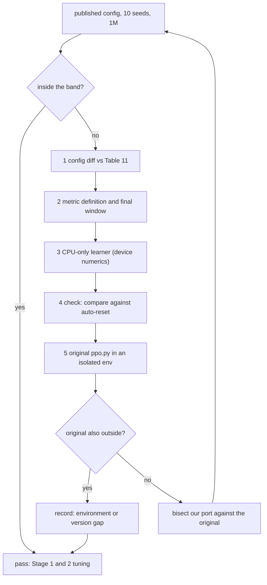

# Craftax PPO control implementation plan

Status: in progress

> **For agentic workers:** REQUIRED SUB-SKILL: Use superpowers:subagent-driven-development (recommended) or superpowers:executing-plans to implement this plan task-by-task. Steps use checkbox (`- [ ]`) syntax for tracking.

**Goal:** the feed-forward PPO control reproduces the published Craftax-Symbolic scores (2.2% at 1M, 11.9% at 1B, [[Craftax Baselines results]]) inside an acceptance band, is lightly tuned at 1M, and its tuned shared settings become the starting point of every PPO-based method in [[2026-10-20-craftax-project]].

**Architecture:** the trainer already exists: `src/wut_murl_craftax/training/ppo.py` (the MLP PPO ported from Craftax_Baselines `ppo.py`; adapted to the trainer interface by Task 3 of [[2026-10-20-craftax-infrastructure]]). This plan adds the paper configurations as `configs/methods/ppo.yaml`, a port audit against the original, the published reference scores (`configs/reference/published_scores.yaml`) with a shared reproduction check (`evaluation/reproduction.py`, also used by PPO-RNN and PQN-RNN), and the five phases. Design decisions: [[PPO design]].

**Tech Stack:** JAX 0.11, craftax 1.6.1, flax, optax, MLflow, PyYAML, existing `wut_murl_craftax.training` (ppo, records, checkpoints) and `wut_murl_craftax.orchestration` (queue, runner, runtime: `device_roles`, `env_mesh`, `shard_envs`), `wut_murl_craftax.evaluation.events` (`StepEvents`, [[2026-10-20-craftax-evaluation-and-metrics]] Task 2).

---

## Design

- Clipped PPO with GAE, separate actor and critic MLPs (3 x Dense(512), tanh), linear learning-rate annealing; the losses of the existing port are kept bit-for-bit.
- Two published configurations: Craftax-1M (paper Table 11) and Craftax-1B (paper Table 7); both are set explicitly, never taken from code defaults (the port's defaults are a Classic debugging setup).
- Reproduction check at 1M (published config, 10 seeds) before any method tuning starts, and at 1B (the final-1b phase itself, 3 seeds, so a wider band); acceptance band and debug order in Task 5.
- Light tuning: Stage 1 checks only published alternatives one knob at a time; the tuned config replaces the published one only if it wins by more than the band half-width.
- Optimistic resets, as the original: `auto_reset=False` envs inside Craftax_Baselines' `OptimisticResetVecEnvWrapper` with reset ratio 16 (`min(16, envs)`), vendored into `src/wut_murl_craftax/training/wrappers.py` (Task 2); every control and method uses the same reset setup ([[Experiment decisions]]); everything else matches `ppo.py` at commit 7ce36fa as well.
- Step events: the vendored reset wrapper computes a `StepEvents` record (unlocks, floor, damage, kills, ...) from the pre-reset next state of every env step, before the optimistic reset swaps in a new episode, and returns it in `info["events"]`; metrics, evaluation, SIL, skill success tests and the count bonus read these events, and nothing compares env states across a done step (an unlock on the last step of an episode, such as `DEFEAT_NECROMANCER`, is otherwise lost).
- Env batch sharded over the CPU devices (`env_mesh`, `shard_envs`) when the actor is the CPU and the runner started JAX with more than one host device ([[Craftax runtime setup]]).
- Decisions and their reasons: [[PPO design]].

## Hyperparameter grid

Stage 1 (coarse, Craftax-1M, 3 seeds; the published config gets 10 seeds because it is the reproduction check): one knob at a time away from Table 11, so the grid is 7 configs, not a Cartesian product.

| Knob | Values (published first) | Why |
|---|---|---|
| Rollout shape (envs x steps) | 256 x 16 (Table 11); 1024 x 64 with lr 2e-4 (Table 7 at 1M, 15 updates) | the paper tuned the two budgets separately; checks that the 1M table is needed |
| Learning rate | 3e-4; 2e-4; 4e-4 | the 1M values the paper tried (Table 11) |
| GAE lambda | 0.8; 0.7; 0.9 | tried at 1M {0.7, 0.8, 0.9, 0.95}; the neighbours of the chosen value |
| Entropy coefficient | 0.01; 0 | tried at 1B {0, 0.01}; a third-party rerun found entropy matters ([[PPO (Matthews 2024)]], RePPO row) |

Configs: published (1) + shape (1) + lr (2) + lambda (2) + entropy (1) = 7; runs = 6 x 3 + 10 = 28.

Stage 2 (fine, Craftax-1M, 3 seeds): take the best Stage 1 config; pick the 1-2 numeric knobs with the largest Stage 1 effect (range of 3-seed mean final scores over that knob's values); try 2 neighbours each; the rollout shape is categorical and never refined.

| Knob | Fine values around the best coarse value b |
|---|---|
| Learning rate | b x 0.75, b x 1.5 |
| GAE lambda | b - 0.05, b + 0.05 |
| Entropy coefficient | b x 0.5, b x 2 (if b = 0: 0.001, 0.003) |

Expected: 2 knobs x 2 values = 4 configs, 12 runs. Selection: the best Stage 1 or 2 config becomes `tuned` only if its 3-seed mean beats the published config's 10-seed mean by more than the reproduction band half-width h (Task 5); otherwise `tuned` = published.

Fixed settings (shared PPO settings for every PPO-based method start from the `tuned` column; [[Craftax Baselines algorithms and hyperparameters]]):

| Setting | Craftax-1M (Table 11) | Craftax-1B (Table 7) | Note |
|---|---|---|---|
| Environment | `Craftax-Symbolic-v1` | `Craftax-Symbolic-v1` | Classic only in `smoke` |
| Envs x steps per rollout | 256 x 16 (4,096) | 1024 x 64 (65,536) | updates 244 and 15,258 |
| Update epochs, minibatches | 4, 8 | 4, 8 | minibatch 512 and 8,192 steps |
| Learning rate | 3e-4, annealed to 0 | 2e-4, annealed to 0 | Adam eps 1e-5 |
| Gamma, GAE lambda | 0.99, 0.8 | 0.99, 0.8 | |
| Clip epsilon, value coef, entropy coef | 0.2, 0.5, 0.01 | 0.2, 0.5, 0.01 | value loss clipped |
| Max grad norm | 1.0 | 1.0 | code default, not in the tables |
| Width, activation | 512, tanh | 512, tanh | `--activation` is a no-op in the original; tanh is the class default |
| Resets | optimistic, ratio 16 (16 new worlds per step) | optimistic, ratio 16 (64 new worlds per step) | as the original: `auto_reset=False` + `OptimisticResetVecEnvWrapper` |

- 1B: no tuning; final-1b runs Table 7 exactly (PPO has no method knobs), which makes final-1b the 1B reproduction check.

## Runs and laptop time estimate

Throughput (estimate): PPO on Craftax-Symbolic 3,000 steps/s with 8 CPU shards, Craftax-Classic 10,000 steps/s; overhead factor 1.0 (PPO is the reference of the shared throughput assumptions; estimate); +1 min compile per run.

| Phase (MLflow experiment) | Configs | Seeds | Steps per run | Runs | Est. steps/s | Est. hours (laptop, sequential) |
|---|---|---|---|---|---|---|
| `smoke` (Craftax-Classic) | 2 | 1 | 200k | 2 | 10,000 | 0.04 |
| `tune-coarse` | 7 | 3 (published: 10) | 1M | 28 | 3,000 | 3.06 |
| `tune-fine` | 4 | 3 | 1M | 12 | 3,000 | 1.31 |
| `final-1m` | 1 | 10 | 1M | 10 | 3,000 | 1.09 |
| `final-1b` | 1 | 3 | 1B | 3 | 3,000 | 277.83 |
| Total | | | | 55 | | 283.3 |

Measured 2026-10-23 (laptop, Craftax-Symbolic 1M, run minutes = process start to last eval file; the estimate table above is superseded for these rows; details and caveats in [[2026-10-20-craftax-compute-budget]]):

| Phase | Runs | Measured min per run | Measured steps/s | Measured wall-clock |
|---|---|---|---|---|
| `tune-coarse` | 28 | 4.3 (1 worker) | 4,364 (published config) | 3.5 h (est. 3.06 h + 0.33 h eval) |
| `tune-fine` | 9 new + 3 reused | 6.9 (2 workers) | | 0.5 h (est. 1.31 h + 0.14 h) |
| `final-1m` (estimate) | 10 | 9.6 (2 workers, 13 checkpoints) | | 0.8 h (est. 1.09 h + 1.54 h) |
| `final-1b` on the laptop (estimate) | 3 | 63.7 h per run | 4,364 | 191 h (est. 277.8 h) |

- One 1M run: 1e6 / 3,000 + 60 s = 393 s; one 1B run: 333,393 s = 92.6 h.
- Optimistic resets should raise the measured throughput above these estimates (the authors report about 2x, [[Craftax performance]]); Task 3 records the measurement.
- final-1b on a CUDA cluster GPU (authors' hardware, estimate): 1e9 / 266,961 steps/s x 1.0 = 1.04 h per run excluding the 1-minute compile (the budget convention), 3.1 h for 3 seeds; laptop hours in the table include it.
- Fixed-seed evaluation is not in the table (rule and planning values: [[2026-10-20-craftax-evaluation-and-metrics]], "Evaluation cost"; estimate at 3,000 steps/s, Classic 10,000): smoke 0.01 h, tune-coarse 0.33 h, tune-fine 0.14 h, final-1m 1.54 h, final-1b 3.70 h (1.23 h per run, counted at the laptop rate wherever the run trained); 5.7 h in total, 2.0 h of it up to final-1m.
- Run counts feed [[2026-10-20-craftax-compute-budget]].

## Tasks

### Task 1: Paper configurations and reference scores

**Files:**
- Modify: `configs/methods/ppo.yaml` (created by infrastructure Task 1)
- Create: `configs/reference/published_scores.yaml`
- Test: `tests/training/test_ppo_configs.py`

The config schema is the one of every method ([[2026-10-20-craftax-infrastructure]] Task 1): `base` (fixed settings), `budgets.1b` (overrides for Craftax-1B), `grid.coarse` (Stage 1 entries), `grid.fine` (`rule` and `knobs`; the Stage 2 entries are generated by `--expand-fine`, never written by hand), `abort` (Task 9) and `tuned` (written by the last tuning task). `base_from: <slug>.tuned` is implemented once, in infrastructure Task 1; this task only tests it on `ppo.yaml`.

- [x] **Step 1: Write the failing tests**: the resolved `ppo` base config equals Table 11 field by field and its `budgets.1b` override equals Table 7 (table in Fixed settings); the 7 `grid.coarse` entries differ from the base in exactly the keys listed in the Stage 1 table; `grid.fine` holds the rule and the knobs of the Stage 2 table and no entries; a temporary method config with `base: {base_from: ppo.tuned, extra_key: 1}` resolves, through the infrastructure Task 1 resolver, to the `tuned` block of a temporary copy of `ppo.yaml` plus `extra_key`, and fails loudly while `tuned` is `null`; `published_scores.yaml` holds PPO 2.2 / 11.9, PPO-RNN 2.3 / 15.3, PQN-RNN 16.0 (1B), each with source URL and s_pub.
- [x] **Step 2: Write** `ppo.yaml`: `base` (Table 11), `budgets.1b` (Table 7 overrides), `grid.coarse` (7 named entries, `published-1m` with `seeds: 10`), `grid.fine` (`rule`: best coarse config, the 1-2 numeric knobs with the largest Stage 1 effect; `knobs`: the multipliers and offsets of the Stage 2 table), `tuned: null` (filled in Task 6), and `published_scores.yaml`.
- [x] **Step 3: Run** `uv run pytest tests/training/test_ppo_configs.py -q`; expected: pass.

### Task 2: Wrappers with step events, port audit, sharded envs

Depends on [[2026-10-20-craftax-evaluation-and-metrics]] Task 2 (`StepEvents` and `step_events` in `evaluation/events.py`) and infrastructure Task 3 (registry).

**Files:**
- Create: `src/wut_murl_craftax/training/wrappers.py` (vendored from Craftax_Baselines `wrappers.py` at 7ce36fa: `GymnaxWrapper`, `LogWrapper`, `OptimisticResetVecEnvWrapper`; its MIT notice kept in the file header; the one copy every control and method imports; our only change: the reset wrapper fills `info["events"]`, plus a helper `unwrap_state(state)` that follows `.env_state` down to the Craftax `EnvState`)
- Modify: `src/wut_murl_craftax/training/ppo.py`
- Test: `tests/training/test_wrappers.py`, `tests/training/test_ppo.py`, `tests/training/test_ppo_sharding.py`

- [x] **Step 1: Write the failing tests** for the wrapper (Craftax-Classic, 32 envs, ratio 16): a non-done env's returned state equals the plain step; every done env's returned state is the start state of a new episode (timestep 0, fresh inventory), never the terminal state; `num_envs % reset_ratio != 0` raises; with fewer done envs than resets (the issue #11 case) only done envs change; the ratio used is `min(16, envs)`.
- [x] **Step 2: Write the failing tests** for the step events (Craftax-Symbolic, 32 envs): on non-done envs `info["events"]` equals `step_events(game, s, action, s2)` of the plain step; an unlock on a done step is reported: env 0 hand-edited to `timestep = max_timesteps - 1` with the wood for a table, action `PLACE_TABLE`, so the step both unlocks `PLACE_TABLE` and times out; `info["events"].unlocked[0, PLACE_TABLE]` is true while the returned state of env 0 is a fresh episode with no achievements; `DEFEAT_NECROMANCER`: a test env wrapping Craftax-Symbolic whose step sets `achievements[DEFEAT_NECROMANCER]` and `done` on env 3 (the real boss kill ends the episode the same way, `is_game_over`) gives `info["events"].unlocked[3, DEFEAT_NECROMANCER]` true and a `LogWrapper` episode return that includes its 8 points; `info["events"].floor` and `health_delta` of a done env come from the terminal state, not the reset one.
- [x] **Step 3: Vendor** the wrappers unchanged in behaviour and build the training env as the original: `make_craftax_env_from_name(name, auto_reset=False)`, then `LogWrapper`, then `OptimisticResetVecEnvWrapper(envs, reset_ratio=min(16, envs))`; config keys `resets: optimistic` (default; `auto` only for the debug comparison of Task 5) and `reset_ratio: 16`. Inside `OptimisticResetVecEnvWrapper.step`, after the batched `step_fn` and before the reset states are selected, compute `jax.vmap(partial(step_events, game))(unwrap_state(state), action, unwrap_state(state_st))` (`game` from the env name) and return it as `info["events"]`; obs, states, rewards and dones stay bit-identical to the vendored code (the Step 1 tests).
- [x] **Step 4: Write the failing tests** for the port: GAE on a hand-computed 4-step, 2-env example with a done at step 2 (gamma 0.9, lambda 0.8; expected advantages written in the test); the clipped policy and value losses on a 2-sample batch against values computed by hand; the learning rate is `lr` at the first minibatch and `lr / n_updates` at the last update; `n_updates` drops the last partial update (1e6 // 4096 = 244); two runs with the same seed on Classic give identical parameters after 2 updates; `clip_frac` and `grad_norm` appear in the loss summary.
- [x] **Step 5: Add** `ppo_terms(logits, value, batch, cfg)` (the loss math, so PPO-RNN reuses it) and the extra summaries `clip_frac` (share of ratios outside 1 +- clip) and `grad_norm` (before clipping); outputs of the existing loss stay identical (the old test values must not change).
- [x] **Step 6: Write the failing test** `tests/training/test_ppo_sharding.py` for the sharded env batch with the vendored wrappers (infrastructure Task 3 Step 3 added sharding to the PPO trainer; this step makes it hold for the optimistic-reset env and checks the numbers): it starts subprocesses (the flag only works before JAX starts), one with `XLA_FLAGS=--xla_force_host_platform_device_count=4` and one without, each running 2 updates on Craftax-Classic with 32 envs x 8 steps and seed 0 and saving the params; in the 4-device run every env-state leaf and every `info["events"]` leaf after an update is sharded over 4 CPU devices (`len(x.sharding.device_set) == 4`), and the params of the two runs agree to 1e-5; a third subprocess with 3 devices and 32 envs gets a `ValueError` naming both numbers.
- [x] **Step 7: Implement** what the test needs on top of infrastructure Task 3 Step 3: `roles = device_roles()`; when `roles.actor.platform == "cpu"` and `len(jax.devices("cpu")) > 1`, build `mesh = env_mesh()` once, check `envs % len(mesh.devices) == 0` (else the `ValueError`), and place the initial env states and observations from `OptimisticResetVecEnvWrapper.reset` with `shard_envs(tree, mesh)`; the rollout keeps that placement, the update runs on `roles.learner`. The trainer never calls `configure_runtime`: the runner's `main` calls it once with the profile's `host_devices` (`orchestration/profiles.py`) before any JAX use (infrastructure Task 2); `ppo.py`'s own CLI `main` keeps its call for standalone runs.
- [x] **Step 8: Check** the registry entry `METHODS["ppo"]` from infrastructure Task 3 accepts every key of `ppo.yaml` (`width`, `envs`, `num_steps`, `lr`, `gae_lambda`, `ent`, ...).
- [x] **Step 9: Run** `uv run pytest tests/training/test_wrappers.py tests/training/test_ppo.py tests/training/test_ppo_sharding.py -q`, then `make tests`.

### Task 3: Smoke run

**Files:**
- Modify: `configs/phases/smoke.yaml` (add PPO: Craftax-Classic, 2 configs `published-1m` and `lr-4e-4`, 1 seed, 200k steps)

- [x] **Step 1: Run** `make queue PHASE=smoke METHOD=ppo`; expected: 2 finished runs in MLflow experiment `smoke`.
- [x] **Step 2: Check** in `make mlflow`: Classic return rises above the uniform-random return measured in the same task (`uv run python -m wut_murl_craftax.visualisation.rollout --game classic --policy random --seeds 1 2 3 4 5 6 7 8 --max-steps 10000`), no NaN, the score and per-achievement metrics of infrastructure Task 4 present (the `ppo/*` names of Task 7 come later), and the final-checkpoint evaluation of infrastructure Task 5 stored under `eval/stochastic/` and `eval/greedy/`.
- [x] **Step 3: Record** the measured steps/s in [[2026-10-20-craftax-compute-budget]].

### Task 4: Reproduction check helper

**Files:**
- Create: `src/wut_murl_craftax/evaluation/reproduction.py`
- Test: `tests/evaluation/test_reproduction.py`

- [x] **Step 1: Write the failing tests**: `band(ours, published, s_pub)` returns h and pass/fail, with SE_ours from the n = `len(ours)` seeds it is given; with 10 seeds of sd 0.083 around 2.2 the planning h is 0.124 (+- 0.001); a mean of 2.40 fails, 2.25 passes; with 3 seeds of sd 0.91 around 11.9 (the 1B case) h is 1.25 (+- 0.01), wider than the 0.86 of 10 seeds.
- [x] **Step 2: Implement** `band` and the CLI `uv run python -m wut_murl_craftax.evaluation.reproduction --method <slug> --budget 1m|1b --phase <phase>` that reads the final scores from MLflow, prints mean, SE_ours, h, pass/fail, and logs them as tags `repro/*` on the phase.
- [x] **Step 3: Run** `uv run pytest tests/evaluation/test_reproduction.py -q`.

### Task 5: Stage 1 and the 1M reproduction check

**Acceptance band** (shared by the three controls; numbers per control in their plans):

- Published reference: README scoreboard, training-episode reward as % of 226, 10 seeds; no spread is published (curves show 1 standard error only).
- Spread proxy s_pub (per-seed sd, percentage points): the largest third-party sd at the same budget; 1M: 0.083 (PPO-RNN 1M, mean of the last 5 updates per seed, derived from the Simulus per-run data, `results/data/craftax/craftax_baselines.json`); 1B: 0.91 (SimBa rerun, raw sd 2.06 / 2.26; [[PPO (Matthews 2024)]]).
- Our score: the final score of [[2026-10-20-craftax-evaluation-and-metrics]] (training episodes in the last 2% of the budget), n seeds (10 at 1M, 3 in `final-1b`), standard error SE_ours = sd / sqrt(n).
- Band half-width: h = 0.05 + 2 sqrt(SE_ours^2 + (s_pub / sqrt(10))^2); 0.05 covers the one-decimal rounding of the published number; the rest is a two-sample 95% interval; with n = 3 at 1B SE_ours is larger, so the 1B band is wider and the 1B check is indicative.
- Planning bands (assuming our sd equals s_pub): 1M, 10 seeds: 2.2 +- 0.12 (2.08 to 2.32); 1B, 3 seeds: 11.9 +- 1.25 (10.65 to 13.15).
- Pass: |our mean - published| <= h. Fail: follow the debug order; after the last step, record the gap and continue with our control as the comparison base.

**Files:**
- Modify: `configs/phases/tune-coarse.yaml` (add `ppo`, all `grid.coarse` entries)

- [x] **Step 1: Run** `make queue PHASE=tune-coarse METHOD=ppo` (resumable; stop and restart at will); `make status PHASE=tune-coarse` shows 28 finished.
- [x] **Step 2: Run** `uv run python -m wut_murl_craftax.evaluation.reproduction --method ppo --budget 1m --phase tune-coarse`; pass: continue; fail: work the debug order in the diagram, one step at a time, 3 seeds per diagnostic run (MLflow experiment `tune-coarse`, config names `debug-<step>`), and note each result in [[PPO design]].
- [x] **Step 3: Run** the debug step 5 command only if needed: `WANDB_MODE=offline uv run --isolated --no-project --python 3.12 --with craftax==1.6.1 --with "jax==0.11.*" --with flax --with optax --with distrax --with wandb python ppo.py --total_timesteps 1e6 --num_envs 256 --num_steps 16 --lr 3e-4 --seed <s>` inside a checkout of Craftax_Baselines at 7ce36fa (outside this repo). (not needed, Step 2 passed)

### Task 6: Stage 2 and the tuned control config

**Files:**
- Modify: `configs/methods/ppo.yaml` (`tuned`, written by `mark_tuned`), `configs/phases/tune-fine.yaml` (add `ppo`)

- [x] **Step 1: Generate** the 4 fine configs from the rule and the tune-coarse results: `make queue PHASE=tune-fine METHOD=ppo FINE=ppo DRY_RUN=1` prints them (generated, never written by hand); check them against the Stage 2 table.
- [x] **Step 2: Run** `make queue PHASE=tune-fine METHOD=ppo FINE=ppo` (the same specs, handed to the runner; resumable); `make status PHASE=tune-fine` shows 12 finished for `ppo`.
- [x] **Step 3: Apply** the selection rule (Hyperparameter grid) and add a dated section to [[Experiment decisions]] with the 3-seed means, h and the choice.
- [x] **Step 4: Mark** the selected config (its `<hash8>` from the run names in `make status PHASE=tune-fine`, or `PHASE=tune-coarse` when `tuned` = published): `uv run python -m wut_murl_craftax.orchestration.queue --mark-tuned ppo <hash8>` writes the `tuned:` block of `ppo.yaml` (the source of truth for `base_from: ppo.tuned`) and sets `best=true` on that config's runs, always both (infrastructure Task 1); review the YAML diff. (done 2026-10-22; the published config won, so `tuned: {}` equals the base, see Experiment decisions)
- [ ] **Step 5: Check** `make queue PHASE=final-1m METHOD=ppo DRY_RUN=1` lists the `tuned` config with 10 seeds. (open: `configs/phases/final-1m.yaml` does not exist yet, Phase 2)

### Task 7: PPO metrics logged per update

**Files:**
- Modify: `src/wut_murl_craftax/training/ppo.py`
- Test: `tests/training/test_ppo.py`

- [x] **Step 1: Write the failing test**: one `train_chunk` returns `ppo/policy_loss`, `ppo/value_loss`, `ppo/entropy`, `ppo/approx_kl`, `ppo/clip_frac`, `ppo/explained_variance`, `ppo/grad_norm`, `ppo/adv_mean`, `ppo/adv_std`, `ppo/lr`, all finite.
- [x] **Step 2: Implement** the names on top of the shared metrics of [[2026-10-20-craftax-evaluation-and-metrics]].
- [x] **Step 3: Run** `uv run pytest tests/training/test_ppo.py -q`; expected: pass.

### Task 8: Finals at 1M and 1B

**Files:**
- Modify: `configs/phases/final-1m.yaml`, `configs/phases/final-1b.yaml` (add `ppo`: `tuned` at 1M with 10 seeds; Table 7 at 1B with 3 seeds)

- [ ] **Step 1: Run** `make queue PHASE=final-1m METHOD=ppo`; 10 finished.
- [ ] **Step 2: Run** `make queue PHASE=final-1b METHOD=ppo` (laptop or `scripts/cluster/run_array.sh`; merge with `make merge-mlflow SRC=<store>`); 3 finished.
- [ ] **Step 3: Run** `uv run python -m wut_murl_craftax.evaluation.reproduction --method ppo --budget 1b --phase final-1b` (n = 3, the wider band); a fail is reported in [[2026-10-20-craftax-comparison-and-results]] with the band, not rerun.

### Task 9: Analysis hooks and stop criteria

**Files:**
- Modify: `src/wut_murl_craftax/orchestration/runner.py` (abort rules per method), `configs/methods/ppo.yaml` (`abort:` block)
- Test: `tests/orchestration/test_runner.py`

- [x] **Step 1: Write the failing test**: a fake run with a NaN `ppo/value_loss` at update 3 ends `FAILED` with its last `state/` save kept; a run with `ppo/approx_kl` > 0.1 for 3 updates in a row is flagged, not stopped.
- [x] **Step 2: Implement** the rules: abort on any NaN or inf in a logged loss; rerun once from the last full-state save (`state/`, `load_state`) with the same seed, and a second NaN marks a bug (open an issue note); flags (tags `flag/*`) for approx KL > 0.1 for 3 updates, entropy < 0.2 nats before 10% of the budget, explained variance < 0 after 20% of the budget; no early stopping on score. (done 2026-10-21; a method metric aborts a run only if the method YAML lists it under `abort.finite`, see Experiment decisions)
- [x] **Step 3: Hand** to [[2026-10-20-craftax-training-analysis]] the obstacles to watch for PPO: plateau at 1M (the paper: only basic achievements at 1M), entropy collapse, value failure, skill forgetting of `defeat_zombie` at 1B, exploration failure (rare dungeon entry), survival failure.
- [x] **Step 4: Run** `uv run pytest tests/orchestration/test_runner.py -q`, then `make tests` and `uv run python scripts/check_vault.py`.

## Risks

- Craftax 1.6.1 vs the 2024 version behind the scoreboard: reward-affecting errata (v1.5.0 `eat_plant`, v1.6.0 Classic health) may shift scores; debug step 5 separates code from environment ([[Craftax Baselines reproduction notes]]).
- Optimistic resets hand duplicate start worlds to envs when more envs finish in one step than worlds are generated (16 per step at 256 envs); the paper reports "essentially no effect" on learning, and debug step 4 (a comparison against auto-reset envs) checks it on our code. The vendored copy is taken at 7ce36fa, which includes the fix for Baselines issue #11 (fewer finished envs than resets).
- Metal learner numerics differ from CUDA float32; debug step 3 runs the learner on CPU ([[Craftax on Apple GPU]]).
- The published number has no spread; s_pub comes from third-party reruns with other protocols, so the band is an estimate.
- Third-party PPO 1M spread is not published; the PPO-RNN 1M spread is the proxy.
- The 1B table at 1M gives only 15 updates; a poor score there is expected and informative, not a bug.
