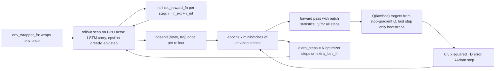
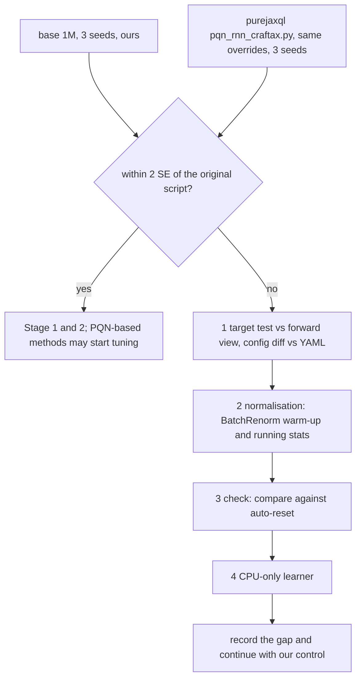

# Craftax PQN-RNN control implementation plan

Status: in progress

> **For agentic workers:** REQUIRED SUB-SKILL: Use superpowers:subagent-driven-development (recommended) or superpowers:executing-plans to implement this plan task-by-task. Steps use checkbox (`- [ ]`) syntax for tracking.

**Goal:** a recurrent Parallelised Q-Network control that reproduces the published Craftax-1B score (16.0%, [[PQN-RNN (Gallici 2025)]]) inside an acceptance band, matches the published code at 1M, is lightly tuned at 1M, and is the base module that the count-bonus (PQN variant) and the skill methods extend through the same hooks as PPO-RNN.

**Architecture:** new module `src/wut_murl_craftax/training/pqn_rnn.py` with `PQNRNNConfig`, `RNNQNetwork` (BatchRenorm on the input, Dense 512 + LayerNorm + ReLU, last action one-hot appended, LSTM 512 reset on done, Dense to 43 Q-values), `build_network(cfg, n_actions, obs_dim)` (public network constructor), `q_lambda_targets` (usable on its own), `learn(train_state, traj, key, loss_mask=None)` (the learner update, callable from another rollout) and `make_trainer(cfg)`; `src/wut_murl_craftax/training/batch_renorm.py` ported from purejaxql (Apache-2.0). Hooks are the `HookFields` of `training/hooks.py` ([[2026-10-20-craftax-method-ppo-rnn]] Task 1), a base class of `PQNRNNConfig`: `init_state_fn(key, spec)`, `intrinsic_reward_fn`, `observe(state, traj)`, `extra_loss_fn`, `extra_steps` (declared there only), `env_wrapper_fn`, `metrics_fn` (fully qualified names); `traj` is the shared `Traj` (`obs`, `actions`, `rewards`, `dones`, `hidden` in float16, `events`, `extra`); plus `extra_obs_dim` for extra network inputs. Users: [[2026-10-20-craftax-method-count-bonus]] (`intrinsic_reward_fn` inside the Q(lambda) reward), [[2026-10-20-craftax-method-smdp-skills]] and [[2026-10-20-craftax-method-dyna-q]] (network constructor, targets, `learn` with `loss_mask`, `extra_obs_dim`). Registry entry `pqn-rnn` in `training/interface.py` ([[2026-10-20-craftax-infrastructure]] Task 3); config `configs/methods/pqn-rnn.yaml`. Design decisions: [[PQN-RNN design]].

**Tech Stack:** JAX 0.11, craftax 1.6.1, flax (`nn.OptimizedLSTMCell`, `nn.scan`, `nn.LayerNorm`), optax (`radam`), MLflow, PyYAML, existing `training.wrappers` and `training.hooks` (from the PPO and PPO-RNN plans), `training.records`, `training.checkpoints` (`save_state`, `load_state`), `orchestration` (`device_roles`, `env_mesh`, `shard_envs`), `evaluation.reproduction` ([[2026-10-20-craftax-method-ppo]] Task 4).

---

## Design

- PQN = online Q(lambda) on the batch just collected from many parallel envs: no replay buffer, no target network; stability from normalisation (paper Section 3).
- Port of `purejaxql/pqn_rnn_craftax.py` at commit 47af6d7 with its config `pqn_rnn_craftax.yaml`: BatchRenorm on the input and LayerNorm in the hidden layer (the repo setting, the paper's best variant in Section 5.5).
- Q(lambda) targets written as one reverse scan whose carry is only the next lambda-return, seeded with max Q(s_{T-1}); this makes the bug class of purejaxql issue #12 (seeding with Q(s_T)) impossible, and a test compares against an independent forward-view lambda-return.
- 1M settings are not published; the base keeps every repo setting except the rollout shape, which takes PPO's 1M shape (256 envs x 16 steps, 244 updates), because the 1B shape gives only 7 updates at 1M.
- 1B: the repo config unchanged; final-1b is the reproduction check against 16.0%.
- Optimistic resets with ratio 16, as the repo (`USE_OPTIMISTIC_RESETS: True`), through `training/wrappers.py` ([[2026-10-20-craftax-method-ppo]] Task 2); the repo's random warm-up rollout is kept: `num_steps` uniform-random steps before the first update (`MEMORY_WINDOW: 0`), outside the step budget.

## Hyperparameter grid

Stage 1 (coarse, Craftax-1M, 3 seeds): one knob at a time from the 1M base, 10 configs. The base gets 3 seeds (no published 1M number); the 1M check is against the original code (Task 6).

| Knob | Values (base first) | Why |
|---|---|---|
| Rollout shape (envs x steps) | 256 x 16; 1024 x 128 (repo 1B, 7 updates at 1M); 64 x 64 | 1M vs 1B shape; 64-step sequences for the LSTM at the same batch |
| Learning rate | 3e-4; 1.5e-4; 6e-4 | the repo value and x 0.5, x 2 |
| Q(lambda) lambda | 0.5; 0; 0.8 | lambda 0 is one-step Q-learning ([[06 Temporal-difference learning]]); 0.8 = PPO's GAE lambda |
| Epsilon decay (share of updates) | 0.1; 0.25 | at 1M the 0.1 decay ends after 24 updates |
| Normalisation | BatchRenorm input + LayerNorm hidden (repo); BatchRenorm input + BatchRenorm hidden (paper Table 4 literally); LayerNorm input + LayerNorm hidden (no batch statistics) | settles the paper vs repo mismatch at 1M; the last removes running statistics that lag in a short run |

Configs: base (1) + shape (2) + lr (2) + lambda (2) + epsilon decay (1) + normalisation (2) = 10; runs = 30.

Stage 2 (fine, Craftax-1M, 3 seeds): best Stage 1 config; the 1-2 numeric knobs with the largest Stage 1 effect; shape and normalisation are categorical and not refined.

| Knob | Fine values around the best coarse value b |
|---|---|
| Learning rate | b x 0.75, b x 1.5 |
| lambda | b - 0.1, b + 0.1 (clipped to 0 and 0.95) |
| Epsilon decay | b x 0.5, b x 2 |

Expected: 4 configs, 12 runs. Selection: `tuned` = the best config; ties within h of the base (h from Task 6 with 3 seeds) keep the base. `tuned` is the fixed shared setting of the PQN-based methods (`base_from: pqn-rnn.tuned`).

Fixed settings ([[PQN-RNN (Gallici 2025)]], repo `config/alg/pqn_rnn_craftax.yaml`):

| Setting | Craftax-1M (base) | Craftax-1B (repo) | Note |
|---|---|---|---|
| Environment | `Craftax-Symbolic-v1` | `Craftax-Symbolic-v1` | Classic only in `smoke` |
| Envs x steps | 256 x 16 (244 updates) | 1024 x 128 (7,629 updates) | the last step of each rollout only bootstraps |
| Epochs, minibatches | 4, 4 (64 envs each) | 4, 4 (256 envs each) | minibatches split envs |
| Learning rate | 3e-4, linear decay | 3e-4, linear decay | RAdam, grad clip 0.5 |
| Gamma, lambda | 0.99, 0.5 | 0.99, 0.5 | |
| Epsilon | 1.0 to 0.005 over 10% of updates | same | one epsilon for all envs (issue #11) |
| Network | input BatchRenorm, Dense 512 + LayerNorm + ReLU, last action, LSTM 512, Dense 43 | same | `NUM_LAYERS 1`, `NUM_RNN_LAYERS 1` |
| BatchRenorm | momentum 0.999, eps 1e-3, r_max 3, d_max 5, warm-up 1,000 grad steps | same | the code comment says 100,000; the code uses 1,000 |
| Reward scale | 1.0 | 1.0 | |
| Resets | optimistic, ratio 16 | optimistic, ratio 16 | as the repo (`OPTIMISTIC_RESET_RATIO: 16`); `training/wrappers.py` |
| Random warm-up rollout | 16 random steps | 128 random steps | as the repo: `MEMORY_WINDOW + NUM_STEPS` steps at epsilon 1 before update 0, not counted in the budget; its transitions are replaced before the first update |

## Runs and laptop time estimate

Throughput (estimate): 2,400 steps/s on Craftax-Symbolic, 8,000 on Classic; overhead factor 1.25 relative to PPO (estimate: the LSTM has 4 gate blocks against the GRU's 3, but the Q-network has one head instead of PPO-RNN's two 2-layer heads, about 6.4M against 6.9M parameters, so the shared RNN planning value applies); +1 min compile per run.

| Phase (MLflow experiment) | Configs | Seeds | Steps per run | Runs | Est. steps/s | Est. hours (laptop, sequential) |
|---|---|---|---|---|---|---|
| `smoke` (Craftax-Classic) | 2 | 1 | 200k | 2 | 8,000 | 0.05 |
| `tune-coarse` | 10 | 3 | 1M | 30 | 2,400 | 3.97 |
| `tune-fine` | 4 | 3 | 1M | 12 | 2,400 | 1.59 |
| `final-1m` | 1 | 10 | 1M | 10 | 2,400 | 1.32 |
| `final-1b` | 1 | 3 | 1B | 3 | 2,400 | 347.27 |
| Total | | | | 57 | | 354.2 |

Measured 2026-10-23 (laptop, Craftax-Symbolic 1M, run minutes = process start to last eval file; the estimate table above is superseded for these rows; details and caveats in [[2026-10-20-craftax-compute-budget]]):

| Phase | Runs | Measured min per run | Measured steps/s | Measured wall-clock |
|---|---|---|---|---|
| `tune-coarse` | 30 | 5.2 (1 worker, 12 runs), 6.8 (2 workers, 14 runs) | 3,830 (base config, 1 worker) | 2.8 h (est. 3.97 h + 0.44 h eval) |
| `tune-fine` | 12 | 6.8 (2 workers) | | 0.7 h (est. 1.59 h + 0.18 h) |
| `final-1m` (estimate) | 10 | 9.8 (2 workers, 13 checkpoints) | | 0.8 h (est. 1.32 h + 1.93 h) |
| `final-1b` on the laptop (estimate) | 3 | 72.5 h per run | 3,830 | 218 h (est. 347.3 h) |

- One 1M run: 477 s; one 1B run: 416,727 s = 115.8 h.
- The 1M reference-code check (Task 6) adds 3 runs of the original script outside the queue, about 0.4 h at the same throughput including compile (estimate), outside the table and without fixed-seed evaluation.
- final-1b on a CUDA cluster GPU (authors' hardware, estimate): 1e9 / 266,961 steps/s x 1.25 = 1.30 h per run excluding the 1-minute compile (the budget convention), 3.9 h for 3 seeds; laptop hours in the table include it.
- Fixed-seed evaluation is not in the table (rule and planning values: [[2026-10-20-craftax-evaluation-and-metrics]], "Evaluation cost"; estimate at 2,400 steps/s, Classic 8,000): smoke 0.01 h, tune-coarse 0.44 h, tune-fine 0.18 h, final-1m 1.93 h, final-1b 4.62 h (1.54 h per run, counted at the laptop rate wherever the run trained); 7.2 h in total, 2.6 h of it up to final-1m.

## Tasks

### Task 1: BatchRenorm port

**Files:**
- Create: `src/wut_murl_craftax/training/batch_renorm.py` (Apache-2.0 header naming purejaxql and Flax)
- Test: `tests/training/test_batch_renorm.py`

- [x] **Step 1: Write the failing tests**: with `use_running_average=True` the output uses the stored mean and var and no statistic changes; in training mode before 1,000 steps the output equals plain batch normalisation; after warm-up r and d are clipped to [1/3, 3] and [-5, 5]; running mean after one step = 0.999 x old + 0.001 x batch mean.
- [x] **Step 2: Port** the module unchanged in behaviour (same defaults).
- [x] **Step 3: Run** `uv run pytest tests/training/test_batch_renorm.py -q`.

### Task 2: Q(lambda) targets

**Files:**
- Create: `src/wut_murl_craftax/training/pqn_rnn.py` (function `q_lambda_targets(q_next_max, reward, done, gamma, lam)`)
- Test: `tests/training/test_q_lambda.py`

- [x] **Step 1: Write the failing tests**: (a) against an independent forward view: for a random 6-step, 3-env trajectory with dones, every target equals `(1 - lam) * sum_n lam^(n-1) G^(n) + lam^(N-1) G^(N)` computed by explicit loops ([[07a n-step TD and TD(λ)]]), with each n-step return cut at episode ends; (b) lam = 0 gives `r + gamma (1 - d) max Q(s')`, one-step Q-learning; (c) lam = 1 without dones gives the discounted reward sum plus `gamma^k max Q(s_{T-1})`; (d) the issue #12 case (T = 6, gamma 0.9, lam 0.8, fixed random Q): the target at T-2 is `r_{T-2} + gamma max Q(s_{T-1})`, not `Q(s_T)`; (e) a done at step t makes the target `r_t`.
- [x] **Step 2: Implement** the reverse scan with carry `G_next` only: `G_t = r_t + gamma (1 - d_t) ((1 - lam) maxQ(s_{t+1}) + lam G_{t+1})`, seeded with `G_{T-1} = max Q(s_{T-1})`; inputs are the stop-gradient Q-values of the same forward pass; output covers steps 0 to T-2.
- [x] **Step 3: Run** `uv run pytest tests/training/test_q_lambda.py -q`.

### Task 3: Network and trainer

Depends on Tasks 1-2, [[2026-10-20-craftax-method-ppo-rnn]] Task 1 (`HookFields`, `HookSpec`, `Traj`), [[2026-10-20-craftax-method-ppo]] Task 2 (wrappers with `info["events"]`) and [[2026-10-20-craftax-infrastructure]] Task 3 (registry and the `Policy` protocol: `init_carry(n)`, `step(params, carry, obs, key, greedy) -> (action, carry)`).

**Files:**
- Modify: `src/wut_murl_craftax/training/pqn_rnn.py`, `src/wut_murl_craftax/training/__init__.py`, `src/wut_murl_craftax/training/interface.py` (registry entry `pqn-rnn`)
- Test: `tests/training/test_pqn_rnn.py`, `tests/training/test_pqn_rnn_hooks.py`, `tests/training/test_pqn_rnn_sharding.py`

- [x] **Step 1: Write the failing tests** in `test_pqn_rnn.py` (Craftax-Classic unless `CRAFTAX_TEST_ENV` names another env, as in [[2026-10-20-craftax-method-ppo-rnn]] Task 2): (a) LSTM reset: the output after a done equals that of a fresh zero carry; (b) the last-action input at step t is the one-hot of the action at t-1 and zero after a reset; (c) epsilon schedule: 1.0 at update 0, 0.005 from `eps_decay x n_updates` on, linear between; (d) epsilon-greedy: epsilon 0 is argmax, epsilon 1 gives every one of 43 actions in 20,000 draws; (e) the rollout's Q-values recomputed in inference mode from the stored start hidden match to 1e-5 (sequence bookkeeping); (f) determinism, 8 envs x 8 steps, 2 updates; (g) `PQNRNNConfig` 1B equals the repo YAML field by field, and `extra_steps` comes from `HookFields` only; (h) `extra_obs_dim = 5` makes `build_network` accept 8268 + 5 inputs and the zero-feature case equals the control; (i) `loss_mask` all ones equals `None` exactly, a mask with zeros on half the steps gives the loss of the other half alone, and an all-zero mask leaves params unchanged; (j) `learn` called directly on a hand-built `Traj` (no `train_chunk`) gives the same params as one `train_chunk` update on the same transitions; (k) `q_lambda_targets` imports and runs without a trainer; (l) the warm-up rollout runs `num_steps` random steps in `init`, leaves the env-step counter at 0, never enters a loss, and does not rerun when a run resumes from `load_state`; (m) `traj.hidden` is float16 of shape (8, 8, 1024) (the LSTM `(c, h)` the action was chosen from) and `traj.events` is the wrapper's `info["events"]` of each step; (n) `policy(state)` gives a `Policy` whose `init_carry(8)` is a zero LSTM carry and a zero last action, and whose `step(params, carry, obs, key, greedy=True)`, run from `init_carry` over the first episode of each env, reproduces the argmax actions of the same Q-values; the `ckpt/` checkpoint of a trained state holds the params and the BatchRenorm statistics, and a policy built from it acts like the live one.
- [x] **Step 2: Write the failing hook tests** in `test_pqn_rnn_hooks.py`: zero hooks give bit-identical params and batch statistics to no hooks (CPU); a constant `r_int = c` raises every target by `c` times the lambda-weighted discount sum (hand check, 3 steps); `extra_steps = 2` with an L2 `extra_loss_fn` (returning `(loss, (state, metrics))`) lowers the param norm and leaves the next learning rate and epsilon unchanged; `observe` sees `traj` with `actions`, `rewards`, `dones`, `hidden`, `events` and `extra["q_vals"]`; `metrics_fn` returning `{"count/x": 1.0}` appears as `count/x`.
- [x] **Step 3: Write the failing sharding test** `test_pqn_rnn_sharding.py`, as [[2026-10-20-craftax-method-ppo]] Task 2 Step 6: 4 host devices against 1, 2 updates on Craftax-Classic with 32 envs x 8 steps; env states, LSTM carry and last actions are sharded over 4 CPU devices; params and BatchRenorm statistics agree with the 1-device run to 1e-5; 3 devices with 32 envs raise a `ValueError`.
- [x] **Step 4: Implement** `PQNRNNConfig` (env, steps, envs 256, num_steps 16, minibatches 4, epochs 4, lr 3e-4, lr_linear_decay True, max_grad_norm 0.5, gamma 0.99, lam 0.5, eps_start 1.0, eps_finish 0.005, eps_decay 0.1, hidden 512, norm_input True, norm_type "layer_norm", input_norm "batch_renorm", add_last_action True, rew_scale 1.0, extra_obs_dim 0, seed; `HookFields` as base class, so `extra_steps` is inherited, not redeclared; `envs % minibatches == 0` checked) and `RNNQNetwork` built by `build_network(cfg, n_actions, obs_dim)`; the input is `obs_dim + extra_obs_dim` wide (the extra features, for example a skill one-hot, are concatenated by the caller or by an `env_wrapper_fn` before the input normalisation).
- [x] **Step 5: Implement** the rollout on the PPO env setup (`auto_reset=False`, `LogWrapper`, `OptimisticResetVecEnvWrapper` from `training/wrappers.py`): carry `(hidden, obs, last_done, last_action, env_state, method_state, key)`; in `init` only (never on resume), the repo's warm-up: `num_steps` steps at epsilon 1 with the initial network, whose env and LSTM states start the first rollout and whose transitions are dropped; network in inference mode (running statistics); epsilon-greedy with the update's epsilon; `intrinsic_reward_fn` per step; keep the float32 start hidden; per step record the acting hidden (float16) and `info["events"]` into `Traj` (`extra`: `r_int`, `q_vals`, `last_actions`); `observe` once per rollout.
- [x] **Step 6: Implement** the update: per epoch permute envs, split into whole-sequence minibatches; forward pass in training mode from the stored start hidden (updates batch statistics); targets by `q_lambda_targets`; loss `0.5 * sum(m_t (Q(s_t, a_t) - G_t)^2) / max(sum(m_t), 1)` over steps 0 to T-2 with `m = loss_mask` (all ones when `None`), so a caller can drop transitions (for example steps where a hand-written skill acted); this update is the public `learn(train_state, traj, key, loss_mask=None) -> (train_state, metrics)`, called by `train_chunk` and callable from another rollout that builds a `Traj` with the same fields; RAdam with global-norm clip; learning rate linear in the update index to about 0 (1e-20 as the repo); then `extra_steps` steps on `extra_loss_fn`.
- [x] **Step 7: Implement** `make_trainer(cfg)` (`init`, `train_chunk`, `policy`): `policy` returns the `Policy` of infrastructure Task 3 (`init_carry(n)`: zero LSTM carry and zero last action; `step(params, carry, obs, key, greedy)`: greedy = argmax, otherwise epsilon-greedy at the update's epsilon, read from `params["eps"]`); checkpoints in `ckpt/` hold `{"variables", "eps"}` (network params, BatchRenorm statistics and the next rollout's epsilon), since evaluation builds one policy from `jax.eval_shape(init)` and needs nothing else (ruling 2026-10-21); `device_roles()` as PPO-RNN.
- [x] **Step 8: Implement** sharding as [[2026-10-20-craftax-method-ppo]] Task 2 Step 7 (env states, observations, LSTM carry, last actions and the per-env leaves of the method state); the trainer never calls `configure_runtime`.
- [x] **Step 9: Run** `uv run pytest tests/training/test_pqn_rnn.py tests/training/test_pqn_rnn_hooks.py tests/training/test_pqn_rnn_sharding.py -q`, then `make tests`.

### Task 4: Verify on Craftax-Symbolic and the laptop devices

**Files:**
- Modify: `knowledge/methods/PQN-RNN design.md` (measured recompute error per learner device)

- [x] **Step 1: Run** `CRAFTAX_TEST_ENV=Craftax-Symbolic-v1 uv run pytest tests/training/test_pqn_rnn.py -q -k "reset or recompute or last_action or warm"`; expected: pass with the 8268-input network.
- [x] **Step 2: Run** the same command on the metal learner and with `JAX_PLATFORMS=cpu`; expected: the Q recompute error stays below 1e-5 on both; otherwise write the measured maximum into [[PQN-RNN design]].
- [x] **Step 3: Run** `uv run pytest tests/training/test_q_lambda.py tests/training/test_pqn_rnn_hooks.py tests/training/test_pqn_rnn_sharding.py -q` on the laptop profile; expected: pass.

### Task 5: Config and smoke run

**Files:**
- Create: `configs/methods/pqn-rnn.yaml`
- Modify: `configs/phases/smoke.yaml` (add `pqn-rnn`: Craftax-Classic, `base` and `lambda-0`, 1 seed, 200k steps)
- Test: `tests/training/test_pqn_rnn_configs.py`

- [x] **Step 1: Write the failing test**: `base` = the 1M base above; `budgets.1b` = the repo YAML; 10 `grid.coarse` entries each differing in exactly the Stage 1 keys; `grid.fine` holds the `rule` and `knobs` of the Stage 2 table and no entries; `tuned: null`.
- [x] **Step 2: Write** the YAML in the shared schema of [[2026-10-20-craftax-method-ppo]] Task 1 (`base`, `budgets.1b`, `grid.coarse`, `grid.fine`, `abort`, `tuned`) and run `uv run pytest tests/training/test_pqn_rnn_configs.py -q`; expected: pass.
- [x] **Step 3: Run** `make queue PHASE=smoke METHOD=pqn-rnn`; check: return above the uniform-random Classic return ([[2026-10-20-craftax-method-ppo]] Task 3), no NaN, the score and per-achievement metrics of infrastructure Task 4 and the final-checkpoint evaluation under `eval/stochastic/` and `eval/greedy/` present (the `pqn/*` names of Task 9 come later; until then the smoke run's Q-values are checked with `uv run pytest tests/training/test_pqn_rnn.py -q`); record steps/s in [[2026-10-20-craftax-compute-budget]]. (done 2026-10-21; the 200k Classic smoke ends below the random return, accepted as a plumbing check because epsilon is still high; the 1M `tune-coarse` is the real check)

### Task 6: Stage 1 and the reference-code check at 1M

**Acceptance bands** (formula of [[2026-10-20-craftax-method-ppo]] Task 5):

- 1M, no published number: our base (3 seeds) against the original `pqn_rnn_craftax.py` with the same 1M overrides (3 seeds); pass if |difference of means| <= 2 sqrt(SE_ours^2 + SE_orig^2).
- 1B (Task 8): published 16.0; s_pub 1.31 percentage points (the only spread found: the Auto-Craftax PyTorch PQN-LSTM port, raw sd 2.95, [[PQN-RNN (Gallici 2025)]]); our side has n = 3 seeds in `final-1b`, so planning h 1.77, band 14.23 to 17.77 (indicative).

**Files:**
- Modify: `configs/phases/tune-coarse.yaml` (add `pqn-rnn`)

- [x] **Step 1: Run** `make queue PHASE=tune-coarse METHOD=pqn-rnn`; 30 finished.
- [x] **Step 2: Run** the original in a throwaway environment outside this repo: a checkout of `mttga/purejaxql` at 47af6d7 and a short driver that replaces `wandb.log` with a JSONL writer, sets `WANDB_MODE` to a value other than `disabled`, and calls `make_train` with `TOTAL_TIMESTEPS=1e6 TOTAL_TIMESTEPS_DECAY=1e6 NUM_ENVS=256 NUM_STEPS=16`, seeds 0-2: `uv run --isolated --no-project --python 3.12 --with craftax==1.6.1 --with "jax==0.11.*" --with flax --with optax --with chex --with hydra-core --with wandb --with safetensors python driver.py`.
- [x] **Step 3: Compare** the final scores (last 2% of the budget, `returned_episode_returns` / 226) with ours; on a fail, work the diagram, 3 seeds per diagnostic run, results noted in [[PQN-RNN design]]. (done 2026-10-22: original 1.509, sd 0.193, against ours 1.270, sd 0.849; difference 0.239 within 1.005: pass)

### Task 7: Stage 2 and the tuned config

**Files:**
- Modify: `configs/methods/pqn-rnn.yaml` (`tuned`, written by `mark_tuned`), `configs/phases/tune-fine.yaml` (add `pqn-rnn`)

- [x] **Step 1: Run** `make queue PHASE=tune-fine METHOD=pqn-rnn FINE=pqn-rnn DRY_RUN=1`, check the 4 generated configs against the Stage 2 table, then `make queue PHASE=tune-fine METHOD=pqn-rnn FINE=pqn-rnn`; `make status PHASE=tune-fine` shows 12 finished for `pqn-rnn`.
- [x] **Step 2: Apply** the selection rule and add a dated section to [[Experiment decisions]] (including which normalisation won at 1M).
- [x] **Step 3: Mark** the selected config: `uv run python -m wut_murl_craftax.orchestration.queue --mark-tuned pqn-rnn <hash8>` (writes the `tuned:` block of `pqn-rnn.yaml`, the source of truth for `base_from: pqn-rnn.tuned`, and sets `best=true` on its runs). (done 2026-10-22; the base won, so `tuned: {}` equals the base, see Experiment decisions)

### Task 8: Finals at 1M and 1B

**Files:**
- Modify: `configs/phases/final-1m.yaml` (add `pqn-rnn`: `tuned`, 10 seeds), `configs/phases/final-1b.yaml` (add `pqn-rnn`: the repo 1B config, 3 seeds)

- [x] **Step 1: Run** `make queue PHASE=final-1m METHOD=pqn-rnn`; 10 finished. (done 2026-10-24: 10 finished; results in `## Results`)
- [ ] **Step 2: Run** `make queue PHASE=final-1b METHOD=pqn-rnn` (repo 1B config; laptop or `scripts/cluster/run_array.sh`, merged with `make merge-mlflow SRC=<store>`); 3 finished.
- [ ] **Step 3: Run** `uv run python -m wut_murl_craftax.evaluation.reproduction --method pqn-rnn --budget 1b --phase final-1b` (n = 3, the wider band); report in [[2026-10-20-craftax-comparison-and-results]] with the note that the paper does not say whether 16.0% is training or greedy-test episodes.

### Task 9: PQN-RNN metrics logged per update

**Files:**
- Modify: `src/wut_murl_craftax/training/pqn_rnn.py`
- Test: `tests/training/test_pqn_rnn.py`

- [x] **Step 1: Write the failing test**: `train_chunk` returns, all finite: `pqn/td_loss`, `pqn/q_taken_mean`, `pqn/q_max_mean`, `pqn/target_mean`, `pqn/action_gap` (max Q minus second-best Q), `pqn/epsilon`, `pqn/greedy_share` (share of steps that took the greedy action), `pqn/lr`, `pqn/grad_norm`, `pqn/bn_warm` (BatchRenorm past warm-up), `pqn/bn_var_min` (smallest running variance of the input), `rnn/hidden_norm`, `rnn/reset_share`, `reward/extrinsic`, `reward/intrinsic`, and every name returned by `metrics_fn`, unchanged. (done 2026-10-22; only the `loss_columns` PQN-RNN fills are logged and abort-checked, see Experiment decisions)
- [x] **Step 2: Implement** them; `train/action_entropy` of [[2026-10-20-craftax-evaluation-and-metrics]] is the entropy of the epsilon-greedy behaviour.
- [x] **Step 3: Run** `uv run pytest tests/training/test_pqn_rnn.py -q`; expected: pass.

### Task 10: Analysis hooks and stop criteria

**Files:**
- Modify: `configs/methods/pqn-rnn.yaml` (`abort:` block)
- Test: `tests/orchestration/test_runner.py`

- [x] **Step 1: Write the failing test**: a fake run with `pqn/q_max_mean` = 400 at update 5 ends `FAILED` (divergence); a `pqn/td_loss` above 10 x its running median for 3 updates is flagged.
- [x] **Step 2: Implement** the rules: abort on NaN or inf (one rerun from the last `state/` save, then an issue note); abort when `pqn/q_max_mean` > 300 (no Craftax episode returns more than the 226 achievement points plus the small net health term, [[Craftax scoring and evaluation]]); flags for the TD-loss spike, `pqn/action_gap` < 1e-3 after epsilon reaches its floor (Q-values that do not separate actions), `pqn/bn_var_min` < 1e-6; no early stopping on score.
- [x] **Step 3: Hand** to [[2026-10-20-craftax-training-analysis]] the obstacles to watch: exploration failure once epsilon reaches 0.005 (epsilon-greedy is "too simple" per the PQN paper), value failure and numerical failure (bootstrapping with no target network, [[09b Control with approximation, bootstrapping]]), plateau at 1M, skill forgetting, survival failure; compare the dungeon-entry rate with PPO-RNN ([[Craftax floors and progression]]).
- [x] **Step 4: Run** `uv run pytest tests/orchestration/test_runner.py -q`, then `make tests` and `uv run python scripts/check_vault.py`.

## Results

### `final-1m`

Craftax-1M, seeds 0-9, phase `final-1m` 2026-10-23 21:41 to 2026-10-24 07:23 ([[2026-10-20-craftax-project]]). `tuned` is the base 1M config, so seeds 0-2 are its `tune-coarse` runs (base-1m), joined by run name; 13 evaluated checkpoints per run, none aborted. Mean and sd (sample) are of `final_score`; IQM from `evaluation/stats.py`, as `select_pair` ranks.

| Config | Hash | n | Mean | sd | IQM |
|---|---|---|---|---|---|
| tuned (base-1m) | 10cbfc16 | 10 | 1.356 | 0.508 | 1.465 |

- The 3 tuning seeds gave 1.270 (sd 0.849); seeds 3-9 put the mean higher and the spread lower, and the IQM sits above the mean (two seeds below 0.8: 0.303 and 0.790). Base control of `count-bonus-pqn-rnn`, `smdp-skills` and `dyna-q`.

## Risks

- Paper Table 4 says `batch_norm`, the repo YAML `layer_norm`; we follow the repo (the code the scoreboard links) and test the literal Table 4 setting in Stage 1.
- At 1M the BatchRenorm warm-up (1,000 grad steps) covers a quarter of the 3,904 grad steps and the running statistics (momentum 0.999) lag, so early rollouts act on stale input statistics; the LayerNorm-input alternative checks this.
- purejaxql issue #12 (wrong Q(lambda) seed) affects the MLP scripts, not `pqn_rnn_craftax.py` (it re-seeds before the scan; read at 47af6d7 and confirmed in the issue thread); our target code and its forward-view test make it impossible either way.
- The 16.0% has no published spread; the band uses a third-party port's sd and may be too wide or too narrow.
- Epsilon-greedy episodes are the training episodes behind the scoreboard metric; their return depends on epsilon, which ends at 0.005, so the training score is close to greedy only late in training.
- No published 1M number: the 1M control is anchored to the original code, not to a scoreboard value.
- The repo's random warm-up rollout is kept as published (outside the step budget); a resumed run must not replay it, which test (l) of Task 3 checks.
