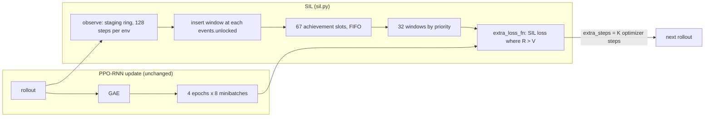

# Self-Imitation Learning implementation plan

Status: in progress

> **For agentic workers:** REQUIRED SUB-SKILL: Use superpowers:subagent-driven-development (recommended) or superpowers:executing-plans to implement this plan task-by-task. Steps use checkbox (`- [ ]`) syntax for tracking.

**Goal:** add self-imitation of better-than-expected actions from a per-achievement replay buffer to PPO-RNN, tune it at Craftax-1M, and run it at 1M and 1B against our PPO-RNN control, with a one-buffer ablation.

**Architecture:** `training/sil.py` keeps a per-env staging ring of the last 128 steps and a buffer of windows, one FIFO slot per achievement. It plugs into the shared hook contract of `training/hooks.py` ([[2026-10-20-craftax-method-ppo-rnn]] Task 1): `init_state_fn(key, spec)` sizes the buffers from `HookSpec`; `observe(state, traj)` runs once per rollout, writes the rollout into the staging ring and copies the window that ends at every new unlock (`traj.events.unlocked`) into that achievement's slot; `extra_loss_fn` with `extra_steps = K` runs `K` optimizer steps on the SIL loss after the PPO epochs; `metrics_fn` returns `sil/...` names. Registry entry `sil`, config `configs/methods/sil.yaml`. Design decisions: [[Self-Imitation Learning design]].

**Tech Stack:** JAX 0.11, craftax 1.6.1, flax, optax, MLflow, the runner and queue of [[2026-10-20-craftax-infrastructure]].

---

## Design

- Unit of replay: a 128-step window ending at a new achievement unlock, with returns truncated at the unlock and the GRU state at the window start.
- Trigger: `traj.events.unlocked` (a `StepEvents` field computed by the wrapper from the pre-reset next state, [[2026-10-20-craftax-method-ppo]] Task 2), so an unlock on an episode's last step is seen; it is privileged and only selects which windows are stored and their slot, never an input or a reward.
- GRU state: `traj.hidden` (per-step recurrent state, `float16`) from the hook contract, copied into the staging ring.
- Layout: 67 slots (one per achievement) of `S` windows each, FIFO inside a slot; sampling uniform over non-empty slots, then by priority $(R - V)_+$.
- Loss: $\lambda_{\text{sil}} [-\log\pi(a|s)(R - V)_+ + 0.01 \cdot \tfrac12 (R - V)_+^2]$ on 32 windows, `K` steps per PPO update, same optimizer.
- Memory: 8,432 B per stored step (`uint8` map, `float32` tail); staging 1.21 MB per env; buffer 145 MB to 1.16 GB over the grid; checked against `memory_limit_bytes` of the machine profile before compiling.
- Ablation at `final-1m`: one shared buffer of the same capacity (`layout: single`).
- Decisions, memory table and loss details: [[Self-Imitation Learning design]].



## Hyperparameter grid

Config file `configs/methods/sil.yaml` (the schema shared by every method, [[2026-10-20-craftax-infrastructure]] Task 1): `base:` (`base_from: ppo-rnn.tuned` plus the fixed SIL settings), `grid.coarse:` the 18 stage-1 configs, `grid.fine:` the stage-2 rule as data (configs generated by `--expand-fine sil`, never written by hand), and `tuned:`, written by Task 7 with `mark_tuned`, which also sets the MLflow tag `best=true`.

Stage 1 (coarse, Craftax-1M, 3 seeds):

| Knob | Values | Why |
|---|---|---|
| SIL loss weight $\lambda_{\text{sil}}$ | 0.1, 0.3, 1.0 | 1.0 is the paper's unweighted loss; smaller keeps the off-policy step small (candidate note risk) |
| Windows per slot `S` | 2, 8 | 145 MB and 579 MB buffers; few recent successes against more varied ones |
| SIL steps per PPO update `K` | 1, 2, 4 | the candidate note's 1-2 plus one stronger setting; a 1M update has 32 PPO minibatch steps |

- Configs: 3 x 2 x 3 = 18; 54 runs.

Stage 2 (fine, 3 seeds; `grid.fine`):

- Knobs: the two of $\lambda_{\text{sil}}$, `S`, `K` whose stage-1 config means spread most.
- Values: best stage-1 value x {0.5, 1, 2}, rounded to integers >= 1 for `S` and `K` (largest point `S` = 16, 1.16 GB).
- Configs: 3 x 3 = 9, the centre reused by run name; 8 new configs, 24 runs.
- Selection: highest mean final score over 3 seeds ([[2026-10-20-craftax-evaluation-and-metrics]]); ties go to the smaller buffer.

Fixed settings, PPO-RNN part (the tuned PPO-RNN control; Craftax paper Table 11 at 1M, Table 7 at 1B, [[Craftax Baselines algorithms and hyperparameters]]):

| Setting | 1M | 1B |
|---|---|---|
| Envs x steps per rollout | 256 x 16 | 1024 x 64 |
| Learning rate (linear anneal) | 3e-4 | 2e-4 |
| Epochs / minibatches | 4 / 8 | 4 / 8 |
| γ / GAE λ | 0.99 / 0.8 | 0.99 / 0.8 |
| Clip / value coef / entropy | 0.2 / 0.5 / 0.01 | 0.2 / 0.5 / 0.01 |
| Max grad norm | 1.0 | 1.0 |
| Network | Dense 512, GRU 512, 2 x Dense 512 heads (ReLU) | same |

Fixed SIL settings:

| Setting | Value |
|---|---|
| Window length $L_w$ | 128 steps |
| Value-loss weight $\beta_v$ | 0.01 |
| SIL batch | 32 windows (4,096 steps) |
| Return | discounted with the control γ, truncated at the unlock, no bootstrap |
| Priority | mean $(R - V)_+$ + 0.01, exponent 0.6, new windows at max priority |
| Insertion cap | 64 windows per update |
| Layout | per-achievement slots (ablation: single buffer) |
| Storage | map `uint8`, tail `float32`, staging GRU state `float16` |
| 1B finals | best 1M SIL knobs on the 1B PPO-RNN settings |

## Runs and laptop time estimate

- Throughput: PPO-RNN 2,400 steps/s (shared assumption), Craftax-Classic RNN 8,000 steps/s (0.8 x 10,000).
- Overhead factor 1.3 (estimate): one SIL step is a GRU forward and backward pass over 4,096 steps, about a quarter of the 4 PPO epochs; with learning at roughly 40% of an update, `K` = 1, 2, 4 cost about +10%, +20%, +40%, plus about 5% for staging and insertion; 1.3 is the mean over the stage-1 grid.
- Method throughput: 1,846 steps/s on Craftax, 6,154 steps/s on Craftax-Classic.
- Laptop hours per run include the 1-minute compile; GPU hours exclude it (project convention, [[2026-10-20-craftax-compute-budget]]); fixed-seed evaluation is listed below the table.

| Phase | Configs | Seeds | Steps per run | Runs | Est. steps/s | Est. hours (laptop, sequential) |
|---|---|---|---|---|---|---|
| `smoke` (Classic) | 2 | 1 | 200k | 2 | 6,154 | 0.05 |
| `tune-coarse` | 18 | 3 | 1M | 54 | 1,846 | 9.03 |
| `tune-fine` | 8 new | 3 | 1M | 24 | 1,846 | 4.01 |
| `final-1m` (best + single-buffer ablation) | 2 | 10 | 1M | 20 | 1,846 | 3.34 |
| `final-1b` | 1 | 3 | 1B | 3 | 1,846 | 451.44 |
| Total | | | | 103 | | 467.9 |

Measured 2026-10-23 (laptop, Craftax-Symbolic 1M, run minutes = process start to last eval file; the estimate table above is superseded for these rows; details and caveats in [[2026-10-20-craftax-compute-budget]]):

| Phase | Runs | Measured min per run | Measured steps/s | Measured wall-clock |
|---|---|---|---|---|
| `tune-coarse` | 54 | 11.2 (2 workers) | 1,603 (tuned config) | 5.2 h (est. 9.03 h + eval) |
| `tune-fine` | 12 | 10.8 (2 workers) | | 1.1 h (est. 4.01 h) |
| `final-1m` (estimate) | 20 | 14.2 (2 workers, 13 checkpoints) | | 2.4 h (est. 3.34 h + 5.0 h eval) |
| `final-1b` on the laptop (estimate) | 3 | 118.7 h per run | 2,340 (1 worker) | 356 h (est. 451.4 h) |

- One 1M run: 0.167 h; one 1B run: 150.5 h (both with compile).
- 1B on a CUDA cluster GPU (authors' hardware, estimate): 266,961 x 0.8 (RNN) / 1.3 = 164,284 steps/s, 1.69 h per run excluding the 1-minute compile, 5.1 h for 3 seeds.
- Fixed-seed evaluation is not in the table (rule and planning values: [[2026-10-20-craftax-evaluation-and-metrics]], "Evaluation cost"; 128,000 eval steps per tuning or smoke run, 1,664,000 per `final-1m` run, 13,312,000 per `final-1b` run, at the method throughput above): smoke 0.01 h, tune-coarse 1.04 h, tune-fine 0.46 h, `final-1m` 5.01 h, `final-1b` 6.01 h (2.00 h per run, counted at the laptop rate wherever the run trained); 12.5 h in total, 6.5 h of it up to `final-1m`.
- Peak extra memory per run: 1M up to 1.47 GB (staging 310 MB + `S` = 16 buffer); 1B up to 2.40 GB.
- Measured throughput replaces these numbers in [[2026-10-20-craftax-compute-budget]] after the smoke phase.

### Task 1: Window buffer

**Files:**
- Create: `src/wut_murl_craftax/training/sil.py` (buffer part)
- Test: `tests/training/test_sil_buffer.py`

- [x] **Step 1: Write the failing tests** on scripted `traj` pytrees with the hook-contract fields (`obs`, `actions`, `rewards`, `dones`, `hidden`, `events`):
  - `compress_obs` / `decompress_obs` round-trip a real Craftax and a real Craftax-Classic observation exactly.
  - `init(cfg, n_envs=4, n_ach=67, obs_dim=8268)` returns empty slots, an empty staging ring and `buffer_bytes(cfg)` equal to the memory table of [[Self-Imitation Learning design]] for 256 and 1024 envs.
  - `events.unlocked[t, 1, a]` true at global step 130 of env 1 copies steps 3-130 of that env (rows from the staging ring and the current rollout) into slot `a`, with `traj.hidden` of step 3 as the window's start state.
  - An unlock flagged on a done step (the episode's last step) is inserted like any other; the window's steps before the current episode's start get mask 0.
  - Returns of a window with rewards `[0, 0, 1]` and γ 0.9 are `[0.81, 0.9, 1.0]`.
  - A slot with `S` = 2 keeps the two newest windows (FIFO); 70 unlocks in one update insert 64 and report 6 overflowed.
  - `observe` never reads an `EnvState` (it takes only `state` and `traj`).
- [x] **Step 2: Implement** `SILConfig` (lambda_sil, slots_windows `S`, sil_steps `K`, window 128, beta_v, batch 32, alpha 0.6, insert_cap 64, layout `slots|single`), `init(cfg, n_envs, n_ach, obs_dim) -> SILState`, `buffer_bytes(cfg, n_envs, n_ach)` and `observe(state, traj) -> state` (staging write once per rollout, unlock detection from `traj.events.unlocked`, window copy, returns), all `jit`-compatible with static shapes.
- [x] **Step 3: Run** `uv run pytest tests/training/test_sil_buffer.py -q`.

### Task 2: Sampling and loss

**Files:**
- Modify: `src/wut_murl_craftax/training/sil.py` (sampling and loss)
- Test: `tests/training/test_sil_loss.py`

- [x] **Step 1: Write the failing tests**: with slots holding 1 and 3 windows, slot frequencies over 10,000 draws are 0.5 / 0.5 within 0.02 (slots layout) and 0.25 / 0.75 at equal priority (single layout); window frequencies inside a slot follow priority^0.6 within 0.02; where $V > R$ on every step the loss and its gradient are 0; on a 2-step example (log-probs, values, returns given) the loss equals the hand-computed value; replaying a window from its stored GRU state gives the same logits as the original rollout when the parameters are unchanged (tolerance from the `float16` state); sampled priorities are rewritten after a step.
- [x] **Step 2: Implement** `sample(state, key) -> windows`, `sil_loss(params, windows) -> (loss, aux)` and `extra_loss(params, state, key) -> (loss, (state, metrics))` matching the `extra_loss_fn` contract of `training/hooks.py`; the network comes from `ppo_rnn.build_network(cfg, n_actions, obs_dim)`.
- [x] **Step 3: Run** `uv run pytest tests/training/test_sil_loss.py -q`.

### Task 3: Trainer registry and config

**Files:**
- Modify: `src/wut_murl_craftax/training/interface.py` (entry `sil`)
- Create: `configs/methods/sil.yaml` (`base` with `base_from: ppo-rnn.tuned`, `grid.coarse`, `grid.fine` rule, `tuned: null`)
- Test: `tests/training/test_sil_trainer.py`

- [x] **Step 1: Write the failing tests**:
  - The factory's `HookFields` sets exactly `init_state_fn`, `observe`, `extra_loss_fn`, `extra_steps = K` and `metrics_fn`; `intrinsic_reward_fn` and `env_wrapper_fn` stay `None`.
  - With `K` = 0 (no SIL step) the parameters after 2 updates on Craftax-Classic equal the PPO-RNN control's bit for bit (same seed) while `observe` still fills the buffer.
  - With an empty buffer the SIL step is skipped (no optimizer step, so the Adam moments are untouched) and logs `sil/active = 0`.
  - The buffer and the staging ring are part of the trainer state written by `save_state`; a run restored with `load_state` continues with the same buffer contents (`training/checkpoints.py`, [[2026-10-20-craftax-infrastructure]] Task 2).
  - The entry passes the interface test of [[2026-10-20-craftax-infrastructure]] Task 3.
  - `configs/methods/sil.yaml` loads with `base.base_from == "ppo-rnn.tuned"`, 18 `grid.coarse` entries, a `grid.fine` rule over two of `lambda_sil`, `S`, `K`, and `tuned: null`.
- [x] **Step 2: Implement** the factory: entry `make_ppo_rnn_trainer(PPORNNConfig(), method=HookMethod(SILConfig, hooks))` (`training/hooks.py`), where `hooks(cfg, base)` gets the SIL keys and the resolved PPO-RNN config and returns `HookFields(init_state_fn=lambda key, spec: sil.init(cfg, spec.n_envs, spec.n_achievements, spec.obs_dim), observe=functools.partial(sil.observe, base.gamma), extra_loss_fn=functools.partial(sil.extra_loss, net), extra_steps=cfg.sil_steps, metrics_fn=sil.metrics)` with `net = ppo_rnn.build_network(base, n_actions, obs_dim)` (dims from `ppo.make_env(base.env)`); the builder creates no arrays (it may run inside `jax.eval_shape`); the SIL state lives in the method state.
- [x] **Step 3: Write** `configs/methods/sil.yaml` with the grids above.
- [x] **Step 4: Run** `uv run pytest tests/training/test_sil_trainer.py -q`, then `make tests`.

### Task 4: Method metrics

**Files:**
- Modify: `src/wut_murl_craftax/training/sil.py`
- Test: `tests/training/test_sil_loss.py`

- [x] **Step 1: Write the failing test**: one update logs every metric below; every name returned by `metrics_fn` starts with `sil/`; slot fill never exceeds `S`.
- [x] **Step 2: Implement** `metrics(state) -> dict` (the `metrics_fn` hook, fully qualified names) beyond [[2026-10-20-craftax-evaluation-and-metrics]]: `sil/slot_fill/<achievement>`, `sil/nonempty_slots`, `sil/inserted`, `sil/insert_overflow`, `sil/active` (share of sampled steps with $R > V$), `sil/adv_pos_mean`, `sil/policy_loss`, `sil/value_loss`, `sil/grad_norm`, `sil/kl_after` (KL between the policy before and after the SIL steps on the latest PPO batch), `sil/sample_age` (updates since insertion, mean and max), `sil/sample_share/<achievement>`, `sil/value_bias` (mean $V - R$ on sampled steps); per run `sil/buffer_bytes` and `sil/staging_bytes`.
- [x] **Step 3: Run** `uv run pytest tests/training/test_sil_loss.py -q`.

### Task 5: Smoke run

**Files:**
- Modify: `configs/phases/smoke.yaml` (sil: config A slots, `S` 2, `K` 1, $\lambda$ 0.3; config B single, `S` 2, `K` 2, $\lambda$ 1.0; 1 seed, 200k steps, Craftax-Classic)

- [x] **Step 1: Run** `make queue PHASE=smoke METHOD=sil`; expected: 2 runs finish, `sil/nonempty_slots` > 5, `sil/active` > 0 early, no NaN.
- [x] **Step 2: Interrupt** one run with Ctrl-C and rerun the command; expected: it resumes from the run directory's `state/` with the same `sil/slot_fill` values. (done 2026-10-22 on `outputs/stores/resume-checks.db`, one `kill -INT` of the python queue pid after the first state save: interrupted at update 2, resumed at 2, FINISHED at 48; the first two `sil/slot_fill` rows identical, `sil/nonempty_slots` 3, 4 then 5, 6, 7 (continues, not from zero))
- [x] **Step 3: Record** measured steps/s and peak memory in [[2026-10-20-craftax-compute-budget]].

### Task 6: Coarse tuning

**Files:**
- Modify: `configs/phases/tune-coarse.yaml` (add `sil`: all `grid.coarse` entries, 3 seeds), this plan (`## Results`)

- [x] **Step 1: Check** the expansion: `make queue PHASE=tune-coarse METHOD=sil DRY_RUN=1`; expected: 54 runs.
- [x] **Step 2: Run** `make queue PHASE=tune-coarse METHOD=sil` (54 runs, resumable). (done 2026-10-22 19:46 to 2026-10-23 01:02, 2 workers)
- [x] **Step 3: Check** `make status PHASE=tune-coarse`; expected: 54 finished for `sil`. (54 finished, none killed or aborted)
- [x] **Step 4: Write** the stage-1 table (config, mean final score, sd, `sil/active` at 1M, non-empty slots) into this plan under a new section `## Results`.

### Task 7: Fine tuning and the tuned config

**Files:**
- Modify: `configs/phases/tune-fine.yaml` (add `sil`, stage `fine`, 3 seeds), `configs/methods/sil.yaml` (`tuned:`), this plan (`## Results`), [[Experiment decisions]]

- [x] **Step 1: Generate** the stage-2 configs from the `grid.fine` rule: `make queue PHASE=tune-fine METHOD=sil FINE=sil DRY_RUN=1`; expected: 9 configs, the centre reused by run name, 24 new runs. (6 configs: the best `K` is 1, and 1 x 0.5 rounds to 1, so `K` takes only 1 and 2; 2 stage-1 configs reused by run name, the centre and $\lambda_{\text{sil}}$ 0.3 with `K` 2; 12 new runs)
- [x] **Step 2: Run** `make queue PHASE=tune-fine METHOD=sil FINE=sil` (resumable); `make status PHASE=tune-fine` shows 27 finished for `sil` (24 new, 3 reused from `tune-coarse`). (done 2026-10-23 10:25 to 11:32; 18 finished: 12 new, 6 reused)
- [x] **Step 3: Select** the best config by the rule above and mark it with `mark_tuned` of `orchestration/queue.py` ([[2026-10-20-craftax-infrastructure]] Task 1), which writes the `tuned:` block of `configs/methods/sil.yaml` and sets the MLflow tag `best=true` on that config's runs together (config hash from `make status PHASE=tune-fine`) (done 2026-10-23 15:44 at 402a727: `6f8690ad`, `best=true` on its 3 runs):

```bash
uv run python -m wut_murl_craftax.orchestration.queue --mark-tuned sil <confighash8>
```

- [x] **Step 4: Record** the choice in `## Results` and [[Experiment decisions]]. (done 2026-10-23; Experiment decisions at e64f918)

### Task 8: Final 1M

**Files:**
- Modify: `configs/phases/final-1m.yaml` (add `sil`: `tuned` x 10 seeds and `tuned` with `layout: single` x the same 10 seeds)

- [x] **Step 1: Run** `make queue PHASE=final-1m METHOD=sil` (best config x 10 seeds and the same config with `layout: single` x the same 10 seeds: 20 runs); `make status PHASE=final-1m` shows 20 finished for `sil`. (done 2026-10-24: 20 finished; results in `## Results`)
- [x] **Step 2: Check** that the PPO-RNN control final exists with the same seeds; comparisons and statistics follow [[2026-10-20-craftax-comparison-and-results]]. (done 2026-10-24: the PPO-RNN control finished seeds 0-9 in `final-1m`)

### Task 9: Final 1B

**Files:**
- Modify: `configs/phases/final-1b.yaml` (add `sil`: `tuned` SIL knobs on the 1B PPO-RNN settings, 3 seeds)

- [ ] **Step 1: Run** `make queue PHASE=final-1b METHOD=sil` (best 1M knobs on the 1B PPO-RNN settings, 3 seeds; laptop or `scripts/cluster/run_array.sh`).
- [ ] **Step 2: Merge** node stores with `make merge-mlflow SRC=<store>`; `make status PHASE=final-1b` shows 3 finished for `sil`.

### Task 10: Abort rules

**Files:**
- Modify: `src/wut_murl_craftax/training/sil.py` (guards)
- Test: `tests/training/test_sil_trainer.py`

- [x] **Step 1: Write the failing tests**: a NaN SIL loss aborts the run with status `FAILED` and `abort=nan`; with a `Profile` whose `memory_limit_bytes` is 100 MB (`orchestration/profiles.py`), `sil.check_memory(cfg, spec, profile)` refuses a config with `S` = 2 before compiling and the run ends `FAILED` with `abort=memory`; `sil/kl_after` > 0.5 for 20 consecutive updates aborts with `abort=sil_dominates`.
- [x] **Step 2: Implement** the abort rules: NaN or inf in loss or parameters; `buffer_bytes + staging_bytes` above `memory_limit_bytes` of the machine profile the runner loaded with `load_profile` of `orchestration/profiles.py` (`configs/profiles/laptop.yaml` or `configs/profiles/cuda.yaml`, field tested in [[2026-10-20-craftax-infrastructure]] Task 6), checked at init; `sil/kl_after` > 0.5 for 20 consecutive updates (the SIL step dominates the policy).
- [x] **Step 3: Run** `uv run pytest tests/training/test_sil_trainer.py -q`, then `make tests`.

## Results

Craftax-1M, 3 seeds per config: `tune-coarse` 2026-10-22 19:46 to 2026-10-23 01:02 (54 runs), `tune-fine` 2026-10-23 10:25 to 11:32 (12 new runs); every run finished, none aborted. Mean and sd are of `final_score` over the 3 seeds (sample sd); `sil/active` and non-empty slots (`sil/nonempty_slots`) are the values at the last update (step 999,424), averaged over the seeds. Config names: l = $\lambda_{\text{sil}}$, s = `S`, k = `K`. Rows are sorted by mean.

### Stage 1

| Config | Hash | Mean | sd | `sil/active` | Non-empty slots |
|---|---|---|---|---|---|
| l0.3-s2-k1 | 6f8690ad | 2.140 | 0.049 | 0.863 | 16.3 |
| l0.3-s8-k1 | 5af5a226 | 2.136 | 0.161 | 0.861 | 16.0 |
| l1-s2-k1 | 23c60c53 | 2.133 | 0.069 | 0.768 | 16.3 |
| l0.1-s2-k1 | 616498cb | 2.128 | 0.108 | 0.825 | 15.3 |
| l0.1-s8-k1 | f981b2ac | 2.097 | 0.102 | 0.872 | 15.3 |
| l1-s8-k1 | bfce924d | 2.089 | 0.088 | 0.799 | 16.0 |
| l0.1-s2-k2 | 416776b8 | 2.076 | 0.147 | 0.819 | 14.3 |
| l0.1-s2-k4 | 3df9db33 | 2.068 | 0.114 | 0.799 | 14.3 |
| l0.3-s8-k2 | e87209a5 | 2.057 | 0.075 | 0.839 | 15.7 |
| l0.1-s8-k2 | 66ffbefe | 2.026 | 0.092 | 0.863 | 16.3 |
| l0.3-s2-k2 | 8a8a7685 | 2.014 | 0.034 | 0.800 | 15.3 |
| l1-s2-k2 | 63869bab | 2.014 | 0.047 | 0.831 | 17.7 |
| l0.1-s8-k4 | b1473913 | 1.983 | 0.137 | 0.815 | 15.3 |
| l0.3-s8-k4 | 0173b60d | 1.967 | 0.028 | 0.800 | 14.7 |
| l1-s8-k2 | 7cd81bf3 | 1.943 | 0.021 | 0.836 | 15.3 |
| l0.3-s2-k4 | fee2e521 | 1.936 | 0.094 | 0.820 | 15.7 |
| l1-s2-k4 | 0a3c458c | 1.914 | 0.133 | 0.727 | 14.7 |
| l1-s8-k4 | f9787b8b | 1.901 | 0.049 | 0.746 | 14.3 |

### Stage 2

The rule picked $\lambda_{\text{sil}}$ and `K`; `S` stays 2. $\lambda_{\text{sil}}$ 0.3 x {0.5, 1, 2} gives 0.15, 0.3, 0.6; `K` 1 x {0.5, 1, 2} rounds to 1, 1, 2, so only 2 values: 6 configs, 2 of them stage-1 configs reused by run name.

| Config | Hash | Runs | Mean | sd | `sil/active` | Non-empty slots |
|---|---|---|---|---|---|---|
| fine-sil_steps=1-lambda_sil=0.3 | 6f8690ad | reused (l0.3-s2-k1) | 2.140 | 0.049 | 0.863 | 16.3 |
| fine-sil_steps=1-lambda_sil=0.15 | 4b57f12c | new | 2.109 | 0.045 | 0.825 | 16.3 |
| fine-sil_steps=2-lambda_sil=0.15 | d28eab4c | new | 2.094 | 0.054 | 0.827 | 17.0 |
| fine-sil_steps=1-lambda_sil=0.6 | 247defae | new | 2.037 | 0.092 | 0.823 | 17.0 |
| fine-sil_steps=2-lambda_sil=0.3 | 8a8a7685 | reused (l0.3-s2-k2) | 2.014 | 0.034 | 0.800 | 15.3 |
| fine-sil_steps=2-lambda_sil=0.6 | e8c033f7 | new | 1.967 | 0.061 | 0.835 | 16.7 |

### Chosen config

- `6f8690ad` l0.3-s2-k1 ($\lambda_{\text{sil}}$ 0.3, `S` 2, `K` 1), mean 2.140, sd 0.049; the stage-1 best and stage-2 centre; -0.048 against the PPO-RNN control (2.188, 10 seeds).
- Rule and comparison: [[Experiment decisions]] (2026-10-23, Phase 1 tuning results).

### `final-1m`

Craftax-1M, seeds 0-9, phase `final-1m` 2026-10-23 21:41 to 2026-10-24 07:23 ([[2026-10-20-craftax-project]]); seeds 0-2 of the tuned config are its tuning runs, joined by run name; 13 evaluated checkpoints per run, none aborted. Mean and sd (sample) are of `final_score`; IQM and PoI (probability of improvement over the base control's 10 runs) from `evaluation/stats.py`, as `select_pair` ranks.

| Config | Hash | n | Mean | sd | IQM | PoI vs PPO-RNN |
|---|---|---|---|---|---|---|
| tuned (l0.3-s2-k1) | 6f8690ad | 10 | 2.137 | 0.046 | 2.138 | 0.330 |
| `layout: single` ablation | 57a864f9 | 10 | 2.138 | 0.094 | 2.133 | 0.360 |

- Control: PPO-RNN b3ce95c4 mean 2.188, sd 0.107, IQM 2.187.
- Per-achievement slots and one shared buffer tie (PoI of the tuned config over the ablation 0.520); both stay below the control, as in tuning.
- `select_pair` ranks `sil` second; it is in the combination ([[Experiment decisions]], 2026-10-24).

## Detectors to add

Implemented in [[2026-10-20-craftax-training-analysis]] Task 4 (Phase 4), not in this plan; this plan only logs the metrics they read.

- Overfitting to early lucky windows: `sil/sample_age` max above 50% of the updates so far while `sil/active` > 0.5 on that slot, and entropy below the control's at the same step.
- Forgetting: `DEFEAT_ZOMBIE` and other basic success rates falling below the control's by more than 10 points.
- Imitated unsafe play: a cause-of-death share rising above the control's by more than 10 points after SIL starts.
- Value overestimation: `sil/value_bias` > 0 and explained variance of the PPO critic below the control's.
- Dead SIL: `sil/active` < 0.01 for 20% of the budget (the critic caught up; SIL is a no-op).
- Insertion overflow in > 10% of updates (cap too small for the env count).

## Risks

- Memory: the buffer is computed and checked against the profile at init, stored compressed, and the staging ring is written once per rollout; the grid tops at 2.4 GB at 1B.
- Overfitting to early lucky episodes: FIFO slots replace old windows when the achievement repeats; for windows that never repeat, $(R - V)_+$ falls to 0 as the critic learns; the age detector flags the rest; mitigation if it fires: an age cap per window, logged in [[Experiment decisions]].
- Off-policy drift inside PPO: $\lambda_{\text{sil}}$ and `K` are tuned, `sil/kl_after` is logged and bounded by an abort rule.
- Stale GRU start states: replay from stored states without burn-in; the replay test bounds the error for unchanged parameters; burn-in is the fallback.
- Truncated returns ignore rewards after the unlock, so SIL fires only when the unlock beats the critic's expectation; this makes it conservative, not wrong.
- Hook mismatch with the base plan: SIL needs `observe` with `traj.events` and `traj.hidden`, `extra_loss_fn` with `extra_steps` and `init_state_fn(key, spec)`; Task 3 tests the contract of `training/hooks.py`, and any change in [[2026-10-20-craftax-method-ppo-rnn]] updates this plan in the same change.
- 1M budget: about 250 updates; SIL needs unlocks to start, so early updates have few windows; `sil/nonempty_slots` over time shows how much of the budget SIL was active.
