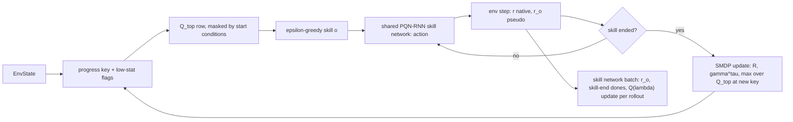

# SMDP Q-Learning over Hand-Defined Skills implementation plan

Status: draft

> **For agentic workers:** REQUIRED SUB-SKILL: Use superpowers:subagent-driven-development (recommended) or superpowers:executing-plans to implement this plan task-by-task. Steps use checkbox (`- [ ]`) syntax for tracking.

**Goal:** a two-level value-based agent on Craftax: a tabular SMDP Q-learning top level over progress keys that picks one of 25 hand-written skills, and one shared PQN-RNN Q($\lambda$) network that learns all skills; tuned at Craftax-1M, run at 1M and 1B, and reported in its own "uses hand-written skills" block next to the flat PQN-RNN control.

**Architecture:** `training/skills.py` holds the skill library (start conditions, success tests, step limits, pseudo-rewards, one `jax.lax.switch` per test); `training/smdp.py` holds the per-env skill state, the masked ε-greedy top level, the batched SMDP update of the table `Q_top[2^20, 25]` inside the rollout `scan`, and a trainer that reuses the network and learner update of `training/pqn_rnn.py` ([[2026-10-20-craftax-method-pqn-rnn]]); the progress key comes from `training/progress_key.py` ([[2026-10-20-craftax-method-count-bonus]] Task 1). Registry entry `smdp-skills`. Design decisions: [[SMDP Q-Learning over Hand-Defined Skills design]], [[Craftax skill library]].

**Tech Stack:** JAX 0.11, craftax 1.6.1, flax, optax, MLflow, the runner and queue of [[2026-10-20-craftax-infrastructure]], `evaluation/events.py` of [[2026-10-20-craftax-evaluation-and-metrics]].

---

## Design

- Top level: $Q[k, o] \leftarrow Q[k, o] + \alpha\,\overline{(R + \gamma^\tau (1 - \text{done}) \max_{o' \in A(s')} Q[k', o'] - Q[k, o])}$ on the native reward, the semi-Markov backup of [[14.4 Elevator dispatching]]; the bar averages envs that end the same pair in the same step.
- Key: progress fields (recipe or log2 buckets) plus 4 low-stat flags, hashed to $2^{20}$ rows; start conditions mask the 25 columns; optimistic $q_{\text{init}} = 10$.
- Skills: 23 learned skills and 2 one-step primitive options ([[Craftax skill library]]); one PQN-RNN network with the skill one-hot and the step-limit fraction as extra inputs, the skill pseudo-reward as reward and skill ends as dones.
- Every primitive game step counts toward the budget; the skill method uses the PQN-RNN control's 1M and 1B settings for the skill network.
- Prior knowledge (skills, start conditions, success tests, interruptions) puts the results in a separate block ([[Craftax skill library#Prior knowledge]]).
- Ablations at `final-1m`: random top level, Monte Carlo top level, no low-stat flags.

## Hyperparameter grid

Stage 1 (coarse, Craftax-1M, 3 seeds, full factorial):

| Knob | Values | Why |
|---|---|---|
| Top-level α | 0.05, 0.2 | ends of the candidate range 0.05-0.2; batched means already average noise, so the larger step may suffice |
| Top-level γ (per game step, discount $\gamma^\tau$) | 0.995, 0.999 | effective horizon 200 vs 1,000 steps, about one skill vs a short chain of skills |
| ε decay fraction (1.0 to 0.05, linear) | 0.1, 0.3 | length of the uniform-random warm-up while the skills are still poor |
| Skill timeout multiplier on `T_max` | 0.5, 1, 2 | too short and hard skills always fail, too long and a stuck skill wastes the episode |
| Key granularity | recipe, log2 | recipe caps (no hoarding, fewer keys) against the candidate note's finer log2 buckets |

- Configs: 2 x 2 x 2 x 3 x 2 = 48; 144 runs.

Stage 2 (fine, Craftax-1M, 3 seeds):

- Knobs: the two numeric knobs (α, γ, ε decay fraction, timeout multiplier) with the largest stage-1 main effect (spread of the per-value mean final score); key granularity stays at its best value.
- Values: best x {0.5, 1, 2}; γ is scaled through its horizon $1/(1 - \gamma)$ (for 0.999: 0.998, 0.999, 0.9995).
- Configs: 3 x 3 = 9, the centre is the stage-1 best and is reused by run name; 8 new configs, 24 runs.
- Selection: highest mean final score over 3 seeds ([[2026-10-20-craftax-evaluation-and-metrics]]); ties go to the smaller timeout multiplier.

Fixed skill-network settings (the PQN-RNN control; [[PQN-RNN (Gallici 2025)]] Table 4 at 1B; at 1M the control's tuned 1M values of `PQNRNNConfig` from [[2026-10-20-craftax-method-pqn-rnn]]):

| Setting | 1B |
|---|---|
| Envs x steps per update | 1024 x 128 |
| ε start / finish / decay fraction (low level) | 1.0 / 0.005 / 0.1 |
| Epochs / minibatches | 4 / 4 |
| Learning rate (linear decay), optimiser | 3e-4, RAdam |
| γ / λ (low level) | 0.99 / 0.5 |
| Max grad norm / reward scale | 0.5 / 1.0 |
| Network | 512 hidden, 1 layer + 1 LSTM layer, LayerNorm, last action as input; input + 26 (skill one-hot, step-limit fraction) |

Fixed method settings:

| Setting | Value | Note |
|---|---|---|
| Table | `float32[2^20, 25]` (105 MB) | same hash and fold as the count bonus |
| $q_{\text{init}}$ | 10 | optimistic, above early returns |
| Top-level ε end | 0.05 | top-level choices stay cheap to explore |
| Low-stat flag threshold | stat <= 3 (food, drink, energy, health) | about 60-90 awake steps before 0 at dexterity 1 |
| Skill death reward | 0 | success indicator only |
| Per-skill `T_max` | 100-1000 by skill ([[Craftax skill library#Skill table]]) | scaled by the timeout multiplier |
| Duplicate pairs in one step | mean TD error | test in Task 2 |
| 1B finals | best 1M method knobs on the 1B skill-network settings | ε decay is a fraction of the budget, so it rescales |

## Runs and laptop time estimate

- Throughput: PQN-RNN 2,400 steps/s (shared assumption), Craftax-Classic RNN 8,000 steps/s (0.8 x 10,000).
- Overhead factor 1.1 (estimate): per env step one key hash, a 25-branch success test (under `vmap` every branch is evaluated, all integer comparisons on the state and `StepEvents`), a masked argmax over one 25-wide table row and a scatter-add for the envs whose skill ended; the network grows by 26 inputs only.
- Method throughput: 2,182 steps/s on Craftax, 7,273 steps/s on Craftax-Classic; +1 min compile per run.

| Phase | Configs | Seeds | Steps per run | Runs | Est. steps/s | Est. hours (laptop, sequential) |
|---|---|---|---|---|---|---|
| `smoke` (Classic) | 2 | 1 | 200k | 2 | 7,273 | 0.05 |
| `tune-coarse` | 48 | 3 | 1M | 144 | 2,182 | 20.73 |
| `tune-fine` | 8 new | 3 | 1M | 24 | 2,182 | 3.46 |
| `final-1m` (best + 3 ablations) | 4 | 10 | 1M | 40 | 2,182 | 5.76 |
| `final-1b` | 1 | 10 | 1B | 10 | 2,182 | 1,273.3 |
| Total | | | | 220 | | 1,303.3 |

- One 1M run: 0.144 h; one 1B run: 127.3 h.
- 1B on a CUDA cluster GPU (authors' hardware, estimate): 266,961 x 0.8 (RNN) / 1.1 = 194,153 steps/s, 1.45 h per run, 14.5 h for 10 seeds.
- Measured throughput replaces these numbers in [[2026-10-20-craftax-compute-budget]] after the smoke phase.

### Task 1: Skill library

**Files:**
- Create: `src/wut_murl_craftax/training/skills.py`
- Test: `tests/training/test_skills.py`

- [ ] **Step 1: Write the failing tests** on scripted Craftax states (`env.reset`, then `.replace(...)` of inventory, map, position and stats, the pattern of the runtime checks in [[Game]]), one step each:
  - `collect_wood`: tree on the facing tile, `DO`, wood 0 to 1: success under `recipe`; wood 1 to 2 under `log2` (bucket 1 to 1): no success; wood at the recipe cap 4: unavailable.
  - `make_wood_pickaxe`: 1 wood with a table on a diagonal tile, `MAKE_WOOD_PICKAXE`: success; same state without a table: no success, `steps_in_skill` + 1.
  - `place_furnace`: success only when a table is among the 8 tiles around the player after the placement.
  - `descend`: on the down ladder with 8 kills on floor 1: success; with 7 kills: unavailable; floor 0 with no kills: available.
  - `drink`: drink 8 to 9 = max: success; 7 to 8: not yet; `sleep`: woken at max energy: success; woken by a zombie hit: failure.
  - `fight`: a zombie killed by `DO` (via `StepEvents` kills): success; a cow killed: no success; floor 8 boss progress + 1: success.
  - `open_chest`: facing tile chest to path: success; `enchant`: sword enchantment 0 to 1 at the floor-4 table: success.
  - `unlock_any`: any new unlock bit: success.
  - Common ends: step limit reached; death; floor change during `collect_stone`; food falling to 3 during `collect_iron` (interrupt) but not during `eat`.
  - Primitive options: `read_book` and `level_up` return a fixed action; `level_up` picks the lowest attribute with ties dexterity, strength, intelligence.
  - Masks: `make_iron_pickaxe` unavailable without coal; `fight` and `unlock_any` always available; the mask of a Craftax-Classic state has 16 true-capable skills and 9 always false.
  - `jax.vmap` of `skill_step` over 8 states equals a Python loop; `jit` compiles once for all skill ids.
- [ ] **Step 2: Implement** `SKILLS` (name, `T_max`, kind learned or primitive), `available(state) -> bool[25]`, `skill_step(skill, s, action, s2, events, steps_in_skill, timeout_mult) -> (success, ended, reason)` with `jax.lax.switch` over the 25 success tests, `primitive_action(skill, s)`, and the Classic adapter.
- [ ] **Step 3: Run** `uv run pytest tests/training/test_skills.py -q`; expected: all pass.

### Task 2: Top-level SMDP update

**Files:**
- Create: `src/wut_murl_craftax/training/smdp.py` (table functions)
- Test: `tests/training/test_smdp.py`

- [ ] **Step 1: Write the failing tests** on a hand-computed 3-skill toy (keys $k_0$, $k_1$; γ 0.9, α 0.5; table zero except $Q[k_1] = [2, 0, 1]$):
  - Env A runs $o_0$ from $k_0$ for τ = 3 with native rewards 0, 0, 1 and ends in $k_1$: the accumulator gives $R = 0.81$ and `disc` $= 0.729$; target $0.81 + 0.729 \cdot 2 = 2.268$; $Q[k_0, o_0] = 1.134$.
  - Same with $o_0$ masked at $k_1$: target $0.81 + 0.729 \cdot 1 = 1.539$; $Q[k_0, o_0] = 0.7695$.
  - Same ending in death: target 0.81; $Q[k_0, o_0] = 0.405$.
  - Env A and env B (R = 0, death) end $(k_0, o_0)$ in the same step: mean TD $(2.268 + 0) / 2$, $Q[k_0, o_0] = 0.567$ (a plain scatter-add would give 1.134).
  - Envs whose skill did not end leave the table unchanged.
  - Monte Carlo ablation: records $(k_0, o_0, R = 0.81, \gamma^\tau = 0.729)$ then $(k_1, o_1, R = 1)$ and episode end: targets 1.539 and 1, values 0.7695 and 0.5.
  - Masked ε-greedy: with ε = 0 it returns the masked argmax; with ε = 1 over 10,000 draws every available skill appears and no masked one does.
- [ ] **Step 2: Implement** `init_table(log2_rows, n_skills, q_init)`, `smdp_update(Q, k, o, R, disc, k_next, avail_next, done, ended, alpha)` (TD sums and counts by scatter-add, then the mean step), `select_skill(Q, k, avail, eps, key)` and `mc_update(...)` for the ablation.
- [ ] **Step 3: Run** `uv run pytest tests/training/test_smdp.py -q`.

### Task 3: Skill rollout step

**Files:**
- Modify: `src/wut_murl_craftax/training/smdp.py` (per-env skill state and rollout step)
- Test: `tests/training/test_smdp.py`

- [ ] **Step 1: Write the failing tests**: `SkillState` (skill, `k_start`, `R`, `disc`, `steps_in_skill`) accumulates $R$ and `disc` over a scripted 3-step skill exactly as in Task 2; after a skill end the next skill is chosen from the new state in the same step and the counters reset; an episode end resets the skill state and bootstraps 0; a primitive option ends after one step and its step carries `loss_mask = 0`; the extra network input is the skill one-hot and `steps_in_skill / T_max`; two runs with the same key give identical skill sequences (determinism).
- [ ] **Step 2: Implement** `rollout_step(carry, env, network)` for one `scan` step over all envs: key, mask, network action (or primitive action), env step, `StepEvents`, success test, accumulator, top-level update and re-decision; outputs the skill-network transition (obs, extra input, action, $r^o$, skill-end done, `loss_mask`).
- [ ] **Step 3: Run** `uv run pytest tests/training/test_smdp.py -q`.

### Task 4: Trainer, registry entry and config

**Files:**
- Modify: `src/wut_murl_craftax/training/smdp.py` (trainer), `src/wut_murl_craftax/training/interface.py` (entry `smdp-skills`)
- Create: `configs/methods/smdp-skills.yaml` (base config, `grid_stage1`, `grid_stage2` rule, `ablations`)
- Test: `tests/training/test_smdp_trainer.py`

- [ ] **Step 1: Check** the contract with [[2026-10-20-craftax-method-pqn-rnn]]: `PQNRNNConfig.extra_obs_dim`, the network constructor, the backward Q($\lambda$) target and the learner update with a per-transition `loss_mask` are callable from another rollout; `intrinsic_reward_fn` and `extra_loss_fn` are not used (the skill reward replaces the reward); any missing piece is added in that plan's module in the same change.
- [ ] **Step 2: Write the failing tests**: 2 updates on Craftax-Classic pass the interface test of [[2026-10-20-craftax-infrastructure]] Task 3; the Q($\lambda$) target on a 1-env, 4-step batch with a skill end at step 2 equals a hand-computed one (γ 0.99, λ 0.5; no value crosses the skill end); `Q_top` and the skill state are in the checkpoint and a resumed run equals an uninterrupted one; `policy(state)` returns both levels for eval.
- [ ] **Step 3: Implement** `init`, `train_chunk` (rollout `scan` of Task 3, then the PQN-RNN learner update on the skill transitions) and `policy`; device roles from `orchestration.device_roles()`.
- [ ] **Step 4: Write** `configs/methods/smdp-skills.yaml`; `uv run python -m wut_murl_craftax.orchestration.queue --phase configs/phases/tune-coarse.yaml --method smdp-skills --dry-run` lists 144 runs.
- [ ] **Step 5: Run** `make tests`.

### Task 5: Method metrics and eval artifacts

**Files:**
- Modify: `src/wut_murl_craftax/training/smdp.py`
- Test: `tests/training/test_smdp_trainer.py`

- [ ] **Step 1: Write the failing test**: one update logs every metric below; per-skill success rates lie in [0, 1]; the eval artifact holds one skill id and one key per step.
- [ ] **Step 2: Implement** per-update logging beyond [[2026-10-20-craftax-evaluation-and-metrics]]:
  - per skill: `skill/<name>/chosen_share`, `skill/<name>/success_rate`, `skill/<name>/mean_len`, `skill/<name>/end/<reason>` (success, timeout, death, interrupt);
  - top level: `smdp/eps`, `smdp/td_abs_mean`, `smdp/decisions_per_episode`, `smdp/keys_visited`, `smdp/occupancy`, `smdp/collision_est`, `smdp/q_start` (masked max at the reset key), `smdp/q_max_updated`;
  - low level: `low/loss`, `low/q_mean`, `low/eps`;
  - cumulative `count/collect_diamond_episodes` (env steps of the first and tenth diamond episode, used by the Dyna comparison).
- [ ] **Step 3: Implement** eval extras: per eval episode the arrays `skill[t]` and `key[t]` beside the stored actions (Task 5 of [[2026-10-20-craftax-infrastructure]]), and per checkpoint `smdp_greedy_table.parquet` (visited key, decoded fields, greedy skill, value) for [[2026-10-20-craftax-interpretation-and-ruleset]], where each visited key with its greedy skill is one rule.
- [ ] **Step 4: Run** `uv run pytest tests/training/test_smdp_trainer.py -q`.

### Task 6: Smoke run

**Files:**
- Modify: `configs/phases/smoke.yaml` (smdp-skills: config A base; config B random top level; 1 seed, 200k steps, Craftax-Classic)

- [ ] **Step 1: Run** `make queue PHASE=smoke METHOD=smdp-skills`; expected: 2 runs finish, `skill/collect_wood/success_rate` and `skill/place_table/success_rate` above 0, no NaN.
- [ ] **Step 2: Interrupt** one run with Ctrl-C and rerun the command; expected: it resumes with the same `Q_top` (equal `smdp/keys_visited` at the checkpoint).
- [ ] **Step 3: Record** measured steps/s in [[2026-10-20-craftax-compute-budget]].

### Task 7: Coarse tuning

- [ ] **Step 1: Run** `make queue PHASE=tune-coarse METHOD=smdp-skills` (144 runs, resumable).
- [ ] **Step 2: Check** `make status PHASE=tune-coarse`; expected: 144 finished for this method.
- [ ] **Step 3: Write** the stage-1 table (config, mean final score, sd, keys visited, mean skill success) into this plan under a new section `## Results` and pick the stage-2 knobs by the main-effect rule.

### Task 8: Fine tuning

- [ ] **Step 1: Fill** `grid_stage2` in `configs/methods/smdp-skills.yaml` from Task 7.
- [ ] **Step 2: Run** `make queue PHASE=tune-fine METHOD=smdp-skills` (24 new runs).
- [ ] **Step 3: Tag** the best config `best=true` in MLflow; record it in `## Results` and [[Experiment decisions]]; [[2026-10-20-craftax-method-dyna-q]] starts its tuning from this config.

### Task 9: Final 1M with ablations

- [ ] **Step 1: Run** `make queue PHASE=final-1m METHOD=smdp-skills` (best config and the 3 ablations of [[SMDP Q-Learning over Hand-Defined Skills design#Ablations]], seeds 0-9: 40 runs).
- [ ] **Step 2: Check** that the PQN-RNN control final exists with the same seeds ([[2026-10-20-craftax-method-pqn-rnn]]); comparisons and statistics follow [[2026-10-20-craftax-comparison-and-results]], with the skill methods in their own block.

### Task 10: Final 1B

- [ ] **Step 1: Run** `make queue PHASE=final-1b METHOD=smdp-skills` (best 1M knobs on the 1B skill-network settings, 10 seeds; laptop or `scripts/cluster/run_array.sh`).
- [ ] **Step 2: Merge** node stores with `make merge-mlflow SRC=<store>`; `make status PHASE=final-1b` shows 10 finished for this method.

### Task 11: Analysis hooks and abort rules

**Files:**
- Modify: `src/wut_murl_craftax/training/smdp.py` (guards), `src/wut_murl_craftax/analysis/obstacles.py` (method detectors, from [[2026-10-20-craftax-training-analysis]])
- Test: `tests/training/test_smdp_trainer.py`, `tests/analysis/test_obstacles.py`

- [ ] **Step 1: Write the failing tests**: a NaN in `Q_top` or the skill loss aborts the run with status `FAILED` and tag `abort=nan`; occupancy above 0.25 aborts with `abort=table_full`; an updated entry above 300 aborts with `abort=divergence`; each detector below fires on a synthetic series and stays silent on a clean one.
- [ ] **Step 2: Implement** the abort rules: NaN or inf in `Q_top`, losses or parameters; occupancy > 0.25; any updated `Q_top` entry > 300 (no discounted return can exceed the 226 achievement reward plus the bounded health term).
- [ ] **Step 3: Implement** the detectors for [[2026-10-20-craftax-training-analysis]]:
  - Stuck top level: one skill with success rate < 5% takes > 20% of decisions for >= 10% of the budget.
  - Fallback collapse: `fight` plus `unlock_any` take > 60% of decisions after the ε decay.
  - Skill interference: the shared skill-forgetting rule applied per skill (`skill/<name>/success_rate` from >= 20% to < 5%), with the skill whose `chosen_share` rose most in the same window.
  - Timeout dominance: timeouts > 50% of one skill's ends for >= 10% of the budget (timeout multiplier too small or skill unlearnable).
  - Deep-skill starvation: `collect_diamond`, `descend` from floor 1 or `make_iron_pickaxe` chosen fewer than 100 times in the run.
  - Survival failure despite flags: > 30% of low-stat interruptions followed by death within 100 steps.
  - Key aliasing: the same key reached with both success and timeout of one skill in > 40% of tries (the key hides the map).
- [ ] **Step 4: Run** `make tests`.

## Risks

- Prior knowledge decides much of the result: the score measures the library as much as the learner; the random-top-level ablation and the separate reporting block keep this visible.
- Deep skills rarely succeed early, so the top level sees few samples for them: optimistic $q_{\text{init}}$ and the ε warm-up; the starvation detector reports it.
- Non-Markov top level: one key averages situations with and without nearby water, trees or ladders; the aliasing detector measures it.
- Shared-network interference: the per-skill detector; the fallback is a per-skill output head, an ablation outside the grid.
- Few top-level samples at 1M (each env finishes only a few skills in 1M steps): the comparison with Dyna is the planned answer; the flat PQN-RNN control may win at 1M, which is a result.
- Dependency on two other modules: the PQN-RNN learner contract (Task 4 Step 1) and `progress_key.py` (`fields`, `bucket`, `hash_fields`, [[Craftax skill library#What the skills need from the progress key]]); a change there updates this plan in the same change.
- Hash collisions: 105 MB table, occupancy logged, abort at 0.25.
