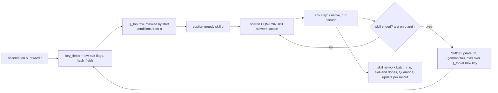

# SMDP Q-Learning over Hand-Defined Skills implementation plan

Status: in progress

> **For agentic workers:** REQUIRED SUB-SKILL: Use superpowers:subagent-driven-development (recommended) or superpowers:executing-plans to implement this plan task-by-task. Steps use checkbox (`- [ ]`) syntax for tracking.

**Goal:** a two-level value-based agent on Craftax: a tabular SMDP Q-learning top level over progress keys that picks one of 25 hand-written skills, and one shared PQN-RNN Q($\lambda$) network that learns all skills; tuned at Craftax-1M, run at 1M and 1B, and reported in its own "uses hand-written skills" block next to the flat PQN-RNN control.

**Architecture:** `training/skills.py` holds the skill library: an observation decoder (`decode_obs`), the top-level key fields (`key_fields`), the achievement part of the reward, start conditions, success tests, step limits and pseudo-rewards, one `jax.lax.switch` per test; every decision reads only the observation and the reward, and privileged state (`EnvState`, `StepEvents`) is read for logging only. `training/smdp.py` holds the per-env skill state, the masked ε-greedy top level, the batched SMDP update of the table `Q_top[2^20, 25]` inside the rollout `scan`, and a trainer that reuses the network (`build_network`) and learner update (`learn`) of `training/pqn_rnn.py` ([[2026-10-20-craftax-method-pqn-rnn]]); `bucket` and `hash_fields` come from `training/progress_key.py` ([[2026-10-20-craftax-method-count-bonus]] Task 1). Registry entry `smdp-skills`, config `configs/methods/smdp-skills.yaml`. Design decisions: [[SMDP Q-Learning over Hand-Defined Skills design]], [[Craftax skill library]].

**Tech Stack:** JAX 0.11, craftax 1.6.1, flax, optax, MLflow, the runner and queue of [[2026-10-20-craftax-infrastructure]], `evaluation/events.py` of [[2026-10-20-craftax-evaluation-and-metrics]] (logging only).

---

## Design

- Top level: $Q[k, o] \leftarrow Q[k, o] + \alpha\,\overline{(R + \gamma^\tau (1 - \text{done}) \max_{o' \in A(s')} Q[k', o'] - Q[k, o])}$ on the native reward, the semi-Markov backup of [[14.4 Elevator dispatching]]; the bar averages envs that end the same pair in the same step.
- Key: progress fields decoded from the observation (recipe or log2 buckets) plus 4 low-stat flags, hashed to $2^{20}$ rows; start conditions, read from the observation, mask the 25 columns; optimistic $q_{\text{init}} = 10$.
- Skills: 23 learned skills and 2 one-step primitive options ([[Craftax skill library]]); one PQN-RNN network with the skill one-hot and the step-limit fraction as extra inputs, the skill pseudo-reward as reward and skill ends as dones.
- No privileged state for acting: success tests use the decoded observation and the reward (`unlock_any`: achievement part of the reward > 0; `fight`: the attacked hostile creature gone from the 3 x 3 neighbourhood, or a kill achievement's reward); no test runs across a done step; `StepEvents` only feed `smdp/skill/<name>/test_agreement`.
- Every primitive game step counts toward the budget; the skill method uses the PQN-RNN control's 1M and 1B settings for the skill network.
- Prior knowledge (skills, start conditions, success tests, interruptions) puts the results in a separate block ([[Craftax skill library#Prior knowledge]]).
- Ablations at `final-1m`: random top level, Monte Carlo top level, no low-stat flags.



## Hyperparameter grid

Config file `configs/methods/smdp-skills.yaml` (the schema shared by every method, [[2026-10-20-craftax-infrastructure]] Task 1): `base:` (`base_from: pqn-rnn.tuned` for the skill network plus the fixed method settings), `grid.coarse:` the 48 stage-1 configs, `grid.fine:` the stage-2 rule as data (configs generated by `--expand-fine smdp-skills`, never written by hand), and `tuned:`, written by Task 8 with `mark_tuned`, which also sets the MLflow tag `best=true`; [[2026-10-20-craftax-method-dyna-q]] starts from it with `base_from: smdp-skills.tuned`.

Stage 1 (coarse, Craftax-1M, 3 seeds, full factorial):

| Knob | Values | Why |
|---|---|---|
| Top-level α | 0.05, 0.2 | ends of the candidate range 0.05-0.2; batched means already average noise, so the larger step may suffice |
| Top-level γ (per game step, discount $\gamma^\tau$) | 0.995, 0.999 | effective horizon 200 vs 1,000 steps, about one skill vs a short chain of skills |
| ε decay fraction (1.0 to 0.05, linear) | 0.1, 0.3 | length of the uniform-random warm-up while the skills are still poor |
| Skill timeout multiplier on `T_max` | 0.5, 1, 2 | too short and hard skills always fail, too long and a stuck skill wastes the episode |
| Key granularity | recipe, log2 | recipe caps (no hoarding, fewer keys) against the candidate note's finer log2 buckets |

- Configs: 2 x 2 x 2 x 3 x 2 = 48; 144 runs.

Stage 2 (fine, Craftax-1M, 3 seeds; `grid.fine`):

- Knobs: the two numeric knobs (α, γ, ε decay fraction, timeout multiplier) with the largest stage-1 main effect (spread of the per-value mean final score); key granularity stays at its best value.
- Values: best x {0.5, 1, 2}; γ is scaled through its horizon $1/(1 - \gamma)$ (for 0.999: 0.998, 0.999, 0.9995).
- Configs: 3 x 3 = 9, the centre is the stage-1 best and is reused by run name; 8 new configs, 24 runs.
- Selection: highest mean final score over 3 seeds ([[2026-10-20-craftax-evaluation-and-metrics]]); ties go to the smaller timeout multiplier.

Fixed skill-network settings (the PQN-RNN control; [[PQN-RNN (Gallici 2025)]] Table 4 at 1B; at 1M the control's tuned 1M values of `PQNRNNConfig` from [[2026-10-20-craftax-method-pqn-rnn]]):

| Setting | 1B |
|---|---|
| Envs x steps per update | 1024 x 128 |
| ε start / finish / decay fraction (low level) | 1.0 / 0.005 / 0.1 |
| Epochs / minibatches | 4 / 4 |
| Learning rate (linear decay), optimiser | 3e-4, RAdam |
| γ / λ (low level) | 0.99 / 0.5 |
| Max grad norm / reward scale | 0.5 / 1.0 |
| Network | 512 hidden, 1 layer + 1 LSTM layer, LayerNorm, last action as input; input + 26 (skill one-hot, step-limit fraction) |

Fixed method settings:

| Setting | Value | Note |
|---|---|---|
| Table | `float32[2^20, 25]` (105 MB) | same hash and fold as the count bonus |
| $q_{\text{init}}$ | 10 | optimistic, above early returns |
| Top-level ε end | 0.05 | top-level choices stay cheap to explore |
| Low-stat flag threshold | stat <= 3 (food, drink, energy, health) | about 60-90 awake steps before 0 at dexterity 1 |
| Skill death reward | 0 | success indicator only; also 0 on any done step |
| Achievement-reward threshold | 0.5 on $r - \Delta h_{\text{obs}}$ | smallest achievement weight is 1 |
| Per-skill `T_max` | 100-1000 by skill ([[Craftax skill library#Skill table]]) | scaled by the timeout multiplier |
| Duplicate pairs in one step | mean TD error | test in Task 2 |
| 1B finals | best 1M method knobs on the 1B skill-network settings | ε decay is a fraction of the budget, so it rescales |

## Runs and laptop time estimate

- Throughput: PQN-RNN 2,400 steps/s (shared assumption), Craftax-Classic RNN 8,000 steps/s (0.8 x 10,000).
- Overhead factor 1.1 (estimate): per env step one observation decode, one key hash, a 25-branch success test (under `vmap` every branch is evaluated, all comparisons on the decoded observation and the reward), a masked argmax over one 25-wide table row and a scatter-add for the envs whose skill ended; the network grows by 26 inputs only.
- Method throughput: 2,182 steps/s on Craftax, 7,273 steps/s on Craftax-Classic.
- Laptop hours per run include the 1-minute compile; GPU hours exclude it (project convention, [[2026-10-20-craftax-compute-budget]]); fixed-seed evaluation is listed below the table.

| Phase | Configs | Seeds | Steps per run | Runs | Est. steps/s | Est. hours (laptop, sequential) |
|---|---|---|---|---|---|---|
| `smoke` (Classic) | 2 | 1 | 200k | 2 | 7,273 | 0.05 |
| `tune-coarse` | 48 | 3 | 1M | 144 | 2,182 | 20.73 |
| `tune-fine` | 8 new | 3 | 1M | 24 | 2,182 | 3.46 |
| `final-1m` (best + 3 ablations) | 4 | 10 | 1M | 40 | 2,182 | 5.76 |
| `final-1b` | 1 | 3 | 1B | 3 | 2,182 | 381.99 |
| Total | | | | 213 | | 412.0 |

Measured 2026-10-23 (laptop, Craftax-Symbolic 1M, run minutes = process start to last eval file; the estimate table above is superseded for these rows; details and caveats in [[2026-10-20-craftax-compute-budget]]):

| Phase | Runs | Measured min per run | Measured steps/s | Measured wall-clock |
|---|---|---|---|---|
| `tune-coarse` | 144 | 6.2 (2 workers) | 2,937 (tuned config) | 7.5 h (est. 20.73 h + eval) |
| `tune-fine` | 21 new + 3 reused | 5.4 (2 workers) | | 1.0 h (est. 3.46 h) |
| `final-1m` (estimate) | 40 | 9.5 (2 workers, 13 checkpoints) | | 3.2 h (est. 5.76 h + 8.5 h eval) |
| `final-1b` on the laptop (estimate) | 3 | 64.8 h per run | 4,288 (1 worker) | 194 h (est. 382.0 h) |

- One 1M run: 0.144 h; one 1B run: 127.3 h (both with compile).
- 1B on a CUDA cluster GPU (authors' hardware, estimate): 266,961 x 0.8 (RNN) / 1.1 = 194,153 steps/s, 1.43 h per run excluding the 1-minute compile, 4.3 h for 3 seeds.
- Fixed-seed evaluation is not in the table (rule and planning values: [[2026-10-20-craftax-evaluation-and-metrics]], "Evaluation cost"; 128,000 eval steps per tuning or smoke run, 1,664,000 per `final-1m` run, 13,312,000 per `final-1b` run, at the method throughput above): smoke 0.01 h, tune-coarse 2.35 h, tune-fine 0.39 h, `final-1m` 8.47 h, `final-1b` 5.08 h (1.69 h per run, counted at the laptop rate wherever the run trained); 16.3 h in total, 11.2 h of it up to `final-1m`.
- Measured throughput replaces these numbers in [[2026-10-20-craftax-compute-budget]] after the smoke phase.

### Task 1: Skill library

**Files:**
- Create: `src/wut_murl_craftax/training/skills.py`
- Test: `tests/training/test_skills.py`

- [x] **Step 1: Write the failing tests** on scripted Craftax states (`env.reset`, then `.replace(...)` of inventory, map, position and stats, the pattern of the runtime checks in [[Game]]), rendered to symbolic observations by the env's renderer; every skill function receives only decoded observations, the action and the reward, one step each:
  - `decode_obs(obs)`: inventory counts, tool levels, armour, enchantments, stats, floor, ladder-open flag, sleeping flag, the facing tile (block, item, creature) and the 8 tiles around the player equal the `EnvState` values on 100 random states (counts exact after `round(100 x^2)`).
  - `key_fields(decode_obs(obs), g)` equals `progress_key.fields(progress_key.unwrap(state), g)` for `g` in `recipe`, `log2` on the same states: the top-level key holds nothing the observation lacks.
  - `achievement_reward(r, view, view2)`: an unlock of weight 1 with a health drop of 2 ($r$ = 0.8) gives 1.0; health regeneration alone ($r$ = 0.1) gives 0.
  - `collect_wood`: tree on the facing tile, `DO`, wood 0 to 1: success under `recipe`; wood 1 to 2 under `log2` (bucket 1 to 1): no success; wood at the recipe cap 4: unavailable.
  - `make_wood_pickaxe`: 1 wood with a table on a diagonal tile, `MAKE_WOOD_PICKAXE`: success; same state without a table: no success, `steps_in_skill` + 1.
  - `place_furnace`: success only when a table is among the 8 tiles around the player in the next observation.
  - `descend`: on the down ladder with the ladder-open flag set on floor 1: success; flag not set: unavailable; floor 0: available.
  - `drink`: drink 8 to 9 = max: success; 7 to 8: not yet; `sleep`: sleeping flag 1 to 0 at max energy: success; 1 to 0 with energy below max (woken by a hit): failure.
  - `fight`: `DO` with a zombie on the facing tile and no zombie in the 3 x 3 neighbourhood of the next observation: success; a cow killed the same way: no success (passive class); `DO` with a zombie that is still adjacent: no success; achievement part of the reward 1 on an attack step: success.
  - `open_chest`: facing tile chest to path: success; `enchant`: sword enchantment channel 0 to 1 at the floor-4 table: success.
  - `unlock_any`: achievement part of the reward > 0: success; $r$ = 0.1 from regeneration: no success.
  - Common ends: step limit reached; a done step ends the skill with reason `episode_end` and pseudo-reward 0 even when the reset observation shows more wood (no test across the reset); floor change during `collect_stone`; food falling to 3 during `collect_iron` (interrupt) but not during `eat`.
  - Primitive options: `read_book` and `level_up` return a fixed action; `level_up` picks the lowest attribute with ties dexterity, strength, intelligence.
  - Masks: `make_iron_pickaxe` unavailable without coal; `fight` and `unlock_any` always available; the mask of a Craftax-Classic observation has 16 true-capable skills and 9 always false.
  - No privileged input: `available`, `skill_step` and `primitive_action` take no `EnvState` argument; `test_agreement(skill, success, events)` compares an observation test with the `StepEvents` result and is the only function that reads events.
  - `jax.vmap` of `skill_step` over 8 observations equals a Python loop; `jit` compiles once for all skill ids.
- [x] **Step 2: Implement** `SKILLS` (name, `T_max`, kind learned or primitive), `decode_obs(obs) -> ObsView`, `key_fields(view, granularity) -> int32[F]` (using `progress_key.bucket`), `achievement_reward(r, view, view2)`, `available(view) -> bool[25]`, `skill_step(skill, view, action, r, view2, done, steps_in_skill, timeout_mult) -> (success, ended, reason)` with `jax.lax.switch` over the 25 success tests, `primitive_action(skill, view)`, `test_agreement(skill, success, events)` and the Classic decoder.
- [x] **Step 3: Run** `uv run pytest tests/training/test_skills.py -q`; expected: all pass.

### Task 2: Top-level SMDP update

**Files:**
- Create: `src/wut_murl_craftax/training/smdp.py` (table functions)
- Test: `tests/training/test_smdp.py`

- [x] **Step 1: Write the failing tests** on a hand-computed 3-skill toy (keys $k_0$, $k_1$; γ 0.9, α 0.5; table zero except $Q[k_1] = [2, 0, 1]$):
  - Env A runs $o_0$ from $k_0$ for τ = 3 with native rewards 0, 0, 1 and ends in $k_1$: the accumulator gives $R = 0.81$ and `disc` $= 0.729$; target $0.81 + 0.729 \cdot 2 = 2.268$; $Q[k_0, o_0] = 1.134$.
  - Same with $o_0$ masked at $k_1$: target $0.81 + 0.729 \cdot 1 = 1.539$; $Q[k_0, o_0] = 0.7695$.
  - Same ending in death: target 0.81; $Q[k_0, o_0] = 0.405$.
  - Env A and env B (R = 0, death) end $(k_0, o_0)$ in the same step: mean TD $(2.268 + 0) / 2$, $Q[k_0, o_0] = 0.567$ (a plain scatter-add would give 1.134).
  - Envs whose skill did not end leave the table unchanged.
  - Monte Carlo ablation: records $(k_0, o_0, R = 0.81, \gamma^\tau = 0.729)$ then $(k_1, o_1, R = 1)$ and episode end: targets 1.539 and 1, values 0.7695 and 0.5.
  - Masked ε-greedy: with ε = 0 it returns the masked argmax; with ε = 1 over 10,000 draws every available skill appears and no masked one does.
- [x] **Step 2: Implement** `init_table(log2_rows, n_skills, q_init)`, `smdp_update(Q, k, o, R, disc, k_next, avail_next, done, ended, alpha)` (TD sums and counts by scatter-add, then the mean step), `select_skill(Q, k, avail, eps, key)` and `mc_update(...)` for the ablation.
- [x] **Step 3: Run** `uv run pytest tests/training/test_smdp.py -q`.

### Task 3: Skill rollout step

**Files:**
- Modify: `src/wut_murl_craftax/training/smdp.py` (per-env skill state and rollout step)
- Test: `tests/training/test_smdp.py`

- [x] **Step 1: Write the failing tests**: `SkillState` (skill, `k_start`, `R`, `disc`, `steps_in_skill`) accumulates $R$ and `disc` over a scripted 3-step skill exactly as in Task 2; after a skill end the next skill is chosen from the new observation in the same step and the counters reset; an episode end resets the skill state, bootstraps 0 and runs no success test; a primitive option ends after one step and its step carries `loss_mask = 0`; the extra network input is the skill one-hot and `steps_in_skill / T_max`; key, mask and skill end come from `skills` functions that receive only decoded observations, the action, the reward and `done` (the `StepEvents` of the step reach only `test_agreement`); two runs with the same key give identical skill sequences (determinism); an optional `intrinsic_reward_fn` with the hook signature of `training/hooks.py` adds its $r^+$ to the native reward accumulated into $R$ (never to the skill pseudo-reward), and `None` leaves the rollout bit-identical (the combination hook, [[#Combination with other methods]]).
- [x] **Step 2: Implement** `rollout_step(carry, env, network, intrinsic_reward_fn=None)` for one `scan` step over all envs: decode the observation, key, mask, network action (or primitive action), env step (observation, reward, done and `StepEvents` from the wrapper), success test on the observations and the reward, accumulator, top-level update and re-decision, `test_agreement` counters from the events; outputs the skill-network transition (obs, extra input, action, $r^o$, skill-end done, `loss_mask`).
- [x] **Step 3: Run** `uv run pytest tests/training/test_smdp.py -q`.

### Task 4: Trainer, registry entry and config

**Files:**
- Modify: `src/wut_murl_craftax/training/smdp.py` (trainer), `src/wut_murl_craftax/training/interface.py` (entry `smdp-skills`)
- Create: `configs/methods/smdp-skills.yaml` (`base` with `base_from: pqn-rnn.tuned`, `grid.coarse`, `grid.fine` rule, `tuned: null`)
- Test: `tests/training/test_smdp_trainer.py`

- [x] **Step 1: Check** the contract with [[2026-10-20-craftax-method-pqn-rnn]]: `PQNRNNConfig.extra_obs_dim`, `build_network(cfg, n_actions, obs_dim)`, the backward Q($\lambda$) target and `learn(train_state, traj, key, loss_mask)` are callable from another rollout; `HookFields` is not used (the skill reward replaces the reward and the rollout is this method's own; only the optional `intrinsic_reward_fn` of Task 3 exists for a combination); any missing piece is added in that plan's module in the same change.

Contract with `pqn_rnn.learn` (checked 2026-10-21 against `training/pqn_rnn.py`):

- `loss_mask` only removes steps from the loss; an all-zero mask still moves params through RAdam momentum, so a method that wants no update skips `learn`.
- The LR schedule assumes one `learn` call per update; extra calls shift it.
- The `Traj` needs `extra["last_actions"]` and observations already widened to the network input.
- `extra_obs_dim` stays 0 when an env wrapper widens the observations; it only appends zero features.
- `learn` raises `ValueError` on a `Traj` (or `loss_mask`, `h0`) whose `(steps, envs)` differ from the config.

- [x] **Step 2: Write the failing tests**:
  - 2 updates on Craftax-Classic pass the interface test of [[2026-10-20-craftax-infrastructure]] Task 3.
  - The Q($\lambda$) target on a 1-env, 4-step batch with a skill end at step 2 equals a hand-computed one (γ 0.99, λ 0.5; no value crosses the skill end).
  - `Q_top` and the skill state are part of the trainer state written by `save_state`; a run restored with `load_state` equals an uninterrupted one (`training/checkpoints.py`, [[2026-10-20-craftax-infrastructure]] Task 2).
  - `policy(state)` returns a `Policy` whose `init_carry(n)` holds the LSTM state and the skill state and whose `step` returns the primitive action and the running skill id (stochastic steps act at the checkpoint's epsilons, stored in the `ckpt/` params payload as in `pqn-rnn`: evaluation builds one policy from `jax.eval_shape(init)`, ruling 2026-10-21), for `visualisation/eval_rollouts.py` ([[2026-10-20-craftax-evaluation-and-metrics]]).
  - `configs/methods/smdp-skills.yaml` loads with `base.base_from == "pqn-rnn.tuned"`, 48 `grid.coarse` entries, a `grid.fine` rule over two numeric knobs, and `tuned: null`.
- [x] **Step 3: Implement** `init`, `train_chunk` (rollout `scan` of Task 3, then `learn` on the skill transitions) and `policy`; device roles from `orchestration.device_roles()`.
- [x] **Step 4: Write** `configs/methods/smdp-skills.yaml` with the grids above.
- [x] **Step 5: Run** `uv run pytest tests/training/test_smdp_trainer.py -q`, then `make tests`.

### Task 5: Method metrics and eval artifacts

**Files:**
- Modify: `src/wut_murl_craftax/training/smdp.py`
- Test: `tests/training/test_smdp_trainer.py`

- [x] **Step 1: Write the failing test**: one update logs every metric below; every name starts with `smdp/`; per-skill success rates and test agreements lie in [0, 1]; the eval record holds one skill id per step.
- [x] **Step 2: Implement** per-update logging beyond [[2026-10-20-craftax-evaluation-and-metrics]], all fully qualified under `smdp/`:
  - per skill: `smdp/skill/<name>/chosen_share`, `smdp/skill/<name>/success_rate`, `smdp/skill/<name>/mean_len`, `smdp/skill/<name>/end/<reason>` (success, timeout, episode_end, interrupt), `smdp/skill/<name>/test_agreement` (share of ends where the observation test agrees with `StepEvents`; logging only);
  - top level: `smdp/eps`, `smdp/td_abs_mean`, `smdp/decisions_per_episode`, `smdp/keys_visited`, `smdp/occupancy`, `smdp/collision_est`, `smdp/q_start` (masked max at the reset key), `smdp/q_max_updated`;
  - low level: `smdp/low/loss`, `smdp/low/q_mean`, `smdp/low/eps`;
  - cumulative `smdp/diamond_episodes` (env steps of the first and tenth episode with `COLLECT_DIAMOND`, used by the Dyna comparison).
- [x] **Step 3: Implement** eval extras: the two-level `Policy.step` returns the running skill id beside the primitive action, and eval stores it (`uint8`) and the step count inside the running skill (`uint16`, the skill network's step-limit input) next to the actions in `eval/<mode>/<update>.npz` ([[2026-10-20-craftax-infrastructure]] Task 5); the key is recomputed from replayed observations; per checkpoint `smdp_greedy_table.parquet` in the run directory's `eval/` (visited key, decoded fields, greedy skill, value) for [[2026-10-20-craftax-interpretation-and-ruleset]], where each visited key with its greedy skill is one rule.
- [x] **Step 4: Run** `uv run pytest tests/training/test_smdp_trainer.py -q`.

### Task 6: Smoke run

**Files:**
- Modify: `configs/phases/smoke.yaml` (smdp-skills: config A base; config B random top level; 1 seed, 200k steps, Craftax-Classic)

- [x] **Step 1: Run** `make queue PHASE=smoke METHOD=smdp-skills`; expected: 2 runs finish, `smdp/skill/collect_wood/success_rate` and `smdp/skill/place_table/success_rate` above 0, `smdp/skill/fight/test_agreement` above 0.8, no NaN. (done 2026-10-22; 2 runs finished without NaN, `fight` test agreement 1.0; at 200k Classic the final score is below zero and `place_table` never succeeded in 2 to 5 attempts, so that check is inconclusive; 1M Classic learns)
- [x] **Step 2: Interrupt** one run with Ctrl-C and rerun the command; expected: it resumes from the run directory's `state/` with the same `Q_top` (equal `smdp/keys_visited` at the saved state). (done 2026-10-22 on `outputs/stores/resume-checks.db`, one `kill -INT` of the python queue pid after the first state save: interrupted at update 4, resumed at 4, FINISHED at 48; `smdp/keys_visited` 3, 5, 9, 9 kept, then 9, 10 .. 40 (monotone))
- [x] **Step 3: Record** measured steps/s and the per-skill test agreements in [[2026-10-20-craftax-compute-budget]]. (done 2026-10-22; steps/s, RSS and the per-skill test agreements are recorded)

### Task 7: Coarse tuning

**Files:**
- Modify: `configs/phases/tune-coarse.yaml` (add `smdp-skills`: all `grid.coarse` entries, 3 seeds), this plan (`## Results`)

- [x] **Step 1: Check** the expansion: `make queue PHASE=tune-coarse METHOD=smdp-skills DRY_RUN=1`; expected: 144 runs.
- [x] **Step 2: Run** `make queue PHASE=tune-coarse METHOD=smdp-skills` (144 runs, resumable). (done 2026-10-23 01:03 to 08:44, 2 workers)
- [x] **Step 3: Check** `make status PHASE=tune-coarse`; expected: 144 finished for this method. (144 finished, none killed or aborted)
- [x] **Step 4: Write** the stage-1 table (config, mean final score, sd, keys visited, mean skill success) into this plan under a new section `## Results`.

### Task 8: Fine tuning and the tuned config

**Files:**
- Modify: `configs/phases/tune-fine.yaml` (add `smdp-skills`, stage `fine`, 3 seeds), `configs/methods/smdp-skills.yaml` (`tuned:`), this plan (`## Results`), [[Experiment decisions]]

- [x] **Step 1: Generate** the stage-2 configs from the `grid.fine` rule: `make queue PHASE=tune-fine METHOD=smdp-skills FINE=smdp-skills DRY_RUN=1`; expected: 9 configs, the centre reused by run name, 24 new runs. (9 configs, 2 of them stage-1 configs reused by run name: the centre and α 0.05 with timeout 1; 21 new runs)
- [x] **Step 2: Run** `make queue PHASE=tune-fine METHOD=smdp-skills FINE=smdp-skills` (resumable); `make status PHASE=tune-fine` shows 27 finished for this method (24 new, 3 reused from `tune-coarse`). (done 2026-10-23 11:32 to 12:36; 27 finished: 21 new, 6 reused)
- [x] **Step 3: Select** the best config by the rule above and mark it with `mark_tuned` of `orchestration/queue.py` ([[2026-10-20-craftax-infrastructure]] Task 1), which writes the `tuned:` block of `configs/methods/smdp-skills.yaml` and sets the MLflow tag `best=true` on that config's runs together (config hash from `make status PHASE=tune-fine`); [[2026-10-20-craftax-method-dyna-q]] reads the block through `base_from: smdp-skills.tuned` (done 2026-10-23 15:43 at 736807f: `0b84c247`, `best=true` on its 3 runs):

```bash
uv run python -m wut_murl_craftax.orchestration.queue --mark-tuned smdp-skills <confighash8>
```

- [x] **Step 4: Record** the choice in `## Results` and [[Experiment decisions]]. (done 2026-10-23; Experiment decisions at e64f918)

### Task 9: Final 1M with ablations

**Files:**
- Modify: `configs/phases/final-1m.yaml` (add `smdp-skills`: `tuned` and the 3 ablations as overrides of `tuned`, seeds 0-9)

- [x] **Step 1: Run** `make queue PHASE=final-1m METHOD=smdp-skills` (best config and the 3 ablations of [[SMDP Q-Learning over Hand-Defined Skills design#Ablations]], seeds 0-9: 40 runs); `make status PHASE=final-1m` shows 40 finished for this method. (done 2026-10-24: 40 finished; results in `## Results`)
- [x] **Step 2: Check** that the PQN-RNN control final exists with the same seeds ([[2026-10-20-craftax-method-pqn-rnn]]); comparisons and statistics follow [[2026-10-20-craftax-comparison-and-results]], with the skill methods in their own block. (done 2026-10-24: the PQN-RNN control finished seeds 0-9 in `final-1m`)

### Task 10: Final 1B

**Files:**
- Modify: `configs/phases/final-1b.yaml` (add `smdp-skills`: `tuned` method knobs on the 1B skill-network settings, 3 seeds)

- [ ] **Step 1: Run** `make queue PHASE=final-1b METHOD=smdp-skills` (best 1M knobs on the 1B skill-network settings, 3 seeds; laptop or `scripts/cluster/run_array.sh`).
- [ ] **Step 2: Merge** node stores with `make merge-mlflow SRC=<store>`; `make status PHASE=final-1b` shows 3 finished for this method.

### Task 11: Abort rules

**Files:**
- Modify: `src/wut_murl_craftax/training/smdp.py` (guards)
- Test: `tests/training/test_smdp_trainer.py`

- [x] **Step 1: Write the failing tests**: a NaN in `Q_top` or the skill loss aborts the run with status `FAILED` and tag `abort=nan`; occupancy above 0.25 aborts with `abort=table_full`; an updated entry above 300 aborts with `abort=divergence`.
- [x] **Step 2: Implement** the abort rules: NaN or inf in `Q_top`, losses or parameters; occupancy > 0.25; any updated `Q_top` entry > 300 (no discounted return can exceed the 226 achievement reward plus the bounded health term).
- [x] **Step 3: Run** `uv run pytest tests/training/test_smdp_trainer.py -q`, then `make tests`.

## Results

Craftax-1M, 3 seeds per config: `tune-coarse` 2026-10-23 01:03 to 08:44 (144 runs), `tune-fine` 2026-10-23 11:32 to 12:36 (21 new runs); every run finished, none aborted. Mean and sd are of `final_score` over the 3 seeds (sample sd); keys visited is `smdp/keys_visited` at the last update (step 999,424), averaged over the seeds. Mean skill success is not logged as one metric: it is the sum over skills of `smdp/skill/<name>/chosen_share` x `smdp/skill/<name>/success_rate` at the last update (the decision-weighted success rate), averaged over the seeds. Config names: a = α, h = horizon $1/(1 - \gamma)$ (200: γ 0.995, 1000: γ 0.999), e = ε decay fraction, t = timeout multiplier, then the key granularity. Rows are sorted by mean.

### Stage 1

| Config | Hash | Mean | sd | Keys visited | Mean skill success |
|---|---|---|---|---|---|
| a0.05-h200-e0.3-t2-recipe | 0b84c247 | 1.415 | 0.196 | 157.7 | 0.489 |
| a0.05-h200-e0.1-t0.5-recipe | 19c7afba | 1.252 | 0.358 | 195.0 | 0.520 |
| a0.05-h200-e0.1-t0.5-log2 | 20abd682 | 1.244 | 0.313 | 198.0 | 0.437 |
| a0.05-h200-e0.1-t1-log2 | 444c53cb | 1.179 | 0.555 | 155.7 | 0.401 |
| a0.05-h1000-e0.1-t1-recipe | 0dfd8119 | 1.098 | 0.272 | 109.0 | 0.434 |
| a0.05-h1000-e0.1-t1-log2 | f8dc78a9 | 1.062 | 0.593 | 144.7 | 0.466 |
| a0.2-h200-e0.1-t1-log2 | 56ec83c5 | 1.061 | 0.606 | 212.3 | 0.389 |
| a0.2-h200-e0.1-t0.5-log2 | 19afd263 | 1.027 | 0.138 | 164.0 | 0.354 |
| a0.05-h200-e0.1-t1-recipe | ce15b449 | 0.980 | 0.228 | 112.7 | 0.397 |
| a0.05-h1000-e0.1-t2-recipe | ce43ea6d | 0.957 | 0.474 | 136.3 | 0.345 |
| a0.2-h1000-e0.3-t0.5-log2 | abbcecb7 | 0.926 | 0.739 | 186.7 | 0.282 |
| a0.05-h1000-e0.1-t0.5-log2 | a9db0cd0 | 0.918 | 0.249 | 135.0 | 0.382 |
| a0.2-h1000-e0.3-t1-log2 | 9c69793d | 0.902 | 0.306 | 158.0 | 0.195 |
| a0.05-h200-e0.3-t0.5-log2 | 4ada2a18 | 0.762 | 0.928 | 195.3 | 0.388 |
| a0.2-h200-e0.3-t1-log2 | b968eb87 | 0.757 | 0.284 | 168.3 | 0.265 |
| a0.05-h1000-e0.3-t0.5-recipe | 4b9a4440 | 0.756 | 0.689 | 141.7 | 0.442 |
| a0.2-h1000-e0.1-t0.5-recipe | 266dbc11 | 0.754 | 0.997 | 185.3 | 0.364 |
| a0.2-h1000-e0.1-t1-recipe | 6210a984 | 0.734 | 0.935 | 152.3 | 0.247 |
| a0.2-h200-e0.1-t2-recipe | fe3b47ed | 0.705 | 0.761 | 118.3 | 0.158 |
| a0.05-h200-e0.3-t2-log2 | 5d748ccc | 0.677 | 0.924 | 173.3 | 0.283 |
| a0.05-h200-e0.3-t1-recipe | 15cefa4b | 0.672 | 0.195 | 97.3 | 0.248 |
| a0.05-h1000-e0.3-t0.5-log2 | 61c71a09 | 0.646 | 0.250 | 120.7 | 0.265 |
| a0.05-h200-e0.3-t0.5-recipe | 291e3368 | 0.641 | 0.434 | 111.3 | 0.305 |
| a0.05-h1000-e0.1-t2-log2 | de632e0e | 0.640 | 0.255 | 115.7 | 0.383 |
| a0.2-h200-e0.1-t0.5-recipe | 86b6e526 | 0.636 | 0.145 | 74.3 | 0.212 |
| a0.05-h200-e0.3-t1-log2 | 9f769fa6 | 0.630 | 0.958 | 169.7 | 0.337 |
| a0.05-h1000-e0.3-t1-recipe | bc4067e9 | 0.613 | 0.424 | 107.7 | 0.373 |
| a0.05-h1000-e0.3-t2-log2 | 39e80cf8 | 0.613 | 0.083 | 143.3 | 0.313 |
| a0.2-h1000-e0.3-t2-recipe | 569f516e | 0.609 | 0.152 | 139.0 | 0.261 |
| a0.05-h200-e0.1-t2-log2 | 4dd34e55 | 0.564 | 0.817 | 146.3 | 0.306 |
| a0.05-h1000-e0.1-t0.5-recipe | 7e58e4c7 | 0.545 | 0.393 | 86.7 | 0.318 |
| a0.2-h200-e0.3-t0.5-log2 | 0677f9a9 | 0.541 | 0.337 | 99.7 | 0.266 |
| a0.2-h1000-e0.1-t0.5-log2 | 3f20dce9 | 0.528 | 0.738 | 133.0 | 0.179 |
| a0.2-h200-e0.3-t2-log2 | 4e217798 | 0.510 | 0.889 | 125.7 | 0.195 |
| a0.2-h200-e0.1-t1-recipe | 9609516c | 0.504 | 0.147 | 109.7 | 0.228 |
| a0.2-h200-e0.3-t2-recipe | 024ec3ed | 0.496 | 0.619 | 112.3 | 0.184 |
| a0.2-h1000-e0.1-t2-log2 | e86dcb67 | 0.465 | 0.181 | 161.3 | 0.125 |
| a0.05-h1000-e0.3-t2-recipe | 1fbec586 | 0.445 | 0.390 | 93.3 | 0.382 |
| a0.2-h200-e0.3-t0.5-recipe | 2f9b6587 | 0.432 | 0.178 | 110.7 | 0.185 |
| a0.2-h1000-e0.3-t2-log2 | 43403c70 | 0.408 | 0.884 | 112.3 | 0.054 |
| a0.2-h1000-e0.3-t1-recipe | 50308b37 | 0.341 | 0.257 | 117.3 | 0.224 |
| a0.2-h200-e0.3-t1-recipe | b1a684ea | 0.291 | 0.422 | 75.7 | 0.232 |
| a0.2-h200-e0.1-t2-log2 | 7dca71f1 | 0.221 | 0.651 | 90.0 | 0.225 |
| a0.05-h1000-e0.3-t1-log2 | 7bb4bec6 | 0.219 | 0.663 | 105.0 | 0.121 |
| a0.2-h1000-e0.3-t0.5-recipe | 0d4fe820 | 0.153 | 0.404 | 111.3 | 0.051 |
| a0.05-h200-e0.1-t2-recipe | 5f84ab18 | 0.153 | 0.398 | 82.0 | 0.117 |
| a0.2-h1000-e0.1-t2-recipe | 94991889 | 0.122 | 0.390 | 78.7 | 0.252 |
| a0.2-h1000-e0.1-t1-log2 | c18671b3 | -0.122 | 0.396 | 75.7 | 0.090 |

### Stage 2

The rule picked α and the timeout multiplier; horizon 200, ε decay 0.3 and recipe keys stay. α 0.05 x {0.5, 1, 2} crossed with timeout 2 x {0.5, 1, 2}: 9 configs, 2 of them stage-1 configs reused by run name.

| Config | Hash | Runs | Mean | sd | Keys visited | Mean skill success |
|---|---|---|---|---|---|---|
| fine-alpha=0.05-timeout_mult=2.0 | 0b84c247 | reused (a0.05-h200-e0.3-t2-recipe) | 1.415 | 0.196 | 157.7 | 0.489 |
| fine-alpha=0.1-timeout_mult=4.0 | cbb15b50 | new | 0.916 | 0.442 | 155.0 | 0.428 |
| fine-alpha=0.025-timeout_mult=2.0 | 4230b23f | new | 0.772 | 0.509 | 141.7 | 0.412 |
| fine-alpha=0.025-timeout_mult=1.0 | 21eb67fc | new | 0.755 | 0.092 | 91.7 | 0.280 |
| fine-alpha=0.05-timeout_mult=1.0 | 15cefa4b | reused (a0.05-h200-e0.3-t1-recipe) | 0.672 | 0.195 | 97.3 | 0.248 |
| fine-alpha=0.1-timeout_mult=2.0 | 73afc33b | new | 0.661 | 0.706 | 133.0 | 0.281 |
| fine-alpha=0.025-timeout_mult=4.0 | 9d6f4f9c | new | 0.286 | 0.290 | 81.3 | 0.182 |
| fine-alpha=0.05-timeout_mult=4.0 | e2202c44 | new | 0.279 | 0.071 | 71.7 | 0.192 |
| fine-alpha=0.1-timeout_mult=1.0 | dbbd4d9d | new | -0.297 | 0.069 | 55.7 | 0.084 |

### Chosen config

- `0b84c247` a0.05-h200-e0.3-t2-recipe (α 0.05, γ 0.995, ε decay 0.3, timeout 2, recipe), mean 1.415, sd 0.196; the stage-1 best and stage-2 centre; +0.145 over the PQN-RNN control (1.270, 3 seeds). The other 8 stage-2 configs score -0.297 to 0.916, so the win may be a lucky isolated cell; the 10 `final-1m` seeds will tell.
- Rule and comparison: [[Experiment decisions]] (2026-10-23, Phase 1 tuning results).

### `final-1m`

Craftax-1M, seeds 0-9, phase `final-1m` 2026-10-23 21:41 to 2026-10-24 07:23 ([[2026-10-20-craftax-project]]); seeds 0-2 of the tuned config are its tuning runs, joined by run name; 13 evaluated checkpoints per run, none aborted. Mean and sd (sample) are of `final_score`; IQM and PoI (probability of improvement over the base control's 10 runs) from `evaluation/stats.py`, as `select_pair` ranks.

| Config | Hash | n | Mean | sd | IQM | PoI vs PQN-RNN |
|---|---|---|---|---|---|---|
| tuned (a0.05-h200-e0.3-t2-recipe) | 0b84c247 | 10 | 0.831 | 0.651 | 0.907 | 0.240 |
| random top level (`eps_top_end: 1.0`) | 1f559f2c | 10 | 0.274 | 0.399 | 0.342 | 0.050 |
| Monte Carlo top level (`monte_carlo: true`) | 20ec0807 | 10 | 0.478 | 0.482 | 0.518 | 0.080 |
| no low-stat flags (`low_flags: false`) | 89f3c98f | 10 | 0.446 | 0.531 | 0.520 | 0.100 |

- Control: PQN-RNN 10cbfc16 mean 1.356, sd 0.508, IQM 1.465.
- The tuning win did not hold: seeds 0-2 average 1.415 and seeds 3-9 0.581, so the tuned config falls below the control at 10 seeds.
- The tuned config beats each ablation (PoI over random 0.740, over Monte Carlo 0.680, over no flags 0.660).
- The Monte Carlo ablation's greedy-table artifact (`eval/smdp_greedy_table.parquet`) holds no rows in all 10 runs, each tagged `warn/artifacts`: the per-checkpoint write failed on a parquet schema mismatch (`greedy_skill` null against string). Scores and eval files are complete.

## Combination with other methods

For Phase 3 of [[2026-10-20-craftax-project]] (compatible = same base control and no `HookFields` field set by both):

- Base control: PQN-RNN (the skill network's learner); `smdp-skills` sets no `HookFields` field, because its rollout is its own.
- `count-bonus-pqn-rnn`: compatible. The combination passes the count bonus's `intrinsic_reward_fn` (the same hook function, with its `init_state_fn` state carried in the skill rollout) to `rollout_step` (Task 3), and $r^+$ is added to the native reward in the top-level return $R$, so the bonus steers which skill to choose; the skill pseudo-rewards are unchanged.
- `sil` and `count-bonus-ppo-rnn`: incompatible (PPO-RNN base).
- `dyna-q`: not a pair; `dyna-q` already contains `smdp-skills`.
- A combination with a skill method is reported in the "uses hand-written skills" block.

## Detectors to add

Implemented in [[2026-10-20-craftax-training-analysis]] Task 4 (Phase 4), not in this plan; this plan only logs the metrics they read. [[2026-10-20-craftax-method-dyna-q]] reuses them unchanged.

- Stuck top level: one skill with success rate < 5% takes > 20% of decisions for >= 10% of the budget.
- Fallback collapse: `fight` plus `unlock_any` take > 60% of decisions after the ε decay.
- Skill interference: the shared skill-forgetting rule applied per skill (`smdp/skill/<name>/success_rate` from >= 20% to < 5%), with the skill whose `chosen_share` rose most in the same window.
- Timeout dominance: timeouts > 50% of one skill's ends for >= 10% of the budget (timeout multiplier too small or skill unlearnable).
- Deep-skill starvation: `collect_diamond`, `descend` from floor 1 or `make_iron_pickaxe` chosen fewer than 100 times in the run.
- Survival failure despite flags: > 30% of low-stat interruptions followed by death within 100 steps.
- Key aliasing: the same key reached with both success and timeout of one skill in > 40% of tries (the key hides the map).
- Blind skill test: `smdp/skill/<name>/test_agreement` below 0.9 for one skill (the observation test misses what the events record, for example unlit tiles on dark floors).

## Risks

- Prior knowledge decides much of the result: the score measures the library as much as the learner; the random-top-level ablation and the separate reporting block keep this visible.
- Observation-only skill tests are noisier than privileged ones (unlit facing tiles, creatures walking out of view after an attack): `test_agreement` measures the error per skill, and the blind-test detector flags it; the tests stay observation-only by design.
- Deep skills rarely succeed early, so the top level sees few samples for them: optimistic $q_{\text{init}}$ and the ε warm-up; the starvation detector reports it.
- Non-Markov top level: one key averages situations with and without nearby water, trees or ladders; the aliasing detector measures it.
- Shared-network interference: the per-skill detector; the fallback is a per-skill output head, an ablation outside the grid.
- Few top-level samples at 1M (each env finishes only a few skills in 1M steps): the comparison with Dyna is the planned answer; the flat PQN-RNN control may win at 1M, which is a result.
- Dependency on two other modules: the PQN-RNN learner contract (Task 4 Step 1) and `progress_key.py` (`bucket`, `hash_fields`, and `fields` in the key-equality test, [[Craftax skill library#What the skills need from the progress key]]); a change there updates this plan in the same change.
- Hash collisions: 105 MB table, occupancy logged, abort at 0.25.
