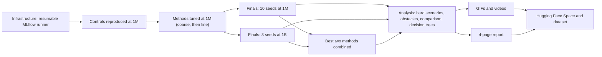

# Craftax project plan overview

Status: Phase 1 complete 2026-10-23 20:33 (all four methods tuned and marked, Dyna-Q last at 7dbe10f; full suite on main 20900ed: 1119 passed); Phase 2 `final-1m` running since 21:41

> **For agentic workers:** REQUIRED SUB-SKILL: Use superpowers:subagent-driven-development (recommended) or superpowers:executing-plans to implement this plan task-by-task. Steps use checkbox (`- [ ]`) syntax for tracking.

**Goal:** a one-page summary of the whole project plan for anyone joining the team; the executable steps live in [[2026-10-20-craftax-project]] and its linked files.

**Architecture:** seven agents (three controls, four methods) trained on the same game with the same code, compared on the same metrics, then explained, filmed, written up and published.

**Tech Stack:** JAX, craftax, MLflow, ffmpeg, LaTeX, Hugging Face.

---

## The idea in five sentences

- Craftax is a fast, open-ended survival and crafting game with 67 achievements across 9 floors ([[Craftax]], [[Game]]); no published agent gets far past the second floor.
- We train three published agents as controls (PPO, PPO-RNN, PQN-RNN) and four textbook-level methods that each attack a different difficulty of the game ([[Methods]]).
- Every agent runs at the two scoreboard budgets, 1M and 1B environment steps, so our numbers sit next to [[Existing Implementations]].
- Beyond the score we measure learning stability, hardware use and twelve in-game behaviours (who unlocks what first, in which order, how deep, how they die, how they explore, fight and survive), and we distil each final policy into a decision tree to see how complex its rules are.
- Results become GIFs and YouTube videos, a 4-page report, and a public Hugging Face Space and dataset.

## The four methods in plain words

| Method | One sentence | Difficulty it attacks |
|---|---|---|
| Count-Based Progress Bonus | Reward the agent for reaching combinations of floor, tools and items it has rarely reached | exploration that chases new scenery instead of progress |
| Self-Imitation Learning | Replay the agent's own lucky successes so it learns them faster | rare one-time achievements |
| SMDP Q-Learning over Hand-Defined Skills | A table chooses the next skill ("get wood", "make a pickaxe", "descend"); a network learns to execute the skills | the long crafting chain |
| Dyna-Q over a Skill-Level Progress Model | The same skills, plus a learned table of what each skill does, used to plan ahead | slow value propagation along the chain |

## How the work flows

## Phases and where they run

| Phase | What happens | Runs | Time estimate (training + evaluation) |
|---|---|---|---|
| 0 | Infrastructure, metrics, controls tuned and reproduced | 6 smoke + 89 coarse + 36 fine (controls) | measured: 13.0 run-hours, 11.9 h wall-clock (estimate: about 18 laptop hours) |
| 1 | Each method implemented, tested, tuned at 1M | 10 smoke + 405 coarse + 102 fine | measured for 4 of 5 methods: 52.7 run-hours, 30.5 h wall-clock; Dyna-Q 4.8 h wall-clock (estimate 5.4 h; was about 83 laptop hours for all) |
| 2 | Finals: 10 seeds at 1M, 3 seeds at 1B | 140 `final-1m` + 24 `final-1b` | 1M: about 13 laptop hours with 2 workers (estimate from measured run times; was 49); 1B: about 43 GPU hours on CUDA (33.0 + 10.4; was 72), about 2,077 laptop hours |
| 3 | Best two methods combined, after both finals | 10 `combo-1m` + 3 `combo-1b` | 1M: about 1.2 laptop hours (estimate; was 4); 1B: about 6 GPU hours (5.1 + 1.3; was 11), about 357 laptop hours |
| 4 | Analysis | offline | small |
| 5-7 | Videos, report, Hugging Face release | offline | small |

- Totals: 825 runs; everything at 1M on the laptop with 2 workers: tuning measured (Phase 0 11.9 h, Phase 1 about 31 h plus Dyna-Q 4.8 h) and finals plus combination about 14 h estimate (was 154.5 sequential hours); everything at 1B about 50 GPU hours (38.0 training + 11.7 evaluation at the measured eval rate; was 83).
- 1B results rest on 3 seeds and are indicative; significance claims are made at 1M (10 seeds) ([[Experiment decisions]]).
- Full numbers: [[2026-10-20-craftax-compute-budget]].

## Progress

- Phase 0 training done 2026-10-22 04:22 (controls tuned; PPO 2.17 vs 2.2, PPO-RNN 2.19 vs 2.3, PQN-RNN matches the original code); Phase 1 code merged 2026-10-22 05:10; online metric families merged 12:06; Phase 0 complete 14:10 (full suite on main green).
- Phase 1 tuning 2026-10-22 06:02 to 2026-10-23 20:33, all four methods tuned and marked; Phase 2 `final-1m` running since 21:41; checklist and status in [[2026-10-20-craftax-project]].
- Timetable (measured to 2026-10-23 21:41): Phase 0 tuning Wed 21 16:23 to Thu 22 04:19; Phase 1 tuning of count bonus, SIL and SMDP skills Thu 22 06:02 to Fri 23 12:34; Dyna-Q tuning Fri 23 15:43 to 20:33. `final-1m` (140 runs) started Fri 23 21:41; estimate with 2 workers about 13-14 h, so it ends about Sat 24 11:00; then `combo-1m` (10 runs) about 1.2 h.

## How to run it

- `make queue PHASE=<phase>` starts or continues a phase; Ctrl-C stops it safely; the next call resumes.
- `make status PHASE=<phase>` shows what is done; `make mlflow` shows the results.
- Laptop and cluster run the same code and run names; their stores merge into one `mlruns.db` ([[2026-10-20-craftax-infrastructure]]).

## What we will be able to say at the end

- Which family learns Craftax best at 1M and at 1B: policy gradient or value-based, flat or hierarchical, model-free or planning ([[2026-10-20-craftax-comparison-and-results]]).
- Which scenarios were hard for each agent and how it eventually solved them ([[2026-10-20-craftax-training-analysis]]).
- How complex each agent's decision rules are ([[2026-10-20-craftax-interpretation-and-ruleset]]).
- How each agent plays, in numbers and on video ([[2026-10-20-craftax-visualisation-production]]).

## Key decisions

- Benchmarks, seeds, tuning, metrics, run and release: [[Experiment decisions]].
- Videos and figures: [[Visualisation decisions]].
- Fastest machine setup: [[Craftax runtime setup]].
