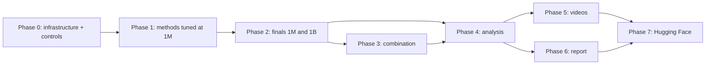

# Craftax project execution plan

Status: draft

> **For agentic workers:** REQUIRED SUB-SKILL: Use superpowers:subagent-driven-development (recommended) or superpowers:executing-plans to implement this plan task-by-task. Steps use checkbox (`- [ ]`) syntax for tracking.

**Goal:** train, compare and explain three controls and four textbook-level methods on Craftax at the 1M and 1B scoreboard budgets; analyse training, in-game behaviour, stability and hardware use; produce GIFs and YouTube videos; write a 4-page report; publish everything on Hugging Face.

**Architecture:** every experiment is a resumable MLflow run of one (method, configuration, budget, seed), executed by one queue runner on the laptop or a cluster node ([[2026-10-20-craftax-infrastructure]]); phases are slices of the run grid, so the plan can stop after any run and continue later. Design decisions: [[Experiment decisions]], [[Visualisation decisions]], method designs in [[Methods]].

**Tech Stack:** JAX 0.11, craftax 1.6.1, flax, optax, MLflow (SQLite `mlruns.db`), ffmpeg, LaTeX (Interspeech template), huggingface_hub.

---

## Plan files

| Area | File |
|---|---|
| One-page summary of the whole plan | [[2026-10-20-craftax-overview]] |
| Infrastructure: runner, queue, MLflow, profiles | [[2026-10-20-craftax-infrastructure]] |
| Metrics and evaluation protocol | [[2026-10-20-craftax-evaluation-and-metrics]] |
| Control: PPO | [[2026-10-20-craftax-method-ppo]] |
| Control: PPO-RNN | [[2026-10-20-craftax-method-ppo-rnn]] |
| Control: PQN-RNN | [[2026-10-20-craftax-method-pqn-rnn]] |
| Method: Count-Based Progress Bonus (on PPO-RNN and PQN-RNN) | [[2026-10-20-craftax-method-count-bonus]] |
| Method: Self-Imitation Learning (on PPO-RNN) | [[2026-10-20-craftax-method-sil]] |
| Method: SMDP Q-Learning over Hand-Defined Skills | [[2026-10-20-craftax-method-smdp-skills]] |
| Method: Dyna-Q over a Skill-Level Progress Model | [[2026-10-20-craftax-method-dyna-q]] |
| Run counts and laptop time | [[2026-10-20-craftax-compute-budget]] |
| Training analysis: hard scenarios, obstacles | [[2026-10-20-craftax-training-analysis]] |
| Comparison and final results | [[2026-10-20-craftax-comparison-and-results]] |
| Interpretation and decision-ruleset complexity | [[2026-10-20-craftax-interpretation-and-ruleset]] |
| GIFs and YouTube videos | [[2026-10-20-craftax-visualisation-production]] |
| 4-page report | [[2026-10-20-craftax-report]] |
| Hugging Face Space and dataset (last step) | [[2026-10-20-craftax-huggingface-release]] |

## How to run and stop

- Start or continue a phase: `make queue PHASE=<phase> [METHOD=<slug>]`; finished runs are skipped, interrupted runs resume from their last checkpoint.
- Stop at any time with Ctrl-C (or the scheduler's SIGTERM): the runner checkpoints and marks the run `KILLED`.
- See progress: `make status PHASE=<phase>`; inspect results: `make mlflow`.
- Cluster: the same phases with `scripts/cluster/run_array.sh`; merge node stores with `make merge-mlflow SRC=<store>`.
- Phases (MLflow experiments): `smoke` -> `tune-coarse` -> `tune-fine` -> `final-1m` -> `final-1b` -> `combo-1m` -> `combo-1b`.

## Phases

Each phase ends with `make check` green and its results visible in MLflow; later phases only read earlier results.

### Phase 0: Infrastructure and controls

- [ ] [[2026-10-20-craftax-infrastructure]] Tasks 1-7 (runner, queue, metrics, eval, profiles, smoke).
- [ ] [[2026-10-20-craftax-evaluation-and-metrics]]: online metrics needed during training (offline ones can follow in Phase 4).
- [ ] Controls implemented and reproduced at 1M: [[2026-10-20-craftax-method-ppo]], [[2026-10-20-craftax-method-ppo-rnn]], [[2026-10-20-craftax-method-pqn-rnn]] (reproduction check against the published 1M numbers).
- [ ] Measure real steps/s per method family and update [[2026-10-20-craftax-compute-budget]].

### Phase 1: Methods, implemented and tuned at 1M

- [ ] For each method file: implementation and tests, `smoke`, `tune-coarse`, `tune-fine` (3 seeds, Craftax-1M).
- [ ] Order (shared code first): progress key and count bonus -> SIL -> skill library and SMDP -> Dyna-Q.
- [ ] Record each method's best configuration in its plan file and in MLflow (tag `best=true`).

### Phase 2: Finals

- [ ] `final-1m`: best configuration of every control and method, 10 seeds.
- [ ] `final-1b`: same, 10 seeds, 1B steps (laptop or cluster; same run names).
- [ ] Fixed-seed evaluation and replayable rollouts for every final checkpoint ([[2026-10-20-craftax-evaluation-and-metrics]]).

### Phase 3: Combination of the two best methods

- [ ] Choose the two best compatible methods from `final-1m` and `final-1b` (by IQM of the final score, then probability of improvement over PPO-RNN); compatible = they change different parts of the agent (e.g. a reward term and an extra loss on the same base).
- [ ] Write `configs/methods/combo.yaml` combining both best configurations without retuning; add the combined method to the trainer registry (test: both components active, each still logs its own metrics).
- [ ] `combo-1m` and `combo-1b`, 10 seeds each; the combination is one more method row in every analysis.

### Phase 4: Analysis

- [ ] [[2026-10-20-craftax-training-analysis]]: hard scenarios, obstacles per method, how complex scenarios were solved.
- [ ] [[2026-10-20-craftax-comparison-and-results]]: controls, methods, combination and published results; all metric families; hyperparameter sensitivity.
- [ ] [[2026-10-20-craftax-interpretation-and-ruleset]]: decision-tree distillation and interpretation.

### Phase 5: Visualisation

- [ ] [[2026-10-20-craftax-visualisation-production]]: GIFs, 3-minute 16:9 and Short, 12-minute video.

### Phase 6: Report

- [ ] [[2026-10-20-craftax-report]]: 4 pages of content plus page 5 for references, disclosure and acknowledgements; numbers generated from MLflow.

### Phase 7: Hugging Face release (last)

- [ ] [[2026-10-20-craftax-huggingface-release]]: public Space `Pawlo77/wut-murl-craftax` and dataset `Pawlo77/wut-murl-craftax-results`, after the user's confirmation.

## Dependencies

- Phase 5 can start early with control and smoke footage; final cuts wait for Phase 4.
- `final-1b` runs are independent of each other and of Phase 3 at 1M; run them on whatever machine is free.
