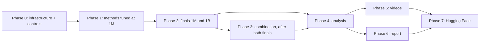

# Craftax project execution plan

Status: in progress

> **For agentic workers:** REQUIRED SUB-SKILL: Use superpowers:subagent-driven-development (recommended) or superpowers:executing-plans to implement this plan task-by-task. Steps use checkbox (`- [ ]`) syntax for tracking.

**Goal:** train, compare and explain three controls and four textbook-level methods on Craftax at the 1M and 1B scoreboard budgets; analyse training, in-game behaviour, stability and hardware use; produce GIFs and YouTube videos; write a 4-page report; publish everything on Hugging Face.

**Architecture:** every experiment is a resumable MLflow run of one (registry entry, configuration, budget, seed), named `<registry-name>-<budget>-<confighash8>-s<seed>` and executed by one queue runner on the laptop or a cluster node ([[2026-10-20-craftax-infrastructure]]); phases are slices of the run grid, so the plan can stop after any run and continue later. Design decisions: [[Experiment decisions]], [[Visualisation decisions]], method designs in [[Methods]].

**Tech Stack:** JAX 0.11, craftax 1.6.1, flax, optax, MLflow (SQLite `mlruns.db`), ffmpeg, LaTeX (Interspeech template), huggingface_hub.

---

## Plan files

| Area | File |
|---|---|
| One-page summary of the whole plan | [[2026-10-20-craftax-overview]] |
| Infrastructure: runner, queue, MLflow, profiles | [[2026-10-20-craftax-infrastructure]] |
| Metrics and evaluation protocol | [[2026-10-20-craftax-evaluation-and-metrics]] |
| Control: PPO | [[2026-10-20-craftax-method-ppo]] |
| Control: PPO-RNN | [[2026-10-20-craftax-method-ppo-rnn]] |
| Control: PQN-RNN | [[2026-10-20-craftax-method-pqn-rnn]] |
| Method: Count-Based Progress Bonus (on PPO-RNN and PQN-RNN) | [[2026-10-20-craftax-method-count-bonus]] |
| Method: Self-Imitation Learning (on PPO-RNN) | [[2026-10-20-craftax-method-sil]] |
| Method: SMDP Q-Learning over Hand-Defined Skills | [[2026-10-20-craftax-method-smdp-skills]] |
| Method: Dyna-Q over a Skill-Level Progress Model | [[2026-10-20-craftax-method-dyna-q]] |
| Run counts, laptop and GPU time, eval time | [[2026-10-20-craftax-compute-budget]] |
| Training analysis: hard scenarios, obstacles | [[2026-10-20-craftax-training-analysis]] |
| Comparison and final results | [[2026-10-20-craftax-comparison-and-results]] |
| Interpretation and decision-ruleset complexity | [[2026-10-20-craftax-interpretation-and-ruleset]] |
| GIFs and YouTube videos | [[2026-10-20-craftax-visualisation-production]] |
| 4-page report | [[2026-10-20-craftax-report]] |
| Hugging Face Space and dataset (last step) | [[2026-10-20-craftax-huggingface-release]] |

## How to run and stop

- Start or continue a phase: `make queue PHASE=<phase> [METHOD=<slug>] [PROFILE=laptop|cuda]`; a config slug selects all its registry entries (`count-bonus` -> `count-bonus-ppo-rnn`, `count-bonus-pqn-rnn`); finished runs are skipped, interrupted runs resume from their full saved state (`state/`).
- List a phase without running it: `make queue PHASE=<phase> [METHOD=<slug>] DRY_RUN=1`; tune-fine adds `FINE=<slug>` (stage-2 configs generated from the rule); mark a tuned config with `uv run python -m wut_murl_craftax.orchestration.queue --mark-tuned <slug> <hash8>`.
- Stop at any time with Ctrl-C (or the scheduler's SIGTERM): the runner saves the full state and marks the run `KILLED`.
- See progress: `make status PHASE=<phase>`; inspect results: `make mlflow`.
- Run identity: a run name is looked up across the whole store, so a run listed by two phases (for example PPO's published config in `tune-coarse` and `final-1m`) runs once and belongs to both (MLflow tag `phases`); `make status` and the exports filter by that tag.
- Cluster: the same phases with `scripts/cluster/run_array.sh`; merge node stores with `make merge-mlflow SRC=<store>`.
- Phases (MLflow experiments): `smoke` -> `tune-coarse` -> `tune-fine` -> `final-1m` -> `final-1b` -> `combo-1m` -> `combo-1b`. Tuning phases are `tune-coarse tune-fine`; the final phases read by every analysis are `final-1m final-1b combo-1m combo-1b`.

## Phases

Each phase ends with `make check` green and its results visible in MLflow; later phases only read earlier results.

Phase 0 training done 2026-10-22 04:22 (controls tuned; PPO 2.17 vs 2.2, PPO-RNN 2.19 vs 2.3, PQN-RNN matches the original code); online metric families (evaluation Task 3) merged 12:06, Phase 0 closes when its full test suite passes on main. Phase 1 code merged 2026-10-22 05:10, stage-1 tuning running since 06:02.

### Phase 0: Infrastructure and controls

- [x] [[2026-10-20-craftax-infrastructure]] Tasks 1-3, then [[2026-10-20-craftax-evaluation-and-metrics]] Tasks 1-2 (`evaluation/events.py`), then [[2026-10-20-craftax-method-ppo]] Task 2 (`training/wrappers.py`, which returns the step events), then infrastructure Tasks 4-7 (metrics, eval, profiles, smoke).
- [ ] [[2026-10-20-craftax-evaluation-and-metrics]]: online metrics needed during training (offline ones can follow in Phase 4). (open: evaluation Task 3 is implemented and merged, 06470be; its Step 5 full-suite run on main is pending; Tasks 4 and later are Phase 4)
- [x] Controls implemented, tuned and reproduced at 1M: [[2026-10-20-craftax-method-ppo]], [[2026-10-20-craftax-method-ppo-rnn]], [[2026-10-20-craftax-method-pqn-rnn]]; each reproduction gate reports the gap to the published 1M number and the work continues with our control.
- [x] Measure real steps/s and eval steps per checkpoint per method family and update [[2026-10-20-craftax-compute-budget]].

### Phase 1: Methods, implemented and tuned at 1M

- [ ] For each method file: implementation and tests, `smoke`, `tune-coarse`, `tune-fine` (3 seeds, Craftax-1M). (2026-10-22: implementation, tests and smoke runs done for all four; the smoke Ctrl-C/resume checks and the tuning remain)
- [ ] Order (shared code first): progress key and count bonus -> SIL -> skill library and SMDP -> Dyna-Q. (implementation followed it; tuning follows it too, Dyna-Q after smdp-skills is tuned)
- [ ] The last tuning step of each control and method writes its `tuned:` block in `configs/methods/<slug>.yaml` (the source of `base_from`) and tags those runs `best=true` in MLflow, both through `mark_tuned` ([[2026-10-20-craftax-infrastructure]] Task 1). (controls done 2026-10-22 04:22; the four methods wait for their `tune-fine`)

### Phase 2: Finals

- [ ] `final-1m`: tuned configuration of every control and method, 10 seeds.
- [ ] `final-1b`: same, 3 seeds, 1B steps (laptop or cluster; same run names); 1B results are indicative, significance claims are made at 1M ([[Experiment decisions]], 2026-10-21).
- [ ] Fixed-seed evaluation of every log-spaced checkpoint of each final run (tuning runs evaluate their final checkpoint only), run by the queue before a run is marked FINISHED ([[2026-10-20-craftax-infrastructure]] Task 5).

### Phase 3: Combination of the two best methods

#### Task 1: Combination of the two best compatible methods

Starts after both `final-1m` and `final-1b` are finished.

**Files:**
- Create: `configs/methods/combo.yaml`, `configs/phases/combo-1m.yaml`, `configs/phases/combo-1b.yaml`
- Modify: `src/wut_murl_craftax/training/interface.py` (`combine` and the registry entry `combo`)
- Test: `tests/training/test_combo.py`

- [ ] **Step 1: Choose** the pair from `final-1m` and `final-1b` together: rank the methods by the IQM of the final score at 1M (10 seeds) and by the mean at 1B (3 seeds), sum the two ranks, break ties by the 1M probability of improvement against its base control; take the best two that are compatible (same base control, and no `HookFields` field set by both, e.g. a reward term and an extra loss on PPO-RNN). Record the pair and the ranking in [[Experiment decisions]]. If the pair contains a skill method (`smdp-skills`, `dyna-q`), the combination is reported in the "uses hand-written skills" block.
- [ ] **Step 2: Write the failing tests** in `tests/training/test_combo.py`: `combine(a, b)` of two fixture methods sums their intrinsic rewards, chains their `observe` and `extra_loss_fn` and merges their metrics with each method's own prefix; a field set by both fails loudly; with both components switched off the first 2 updates on Craftax-Classic equal the base control's bit for bit; with both on, both components are active (each logs non-zero metrics); the `combo` entry passes the interface test of [[2026-10-20-craftax-infrastructure]] Task 3.
- [ ] **Step 3: Implement** `combine` and register `combo` in `training/interface.py`.
- [ ] **Step 4: Write** `configs/methods/combo.yaml` (`base: {base_from: <base control>.tuned}`, the two methods' `tuned` blocks unchanged, `grid: {coarse: [the single combined config], fine: null}`, no retuning) and the phase files `combo-1m.yaml` (10 seeds) and `combo-1b.yaml` (3 seeds), both with log-spaced evaluation.
- [ ] **Step 5: Run** `uv run pytest tests/training/test_combo.py -q`; expected: pass.
- [ ] **Step 6: Run** `make queue PHASE=combo-1m METHOD=combo` (laptop), then `make queue PHASE=combo-1b METHOD=combo PROFILE=cuda` (cluster); check `make status PHASE=combo-1m` shows 10 finished and `make status PHASE=combo-1b` shows 3.
- [ ] **Step 7: Check** that every Phase 4 command lists the four final phases `final-1m final-1b combo-1m combo-1b`; the combination is one more method row in every analysis.

### Phase 4: Analysis

- [ ] First [[2026-10-20-craftax-visualisation-production]] Task 5: `eval_rollouts.network_outputs` re-runs every method's network on replayed observations (the eval files and `Policy.step` carry no action probabilities or values); the stall-case overlay clips of the training analysis and the distillation dataset need it.
- [ ] [[2026-10-20-craftax-training-analysis]]: hard scenarios, obstacles per method, how complex scenarios were solved.
- [ ] [[2026-10-20-craftax-interpretation-and-ruleset]]: decision-tree distillation and interpretation; its Task 6 writes `outputs/interpretation/<budget>/complexity.csv`, so it runs before the comparison's Task 6.
- [ ] [[2026-10-20-craftax-comparison-and-results]]: controls, methods, combination and published results; all metric families; hyperparameter sensitivity; its LaTeX export reads the interpretation's `complexity.csv`.

### Phase 5: Visualisation

- [ ] [[2026-10-20-craftax-visualisation-production]]: GIFs, 3-minute 16:9 and Short, 12-minute video.

### Phase 6: Report

- [ ] [[2026-10-20-craftax-report]]: 4 pages of content plus page 5 for references, disclosure and acknowledgements; numbers generated from MLflow.

### Phase 7: Hugging Face release (last)

- [ ] [[2026-10-20-craftax-huggingface-release]]: public Space `Pawlo77/wut-murl-craftax` and dataset `Pawlo77/wut-murl-craftax-results` (MIT), after the user's confirmation; the three YouTube uploads use Creative Commons BY.

## Dependencies

- Phase 5 can start early with control and smoke footage; final cuts wait for Phase 4.
- `final-1b` runs are independent of each other; run them on whatever machine is free. Phase 3 waits for all of them, because the pair is chosen from both budgets.
