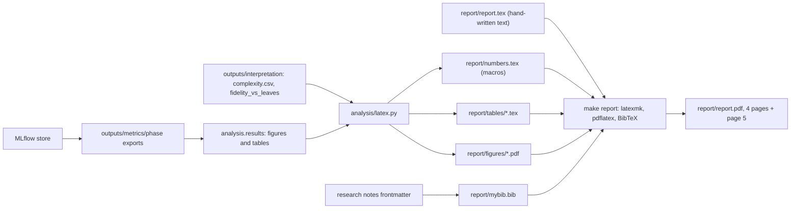

# Craftax report implementation plan

Status: draft

> **For agentic workers:** REQUIRED SUB-SKILL: Use superpowers:subagent-driven-development (recommended) or superpowers:executing-plans to implement this plan task-by-task. Steps use checkbox (`- [ ]`) syntax for tracking.

**Goal:** a report of 4 pages of content, with references, the generative-AI disclosure and acknowledgements on page 5 (decided, [[Experiment decisions]]), in the Interspeech template in `report/` that presents the methods of [[2026-10-20-craftax-project]], the controls, the results on Craftax-1M and Craftax-1B with honest statistics, the in-game behaviour, the decision-tree interpretation and the limitations, with every number generated from the MLflow exports.

**Architecture:** `report/report.tex` (the stripped template, `\documentclass[cameraready]{Interspeech}`) holds the text; `report/numbers.tex` (macros), `report/tables/*.tex` and `report/figures/*.pdf` are generated by `analysis/latex.py` of [[2026-10-20-craftax-comparison-and-results]]; `report/mybib.bib` holds the bibliography built from the research notes; `make report` builds the PDF with latexmk. `report/template.tex` stays as the formatting reference and is never edited.

**Tech Stack:** TeX Live (`latexmk`, `pdflatex`, BibTeX with `IEEEtran`), `report/Interspeech.cls`, generated tables and figures from `wut_murl_craftax.analysis`.

Report build from the MLflow exports to the PDF:

## Page budget

Decided ([[Experiment decisions]]): 4 pages of content; references, the generative-AI disclosure and acknowledgements go on page 5, as the Interspeech rules for regular papers allow (`report/template.tex`, sections "Submissions" and "Acknowledgments").

| Section | Pages | Content |
|---|---|---|
| Title, abstract, index terms | 0.35 | abstract at most 1,000 characters, no citations |
| 1 Introduction | 0.40 | problem, why Craftax, contributions as 4 bullets (methods, metric families, interpretation, open release) |
| 2 Related work | 0.30 | Craftax and its scoreboard, the comparable blocks of [[Existing Implementations]], statistics practice |
| 3 Methods | 0.60 | the two controls in 2 sentences; one paragraph per method from its plan: idea, change against PPO, key hyperparameters; the combined method in 2 sentences |
| 4 Experimental setup | 0.45 | benchmarks and budgets, seeds (3 tuning, 10 final), tuning protocol, eval protocol, statistics, hardware profiles, software (JAX, craftax 1.6.1, MLflow) |
| 5 Results | 1.10 | T1, F1, F2; in-game behaviour (F3, F4); stability and hardware (T2) |
| 6 Interpretation | 0.40 | F5, one sentence per method on its strategy, the complexity result |
| 7 Discussion and conclusion | 0.40 | obstacles from [[2026-10-20-craftax-training-analysis]], limitations, future work, links to videos, Space and dataset |
| **Total** | **4.00** | |
| Page 5 | | Generative AI use disclosure, acknowledgements, references |

## Figure and table budget

| ID | Report item | Source (comparison plan ID) | Width |
|---|---|---|---|
| F1 | Learning curves, % of max, 1M and 1B panels, 95% bands | F1 | 2 columns, 0.25 page |
| F2 | IQM and mean intervals per method and probability of improvement vs controls | F2 + F3 side by side | 1 column |
| F3 | First-unlock race (env steps) and progress funnel | F6 + F8 stacked | 1 column |
| F4 | Playstyle radars at 1B | F17 | 1 column |
| F5 | Fidelity vs leaves per method, dashed 90% line | interpretation `fidelity_vs_leaves_1b.pdf` | 1 column |
| T1 | Main results with literature rows (blocks A and D) | T1 + T2 | 2 columns |
| T2 | Stability and hardware headline columns | T5 | 1 column |

- At most 5 figures and 2 tables; every one is referenced in the text before it appears.
- Fonts in figures at least 7 pt at final size; vector PDF; method colours as in the videos.
- Everything not in the budget goes to the Hugging Face Space ([[2026-10-20-craftax-huggingface-release]]), linked from Section 7.

## Bibliography

Fields come from the frontmatter (`authors`, `year`, `venue`, `paper`) of each note; keys are `<first author><year><first title word>`.

| Cite for | Note | Source |
|---|---|---|
| Craftax benchmark, PPO and PPO-RNN baselines, scoreboard | [[PPO (Matthews 2024)]], [[PPO-RNN (Matthews 2024)]], [[Craftax Baselines]] | arXiv 2402.16801 |
| Intrinsic-reward baselines | [[RND (Matthews 2024)]], [[ICM (Matthews 2024)]], [[E3B (Matthews 2024)]] | same paper |
| Scoreboard entries at 1B | [[PPO-GTrXL (Hamon 2024)]], [[PQN-RNN (Gallici 2025)]] | arXiv 1910.06764, 2407.04811 |
| Scoreboard entries at 1M | [[Simulus (Cohen 2025)]], [[EASimulus (Peng 2026)]], [[Efficient MBRL (Dedieu 2025)]] | arXiv 2502.11537, 2601.19336, 2502.01591 |
| Separate-eval protocol (block A2) | [[PPO-LSTM (Jiralerspong 2026)]] | W&B report (cite as online resource) |
| RL background | [[Sutton & Barto - Reinforcement learning, an introduction (2nd ed draft)]] | book |
| Each method | its source note, named in its method plan | per plan |

Entries without a research note (verify each against the publisher page before adding):

- Schulman et al. 2017, Proximal Policy Optimization Algorithms (arXiv 1707.06347).
- Agarwal et al. 2021, Deep Reinforcement Learning at the Edge of the Statistical Precipice (NeurIPS 2021).
- Hafner 2022, Benchmarking the Spectrum of Agent Capabilities (Crafter, ICLR 2022).
- Bastani et al. 2018, Verifiable Reinforcement Learning via Policy Extraction (VIPER, NeurIPS 2018).
- Pedregosa et al. 2011, Scikit-learn: Machine Learning in Python (JMLR).
- Bradbury et al. 2018, JAX (software).

---

### Task 1: Build target and skeleton

**Files:**
- Modify: `Makefile` (target `report`), `report/report.tex`

- [ ] **Step 1: Add** the target `report: ## Build the report PDF` running `cd report && latexmk -pdf -interaction=nonstopmode -halt-on-error report.tex`, then printing the page count from `report/report.log` (`grep -o "Output written on report.pdf ([0-9]* pages" report/report.log`).
- [ ] **Step 2: Write** the skeleton: `\input{numbers}`, the section headings of the page budget, `\bibliographystyle{IEEEtran}` and `\bibliography{mybib}`, the "Generative AI Use Disclosure" section required by the template.
- [ ] **Step 3: Run** `make report`; expected: a PDF with the headings and no LaTeX error.

### Task 2: Bibliography

**Files:**
- Modify: `report/mybib.bib`

- [ ] **Step 1: Write** one BibTeX entry per row of the bibliography tables, from the note frontmatter, with `url` set to the `paper` link.
- [ ] **Step 2: Check** each entry against its arXiv or publisher page (authors, title, venue, year); the paper page wins over the note; report any mismatch to the user and fix the note through its owner.
- [ ] **Step 3: Run** `make report`; expected: no undefined citation warnings in `report/report.log`.

### Task 3: Generated numbers, tables and figures

- [ ] **Step 1: Run** `uv run python -m wut_murl_craftax.analysis.results --phases <final 1M phase> <final 1B phase> --tuning <tuning phases> --out outputs/results` and the LaTeX export of [[2026-10-20-craftax-comparison-and-results]] (Task 5).
- [ ] **Step 2: Check** that `report/numbers.tex`, `report/tables/main.tex`, `report/tables/stability_hardware.tex` and the 5 report figures exist and that `make report` includes them.

### Task 4: Write Sections 1 to 4

- [ ] **Step 1: Write** the introduction: Craftax as an open-ended benchmark ([[Craftax scoring and evaluation]]), the gap the methods address, 4 contribution bullets.
- [ ] **Step 2: Write** related work: the scoreboard, comparable blocks only, statistics practice (Agarwal et al. 2021).
- [ ] **Step 3: Write** methods: controls, then one paragraph per method taken from its plan `2026-10-20-craftax-method-<slug>.md` and its design note in `knowledge/methods/`, then the combination of the two best methods ([[Experiment decisions]]).
- [ ] **Step 4: Write** the setup from the protocols of [[2026-10-20-craftax-evaluation-and-metrics]] and [[2026-10-20-craftax-infrastructure]]: budgets, seeds, tuning, the final score (mean training-episode return as % of 226 over the last 2% of the budget, at least 100 episodes; decided) with the fixed-seed evaluation reported alongside, eval seeds and modes, statistics, hardware profiles, software versions.
- [ ] **Step 5: Run** `make report`; record the page count of Sections 1 to 4 (target 2.1 pages).

### Task 5: Write Sections 5 to 7 and the abstract

- [ ] **Step 1: Write** results: T1 first (scoreboard metric, then eval), F1, F2, then in-game behaviour (F3, F4) with one finding per paragraph, then T2; every number through a macro from `report/numbers.tex`.
- [ ] **Step 2: Write** interpretation from the draft in `knowledge/results/Decision-tree interpretation.md` ([[2026-10-20-craftax-interpretation-and-ruleset]], Task 7).
- [ ] **Step 3: Write** discussion: the per-method obstacles (5-bullet summaries of the training-analysis notes), limitations (seeds, single environment version, hardware differences, training-episode metric, 1B runs reuse the 1M-tuned method knobs), future work, links to the Space, the dataset and the videos (`configs/video/published.yaml`).
- [ ] **Step 4: Write** the abstract last (at most 1,000 characters, no citations) and the index terms.
- [ ] **Step 5: Run** `make report`; expected: content ends on page 4, references and the disclosure on page 5.

### Task 6: Review

- [ ] **Step 1: Check** the template rules: no layout change, no page numbers, abstract length, two columns, figures referenced in text, captions under figures and above tables.
- [ ] **Step 2: Check** that no hand-typed number remains in the text (`grep -nE "[0-9]+\.[0-9]+" report/report.tex` shows only macros, equations and citations).
- [ ] **Step 3: Check** comparisons: every literature number sits beside its block and protocol; no comparison across blocks of [[Existing Implementations]].
- [ ] **Step 4: Check** terminology: "score" always means reward as % of the maximum 226; "eval" always names the mode.
- [ ] **Step 5: Ask** the user to read the PDF and list fixes; apply them; repeat until approved.
- [ ] **Step 6: Run** `make report` and `make check`; keep `report/report.pdf` and the sources tracked (`report/.gitignore` already ignores the build artefacts).
