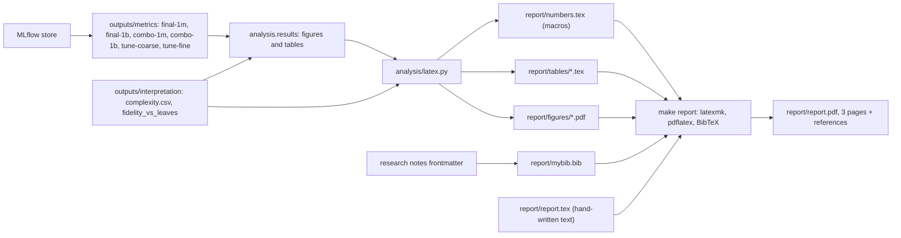

# Craftax report implementation plan

Status: in progress

> **For agentic workers:** REQUIRED SUB-SKILL: Use superpowers:subagent-driven-development (recommended) or superpowers:executing-plans to implement this plan task-by-task. Steps use checkbox (`- [ ]`) syntax for tracking.

**Goal:** a report of 3 pages including text, figures and tables, with the references after them (the course rule, decided 2026-11-01 in [[Experiment decisions]]; the 4-page decision of 2026-10-20 is superseded), in the Interspeech template in `report/` that presents the methods of [[2026-10-20-craftax-project]], the three controls (PPO, PPO-RNN, PQN-RNN), the results in two blocks (main and "uses hand-written skills") on Craftax-1M and Craftax-1B with honest statistics, the in-game behaviour, the decision-tree interpretation and the limitations, with every number generated from the MLflow exports.

**Architecture:** `report/report.tex` (already stripped from the Interspeech example, `\documentclass[cameraready]{Interspeech}`) holds the text; `report/numbers.tex` (macros), `report/tables/*.tex` and `report/figures/*.pdf` are generated by `analysis/latex.py` of [[2026-10-20-craftax-comparison-and-results]]; `report/mybib.bib` holds the bibliography built from the research notes; `make report` builds the PDF with latexmk. `report/template.tex` (the Interspeech example) was only the source of `report.tex`: Task 1 copies its formatting rules into a comment block at the top of `report.tex` and deletes it.

**Tech Stack:** TeX Live (`latexmk`, `pdflatex`, BibTeX with `IEEEtran`), `report/Interspeech.cls`, generated tables and figures from `wut_murl_craftax.analysis`.

Report build from the MLflow exports to the PDF:

## Page budget

Decided ([[Experiment decisions]], 2026-11-01): the report has at most 3 pages including text, figures and tables; only the references may go beyond them ([[Course project requirements]]). The generative-AI disclosure and the acknowledgements are not excluded by that rule, so they sit inside the 3 pages as two short paragraphs at the end of Section 7; the references follow on page 4. The earlier plan (4 pages of content, page 5 for the disclosure, acknowledgements and references, from the Interspeech rules for regular papers) is superseded. The layout rules of the Interspeech example are copied into the rules comment of `report/report.tex` by Task 1.

| Section | Pages | Content |
|---|---|---|
| Title, abstract, index terms | 0.30 | abstract at most 1,000 characters, no citations |
| 1 Introduction | 0.25 | problem, why Craftax, contributions as 4 short bullets (methods, metric families, interpretation, open release) |
| 2 Related work | 0.20 | Craftax and its scoreboard, the comparable blocks of [[Existing Implementations]], statistics practice |
| 3 Methods | 0.45 | the three controls (PPO, PPO-RNN, PQN-RNN) in 2 sentences; one short paragraph per method from its plan: idea, change against its base control, key hyperparameters; the skill methods marked as using hand-written skills; the combined method in 2 sentences |
| 4 Experimental setup | 0.35 | benchmarks and budgets, seeds (3 tuning; finals 10 at 1M, 3 at 1B), tuning protocol, eval protocol, statistics, hardware, software (JAX, craftax 1.6.1, MLflow) |
| 5 Results | 0.90 | T1, F1, F2, main block first, then the "uses hand-written skills" block; reproduction gate per control in one sentence each (pass, or gap and band h); in-game behaviour (F3) |
| 6 Interpretation | 0.20 | one sentence per method on its strategy, the complexity result; the fidelity-versus-leaves figure goes to the Space |
| 7 Discussion and conclusion | 0.25 | obstacles from [[2026-10-20-craftax-training-analysis]], limitations, future work, links to the videos, Space and dataset |
| Generative-AI disclosure, acknowledgements | 0.10 | two short paragraphs closing Section 7 |
| **Total** | **3.00** | |
| References | after page 3 | not counted |

## Figure and table budget

| ID | Report item | Source (comparison plan ID) | Width |
|---|---|---|---|
| F1 | Learning curves, % of max, 1M and 1B panels, 95% bands | F1 | 2 columns, 0.25 page |
| F2 | Intervals per method (IQM and mean at 1M, mean and median at 1B, marked indicative) and the 1M probability of improvement vs the three controls, both blocks | F2 + F3 side by side | 1 column |
| F3 | First-unlock race (env steps) and progress funnel | F6 + F8 stacked | 1 column |
| T1 | Main results with literature rows (blocks A and D) and the reproduction-gate result per control; main block, then the "uses hand-written skills" block under its own heading, the three controls on top of both, PoI and Holm within each block at 1M, 1B rows with mean, median and CIs marked indicative | T1 + T2 | 2 columns |

- At most 3 figures and 1 table (F1, F2, F3, T1); every one is referenced in the text before it appears. The playstyle radars (comparison plan F17), the fidelity-versus-leaves figure (`fidelity_vs_leaves_1b.pdf`) and the stability and hardware table (T5) are cut from the report for the 3-page limit and live in the Space and the README.
- Fonts in figures at least 7 pt at final size; vector PDF; method colours as in the videos.
- Everything not in the budget goes to the Hugging Face Space ([[2026-10-20-craftax-huggingface-release]]), linked from Section 7.

## Bibliography

Fields come from the frontmatter (`authors`, `year`, `venue`, `paper`) of each note; keys are `<first author><year><first title word>`.

| Cite for | Note | Source |
|---|---|---|
| Craftax benchmark, PPO and PPO-RNN baselines, scoreboard | [[PPO (Matthews 2024)]], [[PPO-RNN (Matthews 2024)]], [[Craftax Baselines]] | arXiv 2402.16801 |
| Intrinsic-reward baselines | [[RND (Matthews 2024)]], [[ICM (Matthews 2024)]], [[E3B (Matthews 2024)]] | same paper |
| Scoreboard entries at 1B | [[PPO-GTrXL (Hamon 2024)]], [[PQN-RNN (Gallici 2025)]] | arXiv 1910.06764, 2407.04811 |
| Scoreboard entries at 1M | [[Simulus (Cohen 2025)]], [[EASimulus (Peng 2026)]], [[Efficient MBRL (Dedieu 2025)]] | arXiv 2502.11537, 2601.19336, 2502.01591 |
| Separate-eval protocol (block A2) | [[PPO-LSTM (Jiralerspong 2026)]] | W&B report (cite as online resource) |
| RL background | [[Sutton & Barto - Reinforcement learning, an introduction (2nd ed draft)]] | book |
| Each method | its source note, named in its method plan | per plan |

Entries without a research note (verify each against the publisher page before adding):

- Schulman et al. 2017, Proximal Policy Optimization Algorithms (arXiv 1707.06347).
- Agarwal et al. 2021, Deep Reinforcement Learning at the Edge of the Statistical Precipice (NeurIPS 2021).
- Hafner 2022, Benchmarking the Spectrum of Agent Capabilities (Crafter, ICLR 2022).
- Bastani et al. 2018, Verifiable Reinforcement Learning via Policy Extraction (VIPER, NeurIPS 2018).
- Pedregosa et al. 2011, Scikit-learn: Machine Learning in Python (JMLR).
- Bradbury et al. 2018, JAX (software).

---

### Task 1: Build target and skeleton

**Files:**
- Modify: `Makefile` (target `report`), `report/report.tex`
- Delete: `report/template.tex`

- [x] **Step 1: Add** the target `report: ## Build the report PDF` running `cd report && latexmk -pdf -interaction=nonstopmode -halt-on-error report.tex`, then printing the page count from `report/report.log` (`grep -o "Output written on report.pdf ([0-9]* pages" report/report.log`).
- [x] **Step 2: Write** the skeleton: `\input{numbers}`, the section headings of the page budget, `\bibliographystyle{IEEEtran}` and `\bibliography{mybib}`, the "Generative AI Use Disclosure" section required by the template.
- [x] **Step 3: Copy** the formatting rules of `report/template.tex` that Task 6 checks (the 3-page limit with references after it, the disclosure and acknowledgement paragraphs inside it, abstract length, no page numbers, caption placement, the disclosure and acknowledgement sections) into a `%` comment block at the top of `report/report.tex`, then delete `report/template.tex` with `git rm report/template.tex`.
- [x] **Step 4: Run** `make report`; expected: a PDF with the headings and no LaTeX error.

### Task 2: Bibliography

**Files:**
- Modify: `report/mybib.bib`

- [x] **Step 1: Write** one BibTeX entry per row of the bibliography tables, from the note frontmatter, with `url` set to the `paper` link.
- [x] **Step 2: Check** each entry against its arXiv or publisher page (authors, title, venue, year); the paper page wins over the note; report any mismatch to the user and fix the note through its owner.
- [x] **Step 3: Run** `make report`; expected: no undefined citation warnings in `report/report.log`.

### Task 3: Generated numbers, tables and figures

**Files:**
- Create (generated by `analysis/latex.py`): `report/numbers.tex`, `report/tables/*.tex`, `report/figures/*.pdf`

Runs after [[2026-10-20-craftax-interpretation-and-ruleset]] Task 6 and [[2026-10-20-craftax-comparison-and-results]] Task 6 (Phase 4 order).

- [x] **Step 1: Run** `uv run python -m wut_murl_craftax.analysis.results --phases final-1m final-1b combo-1m combo-1b --tuning tune-coarse tune-fine --out outputs/results`, which includes the LaTeX export of [[2026-10-20-craftax-comparison-and-results]] (Task 5).
- [x] **Step 2: Check** that `report/numbers.tex`, `report/tables/main.tex`, `report/tables/stability_hardware.tex` and the 5 report figures exist and that `make report` includes them.

### Task 4: Write Sections 1 to 4

**Files:**
- Modify: `report/report.tex`

- [x] **Step 1: Write** the introduction: Craftax as an open-ended benchmark ([[Craftax scoring and evaluation]]), the gap the methods address, 4 contribution bullets.
- [x] **Step 2: Write** related work: the scoreboard, comparable blocks only, statistics practice (Agarwal et al. 2021).
- [x] **Step 3: Write** methods: the three controls, then one paragraph per method taken from its plan `2026-10-20-craftax-method-<slug>.md` and its design note in `knowledge/methods/`, compared against its base control; the skill methods (`smdp-skills`, `dyna-q`) flagged as using hand-written skills; then the combination of the two best methods ([[Experiment decisions]]), in the skill block if its pair contains a skill method.
- [x] **Step 4: Write** the setup from the protocols of [[2026-10-20-craftax-evaluation-and-metrics]] and [[2026-10-20-craftax-infrastructure]]: budgets, seeds, tuning, the final score (mean training-episode return as % of 226 over the last 2% of the budget, at least 100 episodes; decided) with the fixed-seed evaluation reported alongside, eval seeds and modes, statistics, hardware profiles, software versions.
- [x] **Step 5: Run** `make report`; record the page count of Sections 1 to 4 (target 1.55 pages with the title block).

### Task 5: Write Sections 5 to 7 and the abstract

**Files:**
- Modify: `report/report.tex`

- [x] **Step 1: Write** results: T1 first (scoreboard metric, then eval), main block then the "uses hand-written skills" block, each method against its base control and never ranked across blocks; significance claims at 1M (10 seeds) only, 1B results (3 seeds) stated as indicative; the reproduction gate per control (pass, or the gap with band h from `evaluation.reproduction`, and that the comparison uses our control); F1, F2, then in-game behaviour (F3) with one finding per paragraph; stability and hardware stay in the Space; every number through a macro from `report/numbers.tex`.
- [x] **Step 2: Write** interpretation from the draft in `knowledge/results/Decision-tree interpretation.md` ([[2026-10-20-craftax-interpretation-and-ruleset]], Task 7).
- [x] **Step 3: Write** discussion: the per-method obstacles (5-bullet summaries of the training-analysis notes), limitations (3 seeds at 1B, so 1B results are indicative; single environment version, hardware differences, training-episode metric, 1B runs reuse the 1M-tuned method knobs), future work, links to the Space, the dataset and the videos (`configs/video/published.yaml`).
- [x] **Step 4: Write** the abstract last (at most 1,000 characters, no citations) and the index terms.
- [x] **Step 5: Run** `make report`; expected: the text, the disclosure and the acknowledgements end on page 3, the references follow.

### Task 6: Review

**Files:**
- Modify: `report/report.tex`, `report/report.pdf`

- [x] **Step 1: Check** the 3-page limit (text, figures, tables, disclosure and acknowledgements end on page 3; only references follow) and the template rules (the comment block at the top of `report/report.tex`): no layout change, no page numbers, abstract length, two columns, figures referenced in text, captions under figures and above tables.
- [x] **Step 2: Check** that no hand-typed number remains in the text (`grep -nE "[0-9]+\.[0-9]+" report/report.tex` shows only macros, equations and citations).
- [x] **Step 3: Check** comparisons: every literature number sits beside its block and protocol; no comparison across blocks of [[Existing Implementations]].
- [x] **Step 4: Check** terminology: "score" always means reward as % of the maximum 226; "eval" always names the mode.
- [x] **Step 5: Ask** the user to read the PDF and list fixes; apply them; repeat until approved. (2026-11-08: the user delegated the draft and the review to the assistant; the PDF pages were checked as images; the user can still read `report/report.pdf` and ask for fixes)
- [x] **Step 6: Run** `make report` and `make check`; keep `report/report.pdf` and the sources tracked (`report/.gitignore` already ignores the build artefacts).

### Draft note (2026-11-08)

- `report/report.tex` is a complete draft: 3 pages in all, references included (the text, three figures and the table end on page 3), no LaTeX warnings, every result number through `numbers.tex` macros (setup constants, versions, years and the three published scores are typed). The new macros `scale*` (rank agreement, advantage changes) come from `analysis.latex.scale_numbers`.
- Bibliography: titles and authors of the five arXiv entries were checked against their arXiv pages on 2026-11-08; the venues (ICML 2024, ICLR 2025, ICML 2018, NeurIPS 2021) are not on those pages and come from the research notes and the page's award note.
- Disclosure: the text states that it was written with Claude Code under the author's direction; the Interspeech template says generative AI should not produce a significant part of a manuscript, so the course allowance is the author's responsibility. The disclosure and acknowledgements sit inside the 3 pages (the conservative reading of "references excluded").
- Open: update the results paragraph and Fig. 2 after the 1B ablations (`ablate-1b`) finish, and replace the placeholder sentence about them; replace the video and Hugging Face sentence with the final links when published.
