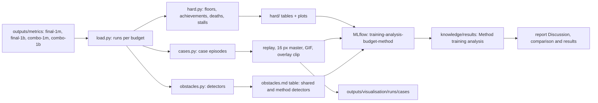

# Craftax training analysis implementation plan

Status: ready

> **For agentic workers:** REQUIRED SUB-SKILL: Use superpowers:subagent-driven-development (recommended) or superpowers:executing-plans to implement this plan task-by-task. Steps use checkbox (`- [ ]`) syntax for tracking.

**Goal:** for each method in [[2026-10-20-craftax-project]] (the three controls PPO, PPO-RNN and PQN-RNN, both count-bonus variants and the combined method included) and each benchmark, a written account of which scenarios were hard, how the hardest ones were eventually solved, and which obstacles the method met, every claim backed by an MLflow number or a replayable episode.

**Architecture:** a new package `src/wut_murl_craftax/analysis/` reads the exported tables of [[2026-10-20-craftax-evaluation-and-metrics]] (`outputs/metrics/<phase>/` of the four final phases `final-1m final-1b combo-1m combo-1b`, grouped by the run's `budget`); `analysis/hard.py` finds hard scenarios, `analysis/cases.py` finds and exports case episodes (replay, 16 px master, GIF), `analysis/obstacles.py` runs the shared and the method-specific obstacle detectors (all of them live here; the method plans only list theirs under "detectors to add") and fills the obstacles table. Outputs go to `outputs/analysis/<budget>/<method>/` and are logged as artifacts of run `training-analysis-<budget>-<method>` in MLflow experiment `analysis`. The hand-written account is one note per method, `knowledge/results/<Method> training analysis.md`.

**Tech Stack:** pandas, numpy, matplotlib, MLflow, `wut_murl_craftax.evaluation` (`episode_records`, `stability`), `wut_murl_craftax.visualisation` (`eval_rollouts.as_rollout`, `render.render_master`, `cuts.gif`, `overlay.render_overlay`).

Analysis pipeline per method and benchmark:

## Questions answered per method

- Which floors were never reached, and which were reached in fewer than 5% of final eval episodes ([[Craftax floors and progression]])?
- Which achievements were never unlocked by any seed at any checkpoint, and which stayed rare (success rate < 5% at the final checkpoint, [[Craftax achievements]])?
- What killed the agent: cause-of-death shares at the final checkpoint and how they moved over training?
- Where did the agent stall: stalls per episode, median stall length, share of stalls escaped, the floor and achievement where stalls start?
- How were long stalls broken: what changed in behaviour just before the unlock that ended the stall?
- How was the deepest floor reached: route, inventory, fights and survival on the way?
- Which obstacles appeared during training (table below), in how many seeds, at which env steps?

## Thresholds

- Rare achievement: success rate < 5% in final stochastic eval episodes.
- Never unlocked: 0 unlocks in training episodes and in every eval of every seed.
- Floor not reached: max floor below `f` in every final eval episode of every seed.
- Stall: >= 300 steps without a new unlock (definition in [[2026-10-20-craftax-evaluation-and-metrics]]).
- Long stall for a case study: the 5 longest escaped stalls per method and benchmark in final-checkpoint eval episodes, plus the longest one at each of 3 earlier checkpoints.
- Deep-floor case: the 3 episodes per method and benchmark with the deepest floor, ties broken by achievements unlocked.
- Rare-unlock case: one episode per rare achievement that unlocked it.
- Death case: one representative episode for each of the 3 most frequent causes of death.

## Obstacle detectors

Shared detectors (every method and control):

| Obstacle | Evidence rule | Source |
|---|---|---|
| Instability | >= 1 drop in the run | `evaluation.stability.drops` |
| Collapse | collapse flag set | `evaluation.stability.collapsed` |
| Plateau | final score minus score at 50% of the budget < 1 (% of max) | per-update score |
| Entropy collapse | mean policy entropy < 0.2 nats before 10% of the budget | `train/action_entropy`, logged policy entropy |
| Value failure | explained variance < 0 for >= 5% of the budget, where the method logs it | losses |
| Numerical failure | any NaN or inf in a logged loss, or gradient norm > 10 x its running median | losses, `grad_norm` |
| Reward hacking | non-achievement share of return > 20% (health term or a method's auxiliary reward), or auxiliary reward rising for >= 10% of the budget while the score is flat; confirmed by a repeated action cycle of >= 50 steps in eval replays | achievement reward share, method metrics, eval actions |
| Exploration failure | no new first unlock in the last 50% of the budget and fewer floors reached than its base control | first-unlock race, funnel |
| Survival failure | > 50% of final-checkpoint deaths caused by needs drain | cause of death |
| Skill forgetting | an achievement's success rate falls from >= 20% to < 5% later in the same run | `train/ach/<name>` |

Base control of each method (used wherever a rule says "base control"): `count-bonus-ppo-rnn`, `sil` -> PPO-RNN; `count-bonus-pqn-rnn`, `smdp-skills`, `dyna-q` -> PQN-RNN; `combo` -> the base of its two components (read from `configs/methods/combo.yaml`); the three controls are compared with each other. The mapping is `BASE_CONTROL` in `analysis/load.py`.

Method detectors, copied from the "detectors to add" lists of the method plans (rules and thresholds as written there; the method plan wins on a mismatch, then fix this table):

| Method | Obstacle | Evidence rule | Source |
|---|---|---|---|
| count-bonus (both variants) | Bonus distraction | `count/r_int_share` > 0.5 after 20% of the budget while the extrinsic score is flat (drawdown definition of [[2026-10-20-craftax-evaluation-and-metrics]]) | `count/r_int_share`, per-update score |
| count-bonus (both variants) | Hoarding or key cycling | repeated-cycle check on eval actions plus inventory counts at recipe caps for > 50% of eval steps (log2 keys only) | eval actions, eval inventory |
| count-bonus (both variants) | Bonus starvation | `count/new_keys` = 0 for 10% of the budget while floors 2 and deeper are never reached | `count/new_keys`, funnel |
| count-bonus (both variants) | Early-race slowdown | first-unlock steps of basic achievements later than the base control's by more than 2x | `first_unlock/*` |
| count-bonus-pqn-rnn | Q overestimation | Q-value magnitude above the largest observed return by 2x | logged Q values, episode returns |
| sil | Overfitting to early lucky windows | `sil/sample_age` max above 50% of the updates so far while `sil/active` > 0.5 on that slot, and entropy below the base control's at the same step | `sil/sample_age`, `sil/active`, entropy |
| sil | Forgetting | `DEFEAT_ZOMBIE` and other basic success rates below the base control's by more than 10 points | `train/ach/<name>` |
| sil | Imitated unsafe play | a cause-of-death share rising above the base control's by more than 10 points after SIL starts | cause of death |
| sil | Value overestimation | `sil/value_bias` > 0 and explained variance of the PPO critic below the base control's | `sil/value_bias`, losses |
| sil | Dead SIL | `sil/active` < 0.01 for 20% of the budget | `sil/active` |
| sil | Insertion overflow | `sil/insert_overflow` in > 10% of updates | `sil/insert_overflow` |
| smdp-skills, dyna-q | Stuck top level | one skill with success rate < 5% takes > 20% of decisions for >= 10% of the budget | `smdp/skill/<name>/success_rate`, `smdp/skill/<name>/chosen_share` |
| smdp-skills, dyna-q | Fallback collapse | `fight` plus `unlock_any` take > 60% of decisions after the epsilon decay | `smdp/skill/<name>/chosen_share`, `smdp/eps` |
| smdp-skills, dyna-q | Skill interference | the shared skill-forgetting rule per skill (`smdp/skill/<name>/success_rate` from >= 20% to < 5%), reported with the skill whose `chosen_share` rose most in the same window | `smdp/skill/<name>/*` |
| smdp-skills, dyna-q | Timeout dominance | timeouts > 50% of one skill's ends for >= 10% of the budget | `smdp/skill/<name>/end/timeout` |
| smdp-skills, dyna-q | Deep-skill starvation | `collect_diamond`, `descend` from floor 1 or `make_iron_pickaxe` chosen fewer than 100 times in the run | `smdp/skill/<name>/chosen_share`, `smdp/decisions_per_episode` |
| smdp-skills, dyna-q | Survival failure despite flags | > 30% of low-stat interruptions followed by death within 100 steps | eval `skill[t]`, skill end reasons, step events |
| smdp-skills, dyna-q | Key aliasing | the same key reached with both success and timeout of one skill in > 40% of tries | eval `skill[t]`, `key[t]`, skill end reasons |
| smdp-skills, dyna-q | Blind skill test | `smdp/skill/<name>/test_agreement` below 0.9 for one skill (the observation test misses what the events record) | `smdp/skill/<name>/test_agreement` |
| dyna-q | Planned-value gap | `smdp/q_start` above 2x the mean return of finished episodes for >= 10% of the budget after the epsilon decay | `smdp/q_start`, episode returns |
| dyna-q | Stale model | `dyna/model_accuracy` falling by > 0.2 within 10% of the budget | `dyna/model_accuracy` |
| dyna-q | Bonus-driven re-trying (kappa > 0) | the share of decisions on pairs with count > 1000 and success rate > 90% rising while the score is flat | `dyna/*`, per-update score |
| dyna-q | No planning effect | `dyna/plan_td_abs` below 1e-3 for >= 20% of the budget | `dyna/plan_td_abs` |
| combo | the detectors of both components | as above | as above |

## Obstacles table template

One table per method in its note, one row per detected obstacle; a row may also come from manual inspection (evidence column says so).

| Obstacle | Benchmark | Runs affected | When (env steps) | Evidence | Mitigation tried | Outcome | Replay or plot |
|---|---|---|---|---|---|---|---|
| e.g. collapse | 1B | 1 / 3 | 420M to 510M | drawdown 0.62, no recovery | lower learning rate in `tune-fine` | 0 / 3 after the change | `training-analysis-1b-<method>/plots/drawdown.png` |

- "Runs affected" counts final runs (`final-1m` and `combo-1m` of 10 seeds, `final-1b` and `combo-1b` of 3 seeds); tuning runs (`tune-coarse`, `tune-fine`) go in a second table with the same columns.
- "Mitigation tried" names the config change; each such change appends a dated section to [[Experiment decisions]].
- Replays and plots are referenced by MLflow run name and artifact path in backticks; `outputs/` is not in git, so no wikilinks to it.

---

### Task 1: Package and loaders

**Files:**
- Create: `src/wut_murl_craftax/analysis/__init__.py`, `src/wut_murl_craftax/analysis/load.py`
- Test: `tests/analysis/conftest.py` (a small synthetic export: 2 methods x 2 budgets x 3 seeds), `tests/analysis/test_load.py`

- [ ] **Step 1: Write the failing tests**: `load_phase(dir)` returns `runs`, `curves` and `episodes` frames with the export schema; `load_phases(dirs)` concatenates several phases and keeps a run listed in two phases (MLflow tag `phases`) once; `select(frames, method=, budget=)` filters every frame consistently; `BASE_CONTROL` maps every registry method except the three controls; a missing column raises a clear error.
- [ ] **Step 2: Implement** `load_phase`, `load_phases`, `select`, `BASE_CONTROL` and `final_checkpoint(episodes, run)`.
- [ ] **Step 3: Run** `uv run pytest tests/analysis/test_load.py -q`.

### Task 2: Hard scenarios

**Files:**
- Create: `src/wut_murl_craftax/analysis/hard.py`
- Test: `tests/analysis/test_hard.py`

- [ ] **Step 1: Write the failing tests** on the fixture: floor reach rates with bootstrap CIs over seeds; never-unlocked and rare lists follow the thresholds; cause-of-death shares sum to 1; stall statistics (stalls per episode, median length, escape rate, start floor histogram).
- [ ] **Step 2: Implement** `floor_reach`, `achievement_status` (final rate, best rate over training, k of n seeds ever), `death_causes` (final and per eval checkpoint), `stall_stats`, each returning a DataFrame.
- [ ] **Step 3: Implement** the plots `floor_reach.png`, `achievement_status.png` (rows grouped by tier and floor), `death_causes_over_training.png`, `stall_lengths.png` (CCDF), same dark style as `visualisation.charts`.
- [ ] **Step 4: Run** `uv run pytest tests/analysis/test_hard.py -q`.

### Task 3: Case finder and replay export

**Files:**
- Create: `src/wut_murl_craftax/analysis/cases.py`
- Test: `tests/analysis/test_cases.py`

- [ ] **Step 1: Write the failing tests**: in a fixture with a 400-step stall ended by an unlock, `find_cases` ranks it first among stall cases; deep-floor, rare-unlock and death cases follow the thresholds; an exported case rollout replays to the same final achievements as the stored eval episode; its GIF lasts at most 20 s.
- [ ] **Step 2: Implement** `find_cases(frames, method, budget) -> cases DataFrame` (id, run, update, mode, seed, kind, start, end, peak, caption).
- [ ] **Step 3: Implement** `export_case(case, out_dir)`: rollout file via `visualisation.eval_rollouts.as_rollout`, 16 px master via `visualisation.render.render_master`, GIF of the window around the peak via `visualisation.cuts.gif`, and for stall cases an agent-internals clip of the last 100 steps before the unlock via `visualisation.overlay.render_overlay`, which re-runs the method's network on the replayed observations for the action probabilities and the value (needs [[2026-10-20-craftax-visualisation-production]] Task 5 for methods other than PPO).
- [ ] **Step 4: Implement** `describe_case(case) -> dict` with the facts the write-up needs: floor, stats and inventory at the stall start and at the unlock; action histogram inside the stall vs the whole episode; coverage gained during the stall; the last 50 actions before the unlock; damage taken and close calls inside the window.
- [ ] **Step 5: Run** `uv run pytest tests/analysis/test_cases.py -q`.

### Task 4: Obstacle detectors and table

**Files:**
- Create: `src/wut_murl_craftax/analysis/obstacles.py`
- Test: `tests/analysis/test_obstacles.py`

This task implements every detector of the project: the shared ones and the method detectors of the table above (the method plans list them under "detectors to add" and never modify this module).

- [ ] **Step 1: Write the failing tests**: for every row of both detector tables (10 shared, 23 method-specific) one synthetic curve, metric or eval series that fires it and one that does not; detectors needing the base control get a synthetic base-control series through `BASE_CONTROL`; `DETECTORS[method]` returns the shared detectors plus that method's (`dyna-q` includes every `smdp-skills` detector, `count-bonus-pqn-rnn` adds Q overestimation, `combo` gets both components'); each detector declares `REQUIRED_METRICS` and a run missing one yields "not logged", not "absent"; `obstacles_table(rows)` renders exactly the template columns in Markdown.
- [ ] **Step 2: Implement** the shared detectors, one function each, returning `Obstacle(name, run, start, end, evidence)`.
- [ ] **Step 3: Implement** the method detectors, one function each, grouped by method (`count_bonus_detectors`, `sil_detectors`, `skill_detectors`, `dyna_detectors`), the registry `DETECTORS: dict[str, list[Detector]]` and `detect_all(frames, method, budget)`.
- [ ] **Step 4: Implement** the repeated-cycle check for reward hacking and key cycling: the shortest action period of >= 50 consecutive steps in eval actions (autocorrelation of the action sequence).
- [ ] **Step 5: Run** `uv run pytest tests/analysis/test_obstacles.py -q`.

### Task 5: Run the analysis for every method

**Files:**
- Create: `src/wut_murl_craftax/analysis/training.py` (CLI)
- Test: `tests/analysis/test_training_cli.py`

- [ ] **Step 1: Write the failing test** in `tests/analysis/test_training_cli.py`: the CLI on the fixture (phases `final-1m`, `final-1b`, `combo-1m`, `combo-1b`) writes `hard/`, `cases/`, `obstacles.md` and `plots/` for each method under `outputs/analysis/<budget>/<method>/`, the combination included, and logs them to a temporary MLflow store under `training-analysis-<budget>-<method>`.
- [ ] **Step 2: Implement** `uv run python -m wut_murl_craftax.analysis.training --phases <phase> [<phase> ...] --method <method|all> --out outputs/analysis`; runs are grouped by their `budget` tag.
- [ ] **Step 3: Run** `uv run pytest tests/analysis/test_training_cli.py -q`, then `uv run python -m wut_murl_craftax.analysis.training --phases final-1m final-1b combo-1m combo-1b --method all --out outputs/analysis`; check the MLflow runs in `make mlflow`.
- [ ] **Step 4: Copy** every case rollout into `outputs/visualisation/runs/cases/` so [[2026-10-20-craftax-visualisation-production]] picks them up as highlight candidates.

### Task 6: Per-method write-up

**Files:**
- Create: `knowledge/results/<Method> training analysis.md` for each method, the combination and the three controls (template `knowledge/_templates/concept.md`, `domain: analysis`, `parent: "[[2026-10-20-craftax-project]]"`)
- Modify: `knowledge/AGENTS.md` (row for `results/`: one note per method plus the cross-method results notes)

- [ ] **Step 1: Write** section "Hard scenarios": floors not reached, never and rare achievements, death causes, stall statistics, each bullet with its number and the MLflow run that holds it.
- [ ] **Step 2: Write** section "How complex scenarios were solved": one paragraph per case (situation, behaviour during the stall, what broke it, outcome), facts from `describe_case`, the GIF and replay referenced by run name and artifact path.
- [ ] **Step 3: Write** section "Obstacles" with the filled template table, one table per benchmark.
- [ ] **Step 4: Write** section "Comparison with the controls": the same three questions answered for the three controls (PPO, PPO-RNN, PQN-RNN) in one line each, its base control first, linking their notes.
- [ ] **Step 5: Check** every number against the MLflow UI for 3 random bullets per note; numbers come from executed output only.
- [ ] **Step 6: Run** `uv run python scripts/check_vault.py` and `make check`.

### Task 7: Hand-off to results, report and video

**Files:**
- Create: `knowledge/architecture/analysis.md` (template `knowledge/_templates/module.md`)

- [ ] **Step 1: Write** a 5-bullet summary per method at the top of its note; [[2026-10-20-craftax-report]] (Discussion) and [[2026-10-20-craftax-comparison-and-results]] quote these bullets.
- [ ] **Step 2: Mark** in `outputs/analysis/<budget>/cases.csv` the cases worth showing on video (column `video` = yes) for the reviewer of [[2026-10-20-craftax-visualisation-production]].
- [ ] **Step 3: Write** the module note (responsibility, public surface, CLI) for the modules of this plan; run `make knowledge`.
