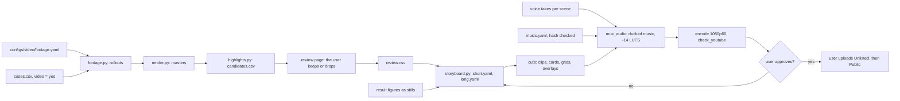

# Craftax visualisation production implementation plan

Status: ready

> **For agentic workers:** REQUIRED SUB-SKILL: Use superpowers:subagent-driven-development (recommended) or superpowers:executing-plans to implement this plan task-by-task. Steps use checkbox (`- [ ]`) syntax for tracking.

**Goal:** with the existing pipeline in `src/wut_murl_craftax/visualisation/` ([[Visualisation]]), produce the GIFs (at most 20 s each), the 3-minute video as a 16:9 upload and as a vertical YouTube Short (at most 180 s), and the 12-minute 16:9 video, all 1080p with voice-over and ducked music, showing the trained agents of [[2026-10-20-craftax-project]] in interesting situations: achievement unlocks, multi-enemy fights, and a long-stuck problem being solved.

**Architecture:** `visualisation/footage.py` turns `configs/video/footage.yaml` into rollouts (trained agents, early checkpoints, random policy, scripted agent, god-mode dive; Craftax main, Craftax-Classic warm-up); the existing render, highlight and review steps produce one reviewer CSV ([[Highlight review workflow]]); a new `visualisation/storyboard.py` reads `configs/video/short.yaml` and `configs/video/long.yaml` (scene list with durations, sources and narration) and assembles clips, cards, stills of the result figures and training graphics with `visualisation.cuts`, then muxes voice and music with `ffmpeg.mux_audio`. Decisions already taken: [[Visualisation decisions]].

**Tech Stack:** JAX + craftax 1.6.1 renderers, Pillow, matplotlib, ffmpeg 9 CLI (no `drawtext`), PyYAML, existing modules `rollout`, `render`, `highlights`, `review`, `cuts`, `curves`, `grid`, `timeline`, `overlay`, `montage`, `ffmpeg`, `text`.

Production pipeline from footage to upload:

## Footage

| Kind | Which | Label on screen | Use |
|---|---|---|---|
| Trained agent, final | final checkpoint of the best seed and the median seed per method (the three controls, both count-bonus variants, SIL, SMDP skills, Dyna-Q and the combination), 1B and 1M, from phases `final-1m final-1b combo-1m combo-1b`, eval seeds `10000` to `10063` | method, budget, "final" | highlights, contenders chapter |
| Early checkpoints | 4 log-spaced checkpoints of the best 1B seed per method ([[Checkpoint comparison grid]]) | env steps, fixed-seed eval score | grid, before-learning scene |
| Random policy | `RandomPolicy`, Craftax and Classic, 8 seeds each | "random policy" | before-learning, warm-up |
| Scripted agent | `HeuristicPolicy`, Craftax and Classic, 8 seeds each ([[Rendering Craftax frames]]) | "scripted agent" | warm-up, contenders contrast |
| God-mode dive | `HeuristicPolicy` with `god_mode=True`, 2 seeds | "god mode tour" | intro only, never as agent footage |
| Cases | episodes flagged `video = yes` in `outputs/analysis/<budget>/cases.csv` ([[2026-10-20-craftax-training-analysis]]) | method, case kind | stuck-then-solved, deepest floor, deaths |
| Classic trained | final checkpoint of the PPO debugging run on Craftax-Classic | "Craftax-Classic, PPO" | warm-up only |

Seed selection (pinned; `orchestration.prune.seed_picks`, the rule the storage prune keeps checkpoints by): per budget, method and `config_ref`, the **best seed** is the run with the highest `final_score` (the training-episode score in `outputs/metrics/<phase>/runs.parquet`) and the **median seed** the lower median of `final_score` (index `(n - 1) // 2` in ascending order, as interpretation's `rules_16.txt`); ties go to the larger run id. Every checkpoint of both is kept, and of the seed with the highest `eval_stochastic_score` (the mean stochastic eval score of the last checkpoint), so an eval-ranked pick is still possible; other final runs keep only their final checkpoint and their case updates. Footage of a final checkpoint can come from any seed; footage of an earlier checkpoint only from these seeds or a case update.

## Storyboard: 3-minute video (16:9 and Short)

Durations are on-screen seconds after crossfades; total 175 s, so the Short stays under 180 s. The Short uses the same scenes in the `vert` layout.

| # | Scene | Seconds | Content | Source |
|---|---|---|---|---|
| 1 | Cold open | 8 | the best trained agent's top kept highlight, freeze-frame banner | top trained row of `review.csv` |
| 2 | Title | 3 | title card | `cuts.card` |
| 3 | What is Craftax | 15 | god-mode dive through floors 0 to 8, floor names as captions | god-mode master |
| 4 | Warm-up on Classic | 12 | random policy vs trained agent on Craftax-Classic, side by side | `cuts.grid` |
| 5 | Before learning | 12 | Craftax random policy and the earliest checkpoint dying | `cuts.grid` |
| 6 | Learning curve | 15 | headline curve, % of max reward per method, achievements panel | `curves` (multi-run) |
| 7 | Same world, more training | 15 | one fixed seed, 4 checkpoints of the best method, panels labelled with the fixed-seed eval score | `grid`, `montage short` (vertical) |
| 8 | Unlocks | 25 | 3 to 4 achievement unlocks of trained agents | kept rows, type achievement |
| 9 | Many enemies at once | 15 | 1 to 2 multi-enemy fights | kept rows, type fight |
| 10 | Stuck, then solved | 20 | a long stall at speed 8, then the unlock at speed 1 | stall-breaker case from `cases.csv`: stall start to unlock - 30 at speed 8, then unlock - 30 to unlock + 20 at speed 1 |
| 11 | Who unlocks first | 12 | first-unlock race chart (F6 of [[2026-10-20-craftax-comparison-and-results]]) | still |
| 12 | Playstyles | 10 | playstyle radars (F17) | still |
| 13 | Scores | 8 | headline numbers vs controls and the scoreboard | still of T1 |
| 14 | Outro | 5 | links to the Space, the report and the 12-minute video; music credit | card |
| | **Total** | **175** | | |

## Storyboard: 12-minute video (16:9)

Total 720 s; each chapter starts with a 3 s chapter card counted inside its first scene, except chapter 3, whose first method card carries the chapter title; chapters become YouTube chapters. Chapter 3 has 8 entries of 4 s card + 11 s clip = 120 s (the two count-bonus variants share one entry).

Chapter timeline (start time, seconds):

| Chapter | Scene | Seconds | Content | Source |
|---|---|---|---|---|
| 0 Intro | Cold open | 15 | best moment of the whole project | kept row |
| 0 Intro | Title | 5 | title card | card |
| 1 What is Craftax | God-mode tour | 40 | floors 0 to 8, creatures, resources | god-mode master |
| 1 What is Craftax | Achievements | 10 | 67 achievements, tiers 1 / 3 / 5 / 8, max 226 ([[Craftax scoring and evaluation]]) | still |
| 1 What is Craftax | Benchmarks | 10 | Craftax-1M and Craftax-1B, scoreboard metric | still |
| 2 Warm-up on Classic | Random | 10 | random policy on Classic | master |
| 2 Warm-up on Classic | Scripted | 10 | scripted agent on Classic | master |
| 2 Warm-up on Classic | Trained | 15 | trained agent on Classic | kept row |
| 2 Warm-up on Classic | Classic curve | 10 | Classic training curve, % of 22 | `curves` |
| 3 The contenders | Controls | 45 | PPO, PPO-RNN, PQN-RNN: per control a 4 s card (idea in one line, grey) + 11 s clip of its final agent; the first card carries the chapter title instead of a separate chapter card | cards, kept rows |
| 3 The contenders | Count bonus | 15 | one 4 s card for both variants + 11 s side-by-side clip of the PPO-RNN and PQN-RNN variants | card, `cuts.grid` of kept rows |
| 3 The contenders | Self-imitation | 15 | 4 s card + 11 s clip | card, kept rows |
| 3 The contenders | Skill methods | 30 | SMDP skills and Dyna-Q: per method a 4 s card marked "uses hand-written skills" + 11 s clip | cards, kept rows |
| 3 The contenders | Combination | 15 | 4 s card naming its two components (marked "uses hand-written skills" if one of them does) + 11 s clip | card, kept rows |
| 4 How they learn | Curves | 30 | headline curves, all methods | `curves` (multi-run) |
| 4 How they learn | Achievement timeline | 30 | best method's 67-row heatmap ([[Achievement timeline]]) | `timeline` |
| 4 How they learn | Checkpoint grid | 30 | 4 checkpoints, one seed | `grid` |
| 4 How they learn | Inside the agent | 30 | observation, action probabilities and value at a breakthrough ([[Agent internals overlay]]); the eval files hold no probabilities or values, so the overlay re-runs the method's network on the replayed observations (Task 5) | `overlay` |
| 5 Results | Score table | 20 | T1 and T2 headline rows | still |
| 5 Results | First-unlock race | 25 | F6 | still |
| 5 Results | Order of achievements | 20 | F7 for two contrasting methods | still |
| 5 Results | Progress funnel | 20 | F8 | still |
| 5 Results | Playstyles | 25 | F17 | still |
| 6 Highlights | Unlocks | 50 | 6 to 8 unlocks, rare ones first | kept rows, type achievement |
| 6 Highlights | Fights | 40 | 3 to 4 multi-enemy fights | kept rows, type fight |
| 6 Highlights | Stuck, then solved | 40 | 2 stall breakers, time-lapse then 1x | stall-breaker cases, two segments each |
| 6 Highlights | Deepest floor | 30 | the deepest descent of the project | kept rows, type floor |
| 7 How they fail | Deaths | 20 | one clip per top death cause | kept rows, type death |
| 7 How they fail | Stalls never escaped | 15 | time-lapse of an unescaped stall | case clip |
| 8 What the agent learned | Decision rules | 30 | 16-leaf tree rules in words, fidelity vs leaves ([[2026-10-20-craftax-interpretation-and-ruleset]]) | still |
| 9 Outro | Credits | 20 | team, Craftax credit, music licence, links | card |
| | **Total** | **720** | | |

## Audio

- Narration lives in the storyboard YAML (`narration:` per scene); budget 2.3 words per second of scene, so about 400 words for the 3-minute video and 1,650 for the 12-minute one.
- Every number in the narration comes from `knowledge/results/Final results.md` (executed output).
- Recording: one WAV per scene, 48 kHz, 24 bit, mono, quiet room, the same microphone for all takes, saved as `outputs/visualisation/audio/voice/<video>/<scene>.wav`.
- The storyboard pads each take with silence to its scene length and fails if a take is more than 0.3 s longer than its scene.
- Mix: `ffmpeg.mux_audio` puts the voice over music ducked with `sidechaincompress` and runs two-pass `loudnorm` to integrated -14 LUFS ([[Encoding GIFs and YouTube videos]]).
- Music: one track per video, from the YouTube Audio Library or a CC0 or CC-BY source, recorded in `configs/video/music.yaml` before use.

## YouTube upload checklist

- [ ] `ffmpeg.check_youtube` passes on each file: H.264 High, yuv420p, BT.709, 60 fps, closed GOP 30, 2 B-frames, AAC-LC 48 kHz stereo, moov before mdat, no `elst`.
- [ ] 3-minute 16:9 is 1920 x 1080; the Short is 1080 x 1920 and at most 180 s including cards; the 12-minute video is 1920 x 1080 and under the 15-minute default limit.
- [ ] Title at most 100 characters; description at most 5,000 characters.
- [ ] Description: one-paragraph summary, chapters, links to the Space, the dataset and the report, Craftax credit (Matthews et al. 2024, MIT), music attribution text exactly as its licence requires, and a line that the video is under CC BY on YouTube and its copy in the Hugging Face dataset under MIT.
- [ ] Chapters (12-minute video): first at 0:00, at least 3, each at least 10 s, generated from the storyboard.
- [ ] Captions: the storyboard's `captions.srt` uploaded as English subtitles.
- [ ] Thumbnail for each 16:9 video: 1280 x 720 PNG under 2 MB (custom thumbnails need a verified channel).
- [ ] Audience: "No, it's not made for kids"; altered or synthetic content: "No" (rendered game footage, recorded human voice).
- [ ] Category Science & Technology; video language English; licence "Creative Commons - Attribution" (CC BY) for all three uploads (decided by the user, [[Experiment decisions]]; YouTube offers no MIT option; the Hugging Face copies are MIT, [[2026-10-20-craftax-huggingface-release]]).
- [ ] Upload as Unlisted; wait for HD processing; check the Copyright step in YouTube Studio shows no claim.
- [ ] End screen on the 16:9 videos linking each other; the Short's "related video" set to the 12-minute video.
- [ ] Switch to Public only after the user confirms in chat; record the three URLs in `configs/video/published.yaml`.

---

### Task 1: Footage set

**Files:**
- Create: `src/wut_murl_craftax/visualisation/footage.py`, `configs/video/footage.yaml`
- Test: `tests/visualisation/test_footage.py`

- [ ] **Step 1: Write the failing tests**: the YAML expands to one rollout spec per (kind, game, policy, checkpoint, seed); each spec's label matches the Footage table; a trained policy loads through `visualisation.eval_rollouts.EvalRun.load` (a `Policy` with `init_carry`/`step` built from `METHODS[cfg["method"]]`, so recurrent, PQN and two-level skill policies carry their state); god-mode specs always carry the "god mode tour" label; `main(["<tmp footage.yaml>", "--out-dir", tmp])` writes one `.npz` per spec.
- [ ] **Step 2: Implement** `load_footage(path) -> list[FootageSpec]`, `make_rollouts(specs, out_dir)` writing `outputs/visualisation/runs/<id>.npz` in the `Rollout` format, and the CLI `main(argv)` (`uv run python -m wut_murl_craftax.visualisation.footage <footage.yaml> --out-dir <dir>`, used by Task 2).
- [ ] **Step 3: Run** `uv run pytest tests/visualisation/test_footage.py -q`.

### Task 2: Masters, highlights and the reviewer CSV

**Files:**
- Create (outputs, not in git): `outputs/visualisation/runs/*.npz`, `outputs/visualisation/masters/`, `outputs/visualisation/review/candidates.csv`, `outputs/visualisation/review/review.csv`

- [ ] **Step 1: Run** `uv run python -m wut_murl_craftax.visualisation.footage configs/video/footage.yaml --out-dir outputs/visualisation/runs`.
- [ ] **Step 2: Run** `uv run python -m wut_murl_craftax.visualisation.render outputs/visualisation/runs/*.npz --out-dir outputs/visualisation/masters`.
- [ ] **Step 3: Run** `uv run python -m wut_murl_craftax.visualisation.highlights outputs/visualisation/runs/*.npz --top 120`; check that achievement, fight and breakthrough candidates of trained agents exist (rank within one batch, [[Highlight detection]]).
- [ ] **Step 4: Run** `uv run python -m wut_murl_craftax.visualisation.review outputs/visualisation/review/candidates.csv`, then serve it with `cd outputs/visualisation/review && python -m http.server 8765 --bind 127.0.0.1`.
- [ ] **Step 5: Hand** the page to the one reviewer (the user); they mark keep or drop, fix captions and speeds, and save `outputs/visualisation/review/review.csv`.
- [ ] **Step 6: Check** that the kept rows cover every storyboard scene that selects clips (counts and seconds per type) before Task 7 renders the drafts.

### Task 3: Multi-method headline curve

**Files:**
- Modify: `src/wut_murl_craftax/visualisation/curves.py`
- Test: `tests/visualisation/test_curves.py`

- [ ] **Step 1: Write the failing test**: `render_curves` with 3 runs draws 3 score lines in `METHOD_COLORS` order with a legend, and the second panel shows achievements unlocked at least once per method over env steps; one run still renders the current single-run panel.
- [ ] **Step 2: Implement** a `runs: Sequence[Path]` argument and the multi-run achievements panel; the y axis stays % of max reward (226 Craftax, 22 Classic).
- [ ] **Step 3: Run** `uv run pytest tests/visualisation/test_curves.py -q`.

### Task 4: Stills and two-speed clips

**Files:**
- Create: `src/wut_murl_craftax/visualisation/stills.py`
- Modify: `src/wut_murl_craftax/visualisation/cuts.py` (`cut_clip` takes a list of `(start, end, speed)` segments)
- Test: `tests/visualisation/test_stills.py`, `tests/visualisation/test_cuts.py`

- [ ] **Step 1: Write the failing tests**: a figure PNG becomes a 1080p60 clip of the requested length with 0.4 s fades, letterboxed without distortion, in `land` and `vert`; a two-segment clip (speed 8 then 1) lasts the sum of its segment durations within one frame.
- [ ] **Step 2: Implement** `still_clip(png, seconds, layout, out)` and segment support in `cut_clip`; video-theme figures come from `analysis.figures` with `theme="video"` (vertical variants stack panels).
- [ ] **Step 3: Run** `uv run pytest tests/visualisation/test_stills.py tests/visualisation/test_cuts.py -q`.

### Task 5: Network outputs for every method and the agent-internals overlay

`Policy.step` returns only the action and the carry, and the eval files hold seeds, actions and step events only, so the overlay re-runs the method's network on the replayed observations to get the action probabilities and the value. Infrastructure Task 5 did this for PPO; this task covers every registry method. It must land before Phase 4: [[2026-10-20-craftax-training-analysis]] Task 3 renders stall-case overlay clips and [[2026-10-20-craftax-interpretation-and-ruleset]] Task 2 needs action probabilities.

**Files:**
- Modify: `src/wut_murl_craftax/visualisation/eval_rollouts.py` (`network_outputs` for every registry method, `episode_outputs`), `src/wut_murl_craftax/visualisation/overlay.py` (method label, value-based panel)
- Test: `tests/visualisation/test_eval_rollouts.py`, `tests/visualisation/test_overlay.py`

- [ ] **Step 1: Write the failing tests** on 2-update Craftax-Classic runs of `ppo`, `ppo-rnn`, `pqn-rnn` and `smdp-skills`: `episode_outputs(run, update, mode, seed)` replays the stored episode from seed + actions and calls `network_outputs(run, update, obs, actions, dones, greedy, skill=None, skill_steps=None)`, which re-runs the network over the observation sequence with the recurrent carry threaded from zeros (PQN-RNN: the previous stored action as last-action input; skill networks: the stored skill id and skill-step count as extra inputs); the probabilities sum to 1 per step, their argmax equals the stored action in greedy mode, and for `ppo-rnn` they equal the probabilities of a live rollout of the same seed to 1e-5; for `pqn-rnn` and the skill network the value is max Q and the probabilities are the epsilon-greedy distribution at the checkpoint's epsilon, read from `params["eps"]` of the `ckpt/` payload (one-hot in greedy mode; ruling 2026-10-21: evaluation builds one policy from `jax.eval_shape(init)`); the overlay renders for each of the four runs with the method in its title.
- [ ] **Step 2: Implement** `network_outputs` with one branch per network family, chosen from the registry entry of `cfg["method"]`: feed-forward PPO (`training.ppo.make_network`, `policy_value`), PPO-RNN family (`ppo_rnn.build_network`: softmax of the actor logits, critic value), PQN-RNN family and skill networks (`pqn_rnn.build_network`, with `extra_obs_dim` inputs for the skill one-hot and step-limit fraction), and `episode_outputs` on top of the replay of `load_eval`.
- [ ] **Step 3: Implement** the overlay on top: `_Episode.load` calls `episode_outputs`; the value panel reads "max Q" for value-based methods; the CLI gains `--mode stochastic|greedy`.
- [ ] **Step 4: Run** `uv run pytest tests/visualisation/test_eval_rollouts.py tests/visualisation/test_overlay.py -q`; expected: pass.

### Task 6: Storyboard engine

**Files:**
- Create: `src/wut_murl_craftax/visualisation/storyboard.py`, `configs/video/short.yaml`, `configs/video/long.yaml`
- Test: `tests/visualisation/test_storyboard.py`

- [ ] **Step 1: Write the failing tests**: `short.yaml` sums to 175 s and `long.yaml` to 720 s; any scene list whose `vert` render exceeds 180 s is rejected; a scene with a missing source fails with the scene name; narration over 2.3 words per second fails; chapters start at 0:00, number at least 3 and last at least 10 s; the SRT has increasing, non-overlapping cues inside their scenes; the voice track lasts exactly the video length.
- [ ] **Step 2: Implement** scene kinds `card`, `still`, `clips` (kept rows filtered by `type`, `policy`, `game`, in score order, filling the scene length), `segments` (a case from `cases.csv` cut into `(start, end, speed)` pieces of its 16 px master, because a stall is longer than a 20 s highlight window), `grid`, `curves`, `timeline`, `overlay`, `montage`; Classic clips only in warm-up scenes (`cuts.order_for_cut`).
- [ ] **Step 3: Implement** outputs per video and layout: `out/<video>_<layout>.mp4`, `captions.srt`, `chapters.txt`, `voice.wav`; CLI `uv run python -m wut_murl_craftax.visualisation.storyboard configs/video/<video>.yaml --layout land|vert --csv outputs/visualisation/review/review.csv [--voice-dir ...] [--music ...]`.
- [ ] **Step 4: Run** `uv run pytest tests/visualisation/test_storyboard.py -q`.

### Task 7: Write the storyboards

**Files:**
- Modify: `configs/video/short.yaml`, `configs/video/long.yaml`

- [ ] **Step 1: Write** `configs/video/short.yaml` and `configs/video/long.yaml` from the two storyboard tables (scene id, title, seconds, kind, source filter, chapter, narration placeholder).
- [ ] **Step 2: Run** `uv run pytest tests/visualisation/test_storyboard.py -q` (sums 175 s and 720 s).
- [ ] **Step 3: Render** silent drafts: `uv run python -m wut_murl_craftax.visualisation.storyboard configs/video/short.yaml --layout land --csv outputs/visualisation/review/review.csv`, the same with `--layout vert`, and `configs/video/long.yaml --layout land`; watch them once; adjust scene sources, not durations.

### Task 8: Voice-over script

**Files:**
- Modify: `configs/video/short.yaml`, `configs/video/long.yaml` (`narration:` per scene)

- [ ] **Step 1: Write** the narration per scene in the YAML files: what the viewer sees, why it matters, one number at most per scene.
- [ ] **Step 2: Check** every number against `knowledge/results/Final results.md` and every game claim against [[Game]].
- [ ] **Step 3: Read** each scene aloud with a stopwatch; shorten any scene that runs over its seconds; rerun `uv run pytest tests/visualisation/test_storyboard.py -q`.
- [ ] **Step 4: Ask** the user to approve both scripts before recording.

### Task 9: Recording

**Files:**
- Create (outputs, not in git): `outputs/visualisation/audio/voice/<video>/<scene>.wav`

- [ ] **Step 1: Record** one take per scene as listed under Audio; the user records (their voice).
- [ ] **Step 2: Trim** leading and trailing silence; keep breaths short; no music under the takes.
- [ ] **Step 3: Run** `uv run python -m wut_murl_craftax.visualisation.storyboard configs/video/<video>.yaml --layout land --csv outputs/visualisation/review/review.csv --voice-dir outputs/visualisation/audio/voice/<video>`; it fails on any take that is too long; re-record those.

### Task 10: Music and licence check

**Files:**
- Create: `configs/video/music.yaml`

- [ ] **Step 1: Pick** two candidate tracks per video; prefer YouTube Audio Library tracks marked "no attribution required", else CC0, else CC-BY.
- [ ] **Step 2: Check** for each track: use in YouTube videos allowed; attribution text and where it must appear; redistribution outside YouTube allowed or not (decides whether the Hugging Face release may carry the videos with music, [[2026-10-20-craftax-huggingface-release]]); no Content ID registration.
- [ ] **Step 3: Record** title, artist, source URL, licence, licence URL, attribution text, download date and SHA-256 of the file (`shasum -a 256 <track file>`) in `configs/video/music.yaml`; the storyboard refuses a music file whose hash is not listed.
- [ ] **Step 4: Ask** the user to confirm the chosen tracks.

### Task 11: Final renders

**Files:**
- Create (outputs, not in git): `outputs/visualisation/hires_land/`, `outputs/visualisation/hires_vert/`, `outputs/visualisation/out/short_land.mp4`, `outputs/visualisation/out/short_vert.mp4`, `outputs/visualisation/out/long_land.mp4`, each with `captions.srt`, `chapters.txt`, `voice.wav`

- [ ] **Step 1: Run** the kept-window re-render at final size for sharp HUDs: `uv run python -m wut_murl_craftax.visualisation.render --kept outputs/visualisation/review/review.csv --layout land --out-dir outputs/visualisation/hires_land` and the same with `--layout vert`.
- [ ] **Step 2: Run** `uv run python -m wut_murl_craftax.visualisation.storyboard configs/video/<video>.yaml --layout <layout> --csv outputs/visualisation/review/review.csv --voice-dir outputs/visualisation/audio/voice/<video> --music <track from configs/video/music.yaml>` for `short` (`land`, `vert`) and `long` (`land`).
- [ ] **Step 3: Check** each file with `ffmpeg.check_youtube` and the integrated loudness with `ffmpeg.integrated_loudness` (-14 LUFS within 1 LU).
- [ ] **Step 4: Ask** the user to watch all three and list fixes; repeat Steps 2 and 3 until approved.

### Task 12: GIFs

**Files:**
- Create (outputs, not in git): `outputs/visualisation/gifs/*.gif`

- [ ] **Step 1: Make** these GIFs, each at most 20 s: stuck-then-solved, multi-enemy fight, deepest floor descent, checkpoint grid over the headline curve, first-unlock race (animated chart), Classic warm-up.
- [ ] **Step 2: Run** `uv run python -m wut_murl_craftax.visualisation.cuts gif outputs/visualisation/review/review.csv <id> --out outputs/visualisation/gifs/<name>.gif` for each clip GIF.
- [ ] **Step 3: Make** the grid GIF in three commands (`montage <run> --updates` writes an MP4, not a GIF): `uv run python -m wut_murl_craftax.visualisation.grid <run> --updates <4 checkpoints> --max-s 20 --out outputs/visualisation/gifs/grid.mp4`; `uv run python -m wut_murl_craftax.visualisation.curves <run> --updates <4 checkpoints> --frames <frame count of grid.mp4, ffmpeg.count_frames> --out outputs/visualisation/gifs/curves.mkv`; `uv run python -m wut_murl_craftax.visualisation.montage --short outputs/visualisation/gifs/grid.mp4 outputs/visualisation/gifs/curves.mkv --out outputs/visualisation/gifs/grid_curves.mp4`, which also writes `grid_curves.gif`.
- [ ] **Step 4: Make** the race GIF: `analysis.figures_game.race(..., theme="video", upto=<env steps>)` ([[2026-10-20-craftax-comparison-and-results]] Task 4) for 60 log-spaced cutoffs into `outputs/visualisation/gifs/race/%03d.png`, then `ffmpeg.write_gif(["-framerate", "6", "-i", "outputs/visualisation/gifs/race/%03d.png"], "[0:v]scale=720:-1:flags=lanczos[g]", Path("outputs/visualisation/gifs/race.gif"))` (10 s).
- [ ] **Step 5: Check** duration with `ffmpeg.duration` (<= 20 s) and size (<= 5 MB, else x2 scale, [[Encoding GIFs and YouTube videos]]).

### Task 13: YouTube package

**Files:**
- Create (outputs, not in git): `outputs/visualisation/youtube/<video>/` (`title.txt`, `description.txt`, `tags.txt`, `captions.srt`, `thumbnail.png`)
- Create: `configs/video/published.yaml`

- [ ] **Step 1: Write** `outputs/visualisation/youtube/<video>/` with `title.txt`, `description.txt` (chapters from `chapters.txt`), `tags.txt`, `captions.srt`, `thumbnail.png`.
- [ ] **Step 2: Walk** through the YouTube upload checklist with the user; the user uploads (an outward-facing action needing their account and confirmation).
- [ ] **Step 3: Write** the published URLs to `configs/video/published.yaml`.

### Task 14: Knowledge updates

**Files:**
- Modify: `knowledge/architecture/visualisation.md` (exists: add `footage`, `stills`, `storyboard` and the changed `curves`, `cuts`, `overlay`, `eval_rollouts.network_outputs`; bump `updated`), `knowledge/visualisation/Visualisation.md` (move music, voice-over, chapters and trained-agent footage from "Not tested" to "Tested" with measured numbers)

- [ ] **Step 1: Write** the module note changes, and the measured render times, sizes and loudness of the final videos into [[Visualisation]].
- [ ] **Step 2: Append** a dated section to [[Visualisation decisions]] for any choice that changed (for example two-speed clips, storyboard YAML).
- [ ] **Step 3: Run** `make knowledge` and `make check`.
