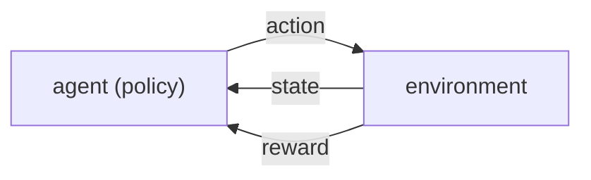

# Introduction: the reinforcement learning problem (Sutton & Barto, Chapter 1)

> [!abstract] TL;DR
> Reinforcement learning (RL) is learning what to do, from interaction, so as to maximize a numerical reward signal, where actions change later situations and rewards are delayed. Its machinery is four elements (policy, reward signal, value function, optional model), and its central device is estimating values from experience; a tic-tac-toe player learned with a temporal-difference (TD) update shows why that can be more efficient than searching policies directly.

## Problem

- **What is learned**: a mapping from situations to actions, chosen to maximize cumulative reward; nobody tells the learner which action is correct, so it must discover it by trying.
- **Three defining features**:
  - It is closed-loop: the learner's actions influence its own later inputs.
  - There is no direct instruction about which actions to take.
  - Consequences, including rewards, play out over extended time: an action can affect the immediate reward, the next situation and, through that, every later reward.
- **Why other paradigms do not cover it**:
  - Supervised learning needs labeled examples of correct behavior from a knowledgeable supervisor, and such examples are rarely both correct and representative of every situation an interactive agent will meet.
  - Unsupervised learning looks for hidden structure in unlabeled data, whereas RL maximizes a reward signal; structure alone does not do that.
  - RL is therefore a third paradigm alongside the two.
- **Exploration versus exploitation**: to collect reward the agent must prefer actions it found effective, but to find them it must try actions it has not chosen before.
  - Neither can be pursued exclusively without failing the task.
  - On a stochastic task each action must be tried many times for a reliable estimate of its expected reward.
  - The dilemma does not arise in purely supervised or unsupervised learning.
- **Whole-problem view**: RL starts from a complete, interactive, goal-seeking agent acting under uncertainty, instead of isolating subproblems.
  - Where planning is involved, it asks how planning interleaves with real-time action and where the environment model comes from.
  - Where supervised learning is involved, it is there for a specific role the agent needs.

## Motivating examples

The chapter motivates RL with five situations, each a different kind of agent:

| Example | Decision being made | What makes it RL |
|---------|---------------------|------------------|
| Chess player choosing a move | which move to play | combines planning (anticipating replies) with intuitive judgments of how desirable positions and moves are |
| Adaptive controller of a refinery | operating parameters, in real time | trades off yield, cost and quality using marginal costs, instead of sticking to engineers' fixed set points |
| Newborn gazelle calf | how to move its legs | goes from struggling to stand to running fast within about half an hour |
| Mobile robot collecting trash | enter a new room, or return to the recharging station | decides from battery charge and how easily it found the recharger before |
| Person preparing breakfast | a web of conditional steps (cupboard, cereal box, bowl, milk) | nested goals and subgoals, each guided by sensed information and by the body's state (hunger, preferences) |

- **What they share**:
  - An active decision-maker interacts with an environment and pursues a goal despite uncertainty about it.
  - Actions alter future states and so the opportunities available later; choosing well needs foresight about indirect, delayed effects.
  - Effects cannot be fully predicted, so the agent keeps monitoring its environment and reacting.
  - Goals are explicit: the agent can judge progress from what it senses directly.
  - The agent improves with experience; prior knowledge, built in or inherited, shapes what is easy to learn, but interaction is essential for tuning to the specifics of the task.
- **Agent and environment are abstract**: the agent is not necessarily a whole robot or organism, and the environment is not only what lies outside it.
  - The robot's battery, or the person's hunger, belongs to the environment of the decision-making agent.
  - The environment's state can include memories and even aspirations.

## Conceptual framework

- **Three aspects the formulation keeps**: sensation (the agent senses the state of the environment), action (it can affect that state), and a goal tied to the state; each in its simplest form without trivializing it.
- **Four elements of an RL system** beyond agent and environment:
  - **Policy**: the agent's way of behaving at a given time, a mapping from perceived states to actions.
    - It can be a lookup table or involve extensive computation such as search; it may be stochastic.
    - It alone suffices to determine behavior.
  - **Reward signal**: one number per time step from the environment, defining the goal; the agent's sole objective is to maximize total reward over the long run.
    - It depends on the current action and state, possibly stochastically, and the agent cannot change the process that generates it, only influence it through its actions.
    - It is the primary basis for changing the policy: an action followed by low reward makes selecting another action in that situation more likely.
  - **Value function**: the total reward an agent can expect to accumulate over the future starting from a state.
    - Rewards are the immediate, intrinsic desirability of states; values are the long-term desirability after accounting for the states that follow and their rewards, so a state can yield low reward yet have high value, or the reverse.
    - Rewards are primary and values are predictions of rewards, but decisions are made on values: seek states of highest value, not highest reward.
    - Rewards are given by the environment, whereas values must be estimated and re-estimated from the agent's whole stream of observations; a method for estimating them efficiently is the most important component of almost all RL algorithms.
  - **Model** (optional): something that mimics the environment, so that given a state and action it predicts the next state and reward, or more generally allows inferences about how the environment will behave.
    - Models serve planning: choosing a course of action by considering possible future situations before experiencing them.
    - Methods that use models and planning are model-based; explicit trial-and-error learners are model-free.

## Approach

The chapter's extended example is tic-tac-toe against an imperfect opponent whose play is unknown in advance, with draws and losses counted as equally bad.

1. **Classical routes fall short**:
   - Minimax assumes a particular way of playing by the opponent, so it never enters states from which it could lose, even if the opponent's mistakes would make it win from there.
   - Dynamic programming gives an optimal solution for any opponent but needs the opponent's move probabilities in every board state, which are unavailable in most practical problems.
   - The best classical route is to learn an opponent model from many games and then apply dynamic programming to it.
2. **Value table**: keep one number per board state, the current estimate of the probability of winning from that state; the whole table is the learned value function.
   - States with three of our marks in a row get value 1; states with three of the opponent's marks, or a full board, get value 0.
   - All other states start at 0.5.
3. **Move selection**: look up the values of the states each possible move would produce.
   - Most of the time move greedily, to the state of highest value.
   - Occasionally pick another move at random; these exploratory moves expose states that would otherwise never be seen.
4. **Learning**: after each greedy move, move the earlier state's value a fraction of the way toward the later state's value (the update in Math). Exploratory moves cause no learning.
5. **Behavior of the result**:
   - With a step-size parameter reduced properly over time, the values converge, for any fixed opponent, to the true winning probabilities under optimal play by our player, and the non-exploratory moves become optimal.
   - With a step size not reduced to zero, the player also plays well against opponents that slowly change how they play.
   - It learns multi-move traps for a shortsighted opponent, achieving lookahead without a model of the opponent and without explicit search; it uses the game's rules to know the states each move produces, so it is model-free only with respect to its opponent.
6. **Beyond the example**:
   - It applies to games against nature, to continuing tasks with rewards of any magnitude at any time, and in principle to continuous time (theory omitted here).
   - With very large state sets, learned values must generalize from experience; the same value learning was combined with a neural network to play backgammon, which has about $10^{20}$ states, though neural networks are not the only, or necessarily the best, way to generalize.
   - RL can also operate at higher levels of a system, where an "action" is itself an elaborate problem-solving method.

### Evolutionary search versus value learning

- **Evolutionary methods** (genetic algorithms, genetic programming, simulated annealing) search policy space directly, for instance by hill climbing or with a population of policies.
  - Each candidate policy is held fixed and evaluated over many games; the win frequency is an unbiased estimate of its winning probability.
  - Each policy change comes only after many games, and only each game's final outcome is used, so a win credits all of the player's behavior in that game, independent of which moves were critical, and even credits moves that never occurred.
  - Value learning instead evaluates individual states from information available during play.
- **When evolutionary search works**: if the policy space is small or structured so good policies are common, if much time is available, or if the agent cannot accurately sense the environment's state.
- **Why the book excludes them** from "RL method": as a simplifying convention, arguing that they ignore the problem's structure, namely that a policy is a function from states to actions, which states an individual passes through, and which actions it selects; this information can occasionally mislead, for example when states are misperceived.
- **Policy gradient methods are included**: they search a space of parameterized policies, estimate the improving direction while the agent interacts, and may use value estimates to sharpen the gradient; the line between them and value-based methods is not sharp. Value functions are central but not strictly necessary.

### Links to other fields

- RL belongs to a trend toward integration with statistics and optimization; learning with parameterized approximators addresses the classical "curse of dimensionality" of operations research and control.
- It is the form of machine learning closest to human and animal learning, with ideas flowing both ways.
- It also fits a trend toward simple general principles over piles of special-purpose heuristics.

## Math

**Notation.**

| Symbol | Meaning |
|--------|---------|
| $s$ | the board state before our greedy move |
| $s'$ | the board state after our greedy move |
| $V(s)$ | the current estimate of the probability of winning from state $s$ (its value) |
| $\alpha$ | step-size parameter, a small positive fraction controlling the learning rate |

**Temporal-difference update of a state value:**

$$
V(s) \leftarrow V(s) + \alpha \Big[ V(s') - V(s) \Big]
$$

- The earlier state's value moves a fraction $\alpha$ of the way toward the value of the later state.
- It is called temporal-difference learning because the change rests on a difference between estimates at two different times, $V(s') - V(s)$.

**Terminal values.** $V = 1$ for states with three of our marks in a row, $V = 0$ for states with three opponent marks or a full board, and $V = 0.5$ as the initial guess elsewhere.

> [!example] Worked intuition
> Formalized here with illustrative numbers; the chapter gives the rule but no arithmetic. If $V(s) = 0.5$, the greedy move leads to a state with $V(s') = 1$ (a win), and $\alpha = 0.1$, then $V(s) \leftarrow 0.5 + 0.1\,(1 - 0.5) = 0.55$. Repeating over many games pulls $V(s)$ toward the true winning probability from $s$. An exploratory move triggers no such update.

## Dataset example

One row per move our player considers or makes during a game against the imperfect opponent; illustrative rows (the chapter prints no data). Boards are written row by row, `_` empty, we play X.

| game | step | state before ($s$) | our move | move type | state after ($s'$) | $V(s')$ | update to $V(s)$ |
|------|------|--------------------|----------|-----------|--------------------|---------|------------------|
| g1 | 1 | `___/___/___` | center | greedy | `___/_X_/___` | 0.5 | yes |
| g1 | 2 | `O__/_X_/___` | top-right | exploratory | `O_X/_X_/___` | 0.5 | no |
| g1 | 3 | `O_X/OX_/___` | bottom-left | greedy | `O_X/OX_/X__` | 1 | yes (win, terminal value 1) |
| g2 | 5 | `OXO/XXO/_OX` | bottom-left | greedy | `OXO/XXO/XOX` | 0 | yes (full board, terminal value 0) |

- **Column to symbol**: state before is $s$, state after is $s'$, and $V(s')$ is the value looked up in the table; the update column marks whether the Math update is applied.
- **What is derived from the rows**: the table of one value per board state is the learned value function; each greedy row adjusts one entry, and terminal rows supply values of 1 or 0 that propagate backward through the updates.
- **Deliberately absent**: the opponent's move probabilities and any model of the opponent.

## Where it matters in practice

### Signs a problem is an RL problem

- The learner's choices change what it sees next, feedback is a scalar reward rather than labels, and consequences can appear many steps later.

### What you need to use it

- **Interaction data**: values are learned from the agent's own experience, not read off the environment.
- **A defined reward signal**: it is the goal; the policy changes only in response to it.
- **A sensed state**: the agent must observe enough to act and to judge progress toward its goal.
- **A model only if available or learnable**: model-free methods avoid building an accurate model and are building blocks for model-based ones.

### When not to trust it

- **Maximizing is not achieving the maximum**: the agent keeps trying to raise reward, but many factors can prevent reaching the maximum even if one exists; optimization is not the same as optimality.

## Assumptions & limitations

- **Tic-tac-toe is deliberately simple**: a small finite state set, observed exactly, episodic with reward only at the end; the chapter warns that this can make RL look more limited than it is.
- **Hidden state**: when different states look the same to the learner, the problem is substantially harder, and the book does not cover it in depth.
- **Not covered**: continuous-time theory, and evolutionary methods as RL methods.
