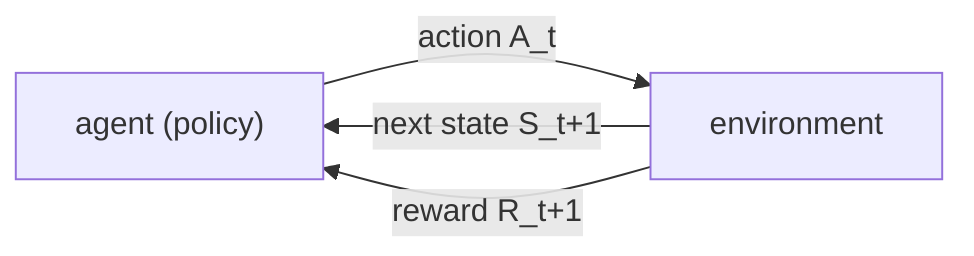

# MDP setting and returns (Sutton & Barto, Chapter 3 part a)

> [!abstract] TL;DR
> Reinforcement learning (RL) is formalized as an agent that, at each discrete time step, observes a state, picks an action, and receives a scalar reward and a new state; its goal is to maximize the expected return, a (usually discounted) sum of future rewards. One notation covers both episodic and continuing tasks, and the state is assumed to have the Markov property, which makes the one-step dynamics enough to predict the future and is what turns the setting into a Markov decision process (MDP).

This is part a of two. Part b, [[03b MDPs, value functions, optimality]], builds value functions and optimal policies on the setting fixed here. The notation tabulated under Math is used in all later notes; the value functions $v_\pi$ and $q_\pi$, the step size $\alpha$ and the trace decay $\lambda$ are introduced where first needed, starting in part b.

## Problem

- **A precise problem to solve**: the rest of the book treats any method suited to this problem as an RL method, so it must be stated in a form that covers many applications yet allows exact theoretical statements.
- **Breadth versus tractability**: the more general the formulation, the harder it is to say anything precise about it; the idealized forms here are chosen so that precise statements are possible.
- **Goal**: choose actions to maximize the total reward received over the long run, not the immediate reward.
- **What must be specified**: where the agent ends and the environment begins, what the actions and states are, how the goal becomes a number, how rewards over time combine into one quantity to maximize, and what the state must contain.

## Examples in the chapter

| Example | Setting / decision | What it demonstrates |
|---------|--------------------|----------------------|
| Bioreactor | target temperatures and stirring rates for a vat of nutrients and bacteria | states and actions are structured vectors, the reward is a single number (rate of chemical production) |
| Pick-and-place robot | motor voltages for a repetitive arm task | low-level actions need fast state readings; a small negative reward per step on jerkiness shapes smooth motion |
| Recycling robot | search for cans, wait, or recharge, decided from battery charge | the agent is only the decision part of the robot; the rest of the robot belongs to its environment |
| Pole balancing | push a cart to keep a hinged pole upright | the same task as episodic (steps until failure) or continuing (discounted failure penalty); also a state that is Markov only in an idealized system |
| Draw poker | betting and card exchange against other players | a state cannot contain hidden information; the state people use is non-Markov, yet decisions stay good |
| Reward-design vignettes | walking, maze escape, can collection, checkers and chess | how scalar rewards encode very different goals |

## Conceptual framework

- **Agent**: the learner and decision-maker.
- **Environment**: everything outside the agent, which responds to the agent's actions with new situations and rewards.
- **Task**: a complete specification of an environment; one instance of the RL problem.
- **Interaction in discrete time**: at step $t$ the agent receives a representation of the environment's state $S_t$, selects an action $A_t$ available in that state, and one step later receives a numerical reward $R_{t+1}$ and finds itself in a new state $S_{t+1}$.
  - The reward is indexed $t+1$ because it and the next state are jointly determined by the action.
- **Three signals**: any goal-directed learning problem is reduced to actions (the choices), states (the basis for choices) and rewards (the definition of the goal) passing between agent and environment.
- **Agent-environment boundary**: anything the agent cannot change arbitrarily is part of the environment.
  - It marks the limit of the agent's control, not of its knowledge: the agent may know exactly how the environment works and still find the task hard, like a puzzle whose rules are known.
  - It is fixed once states, actions and rewards are chosen, and several agents with different boundaries can coexist in one system.
- **Policy**: the agent's rule for acting, a mapping from states to probabilities of selecting each action; RL methods specify how it changes with experience.
- **Reward signal**: a scalar sent from the environment at each step; the agent's goal is to maximize its cumulative sum.
- **Reward hypothesis**: everything meant by goals and purposes can be treated as maximizing the expected value of the cumulative sum of a received scalar signal.
- **Return**: a specific function of the reward sequence after time $t$; the agent maximizes its expected value.
- **Episode and terminal state**: when interaction breaks into repeated subsequences (plays of a game, trips through a maze), each ends in a special terminal state and the task resets to a standard start state or a draw from a start distribution.
- **Episodic task**: a task made of episodes. Its nonterminal states form a set $\mathcal{S}$ and all states plus the terminal one form $\mathcal{S}^+$.
- **Continuing task**: interaction goes on without limit, for example process control or a long-lived robot.
- **Discounting**: weighting a reward by a factor that shrinks with how far in the future it arrives.
- **Absorbing state**: a state that transitions only to itself and yields only zero reward; it represents episode termination.
- **State**: whatever information is available to the agent, assumed to come from a preprocessing system that is nominally part of the environment.
  - It can be built from the current sensation plus the previous state or other memory, for instance position measured at two times giving velocity.
  - Constructing or learning the state signal is outside the scope.
- **Hidden state**: environment information the agent never received through any sensation (the next card in blackjack, the caller's identity); not knowing it is no fault, while forgetting something once known is.
- **Markov property**: a state signal that retains all relevant information from the history is Markov; the future depends on the history only through it ("independence of path").
  - A checkers position and a cannonball's position and velocity are Markov states.
- **Markov decision process**: a task that satisfies the Markov property; when its state and action sets are finite it is a finite MDP, treated in [[03b MDPs, value functions, optimality]].

## Approach

How a task is cast into this setting, step by step.

1. **Choose actions, states and the boundary**:
   - Actions can be any decisions to be learned: low-level controls, high-level choices, or purely mental acts such as where to focus attention.
   - States can be anything useful for those decisions, including memories and subjective conditions.
   - The boundary is usually drawn closer to the agent than its body: motors, sensors, muscles and the reward computation count as environment.
   - Time steps need not be fixed real-time intervals; they can be successive stages of decision-making.
2. **Encode the goal as reward**: reward must say what to achieve, not how.
   - Rewards that pay for subgoals invite the agent to collect them without achieving the goal: a chess agent paid for taking pieces may lose the game to do so.
   - Prior knowledge about how to act belongs in the initial policy or initial value estimates (value functions are defined in [[03b MDPs, value functions, optimality]]), not in the reward.
   - Typical schemes from the chapter: $-1$ on every step before escape, which rewards speed; $+1$ for each can collected; $+1$ win, $-1$ loss, $0$ for a draw and every nonterminal position.
   - The reward lives in the environment because the agent must not be able to decree it received; the agent may still define an internal reward for itself, as many RL methods do.
3. **Pick the return**:
   - A plain sum of rewards up to a final step suits episodic tasks.
   - For a continuing task the final step is infinite and the sum can itself be infinite (a $+1$ at every step), so a discounted sum is used instead.
   - The discount rate sets how future rewards are valued: with $\gamma = 0$ the agent is myopic and cares only about $R_{t+1}$; as $\gamma \to 1$ it weighs the future more and becomes farsighted.
   - A myopic agent can maximize the return by maximizing each immediate reward separately only if actions affect nothing but the immediate reward; in general, chasing immediate reward can reduce access to future reward and lower the return.
4. **Unify episodic and continuing tasks**:
   - Number time steps afresh in every episode, which needs $S_{t,i}$ for step $t$ of episode $i$; drop the episode index $i$ and write $S_t$ when one episode, or all of them, is meant.
   - Treat termination as entering an absorbing state, so episodic returns become infinite sums with zeros after the end and the same discounted formula applies.
   - Undiscounted ($\gamma = 1$) is allowed when episodes always terminate.
5. **Decide what the state must contain**:
   - Aim for a signal that summarizes past sensations compactly while retaining everything relevant: more than the current sensation, never more than the full history.
   - Where the signal is not Markov, still treat it as an approximation to a Markov state: a good basis for predicting future rewards, choosing actions and, when a model of the environment is learned (see [[08a Models, planning, Dyna]]), predicting next states.
   - How the state is represented strongly affects performance; the book treats this choice as more art than science and focuses on learning behavior once it is made.

## Math

**Notation.** The symbols below are fixed for all notes on this book.

| Symbol | Meaning |
|--------|---------|
| $t = 0, 1, 2, \dots$ | discrete time step |
| $S_t \in \mathcal{S}$ | state at step $t$ |
| $\mathcal{S}$, $\mathcal{S}^+$ | set of nonterminal states, and the same plus the terminal state |
| $A_t \in \mathcal{A}(S_t)$ | action at step $t$, from the set available in state $S_t$ |
| $R_{t+1} \in \mathcal{R} \subset \mathbb{R}$ | reward received one step after $A_t$, jointly with $S_{t+1}$ |
| $\pi(a \mid s)$ | policy: probability of selecting $a$ when in $s$ (the book first writes $\pi_t(a \mid s)$ and later drops $t$; this note series uses $\pi$) |
| $G_t$ | return following step $t$ |
| $T$ | final time step of an episode ($T = \infty$ for a continuing task) |
| $\gamma$ | discount rate, $0 \le \gamma \le 1$ |
| $p(s', r \mid s, a)$ | probability of next state $s'$ and reward $r$ given state $s$ and action $a$ |
| $S_{t,i}$ | state at step $t$ of episode $i$ (likewise $A_{t,i}$, $R_{t,i}$, $T_i$), written $S_t$ when the episode is clear, as in the rest of this note |
| $K$ | number of steps before failure in the pole-balancing example |

**Return of an episodic task (sum of rewards):**

$$
G_t = R_{t+1} + R_{t+2} + R_{t+3} + \cdots + R_T
$$

- The simplest return; it needs a final step $T$, so it fits only episodic tasks.

**Discounted return:**

$$
G_t = R_{t+1} + \gamma R_{t+2} + \gamma^2 R_{t+3} + \cdots = \sum_{k=0}^{\infty} \gamma^k R_{t+k+1}
$$

- A reward arriving $k$ steps ahead is worth $\gamma^{k-1}$ times its value if received immediately.
- If $\gamma < 1$ the infinite sum is finite as long as the rewards are bounded.

**Unified return for episodic and continuing tasks:**

$$
G_t = \sum_{k=0}^{T-t-1} \gamma^k R_{t+k+1}
$$

- It covers $T = \infty$ or $\gamma = 1$, but not both at once.
- It equals the discounted return with zero rewards after $T$, matching the absorbing-state convention.

**Full dynamics of a general environment:**

$$
\Pr\{R_{t+1} = r,\; S_{t+1} = s' \mid S_0, A_0, R_1, \dots, S_{t-1}, A_{t-1}, R_t, S_t, A_t\}
$$

- The response at $t+1$ may depend on everything that happened earlier, for all $r$, $s'$ and all possible histories.

**One-step dynamics (Markov property):**

$$
p(s', r \mid s, a) = \Pr\{R_{t+1} = r,\; S_{t+1} = s' \mid S_t, A_t\}
$$

- A state signal is Markov if and only if this equals the full-history distribution for all $s'$, $r$ and histories.
- Iterating it predicts all future states and expected rewards from the current state as well as the whole history would.
- It follows that the best policy as a function of a Markov state is as good as the best policy as a function of complete histories.
- This $p(s', r \mid s, a)$ is the dynamics notation used in all later notes; part b derives expected rewards and transition probabilities from it.

> [!example] Worked intuition
> Formalized here, using the book's absorbing-state diagram: rewards $+1, +1, +1$ and then zeros forever. With $\gamma = 1$ the return from $S_0$ is $3$, summed over the first $T = 3$ rewards or over the full infinite sequence. With $\gamma = 0.9$ it is $1 + 0.9 + 0.81 = 2.71$, again identical either way, because every later term is zero.

## Dataset example

One row per time step of one episode of pole balancing under both of the book's reward conventions; illustrative rows (the book prints no data, and the state values are invented). The Markov state is the cart position and velocity and the pole angle and angular velocity; push left or right is an assumed action set. Rewards and returns follow the unified return: the episodic scheme is $+1$ on each step without failure; continuing scheme is $-1$ on failure and $0$ otherwise with $\gamma = 0.9$.

| $t$ | $S_t$ (position, velocity, angle, angular velocity) | $A_t$ | $R_{t+1}$ episodic | $G_t$ episodic | $R_{t+1}$ continuing | $G_t$ continuing ($\gamma = 0.9$) |
|-----|------------------------------|-------|-----|-----|-----|--------|
| 0 | (0.0, 0.0, 0.00, 0.0) | push right | +1 | 3 | 0 | −0.729 |
| 1 | (0.1, 0.4, 0.05, 0.3) | push right | +1 | 2 | 0 | −0.810 |
| 2 | (0.3, 0.6, 0.12, 0.8) | push left | +1 | 1 | 0 | −0.900 |
| 3 | (0.5, 0.4, 0.25, 1.5) | push left | 0 (pole falls past the limit) | 0 | −1 | −1.000 |
| 4 | terminal (absorbing) | none | 0 | 0 | 0 | 0 |

- **Column to symbol**: the state tuple is $S_t$, the push is $A_t$, and each reward column holds $R_{t+1}$; the return columns are $G_t$ computed from the unified return, with $T = 4$.
- **What is derived**: the episodic return is the number of steps remaining until failure; the continuing return is $-\gamma^{K}$ with $K$ the number of steps left before the failing step, here $K = 3, 2, 1, 0$ for $t = 0, \dots, 3$.
- **Deliberately absent**: any policy probability, a value estimate, and the environment's dynamics $p(s', r \mid s, a)$; the rows are only experience.

## Where it matters in practice

### Signs a problem fits

- Decisions are made repeatedly, they change the situations met later, and feedback is a number rather than a label.

### What you need to use it

- **A reward that matches the real goal**: it is the only statement of the goal the agent receives.
- **A state signal** carrying whatever matters for deciding, built by a preprocessing step you supply.
- **A choice of $\gamma$**: it sets how farsighted the optimization is.

### When not to trust it

- **Large hidden information**: a state that omits much of what matters, such as most of an opponent's history in poker, is non-Markov and the resulting decisions are presumably imperfect.
  - Imperfect states often still work: pole balancing was solved with a coarse, clearly non-Markov state, and ignoring fine distinctions may even have sped learning.

## Assumptions & limitations

- **Discrete time and, for the formal Markov definition, finitely many states and rewards**: the book says the argument extends to continuous states and rewards but does not carry it out.
- **State construction is out of scope**: the state is given, and learning or changing it is not addressed.
- **All the theory assumes a Markov state**: it does not strictly apply to non-Markov cases, though it still helps explain how algorithms behave there and is described as the foundation for extending to those cases.
- **Markov states are not unique to RL**: most other approaches to artificial intelligence assume them too.
- **Representation is art, not science**: how states and actions are represented strongly affects performance, and the book offers only advice and examples.
- **Not covered here**: ways to formulate tasks that are both continuing and undiscounted, described as current research.
