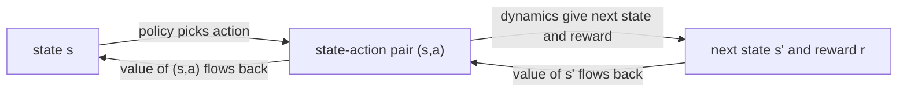

# MDPs, value functions, optimality (Sutton & Barto, Chapter 3 part b)

> [!abstract] TL;DR
> A finite Markov decision process (MDP) is fully specified by its states, actions and the one-step probability of each (next state, reward) pair. Value functions score states and state-action pairs by expected return under a policy; they obey recursive Bellman equations, and the optimal ones obey the Bellman optimality equations, from which an optimal policy follows by acting greedily. Solving those equations exactly is rarely feasible, so reinforcement learning (RL) methods approximate them, concentrating effort on the states that matter.

Part a, [[03a MDP setting and returns]], defines the agent-environment interface, state $S_t$, action $A_t$, reward $R_t$, the return $G_t$, episodic and continuing tasks, and the Markov property. This part uses them without redefining.

## Problem

- **What is estimated**: how good it is to be in a state, or to take an action in a state, measured by the return the agent can expect afterwards; actions are chosen by comparing these numbers.
- **Why a value depends on behavior**: future rewards depend on which actions the agent will take later, so a value is always defined for a particular policy.
- **What "solving" the task means**: finding a policy that achieves a lot of reward over the long run, which needs a precise notion of the best policy.
- **Key difficulty**: the best policy is well defined, but computing it exactly is usually out of reach (limits under Assumptions & limitations), so the practical problem is approximating it.

## Examples in the chapter

| Example | Setting / decision | What it demonstrates |
|---------|--------------------|----------------------|
| Recycling robot | a battery-limited robot chooses to search, wait or recharge, with two battery states | how a finite MDP is written down as a table and a transition graph, and how its Bellman optimality equations look |
| Gridworld | a rectangular grid with deterministic moves, two special cells with large rewards, penalty for trying to move off the grid | a policy's value function computed by solving the Bellman equation, and the optimal value function and policies for the same task |
| Golf | strokes cost $-1$; the choice is putter or driver | values as negative stroke counts, the difference between a state-value function for a fixed policy and an optimal action-value function |

- **Gridworld takeaway**: under the equiprobable random policy with $\gamma = 0.9$, the better special cell is worth less than its immediate reward of $+10$ ($v_\pi = 8.8$) because it leads to a cell near the edge, while the other is worth more than its $+5$ ($v_\pi = 5.3$) because it leads to a cell with positive value; values near the lower edge are negative. Under optimal behavior the best cell has $v_* = 24.4$, and some cells have several equally optimal actions. Both special cells pay their reward for every action and move the agent to a fixed cell.
- **Golf takeaway**: with the putter alone the tee is six strokes from the hole ($v_{\text{putt}} = -6$ there), and sand traps are $-\infty$; the optimal action-value for the driver reaches the tee at $-3$ (two drives and one putt), because after the first drive the better club is chosen; the contours assume deterministic putting of limited range.

## Conceptual framework

- **Markov decision process (MDP)**: an RL task that satisfies the Markov property (the state summarizes the past without hurting prediction of the future; see [[03a MDP setting and returns]]).
  - **Finite MDP**: the state set $\mathcal{S}$ and action sets $\mathcal{A}(s)$ are finite.
  - Most RL theory implicitly assumes a finite MDP, but the ideas apply more generally.
- **Dynamics**: the one-step probability $p(s', r \mid s, a)$ of each next state and reward given the current state and action.
  - These probabilities, together with the state and action sets, define a particular finite MDP.
  - Every other environment quantity follows from them: expected reward for a state-action pair, state-transition probabilities, and expected reward for a state-action-next-state triple.
  - The explicit joint form is used because the older notation characterized only the expected rewards, not their full dynamics, and carried an excess of subscripts and superscripts.
- **Transition graph**: a drawing of a finite MDP with a node for each state and a small node for each state-action pair.
  - Arrows from a pair node lead to next states and are labeled with $p(s'|s,a)$ and the expected reward; the probabilities leaving a pair node sum to 1.
- **Policy** $\pi$: maps each state to a probability $\pi(a|s)$ of taking each action $a \in \mathcal{A}(s)$ in it.
- **State-value function** $v_\pi(s)$: the expected return when starting in $s$ and following $\pi$ afterwards.
  - The value of a terminal state, if any, is zero.
- **Action-value function** $q_\pi(s,a)$: the expected return when starting in $s$, taking $a$ and then following $\pi$.
- **Estimating values from experience**: averaging the returns that actually followed each state (or each state-action pair) converges to the value as the number of visits grows.
  - Such averaging is a Monte Carlo method, because it averages many random samples of actual returns ([[05a Monte Carlo prediction and control]]).
- **Bellman equation**: a consistency condition linking the value of a state to the values of its possible successors.
- **Backup diagram**: a tree that shows which successors a value is computed from, with open circles for states and solid circles for state-action pairs, time running downward.
  - It is named for the backup operations of RL methods, which transfer value information back to a state or pair from its successors.
  - Unlike a transition graph, its state nodes need not be distinct states; a state can be its own successor.
- **Optimal policy** $\pi_*$: a policy at least as good as every other, where $\pi \ge \pi'$ means $v_\pi(s) \ge v_{\pi'}(s)$ for all states.
  - There is always at least one; there may be several, and all share the same optimal value functions.
- **Greedy policy**: one that picks actions using only their short-term (one-step) consequences.
- **Tabular case and tabular methods**: with few enough states, values are stored in an array with one entry per state (or state-action pair).
  - With far more states than table entries, $v_\pi$ and $q_\pi$ must instead be kept as compact parameterized functions whose parameters are adjusted to match observed returns ([[09a Function approximation and linear methods]]).

## Approach

1. **Specify the MDP**: list states, actions per state, and $p(s',r|s,a)$.
   - Under complete knowledge the agent has a full model of these probabilities and expected rewards; under incomplete knowledge it does not.
2. **Evaluate a policy**: compute $v_\pi$ or $q_\pi$ by solving the Bellman equation, or estimate them from experience.
   - The Bellman equation looks one step ahead: from $s$ the policy picks an action, then the environment returns a reward and a next state, and the value is the probability-weighted average of reward plus discounted next-state value.
   - $v_\pi$ is the unique solution of its Bellman equation, which makes it a basis for computing, approximating and learning $v_\pi$ in later chapters.
3. **Define optimality**: take the largest value any policy achieves in each state, giving $v_*$, and likewise $q_*$.
   - For a finite MDP with $N$ states it is a system of $N$ nonlinear equations in $N$ unknowns with a unique solution that does not depend on any policy; if the dynamics are known it can in principle be solved with any method for nonlinear systems, and a related system gives $q_*$.
4. **Extract a policy**: given $v_*$, a one-step lookahead picks the optimal actions; given $q_*$, no lookahead is needed.
   - With $v_*$, any policy greedy with respect to it, that is, one assigning nonzero probability only to actions achieving the maximum in the Bellman optimality equation, is optimal.
   - One-step greed suffices because $v_*$ already accounts for the reward consequences of all future behavior.
   - With $q_*$, the agent maximizes $q_*(s,a)$ over $a$ without knowing the dynamics or successor values.
   - So $q_*$ caches the results of all one-step searches, at the cost of storing a function of state-action pairs instead of states.
5. **Settle for approximation**: an exact solution is akin to exhaustive search over all futures, so methods approximate it instead.
   - Heuristic search expands the right-hand side of the Bellman optimality equation to some depth and uses a heuristic evaluation function in place of $v_*$ at the leaves.
   - Dynamic programming is even closer to that equation ([[04 Dynamic programming]]).
   - Many RL methods approximately solve it using actually experienced transitions in place of known expected transitions.
6. **Spend approximation effort where it pays**: states the agent rarely meets matter little, so the agent can learn good decisions for frequent states at the expense of rare ones.
   - A backgammon-playing program can play very well while making bad decisions on boards that never occur against strong opponents, possibly on a large share of the state set.
   - The chapter calls this one of the key properties that distinguish RL from other approaches to approximately solving MDPs; it follows from learning on-line from the agent's own experience.

## Math

**Notation.** Symbols for state, action, reward, return, $\gamma$ and $\pi$ are as in [[03a MDP setting and returns]]; no deviations.

| Symbol | Meaning |
|--------|---------|
| $\mathcal{S}$, $\mathcal{S}^+$ | set of states; the same set plus the terminal state in an episodic task |
| $\mathcal{A}(s)$ | actions available in state $s$ |
| $\mathcal{R}$ | set of possible rewards |
| $p(s', r \mid s, a)$ | probability of next state $s'$ and reward $r$ after taking $a$ in $s$ |
| $p(s'\mid s,a)$ | state-transition probability |
| $r(s,a)$ | expected next reward for a state-action pair |
| $r(s,a,s')$ | expected next reward for a state-action-next-state triple |
| $\pi(a \mid s)$ | probability of action $a$ in state $s$ under policy $\pi$ |
| $\mathbb{E}_\pi[\cdot]$ | expected value when the agent follows $\pi$ |
| $G_t$ | return, $\sum_{k=0}^{\infty} \gamma^k R_{t+k+1}$, with discount rate $\gamma$ |
| $v_\pi(s)$, $q_\pi(s,a)$ | state-value and action-value function of policy $\pi$ |
| $v_*(s)$, $q_*(s,a)$ | optimal state-value and action-value functions |
| $\pi_*$ | an optimal policy |
| $N$ | number of states |
| $\alpha$, $\beta$ | in the recycling robot only: probabilities that the battery level stays high (after searching when high) or stays low (after searching when low); not the step size |
| $r_{\text{s}}$, $r_{\text{w}}$ | expected cans collected while searching and while waiting, $r_{\text{s}} > r_{\text{w}}$ |
| $\text{h}$, $\text{l}$ | the robot's states high and low, abbreviated in its equations |
| $\mathbb{E}[\cdot]$ | expected value without a policy subscript (optimal-policy equations) |

**Dynamics of a finite MDP:**

$$
p(s', r \mid s, a) = \Pr\{S_{t+1}=s',\, R_{t+1}=r \mid S_t=s,\, A_t=a\}
$$

- The joint probability of the next state and reward; it completely specifies a finite MDP's dynamics.

**Quantities derived from the dynamics:**

$$
r(s,a) = \sum_{r \in \mathcal{R}} r \sum_{s' \in \mathcal{S}} p(s', r \mid s, a)
$$

$$
p(s' \mid s, a) = \sum_{r \in \mathcal{R}} p(s', r \mid s, a)
$$

$$
r(s,a,s') = \sum_{r \in \mathcal{R}} r\, \frac{p(s', r \mid s, a)}{p(s' \mid s, a)}
$$

- Expected reward for a pair, the marginal transition probability, and the expected reward given the next state.

**State-value function of a policy:**

$$
v_\pi(s) = \mathbb{E}_\pi[G_t \mid S_t = s] = \mathbb{E}_\pi\!\left[\sum_{k=0}^{\infty} \gamma^k R_{t+k+1} \,\middle|\, S_t = s\right]
$$

**Action-value function of a policy:**

$$
q_\pi(s,a) = \mathbb{E}_\pi[G_t \mid S_t = s, A_t = a] = \mathbb{E}_\pi\!\left[\sum_{k=0}^{\infty} \gamma^k R_{t+k+1} \,\middle|\, S_t = s, A_t = a\right]
$$

- Both hold for any time step $t$; $q_\pi$ differs only by fixing the first action.

**Bellman equation for $v_\pi$:**

$$
v_\pi(s) = \sum_a \pi(a \mid s) \sum_{s', r} p(s', r \mid s, a)\,\big[\, r + \gamma\, v_\pi(s') \,\big]
$$

- It follows by splitting the return into $R_{t+1}$ plus $\gamma$ times the return from the next state, and merging the sums over $s'$ and $r$.
- Read as an expectation over triples $(a, s', r)$: each has probability $\pi(a|s)\,p(s',r|s,a)$, and the bracket is weighted by it.
- Here $s'$ ranges over $\mathcal{S}$, or $\mathcal{S}^+$ for an episodic task.

**Relations between $v_\pi$ and $q_\pi$, and the Bellman equation for $q_\pi$** (formalized here; the chapter gives only the backup diagram for $q_\pi$ and leaves these to the reader):

$$
v_\pi(s) = \sum_a \pi(a \mid s)\, q_\pi(s,a), \qquad q_\pi(s,a) = \sum_{s',r} p(s',r \mid s,a)\,\big[\, r + \gamma\, v_\pi(s') \,\big]
$$

$$
q_\pi(s,a) = \sum_{s',r} p(s',r \mid s,a)\Big[\, r + \gamma \sum_{a'} \pi(a' \mid s')\, q_\pi(s', a') \Big]
$$

- The first pair says a state's value averages its actions' values under $\pi$, and an action's value is the expected reward plus discounted next-state value; the last equation substitutes one into the other.

**Optimal value functions:**

$$
v_*(s) = \max_\pi v_\pi(s), \qquad q_*(s,a) = \max_\pi q_\pi(s,a)
$$

$$
q_*(s,a) = \mathbb{E}\big[R_{t+1} + \gamma\, v_*(S_{t+1}) \mid S_t = s, A_t = a\big]
$$

- The maximum is taken separately for each state (or pair).
- The last line writes $q_*$ in terms of $v_*$: take $a$ first, then act optimally.

**Bellman optimality equation for $v_*$:**

$$
v_*(s) = \max_{a \in \mathcal{A}(s)} \sum_{s', r} p(s', r \mid s, a)\,\big[\, r + \gamma\, v_*(s') \,\big]
$$

- The value of a state under an optimal policy equals the expected return of its best action; it is $v_\pi$'s Bellman equation with the policy average replaced by a maximum.
- Equivalent expectation form: $v_*(s) = \max_a \mathbb{E}[R_{t+1} + \gamma v_*(S_{t+1}) \mid S_t=s, A_t=a]$.

**Bellman optimality equation for $q_*$:**

$$
q_*(s,a) = \sum_{s', r} p(s', r \mid s, a)\Big[\, r + \gamma \max_{a'} q_*(s', a') \Big]
$$

- Same equation in expectation form: $q_*(s,a)=\mathbb{E}[R_{t+1} + \gamma \max_{a'} q_*(S_{t+1},a') \mid S_t=s, A_t=a]$.
- In the backup diagrams of $v_*$ and $q_*$, arcs at the agent's choice points mark that a maximum is taken instead of a policy average.

**Optimal policy from optimal values** (the chapter states this in words; formalized here):

$$
\pi_*(a \mid s) > 0 \;\text{ only if }\; a \in \arg\max_{a'} \sum_{s',r} p(s',r|s,a')\big[r + \gamma v_*(s')\big]
$$

$$
\arg\max_{a'} \sum_{s',r} p(s',r|s,a')\big[r + \gamma v_*(s')\big] = \arg\max_{a'} q_*(s,a')
$$

- The first line picks the actions a one-step lookahead on $v_*$ favors; the second says the same set is found directly from $q_*$, without the dynamics.

**Bellman optimality equations for the recycling robot** (two states, so two equations; the state-action rows come from the dynamics table of the example):

$$
v_*(\text{h}) = \max\Big\{\, r_{\text{s}} + \gamma\big[\alpha\, v_*(\text{h}) + (1-\alpha)\, v_*(\text{l})\big],\;\; r_{\text{w}} + \gamma\, v_*(\text{h}) \,\Big\}
$$

$$
v_*(\text{l}) = \max\Big\{\, \beta\, r_{\text{s}} - 3(1-\beta) + \gamma\big[(1-\beta)\, v_*(\text{h}) + \beta\, v_*(\text{l})\big],\;\; r_{\text{w}} + \gamma\, v_*(\text{l}),\;\; \gamma\, v_*(\text{h}) \,\Big\}
$$

- Each term of a max is one action's expected reward plus discounted value of where it leads: search, wait and, in the low state only, recharge (last term).
- Searching with a low battery risks depletion: with probability $1-\beta$ the robot is rescued, gets $-3$, and the battery returns to high.
- For any $r_{\text{s}}, r_{\text{w}}, \alpha, \beta$ in range and $0 \le \gamma < 1$ there is exactly one pair $v_*(\text{h}), v_*(\text{l})$ satisfying both.

> [!example] Worked intuition
> Formalized here from numbers the chapter prints for the gridworld (random policy, $\gamma = 0.9$): the center cell has $v_\pi \approx 0.7$ and its four neighbors $2.3$, $0.4$, $-0.4$, $0.7$. Every move is deterministic with reward 0 (no neighbor is off the grid), each action has probability $0.25$, so the Bellman equation gives $v_\pi = 0.25 \times 0.9 \times (2.3 + 0.4 - 0.4 + 0.7) = 0.675 \approx 0.7$, matching to the one decimal place the printed values allow.

## Dataset example

One row per decision step of the recycling robot, as logged experience; illustrative rows (the chapter prints a dynamics table, not logged data). Rewards are sampled cans collected, with $-3$ when the battery is depleted and the robot rescued; the model column reads the probability of that transition off the robot's dynamics.

| $t$ | $S_t$ | $A_t$ | $R_{t+1}$ | $S_{t+1}$ | model $p(S_{t+1} \mid S_t, A_t)$ |
|-----|-------|-------|-----------|-----------|-----------------------------------|
| 0 | high | search | 2 | high | $\alpha$ |
| 1 | high | search | 3 | low | $1-\alpha$ |
| 2 | low | recharge | 0 | high | 1 |
| 3 | high | wait | 1 | high | 1 |
| 4 | high | search | 2 | low | $1-\alpha$ |
| 5 | low | search | $-3$ | high (rescued) | $1-\beta$ |

- **Column to symbol**: $S_t$, $A_t$, $R_{t+1}$, $S_{t+1}$ are the sampled variables of the dynamics $p(s',r|s,a)$; each action respects its allowed set (recharge appears only from the low state).
- **What is derived**: averaging the returns that follow each state gives a Monte Carlo estimate of $v_\pi$.
- **Deliberately absent**: the exact $\alpha$, $\beta$, $r_{\text{s}}$, $r_{\text{w}}$, the discount, and returns (the log is a window of a continuing task, so no return is complete).

## Where it matters in practice

### Signs a problem fits

- Decisions are sequential and each one changes the situation the next decision faces, so judging an action needs its long-run consequences rather than the immediate reward alone.

### What you need to use it

- **A state signal** chosen or constructed so that the Markov property holds as closely as possible; it is rarely exactly true, and values computed from a state that omits relevant history inherit that error.
- **Either dynamics or experience**: known $p(s',r|s,a)$ allows solving the equations; otherwise, returns from experience estimate values.
- **A reward signal** and a discount that make return the quantity to maximize.
- **Compute and memory** sufficient for the method: per-step computation is limited, and tabular methods need one stored value per state.

### When not to trust it

- **Equating optimal with achieved**: an agent that learns an optimal policy has done very well, but in practice optimality is an ideal that agents approach to varying degrees.

## Assumptions & limitations

- **Solving the Bellman optimality equation directly rests on three assumptions** that are rarely all true: accurate knowledge of the dynamics, enough computation to carry out the solution, and the Markov property.
  - In backgammon the first and third hold but the second fails: about $10^{20}$ states would take thousands of years of fastest-computer time, for $v_*$ and for $q_*$.
  - Chess shows the same limit even with a complete model: per-step computation and memory are binding constraints.
