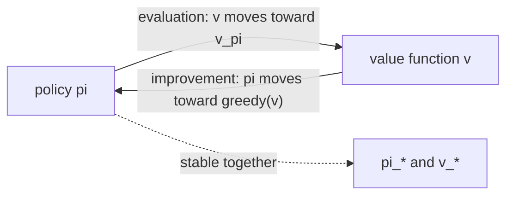

# Dynamic programming (Sutton & Barto, Chapter 4)

> [!abstract] TL;DR
> Dynamic programming (DP) computes optimal policies for a finite Markov decision process (MDP) whose dynamics are fully known, by turning the Bellman equations into update rules: evaluate a policy, make it greedy with respect to its values, and repeat (policy iteration), or fold both into one max-backup (value iteration). Almost every reinforcement learning (RL) method is a cheaper or model-free attempt at the same effect, and the common pattern is generalized policy iteration (GPI), two processes that push a value function and a policy toward consistency with each other.

## Problem

- **What is computed**: the state-value function $v_\pi$ of a given policy (the prediction problem, called policy evaluation), and an optimal policy with its value function $v_*$ or $q_*$ (the control problem).
- **What is assumed**: a perfect model, meaning the dynamics $p(s',r|s,a)$ of a finite MDP are known for every state, action, reward and next state.
  - "Finite" means the state, action and reward sets are finite; $\mathcal{S}^+$ is $\mathcal{S}$ plus a terminal state when the task is episodic.
- **Why classical DP is of limited use in RL**: the perfect model is rarely available, and the computation is expensive; DP still matters as the foundation, because the later methods approximate its effect with less computation and without the model.
- **Continuous states and actions**: exact DP solutions exist only in special cases; a common workaround is to quantize states and actions and apply finite-state DP, and the function approximation methods of [[09a Function approximation and linear methods]] extend this idea.
- **Key idea shared with all of RL**: use value functions to organize the search for good policies; once $v_*$ or $q_*$ is known, an optimal policy follows directly.

## Examples in the chapter

| Example | Setting / decision | What it demonstrates |
|---------|--------------------|----------------------|
| Small gridworld | 14 nonterminal cells, four moves, reward $-1$ per step, two corner exits | iterative policy evaluation converging, and one greedy improvement already yielding an optimal policy |
| Jack's car rental | two locations, overnight car moves, rental income, Poisson demand | policy iteration on a problem whose state is the car count at each of two locations, with a non-obvious optimal policy |
| Gambler's problem | state is capital from 1 to 99 dollars, action is the stake on a coin flip, reward $+1$ only on reaching 100 dollars, so $v$ is the probability of winning | value iteration for a known heads probability (0.4 shown), and that an optimal policy can be oddly shaped and is not unique: ties at the argmax give a whole family of optimal policies |

## Conceptual framework

- **Value functions and Bellman equations**: defined in [[03b MDPs, value functions, optimality]]; this chapter uses the Bellman equation for $v_\pi$ and the Bellman optimality equations for $v_*$ and $q_*$ as the source of every update rule.
- **Backup**: replacing a state's estimated value by a value computed from the estimated values of its successors and the rewards on the transitions; a **backup diagram** pictures which successors feed the update.
  - All DP backups are **full backups**: they use all possible next states weighted by their probabilities, not one sampled next state.
  - There are four primary value functions ($v_\pi$, $v_*$, $q_\pi$, $q_*$), hence four Bellman equations and four corresponding full backups.
  - A full backup is a Bellman equation turned into an assignment; when backups stop changing the values, the values satisfy that Bellman equation.
- **Sweep**: one pass that backs up every state once.
  - **Two-array** version: new values are computed from a separate array of old values.
  - **In-place** version: each new value immediately overwrites the old one, so later backups in the same sweep use new data; it usually converges faster, and the order of states in the sweep then matters. DP usually means this version.
- **Policy evaluation**: computing $v_\pi$ for a fixed policy.
- **Policy improvement**: building a better policy from $v_\pi$ by making it greedy, meaning one-step lookahead picks the action that looks best under $v_\pi$.
- **Policy iteration** and **value iteration**: the two main DP control methods, built from those two operations (see Approach).
- **Generalized policy iteration (GPI)**: any scheme in which a policy evaluation process and a policy improvement process interact, whatever their granularity.
  - Evaluation makes the value function consistent with the current policy; improvement makes the policy greedy with respect to the current value function.
  - The two work against each other: making the policy greedy usually makes the values wrong for the new policy, and fitting the values usually makes the policy non-greedy.
  - They settle only when the policy is greedy with respect to its own value function, which is exactly the Bellman optimality condition, so the policy and values are then optimal.
- **Bootstrapping**: updating estimates of state values from estimates of successor-state values. All DP does this; many RL methods do too even without a model, and [[05a Monte Carlo prediction and control]] (no model, no bootstrapping) and [[06 Temporal-difference learning]] (no model, bootstrapping) separate the two properties.

## Approach

1. **Iterative policy evaluation**: solve for $v_\pi$ by repeated full backups instead of solving the linear system directly.
   - With known dynamics the Bellman equation for $v_\pi$ is $|\mathcal{S}|$ linear equations in $|\mathcal{S}|$ unknowns, a tedious but straightforward direct solve.
   - Start from an arbitrary $v_0$ (the terminal state must be 0) and back up every state each iteration; $v_\pi$ is a fixed point of the update, and $v_k \to v_\pi$ as $k \to \infty$ whenever $v_\pi$ exists.
   - $v_\pi$ exists and is unique if $\gamma < 1$ or termination is guaranteed from all states under $\pi$.
   - It converges only in the limit, so in practice it stops when the largest change in a sweep falls below a small threshold.
2. **Policy improvement**: given $v_\pi$, form the greedy policy by one-step lookahead.
   - The **policy improvement theorem** says that if switching to $\pi'$ at one step and then following $\pi$ is at least as good in every state, then $\pi'$ is at least as good overall; strict improvement at any state gives strict improvement at some state.
   - The greedy policy meets the theorem's condition by construction, so it is as good as or better than the old policy.
   - If the greedy policy is no better than the old one, the Bellman optimality equation holds, so both policies are optimal; improvement is strict unless the policy is already optimal.
   - **Stochastic policies**: the theorem holds as stated with $q_\pi(s,\pi'(s)) = \sum_a \pi'(a|s) q_\pi(s,a)$.
   - Ties among maximizing actions need no single winner: probability can be split among them in any way as long as every submaximal action gets zero.
3. **Policy iteration**: alternate full evaluation and greedy improvement, $\pi_0 \to v_{\pi_0} \to \pi_1 \to v_{\pi_1} \to \dots \to \pi_* \to v_*$.
   - A finite MDP has finitely many policies and each step strictly improves, so it reaches an optimal policy in finitely many iterations.
   - Each evaluation starts from the previous policy's value function, which speeds convergence because values change little between consecutive policies.
4. **Value iteration**: truncate policy evaluation to a single sweep, which merges improvement and truncated evaluation into one backup.
   - It is the Bellman optimality equation turned into an update rule and differs from the policy evaluation backup only by taking a max over actions.
   - For any $v_0$, $v_k \to v_*$ under the conditions that guarantee $v_*$ exists; it also stops on a small maximum change, then outputs the greedy policy.
   - One sweep of value iteration is one sweep of evaluation plus one of improvement; inserting several evaluation sweeps between max-backup sweeps often speeds convergence.
   - This family is truncated policy iteration; all its members converge to an optimal policy for discounted finite MDPs.
5. **Asynchronous DP**: in-place algorithms that back up states in any order, with no systematic sweeps.
   - Some states may be backed up many times before others are backed up once, but to converge no state may be ignored forever.
   - For example, backing up one state $s_k$ per step with the value iteration backup converges to $v_*$ for $0 \le \gamma < 1$ if every state appears infinitely often in $\{s_k\}$, even if the sequence is random.
   - Evaluation and improvement backups can be intermixed (asynchronous truncated policy iteration), so a few backup types are building blocks for many sweepless algorithms.
   - Avoiding sweeps does not by itself cut computation; it lets progress start before a long sweep ends and allows spending backups on the most useful states, for instance ordering them so value information propagates efficiently or skipping states irrelevant to optimal behavior.
   - It can run alongside a real agent: backups are applied to states the agent visits, while the latest values and policy guide the agent. Focusing computation this way is a recurring theme in RL.
6. **GPI as the unifying view**: policy iteration runs each process to completion, value iteration alternates them one sweep each, and asynchronous DP alternates them state by state; typically all converge to the optimal value function and an optimal policy when both processes keep updating all states.

## Math

**Notation.**

| Symbol | Meaning |
|--------|---------|
| $s, s'$ | a state and a successor state |
| $a, a'$ | actions |
| $\mathcal{S}, \mathcal{S}^+, \mathcal{A}(s)$ | nonterminal states, those plus the terminal state, actions available in $s$ |
| $p(s',r\|s,a)$ | probability of next state $s'$ and reward $r$ after taking $a$ in $s$ (the known model) |
| $r$ | reward on a transition |
| $\pi(a\|s)$ | probability that policy $\pi$ takes $a$ in $s$ |
| $v_\pi, q_\pi$ | state-value and action-value functions of $\pi$ |
| $v_*, q_*$ | optimal state-value and action-value functions |
| $v_k$ | $k$-th approximation of a value function in a sequence (iteration index $k$) |
| $V$ | the array holding the current estimate in the algorithm boxes |
| $\gamma$ | discount rate |
| $\Delta, \theta$ | largest change in a sweep, and the small positive stopping threshold |
| $\pi'$ | an improved (greedy) policy |

**Bellman optimality equations (the target of control):**

$$
v_*(s) = \max_a \sum_{s',r} p(s',r|s,a)\big[r + \gamma v_*(s')\big], \qquad
q_*(s,a) = \sum_{s',r} p(s',r|s,a)\Big[r + \gamma \max_{a'} q_*(s',a')\Big]
$$

- Hold for all $s \in \mathcal{S}$, $a \in \mathcal{A}(s)$; they are the fixed points that the control updates below aim at (see [[03b MDPs, value functions, optimality]]).

**Iterative policy evaluation backup:**

$$
v_{k+1}(s) = \sum_a \pi(a|s) \sum_{s',r} p(s',r|s,a)\big[r + \gamma v_k(s')\big]
$$

- Estimates $v_\pi$; each state's new value is the policy-weighted expected reward plus discounted old value of successors, over all one-step transitions.
- Algorithm: set $V(s)=0$ on $\mathcal{S}^+$; repeat sweeps, in each one setting $V(s)$ to the right-hand side with $V$ in place of $v_k$ and tracking $\Delta \leftarrow \max(\Delta, |v - V(s)|)$ where $v$ is the old value; stop when $\Delta < \theta$; output $V \approx v_\pi$.

**Action value from a one-step lookahead on $v_\pi$:**

$$
q_\pi(s,a) = \sum_{s',r} p(s',r|s,a)\big[r + \gamma v_\pi(s')\big]
$$

- The value of taking $a$ once in $s$ and then following $\pi$.

**Policy improvement theorem:** for deterministic $\pi, \pi'$, if

$$
q_\pi(s,\pi'(s)) \ge v_\pi(s) \ \text{ for all } s \in \mathcal{S}
\quad\text{then}\quad
v_{\pi'}(s) \ge v_\pi(s) \ \text{ for all } s \in \mathcal{S}
$$

- Proof idea: repeatedly replace $v_\pi$ by the larger $q_\pi(\cdot,\pi'(\cdot))$ one step further out; the chain converges to the return under $\pi'$, which is $v_{\pi'}(s)$.

**Greedy policy (improvement step):**

$$
\pi'(s) = \arg\max_a \sum_{s',r} p(s',r|s,a)\big[r + \gamma v_\pi(s')\big]
$$

- Ties are broken arbitrarily for a deterministic policy.

**Policy iteration algorithm:** initialize $V$ and $\pi$ arbitrarily; (evaluation) run the policy evaluation sweeps above with $\pi(s)$ in place of the action sum, using $p(s',r|s,\pi(s))$; (improvement) for each $s$ set $\pi(s)$ to the greedy action, and mark policy-stable false if any action changed; if stable, return $V$ and $\pi$, else go back to evaluation.

- Estimates $v_*$ and $\pi_*$. The pseudocode may never terminate if the policy keeps switching among equally good policies; fixing it with extra flags was judged not worth the clutter.

**Value iteration backup:**

$$
v_{k+1}(s) = \max_a \sum_{s',r} p(s',r|s,a)\big[r + \gamma v_k(s')\big]
$$

- Estimates $v_*$; same as the evaluation backup with the policy-weighted sum replaced by a max.
- Algorithm: initialize $V$ arbitrarily; sweep with $V(s) \leftarrow$ the right-hand side, tracking $\Delta$; stop at $\Delta < \theta$; output $\pi(s) = \arg\max_a \sum_{s',r} p(s',r|s,a)[r + \gamma V(s')]$.

> [!example] Worked intuition
> Formalized here from the gridworld rules (undiscounted, $\gamma = 1$, reward $-1$ per move, random policy). After the first sweep every nonterminal state has $v_1 = -1$ and the terminal state is 0. For state 1, the move left reaches the terminal state and the other three moves stay in a state of value $-1$, so $v_2(1) = \tfrac14(-1+0) + \tfrac34(-1-1) = -1.75$. For state 5, all four moves lead to states of $v_1 = -1$, so $v_2(5) = -2$. Repeating gives $v_\pi$, the negative expected number of steps to termination. In this gridworld the greedy policy at the converged values is optimal.

## Dataset example

One row per state-action pair in the gridworld, with its known transition, an input to one full backup of $v_2$ at state 1; illustrative rows (the book prints the dynamics of the first two transitions below; the rest follow from the same rules).

| $s$ | $a$ | $s'$ | $r$ | $p(s',r\|s,a)$ | $\pi(a\|s)$ | $v_1(s')$ | $r + \gamma v_1(s')$ |
|-----|-----|------|-----|----------------|-------------|-----------|----------------------|
| 5 | right | 6 | $-1$ | 1 | 0.25 | $-1$ | $-2$ |
| 7 | right | 7 (off-grid move leaves state unchanged) | $-1$ | 1 | 0.25 | $-1$ | $-2$ |
| 1 | up | 1 (unchanged) | $-1$ | 1 | 0.25 | $-1$ | $-2$ |
| 1 | right | 2 | $-1$ | 1 | 0.25 | $-1$ | $-2$ |
| 1 | down | 5 | $-1$ | 1 | 0.25 | $-1$ | $-2$ |
| 1 | left | terminal | $-1$ | 1 | 0.25 | 0 | $-1$ |

- **Columns to symbols**: the model $p(s',r|s,a)$ is the known dynamics DP requires, $\pi(a|s)$ is the equiprobable random policy, and $v_1$ is the previous approximation.
- **What is derived**: the last column is the bracket in the evaluation backup; weighting the four rows for $s=1$ by $\pi(a|s)$ and summing gives $v_2(1) = -1.75$ (the grid figure prints $-1.7$).
- **Terminal row**: the move left from state 1 ends the episode, so its successor value is 0.
- **Absent**: sampled experience; every successor is used in the backup whether or not an agent would ever reach it, which is what "full backup" means.

## Where it matters in practice

### Signs a problem fits

- The transition probabilities and expected rewards are known, or can be computed, for a finite state and action set.
- Costs, limits and demand are arbitrary rather than linear or smooth, as in the car rental example: DP needs only the transition probabilities, not special structure.

### What you need to use it

- **A complete model**: $p(s',r|s,a)$ for every state-action pair, plus a reward and a discount rate $\gamma$ (or guaranteed termination).
- **Memory and computation for the whole state set**: even one synchronous sweep touches every state.
- **Cost**: the worst-case time to find an optimal policy is polynomial in the number of states $n$ and actions $m$, even though the number of deterministic policies is $m^n$; direct search through policies could not make that guarantee.
  - Linear programming can have better worst-case guarantees but becomes impractical at about 100 times fewer states than DP.
  - On current computers DP solves MDPs with millions of states; in practice policy and value iteration usually converge much faster than their worst case, especially from good initial values or policies.
- **Asynchronous variants for large state sets**: they fit when only a few states occur along optimal trajectories.

### When not to trust it

- When a single sweep is unaffordable and no asynchronous or focused variant is available: over $10^{20}$ states (backgammon) at a million backups per second, one sweep takes over a thousand years.

## Assumptions & limitations

- **Curse of dimensionality**: the number of states often grows exponentially with the number of state variables; the book argues this is a difficulty of the problem rather than of DP, and DP copes with large state sets better than direct policy search or linear programming.
- **Termination conditions**: existence of $v_\pi$ needs $\gamma < 1$ or guaranteed termination; in the undiscounted episodic case some asynchronous backup orderings may not converge, though they are easy to avoid.
- **Convergence is asymptotic**: evaluation and value iteration need infinitely many sweeps in principle, so a threshold $\theta$ decides when to stop; only policy iteration's outer loop is finite.
- **Open which is better**: it is not clear whether policy iteration or value iteration is better in general.
- **Where GPI is proven**: convergence of GPI is proved for the classical DP methods here; for other GPI-style methods it is not always proved, and the idea still clarifies how they work.
- **Not covered**: exact DP for continuous problems beyond quantization, and the finer-grained asynchronous variants.
