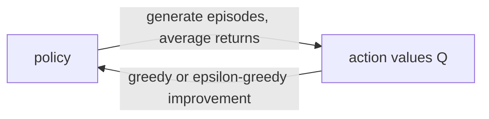

# Monte Carlo prediction and control (Sutton & Barto, Chapter 5 part a)

> [!abstract] TL;DR
> Monte Carlo (MC) methods learn value functions and optimal policies from sample episodes alone, by averaging the returns observed after visiting a state or state-action pair, with no model of the environment's dynamics. Control follows the generalized policy iteration (GPI) pattern, and exploration is kept alive either by exploring starts or by always acting with an $\varepsilon$-soft policy, which then reaches only the best policy among $\varepsilon$-soft ones.

Off-policy learning (estimating one policy from another's data) is covered in [[05b Off-policy Monte Carlo]].

## Problem

- **What is estimated**: the value $v_\pi$ or $q_\pi$ of a fixed policy $\pi$ (prediction), and then an optimal policy (control), without knowing the transition probabilities $p(s', r | s, a)$. Values are defined in [[03b MDPs, value functions, optimality]]; the dynamic programming (DP) approach that needs the model is in [[04 Dynamic programming]].
- **Why DP falls short here**: DP needs the full distribution of next states and rewards for every state and action. Often it is easy to simulate episodes but infeasible to write those distributions down.
- **Episodic tasks only**: returns must be well defined, so every episode must terminate whatever actions are chosen.
  - Values and policies change only when an episode ends, so the methods are incremental episode by episode, not step by step.
- **Each state is a bandit problem, but they are coupled**: averaging returns per state-action pair resembles the bandit methods of [[02 Multi-armed bandits]], with one bandit per state.
  - The return after an action depends on the actions chosen in later states of the same episode.
  - While the policy is still learning, the problem is therefore nonstationary from the point of view of the earlier state.
- **Maintaining exploration**: if the policy is deterministic, only one action per state ever produces returns, so the others never get estimates and the policy cannot be compared against alternatives.

## Examples in the chapter

| Example | Setting / decision | What it demonstrates |
|---------|--------------------|----------------------|
| Blackjack, evaluating a fixed policy | player hits or sticks against a dealer with a fixed rule; policy sticks only on 20 or 21 | MC prediction on a task where DP would need hard-to-compute transition probabilities; estimates sharpen with more episodes; rarer states (usable ace) stay noisier |
| Soap bubble | height of a soap surface over a wire frame, found by random walks from a point to the boundary | MC as averaging samples, and cheap when only a few points are of interest |
| Blackjack, solving it | the same game with random starting situations | MC with exploring starts finds the optimal hit/stick policy from simulated games |

## Conceptual framework

- **Visit**: each occurrence of a state $s$ in an episode.
  - **First visit**: the first occurrence of $s$ within an episode.
  - A state-action pair is visited when its state occurs and that action is taken there.
- **First-visit MC** averages the returns that follow first visits; **every-visit MC** averages the returns following all visits.
  - They differ in theoretical properties; every-visit extends more naturally to function approximation and eligibility traces, while the chapter focuses on first-visit.
  - They coincide when a state cannot recur within an episode, as in blackjack.
- **Return**: the discounted sum of rewards from a time step to the end of the episode, defined in [[03a MDP setting and returns]]. A state's value is its expected return, so an average of observed returns approximates it.
- **No bootstrapping**: the estimate for one state is built only from that state's own sampled returns, never from the estimates of other states, unlike DP.
  - The backup diagram (the tree of what contributes to an update) shows this: one root node and below it the single sampled trajectory down to the terminal state, not all possible one-step transitions.
- **Action values are the natural target without a model**: with a model, state values suffice because one can look one step ahead; without a model one must estimate $q_\pi(s, a)$ for each action to choose among them.
- **Exploring starts**: each episode starts in a state-action pair, and every pair has nonzero probability of being the start, so every pair is visited infinitely often in the limit.
  - It is usable with simulated episodes and unrealistic with real interaction.
- **Soft policy**: $\pi(a|s) > 0$ for all states and actions.
  - **$\varepsilon$-greedy policy**: with probability $1 - \varepsilon$ take a greedy action (maximal estimated action value), with probability $\varepsilon$ pick an action at random.
  - **$\varepsilon$-soft policy**: any policy with $\pi(a|s) \ge \varepsilon / |\mathcal{A}(s)|$ for all states and actions; $\varepsilon$-greedy policies are the ones closest to greedy within this class.
- **On-policy versus off-policy**: on-policy methods evaluate or improve the policy that generates the data; off-policy methods learn about a different policy than the one generating the data (see [[05b Off-policy Monte Carlo]]).
- **Generalized policy iteration (GPI)**: keep an approximate policy and value function that repeatedly chase each other, evaluation pulling the value toward the current policy's value and improvement making the policy greedy (or nearly so) with respect to the current value; details in [[04 Dynamic programming]].

## Approach

1. **Prediction by averaging**: simulate episodes with $\pi$; for each state in an episode record the return after its first visit; $V(s)$ is the mean of the recorded returns.
   - The estimate converges to $v_\pi(s)$ as the number of first visits grows. Each return is an independent, identically distributed, unbiased sample with finite variance, so the law of large numbers applies and the error's standard deviation falls as $1/\sqrt{n}$ for $n$ returns.
   - Every-visit MC also converges asymptotically, but the argument is less direct.
2. **Action values**: the same averaging over state-action pairs estimates $q_\pi$, but it needs every pair visited, which exploring starts or a soft policy supplies.
3. **Control by GPI with exact evaluation**: alternate complete evaluation ($E$) and complete improvement ($I$) starting from an arbitrary $\pi_0$.
   - Improvement makes $\pi_{k+1}$ greedy with respect to $q_{\pi_k}$, which needs no model because action values are available.
   - The policy improvement theorem ([[04 Dynamic programming]]) says that if $q_\pi(s, \pi'(s)) \ge v_\pi(s)$ in every state then $\pi'$ is at least as good as $\pi$; it guarantees each policy is at least as good as the last, so the process reaches the optimal policy.
   - This needs two unrealistic assumptions: exploring starts and infinitely many episodes for each evaluation.
4. **Dropping the infinite-episode assumption**: instead of evaluating to accuracy, interleave evaluation and improvement episode by episode, an extreme form of which is value iteration in dynamic programming ([[04 Dynamic programming]]).
   - Forcing small error bounds in every evaluation is possible in principle but needs too many episodes on all but the smallest problems.
5. **Monte Carlo with exploring starts (Monte Carlo ES)**: after each episode, update $Q$ from the observed returns and make the policy greedy at the states visited.
   - All returns of a pair are averaged regardless of which policy was in force when they were observed.
   - It cannot settle on a suboptimal policy: the values would converge to that policy's values, which would then change the policy.
6. **On-policy first-visit MC control for $\varepsilon$-soft policies**: replace the greedy improvement step by moving the policy toward greedy but only to an $\varepsilon$-greedy policy, so every action keeps being tried.
   - Greedy improvement is not allowed here because it would stop exploration of non-greedy actions; GPI only needs the policy moved toward greedy.
   - Any $\varepsilon$-greedy policy with respect to $q_\pi$ is at least as good as the $\varepsilon$-soft policy $\pi$ (shown in Math).
   - The result is the best policy among $\varepsilon$-soft policies, not the best policy overall, in exchange for removing exploring starts.

## Math

**Notation.**

| Symbol | Meaning |
|--------|---------|
| $S_t$, $A_t$, $R_t$ | state, action and reward at time $t$ |
| $S_0$, $A_0$ | the starting state and action of an episode (chosen by exploring starts) |
| $G$ | return following the first occurrence of a state or state-action pair; $G_t$ is the return from time $t$ |
| $\gamma$ | discount rate (here $\gamma = 1$ in the blackjack example) |
| $\pi$, $\pi'$ | the current policy, and the policy after an improvement step; $\pi_k$ is the $k$-th policy |
| $v_\pi$, $q_\pi$ | true state and action values of $\pi$ |
| $V$, $Q$ | the estimates of $v_\pi$ and $q_\pi$ (random variables, hence capitals) |
| $Returns(s)$, $Returns(s, a)$ | lists of observed returns kept per state or per pair |
| $\varepsilon$ | probability of acting randomly in an $\varepsilon$-greedy policy |
| $\lvert\mathcal{A}(s)\rvert$ | number of actions available in state $s$ |
| $\tilde v_*$, $\tilde q_*$ | optimal value functions of the modified environment used in the proof |
| $n$ | number of returns averaged |

**First-visit estimate of a state value** (prediction; every-visit averages over all visits instead):

$$
V(s) \leftarrow \text{average}\big(Returns(s)\big)
$$

- $Returns(s)$ gains the return $G$ after each first visit to $s$, so $V(s)$ is the sample mean of returns that followed first visits; the same form with $Returns(s, a)$ and $Q(s, a)$ estimates $q_\pi(s, a)$.

**Greedy policy for an action-value function:**

$$
\pi(s) = \arg\max_a q(s, a)
$$

- Improvement without a model: pick the action of maximal value in each state.

**Greedy improvement satisfies the policy improvement condition:**

$$
q_{\pi_k}\big(s, \pi_{k+1}(s)\big) = \max_a q_{\pi_k}(s, a) \ge q_{\pi_k}\big(s, \pi_k(s)\big) = v_{\pi_k}(s)
$$

- This is the condition of the policy improvement theorem, so $\pi_{k+1}$ is at least as good as $\pi_k$ in every state, and equally good only when both are optimal.

**$\varepsilon$-greedy probabilities** (the action is greedy with respect to the current $Q$):

$$
\pi(a|s) =
\begin{cases}
1 - \varepsilon + \varepsilon / |\mathcal{A}(s)| & \text{if } a \text{ is the greedy action} \\
\varepsilon / |\mathcal{A}(s)| & \text{otherwise}
\end{cases}
$$

- Every non-greedy action gets the minimal probability that $\varepsilon$-softness allows; the greedy action gets the rest.

**Improvement over any $\varepsilon$-soft policy** (let $\pi'$ be $\varepsilon$-greedy with respect to $q_\pi$):

$$
q_\pi\big(s, \pi'(s)\big) = \frac{\varepsilon}{|\mathcal{A}(s)|} \sum_a q_\pi(s, a) + (1 - \varepsilon) \max_a q_\pi(s, a) \;\ge\; v_\pi(s)
$$

- The inequality holds because $\max_a q_\pi(s, a)$ is at least a weighted average of the $q_\pi(s, a)$ with nonnegative weights $\big(\pi(a|s) - \varepsilon/|\mathcal{A}(s)|\big)/(1 - \varepsilon)$ that sum to 1; substituting that average makes the right side equal $v_\pi(s)$.
- The policy improvement theorem then gives $v_{\pi'}(s) \ge v_\pi(s)$ for all $s$.

**Optimality among $\varepsilon$-soft policies** (equality case):

$$
\tilde v_*(s) = (1 - \varepsilon) \max_a \tilde q_*(s, a) + \frac{\varepsilon}{|\mathcal{A}(s)|} \sum_a \tilde q_*(s, a)
$$

- To show that equality happens only at the best $\varepsilon$-soft policy, move the $\varepsilon$-softness into the environment: with probability $\varepsilon$ the environment replaces the chosen action by a uniformly random one. The best that general policies can do there equals the best $\varepsilon$-soft policies can do in the original.
- $\tilde v_*$ is the unique solution of this equation. When improvement stops, $v_\pi$ satisfies the same equation (with $q_\pi$ and $v_\pi$ in place of $\tilde q_*$ and $\tilde v_*$), so $v_\pi = \tilde v_*$ and $\pi$ is optimal among $\varepsilon$-soft policies.

> [!example] Worked intuition
> Formalized here with illustrative numbers; the chapter gives the rules but no arithmetic. In blackjack there are two actions, so $|\mathcal{A}(s)| = 2$. With $\varepsilon = 0.1$ the greedy action has probability $1 - 0.1 + 0.05 = 0.95$ and the other $0.05$, summing to 1. For prediction, suppose the returns recorded for one state are $+1, -1, +1, +1$; then $V(s) = 0.5$, and since the error shrinks as $1/\sqrt{n}$, four times as many returns would roughly halve the standard deviation of that error.

## Dataset example

One row per decision step of a simulated blackjack game (episode) under the policy that sticks only on a player sum of 20 or 21, with $\gamma = 1$; illustrative rows (the chapter prints no data). A state is (player sum, dealer's showing card, usable ace); the return $G_t$ is the final outcome, since all non-terminal rewards are zero.

| episode | $t$ | $S_t$ (sum, dealer, usable ace) | $A_t$ | $R_{t+1}$ | $G_t$ |
|---------|-----|----------------------------------|-------|-----------|-------|
| g1 | 0 | (15, 10, no) | hit (drew a 5) | 0 | +1 |
| g1 | 1 | (20, 10, no) | stick (dealer ends on 18, player wins) | +1 | +1 |
| g2 | 0 | (13, 6, no) | hit (drew a 9, sum 22, bust) | -1 | -1 |
| g3 | 0 | (16, 7, yes) | hit (drew a 4) | 0 | 0 |
| g3 | 1 | (20, 7, yes) | stick (dealer ends on 20, draw) | 0 | 0 |

- **Column to symbol**: $S_t$, $A_t$, $R_{t+1}$ and $G_t$ as in Math; the bust in g2 ends the episode, and the terminal state carries no decision row.
- **What is derived**: for each row, $G_t$ is appended to $Returns(S_t)$ (or $Returns(S_t, A_t)$ for action values) and $V$ or $Q$ is the average; no state recurs within a game, so first-visit and every-visit give the same lists. Under Monte Carlo ES the first row of an episode would be a randomly drawn pair $(S_0, A_0)$.
- **Absent**: the dealer's and deck's transition probabilities; only sampled games are needed.

## Where it matters in practice

### Signs a problem fits

- The task is episodic and can be simulated or replayed, but its transition probabilities are hard to compute or unknown.
- Only the values of one state or a small set of states are needed: the cost of estimating one state's value does not depend on the total number of states, so episodes can be started from the states of interest and all others ignored.

### What you need to use it

- **Complete episodes** with a reward signal that gives well-defined returns.
- **Enough visits** to every state-action pair that matters, via exploring starts (only if you control the start states, as in simulation) or an $\varepsilon$-soft policy.
- **Many episodes**, since each average improves only with the number of returns collected.

### When not to trust it

- **Rarely visited states** have noisy averages for a long time.
- **A learned $\varepsilon$-soft policy** keeps acting randomly with probability $\varepsilon$ while it runs.

## Assumptions & limitations

- **No online, step-by-step learning**: estimates wait for the episode to end; learning from partial returns comes in [[06 Temporal-difference learning]].
- **Exact evaluation in the improvement proofs**: the guarantees assume action values computed exactly, whatever method computes them; the practical episode-by-episode algorithms rest on evaluation and improvement converging jointly.
- **Monte Carlo ES convergence is unproved**: convergence to the optimal fixed point seems inevitable, but the authors call it one of the most fundamental open theoretical questions in reinforcement learning (RL).
- **$\varepsilon$-soft control trades optimality for exploration**: it reaches the best $\varepsilon$-soft policy, not the global optimum.
- **Off-policy alternative**: learning a deterministic optimal policy while behaving exploratorily is deferred to [[05b Off-policy Monte Carlo]].
