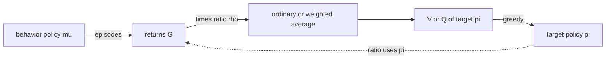

# Off-policy Monte Carlo (Sutton & Barto, Chapter 5 part b)

> [!abstract] TL;DR
> Off-policy Monte Carlo (MC) methods estimate the value of a target policy from episodes generated by a different behavior policy, by weighting each return with the importance-sampling ratio of its trajectory. Ordinary importance sampling is unbiased but can have infinite variance, whereas weighted importance sampling is biased but far more stable and is preferred; plugging it into generalized policy iteration (GPI) gives a control method that learns a deterministic optimal policy while behaving exploratorily.

First-visit MC, action-value estimation, exploring starts and $\varepsilon$-soft policies are defined in [[05a Monte Carlo prediction and control]]; this note starts where on-policy learning ends.

## Problem

- **What is estimated**: $v_\pi$ or $q_\pi$ of a policy $\pi$, when every available episode was generated by another policy $\mu \neq \pi$. This is off-policy learning: learning about a policy from experience "off" it.
- **Why on-policy MC falls short**: it must keep acting with a soft policy to keep exploring, so it can only reach the best $\varepsilon$-soft policy (see [[05a Monte Carlo prediction and control]]). Separating the policy that behaves from the policy that is learned lets the learned one be deterministic and optimal.
- **Key difficulty, mismatch**: returns observed under $\mu$ have expectation $v_\mu$, not $v_\pi$, so they must be reweighted.
- **Key difficulty, variance**: the reweighting is a product of one factor per step, so its variance can be huge or even infinite, particularly when trajectories contain loops.
- **Key difficulty, wasted weight on long episodes**: when the discount $\gamma$ is well below 1, late steps barely affect the return yet still multiply its weight.

## Examples in the chapter

| Example | Setting / decision | What it demonstrates |
|---------|--------------------|----------------------|
| Off-policy blackjack state value | one blackjack state (dealer shows a deuce, player sum 13 with a usable ace); data from a random hit-or-stick behavior policy, target policy sticks only on 20 or 21 | MC can evaluate a single state; both estimators get close to the true value of about $-0.277$ within 1000 episodes, and weighted importance sampling has much lower error, as is typical |
| Infinite variance | a one-state task with actions `end` and `back`; target always plays `back`, behavior picks each with probability $\tfrac12$ | ordinary importance sampling stays unstable even after millions of episodes, while weighted importance sampling is exactly right after the first consistent episode |

## Conceptual framework

- **Target policy $\pi$ and behavior policy $\mu$**: $\pi$ is the policy whose value is being learned; $\mu$ is the policy that controls the agent and generates the data.
  - The target may be deterministic. Typically it is the greedy policy with respect to the current action-value estimate, which one hopes becomes a deterministic optimal policy.
  - The behavior stays stochastic and more exploratory, for example $\varepsilon$-greedy.
- **Coverage**: $\pi(a|s) > 0$ must imply $\mu(a|s) > 0$, so every action the target could take is taken at least occasionally by the behavior.
  - Hence $\mu$ must be stochastic wherever it differs from $\pi$.
  - Control also needs $\mu$ to be soft ($\mu(a|s) > 0$ for all actions, as defined for policies in [[05a Monte Carlo prediction and control]]) to explore everything.
- **Importance sampling**: a general technique for estimating an expected value under one distribution from samples of another, by weighting each sample with the ratio of the two probabilities.
  - **Importance-sampling ratio** $\rho$: the relative probability of a trajectory under the target and behavior policies.
  - The environment's transition probabilities cancel out of the ratio, so it depends only on the two policies and not on the unknown dynamics of the Markov decision process (MDP). This is what makes the method model-free.
- **Ordinary versus weighted importance sampling**: ordinary importance sampling averages the ratio-scaled returns with a plain average; weighted importance sampling divides by the sum of the ratios instead of the count.
  - **Bias**: whether the estimator's expectation equals the true value. **Variance**: how much the estimate scatters around its expectation.
  - Ordinary is unbiased; weighted is biased, with its single-return expectation being $v_\mu$ rather than $v_\pi$.
  - Ordinary has in general unbounded variance (the ratios' variance is unbounded); in weighted, no single return carries a weight above one.
- **Time indexing across episodes**: time steps are numbered continuously over a batch of episodes, so a step number identifies a step of one particular episode.
  - $\mathcal{T}(s)$ is the set of time steps at which $s$ is visited: every visit for every-visit MC, first visits only for first-visit MC.
  - $T(t)$ is the first termination time after $t$, and $G_t$ is the return from $t$ to $T(t)$.
- **Learning from the tails of episodes**: with a deterministic target, a trajectory has nonzero ratio only while the behavior picks exactly the target's actions, so only the end of an episode after the last non-greedy action contributes.
- **Flat partial return and horizon**: the undiscounted sum of rewards from $t$ up to a horizon $h$ before termination; used to view discounting as a probability of terminating.

## Approach

### Prediction with importance sampling

1. **Collect** a batch of episodes generated by $\mu$ that satisfy coverage.
2. **Scale and average**: for each visit of $s$ multiply the return by the ratio of its trajectory from that visit to termination.
   - Ordinary importance sampling takes the plain mean of the scaled returns.
   - Weighted importance sampling takes the ratio-weighted mean, and is defined as zero when all ratios are zero.
3. **Choose weighted in practice**: it usually has dramatically lower variance, and assuming bounded returns its variance converges to zero even when the ratios have infinite variance.
   - Ordinary importance sampling can overshoot: a ratio of ten scales the observed return tenfold, even for a trajectory very representative of the target.
4. **Incremental form**: ordinary importance sampling reuses the incremental averaging of [[02 Multi-armed bandits]], with scaled returns in place of rewards.
   - Weighted importance sampling needs a running weighted mean $V_n$ plus, for each state or pair, the cumulative sum $C_n$ of the weights given so far.

### Evaluation algorithm with weighted importance sampling

1. **Keep** $Q(s,a)$, a cumulative weight $C(s,a) \leftarrow 0$, a soft behavior policy $\mu$ and a target policy $\pi$; the algorithm is an every-visit method.
2. **Generate** an episode with $\mu$, then sweep it backward from $t = T-1$ with $G \leftarrow 0$ and $W \leftarrow 1$.
3. **At each step** update $G \leftarrow \gamma G + R_{t+1}$, add $W$ to $C(S_t, A_t)$, and move $Q(S_t, A_t)$ toward $G$ by the fraction $W / C(S_t, A_t)$.
4. **Then** multiply $W$ by $\pi(A_t|S_t) / \mu(A_t|S_t)$, and stop the sweep when $W = 0$ (nothing earlier can contribute).
   - At the update of step $t$, $W$ holds the ratio of the steps after $t$ only; the ratio of $A_t$ is applied afterwards.
   - Reading formalized here: an action value already conditions on its first action, so that action's probability must not be reweighted.
5. **Result**: $Q$ converges to $q_\pi$ for every encountered pair, although all actions follow $\mu$.
   - Setting $\pi = \mu$ gives on-policy evaluation, where $W$ is always 1.

### Off-policy MC control

1. **Behavior**: any soft policy $\mu$ generates episodes; it may change between or even within episodes. Making it $\varepsilon$-soft ensures infinitely many returns for each pair, which convergence of $\pi$ to the optimum needs.
2. **Target**: $\pi$ is greedy with respect to $Q$ (ties broken arbitrarily), recomputed at each state during the backward sweep. This is GPI with weighted importance sampling doing the evaluation.
3. **Ratio**: because $\pi$ is deterministic, $\pi(A_t|S_t)$ is 1 for the greedy action and 0 otherwise, so the step factor is $1/\mu(A_t|S_t)$ for a greedy action and zero for any other.
   - Derived here from the evaluation algorithm: the sweep therefore stops at the latest non-greedy action, which is the tail-only learning described above.
4. **Result**: $\pi$ converges to an optimal policy at all encountered states, while the behavior explores.

### Truncated returns (an optional refinement)

1. **Observation**: with short-sighted discounting, factors for steps after the reward is determined are independent of the return and have expectation 1. They leave the expected update unchanged but add large, sometimes infinite, variance.
2. **Idea**: treat discounting as a probability of termination, so the discounted return is a mixture of flat partial returns of increasing horizon, with weights depending on $\gamma$.
3. **Estimators**: scale each flat partial return only by the ratio up to its own horizon, then average ordinarily or with weights.

## Math

**Notation.**

| Symbol | Meaning |
|--------|---------|
| $\pi$, $\mu$ | target policy; behavior policy that generates the data |
| $S_t$, $A_t$, $R_t$ | state, action, reward at time $t$ (as in [[05a Monte Carlo prediction and control]]) |
| $p(s'\|s,a)$ | state-transition probability of the MDP |
| $T$, $T(t)$ | termination time of an episode; first termination time after $t$ |
| $\rho_t^T$, $\rho_t^{T(t)}$, $\rho_t^h$ | importance-sampling ratio of the trajectory from $t$ to termination, and from $t$ up to a horizon $h$ |
| $\mathcal{T}(s)$ | set of time steps at which $s$ is visited |
| $G_t$ | return from $t$ to $T(t)$; $\gamma$ is the discount rate |
| $\bar G_t^h$ | flat partial return $R_{t+1} + \dots + R_h$ up to horizon $h$ |
| $V(s)$, $Q(s,a)$ | estimates of $v_\pi(s)$ and $q_\pi(s,a)$ |
| $W_i$, $G_i$ | weight and return of the $i$-th observation of one state |
| $V_n$, $C_n$ | weighted-average estimate after $n-1$ returns; cumulative sum of the first $n$ weights |
| $W$, $C(s,a)$ | running weight and cumulative weight in the algorithms |
| $X$, $\bar X$ | a random variable and its mean (variance calculation) |

**Importance-sampling ratio** (probability of the trajectory under $\pi$ over that under $\mu$; transition probabilities cancel):

$$
\rho_t^T = \frac{\prod_{k=t}^{T-1} \pi(A_k|S_k)\, p(S_{k+1}|S_k, A_k)}{\prod_{k=t}^{T-1} \mu(A_k|S_k)\, p(S_{k+1}|S_k, A_k)} = \prod_{k=t}^{T-1} \frac{\pi(A_k|S_k)}{\mu(A_k|S_k)}
$$

- Each factor is above 1 where the target favors the action more than the behavior does, and zero where the target never takes it.

**Ordinary importance-sampling estimate:**

$$
V(s) = \frac{\sum_{t \in \mathcal{T}(s)} \rho_t^{T(t)}\, G_t}{|\mathcal{T}(s)|}
$$

- A plain average of ratio-scaled returns, unbiased for $v_\pi(s)$.

**Weighted importance-sampling estimate** (zero if the denominator is zero):

$$
V(s) = \frac{\sum_{t \in \mathcal{T}(s)} \rho_t^{T(t)}\, G_t}{\sum_{t \in \mathcal{T}(s)} \rho_t^{T(t)}}
$$

- After a single return the ratio cancels and the estimate equals that return (if the ratio is nonzero); this is the source of the bias noted above.

**Weighted average over $n-1$ returns:**

$$
V_n = \frac{\sum_{k=1}^{n-1} W_k G_k}{\sum_{k=1}^{n-1} W_k}, \qquad n \ge 2
$$

- The target of the incremental rule below; $W_i$ is typically $\rho_t^{T(t)}$.

**Incremental weighted update:**

$$
V_{n+1} = V_n + \frac{W_n}{C_n}\big[ G_n - V_n \big], \qquad C_{n+1} = C_n + W_{n+1}, \quad C_0 = 0
$$

- A step size $W_n / C_n$ that shrinks as weight accumulates replaces the $1/n$ of an ordinary sample average; $V_1$ is arbitrary.
- Each new return pulls $V$ towards it in proportion to its weight relative to all weight so far.

**Evaluation step of the algorithm** (applied backward in time, with $W$ initially 1):

$$
G \leftarrow \gamma G + R_{t+1}, \quad C(S_t,A_t) \leftarrow C(S_t,A_t) + W, \quad Q(S_t,A_t) \leftarrow Q(S_t,A_t) + \frac{W}{C(S_t,A_t)}\big[G - Q(S_t,A_t)\big], \quad W \leftarrow W \frac{\pi(A_t|S_t)}{\mu(A_t|S_t)}
$$

- The control version first sets $\pi(S_t) \leftarrow \arg\max_a Q(S_t, a)$, then multiplies the weight by $1 / \mu(A_t|S_t)$. The text says learning continues only while the actions taken are greedy (tail-only learning), so the loop should stop at the first non-greedy action; the printed algorithm exits only when the weight is 0, which cannot happen as printed (derived here from the text).

**Variance check for the loop example** (first-visit, ordinary importance sampling; target always plays `back`, behavior picks each action with probability $\tfrac12$, `back` returns to the state with probability 0.9 and ends with reward $+1$ with probability 0.1):

$$
\mathbb{E}\!\left[\Big(\prod_{t=0}^{T-1}\frac{\pi(A_t|S_t)}{\mu(A_t|S_t)}\,G_0\Big)^{2}\right] = 0.1 \sum_{k=0}^{\infty} 0.9^k \cdot 2^k \cdot 2 = 0.2 \sum_{k=0}^{\infty} 1.8^k = \infty
$$

- The mean of the scaled return is finite (the true value, 1), so the variance $\mathbb{E}[X^2] - \bar X^2$ is infinite exactly when this expected square is.
- Episodes ending in `end` have ratio zero and drop out; an episode with $k$ loops back before ending has probability $0.45^k \cdot 0.05$ under the behavior policy and squared ratio $4^{k+1}$, so its term in the sum grows like $1.8^k$ and the sum diverges.

**Flat-partial-return decomposition of the discounted return** (for $\gamma < 1$):

$$
G_t = \gamma^{T-t-1} \bar G_t^T + (1 - \gamma) \sum_{h=t+1}^{T-1} \gamma^{h-t-1} \bar G_t^h
$$

- Termination at step $h$ has degree $(1-\gamma)\gamma^{h-t-1}$ and yields the flat partial return up to $h$; the full-length term carries the remaining degree.

**Truncated ordinary estimator** (the weighted version keeps the numerator and divides by the same sum with every $\bar G$ left out, instead of by $|\mathcal{T}(s)|$):

$$
V(s) = \frac{\sum_{t \in \mathcal{T}(s)} \Big( \gamma^{T(t)-t-1} \rho_t^{T(t)} \bar G_t^{T(t)} + (1-\gamma) \sum_{h=t+1}^{T(t)-1} \gamma^{h-t-1} \rho_t^{h} \bar G_t^{h} \Big)}{|\mathcal{T}(s)|}
$$

- Each flat partial return is scaled only by the ratio of the steps up to its horizon $h$; later factors, which cannot change that return, are dropped.
- $\rho_t^h$ is the product of $\pi/\mu$ over steps $t$ to $h-1$ (the pattern of the full ratio, formalized here).

> [!example] Worked intuition
> Formalized here with illustrative numbers. Suppose the first two returns from one state are $G_1 = +1$ with ratio 10 and $G_2 = -1$ with ratio 0.5. Ordinary importance sampling gives $(10 - 0.5)/2 = 4.75$, which lies outside the range of any possible return. Weighted gives $9.5 / 10.5 \approx 0.905$. The incremental rule agrees: $C_1 = 10$, $V_2 = G_1 = 1$, $C_2 = 10.5$, and $V_3 = 1 + \tfrac{0.5}{10.5}(-1 - 1) \approx 0.905$.

## Dataset example

One row per decision step of episodes generated by the behavior policy $\mu$ in the one-state `end`/`back` task, with $\gamma = 1$; illustrative rows (the chapter prints no data). Every step is in state $s$, $\pi(\text{back}|s) = 1$ and $\mu(\text{back}|s) = \tfrac12$; reward is $+1$ only on the final `back` transition that terminates, else 0.

| episode | $t$ | $S_t$ | $A_t$ | $R_{t+1}$ | $\pi(A_t\|S_t)$ | $\mu(A_t\|S_t)$ | $\rho_t^T$ | $G_t$ |
|---------|-----|-------|-------|-----------|-------------------|-------------------|-----------|-------|
| e1 | 0 | $s$ | back (stays) | 0 | 1 | 0.5 | 4 | 1 |
| e1 | 1 | $s$ | back (terminates) | +1 | 1 | 0.5 | 2 | 1 |
| e2 | 0 | $s$ | end (terminates) | 0 | 0 | 0.5 | 0 | 0 |
| e3 | 0 | $s$ | back (terminates) | +1 | 1 | 0.5 | 2 | 1 |

- **Column to symbol**: $\rho_t^T$ is the product of $\pi/\mu$ over this and later steps of the episode, and $G_t$ the undiscounted return from the step; e2 is the failure row, with ratio zero because the target never plays `end`.
- **What is derived**: with every-visit MC the four rows give $\sum \rho G = 4 + 2 + 0 + 2 = 8$, so ordinary importance sampling gives $8/4 = 2$ and weighted gives $8/(4+2+0+2) = 1$, the true value. This shows the ordinary estimate's noise on few episodes (arithmetic formalized here).
- **Absent**: the transition probabilities (0.9 and 0.1), which never enter the computation.

## Where it matters in practice

### Signs a problem fits

- The data come from a different policy than the one of interest, for instance an exploratory policy generating data for a deterministic policy to be evaluated.
- Episodes can be simulated even though the explicit transition model that dynamic programming (DP) needs is hard to build; sample or simulation models suffice.
- The Markov property may be violated: MC may be less harmed by this than bootstrapping methods, because it does not update estimates from the estimates of successor states (the chapter defers the argument to later chapters).

### What you need to use it

- **Behavior probabilities**: $\mu(a|s)$ must be known for every action taken, since the ratio needs it (follows from the ratio formula).
- **Coverage** of the target's actions by the behavior, and soft behavior for control.
- **Complete episodes**, with returns well defined, as in [[05a Monte Carlo prediction and control]].

### When not to trust it

- **Ordinary importance sampling on long or looping trajectories**: its estimates can fail to converge for millions of episodes.
- **Frequent non-greedy behavior in control**: states early in long episodes learn slowly, because only the tail contributes.

## Assumptions & limitations

- **Convergence is claimed only at encountered pairs**: the algorithm descriptions state convergence to $q_\pi$ (evaluation) and to an optimal policy (control) at the states and pairs that occur in the data.
- **Slow learning in control is unresolved**: there has been insufficient experience to say how serious the slowdown is. The suggested remedies are to bring in temporal-difference (TD) learning ([[06 Temporal-difference learning]]) and, for $\gamma < 1$, truncated returns.
- **Off-policy MC is unsettled**: for both prediction and control it remains a subject of ongoing research, and combining it with TD learning and approximation brings subtle issues taken up in later chapters.
- **MC and DP differ in two separable ways**: MC uses sample experience and does not bootstrap; the two are not tightly linked, which motivates methods that learn from experience yet bootstrap, in [[06 Temporal-difference learning]].
- **Examples are single-state**: the variance and error comparisons come from one blackjack state and one two-action task, not from a broad benchmark.
