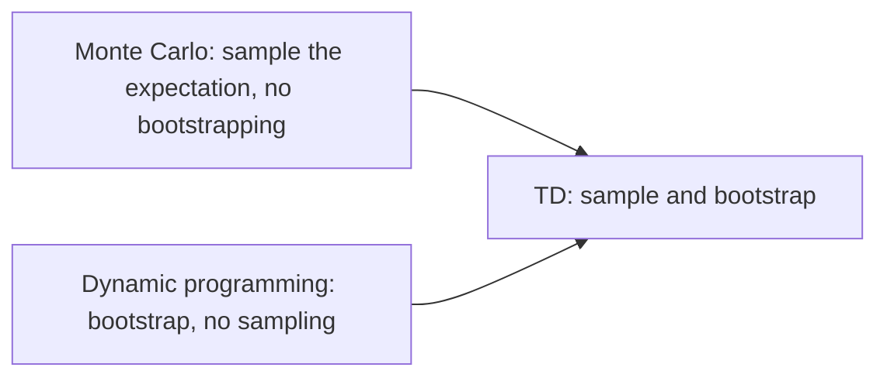

# Temporal-difference learning (Sutton & Barto, Chapter 6)

> [!abstract] TL;DR
> Temporal-difference (TD) learning updates a value estimate toward the observed reward plus the current estimate of the next state's value, so it learns from raw experience like Monte Carlo (MC) methods and bootstraps like dynamic programming (DP), after every single step. Its control forms are Sarsa (on-policy) and Q-learning (off-policy), and in batch form TD(0) computes the exact answer for the maximum-likelihood model of the data, which helps explain why it usually learns faster than constant-step-size MC.

## Problem

- **What is estimated**: the value function $v_\pi$ of a fixed policy $\pi$ (prediction), then an optimal policy (control). Values are defined in [[03b MDPs, value functions, optimality]].
- **MC waits for the end**: [[05a Monte Carlo prediction and control]] needs the complete return before any update, so no learning happens during an episode, and an episode that never ends gives no update at all.
- **DP needs a model**: [[04 Dynamic programming]] updates from the full distribution of next states and rewards, which the learner usually does not have.
- **Goal**: keep MC's ability to learn from experience without a model, and DP's ability to update from other estimates without waiting for the outcome.
- **Control still needs exploration**: as in Monte Carlo, learning action values from experience forces the choice between on-policy and off-policy methods.

## Examples in the chapter

| Example | Setting / decision | What it demonstrates |
|---------|--------------------|----------------------|
| Driving home | predicting the remaining trip time from successive situations; rewards are elapsed times on each leg | MC changes every prediction only after arriving, whereas TD shifts each prediction toward the one that follows it |
| Random walk | five states in a row, start in the middle, equal chance left or right, reward 1 only for exiting on the right | TD(0) learns faster than constant-$\alpha$ MC on a stochastic prediction task |
| Random walk under batch updating | the same task; after each new episode, all episodes seen so far are treated as a batch and replayed until convergence | batch TD(0) is consistently better than batch MC |
| You are the predictor | eight observed episodes on a two-state process | what batch MC and batch TD(0) each converge to, and why they differ |
| Windy gridworld | grid with start, goal and a column-dependent upward wind; reward $-1$ per step | Sarsa learns a good policy on a task where MC cannot easily be used |
| Cliff walking | grid with a cliff edge; falling costs $-100$ and sends the agent back to start | Sarsa and Q-learning learn different paths under $\varepsilon$-greedy behavior |

## Conceptual framework

- **Bootstrapping**: updating an estimate partly from another current estimate. DP and TD bootstrap; MC does not, because it uses only observed returns.
- **Temporal-difference (TD) learning**: a combination of MC's sampling of experience and DP's bootstrapping.
  - It is called temporal-difference because each error is a difference between estimates at successive times.
  - The simplest form, TD(0), looks one step ahead; the multistep forms, including TD($\lambda$), are in [[07a n-step TD and TD(λ)]].
- **Sample backup versus full backup**: MC and TD updates look ahead to one sampled successor (state or state-action pair) and use its value and the reward along the way; DP's full backups use the complete distribution of successors. Backup diagrams draw this lookahead; they are used for the other methods too ([[05a Monte Carlo prediction and control]]).
- **Target**: the quantity an estimate is moved toward. For MC it is the return $G_t$; for TD(0) it is $R_{t+1} + \gamma V(S_{t+1})$.
- **TD error**: the difference between the target and the current estimate; every TD method in the chapter is driven by it.
- **Constant-$\alpha$ MC**: an every-visit MC method that moves $V(S_t)$ a fixed fraction $\alpha$ toward the return; the form suited to nonstationary environments and the comparison baseline for TD.
- **Markov reward process**: a Markov chain (the next state depends only on the current one) that also emits rewards, with no actions to choose; the prediction examples use one.
- **Batch updating**: with a finite amount of experience, replay it repeatedly; the increments of one pass are summed, the value function changes once, and passes repeat until convergence.
- **Maximum-likelihood model and certainty-equivalence estimate**: the maximum-likelihood model is the one whose probability of generating the data is greatest; for a Markov process, it takes each transition probability from $i$ to $j$ as the fraction of observed transitions from $i$ that went to $j$, and each expected reward as the average observed reward on those transitions. The value function that would be exactly correct for that model is the certainty-equivalence estimate, because it treats the estimated model as known with certainty.
- **Afterstate**: the situation right after the agent's own move, before the environment responds; a value function over afterstates is an afterstate value function.
- **On-policy versus off-policy**: as defined in [[05a Monte Carlo prediction and control]]; $\varepsilon$-greedy policies and generalized policy iteration (GPI) are defined there too.

## Approach

### Prediction

1. **Tabular TD(0)**: for each step of each episode, take the action the policy gives, observe $R$ and next state $S'$, then move $V(S)$ toward $R + \gamma V(S')$ by a fraction $\alpha$.
   - The update runs after every transition from a nonterminal state; terminal states have value 0.
2. **TD versus MC on one trip** (driving home): MC can only correct an estimate off-line, meaning after the actual outcome is known (arrival home). TD corrects each estimate toward the one that immediately follows, so a traffic jam already raises the estimate of the initial trip time mid-trip, from 30 minutes toward 50. Each TD error is proportional to the change in prediction over time.
3. **Why bootstrap** (advantages of TD):
   - No model of rewards or next-state probabilities is needed, unlike DP.
   - Learning is online and fully incremental: one time step of waiting instead of an episode, which matters for very long episodes and for continuing tasks (no episodes; see [[03a MDP setting and returns]]).
   - Learning does not discard or discount episodes in which exploratory actions are taken, because TD learns from each transition whatever happens after it.
4. **Soundness**: for any fixed policy, TD(0) converges to $v_\pi$.
   - In the mean for a constant step size, if it is sufficiently small.
   - With probability 1 if the step size decreases according to the usual stochastic approximation conditions from [[02 Multi-armed bandits]].
   - Most proofs cover the table-based case, and some cover general linear function approximation (see [[09a Function approximation and linear methods]]).
5. **Which learns faster** is unproven: no one has shown mathematically that one method converges faster, and the question is not even clearly formalized. In practice TD(0) has usually beaten constant-$\alpha$ MC on stochastic tasks, as in the random walk.

### Optimality of TD(0)

- Under batch updating, TD(0) converges deterministically to one answer independent of $\alpha$, provided $\alpha$ is sufficiently small; constant-$\alpha$ MC also converges deterministically, but to a different answer.
- **Batch MC** converges to the sample average of the returns actually observed after each state, which minimizes mean-squared error on the training set.
- **Batch TD(0)** converges to the certainty-equivalence estimate, which is exactly correct for the maximum-likelihood model of the data.
- In the two-state predictor example, both methods agree on $V(\mathsf{B}) = 3/4$, but batch MC gives $V(\mathsf{A}) = 0$ (the one observed return, so zero error on the data) while batch TD(0) gives $V(\mathsf{A}) = 3/4$ (A always moves to B). If the process is Markov, TD's answer is expected to give lower error on future data, even though MC's fits the existing data better.
- This explains TD's speed advantage in the batch random walk, and may partly explain the nonbatch advantage: online TD does not reach either batch answer but moves roughly toward the better one.
- **Cost of the direct route**: with $N$ states, forming the maximum-likelihood model may need on the order of $N^2$ memory and computing its value function on the order of $N^3$ steps. TD approximates the same solution with memory of order $N$ and repeated passes over the data, so on large state spaces it may be the only feasible way.

### Control

1. **Sarsa (on-policy)**: follow GPI with TD for the evaluation part, learning action values instead of state values.
   - Transitions between state-action pairs form the same kind of Markov chain with rewards, so the TD(0) convergence results carry over.
   - The update uses the quintuple $(S_t, A_t, R_{t+1}, S_{t+1}, A_{t+1})$, which gives the name; it estimates $q_\pi$ of the behavior policy while that policy is made greedier (for example $\varepsilon$-greedy) with respect to $Q$.
   - The chapter reports, attributing it to a personal communication and noting that it is unpublished, a proof of convergence with probability 1 to an optimal policy and action-value function for the case where every state-action pair is visited infinitely often and the policy converges in the limit to the greedy policy, for instance $\varepsilon$-greedy with $\varepsilon = 1/t$.
2. **Q-learning (off-policy)**: the same pair-to-pair update, but the target uses the maximum over next actions, so $Q$ approximates the optimal action-value function $q_*$ whatever policy is followed.
   - The behavior policy still decides which pairs are visited and updated; correct convergence needs only that all pairs keep being updated, a minimal requirement for any method guaranteed to find optimal behavior in general.
   - With a variant of the usual step-size conditions, $Q$ converges to $q_*$ with probability 1.
   - Its backup diagram has a filled action node at the root and, below it, all next-state action nodes joined by an arc that marks the maximum.
3. **Sarsa versus Q-learning on the cliff**: Q-learning learns the values of the optimal path along the cliff edge, but its $\varepsilon$-greedy behavior occasionally falls off, so its online reward is worse than Sarsa's, which accounts for exploration and learns a longer but safer path. If $\varepsilon$ were gradually reduced, both would converge to the optimal policy.
4. **Windy gridworld**: on a grid where an upward wind of 0 to 2 cells (varying by column) shifts the resulting next state, with $\varepsilon = 0.1$, $\alpha = 0.5$ and $Q = 0$ initially, $\varepsilon$-greedy Sarsa reaches the goal faster over time; by 8000 steps the greedy policy was long since optimal, and continued exploration kept the average episode at about 17 steps against a minimum of 15.
   - MC cannot easily be used here: if a policy ever kept the agent in place, that episode would never end.
   - Sarsa learns during the episode that such a policy is poor and switches.

### Afterstates and special cases

- Afterstate value functions suit problems where the immediate effect of an action is known but the rest of the dynamics is not, as in games (we know the position after our move, not the opponent's reply).
- **Efficiency**: different position-move pairs often produce the same resulting position, which then must have the same value; a conventional action-value function would assess each pair separately, an afterstate value function assesses them at once, and what is learned about one pair transfers to the others.
- **Beyond games**: in an access-control queuing task the afterstate would be the number of free servers after an action but before random arrivals and departures; actions leading to the same number share experience, which should cut learning time significantly.
- Afterstate methods still fit GPI, and one still chooses between on-policy and off-policy ways of keeping exploration persistent. The tic-tac-toe learner in [[01 Introduction]] learned an afterstate value function.

## Math

**Notation.**

| Symbol | Meaning |
|--------|---------|
| $S_t$, $A_t$, $R_{t+1}$ | state and action at time $t$, and the reward received after taking $A_t$ |
| $S$, $A$, $R$, $S'$, $A'$ | the same quantities in the algorithm boxes: current state and action, reward, next state and next action |
| $G_t$ | return following time $t$ |
| $\gamma$ | discount rate (the driving-home example uses $\gamma = 1$) |
| $\alpha$ | step-size parameter |
| $\pi$ | the policy being evaluated, or the behavior policy in control |
| $v_\pi$, $q_\pi$, $q_*$ | true state values and action values of $\pi$, and optimal action values |
| $V$, $Q$ | the estimates of $v_\pi$ and of $q_\pi$ or $q_*$; terminal states have value 0 |
| $\delta_t$ | TD error, a label introduced here for the bracket of the update; the chapter writes the bracket out |
| $\varepsilon$ | exploration probability of an $\varepsilon$-greedy policy |

**Constant-$\alpha$ Monte Carlo update:**

$$
V(S_t) \leftarrow V(S_t) + \alpha \Big[ G_t - V(S_t) \Big]
$$

- Target is the actual return, known only at the end of the episode.

**TD(0) update:**

$$
V(S_t) \leftarrow V(S_t) + \alpha \Big[ R_{t+1} + \gamma V(S_{t+1}) - V(S_t) \Big]
$$

- Estimates $v_\pi$ for the fixed policy $\pi$; the update is available one step later, once $R_{t+1}$ and $S_{t+1}$ are observed.
- The bracket is the TD error:

$$
\delta_t = R_{t+1} + \gamma V(S_{t+1}) - V(S_t)
$$

**Two expressions of the value, one per family of targets:**

$$
v_\pi(s) = \mathbb{E}_\pi[G_t \mid S_t = s]
$$

$$
v_\pi(s) = \mathbb{E}_\pi[R_{t+1} + \gamma v_\pi(S_{t+1}) \mid S_t = s]
$$

- The second is the Bellman equation of [[03b MDPs, value functions, optimality]]. MC estimates the first (a sample return stands in for the expectation); DP estimates the second (the model supplies the expectation, but $V(S_{t+1})$ stands in for $v_\pi(S_{t+1})$); TD(0) samples the second expectation and also substitutes $V$.

**Sarsa update** (the algorithm chooses $A'$ from $S'$ with a policy derived from $Q$, such as $\varepsilon$-greedy, takes it next, and sets $S \leftarrow S'$, $A \leftarrow A'$):

$$
Q(S_t, A_t) \leftarrow Q(S_t, A_t) + \alpha \Big[ R_{t+1} + \gamma Q(S_{t+1}, A_{t+1}) - Q(S_t, A_t) \Big]
$$

- Estimates $q_\pi$ for the policy that generates the actions; if $S_{t+1}$ is terminal, $Q(S_{t+1}, A_{t+1})$ is zero.

**Q-learning update:**

$$
Q(S_t, A_t) \leftarrow Q(S_t, A_t) + \alpha \Big[ R_{t+1} + \gamma \max_a Q(S_{t+1}, a) - Q(S_t, A_t) \Big]
$$

- Estimates $q_*$; the next action used in the target is the best one, not the one actually taken. In the algorithm box, $A$ is still chosen from $Q$ by an exploratory rule such as $\varepsilon$-greedy.

> [!example] Worked intuition
> Formalized here with illustrative numbers; the chapter gives the rules but no arithmetic. Let $\alpha = 0.5$, $\gamma = 1$, $R_{t+1} = -1$, $Q(S_t, A_t) = -4$, and let the next state have action values $-2$ (best) and $-5$, with the exploratory policy happening to pick the $-5$ action. Sarsa's target is $-1 + (-5) = -6$, so $Q(S_t, A_t) \leftarrow -4 + 0.5\,(-6 + 4) = -5$. Q-learning's target is $-1 + (-2) = -3$, so $Q(S_t, A_t) \leftarrow -4 + 0.5\,(-3 + 4) = -3.5$. Sarsa charges the exploratory move to the pair; Q-learning ignores it.

## Dataset example

One row per step of one trip in the driving-home task, evaluated with $\gamma = 1$. The states, elapsed times and predicted times to go are the book's printed values; the reward, TD error and Monte Carlo error columns are derived here, with the reward equal to the minutes elapsed on that leg.

| $S_t$ | elapsed (min) | $R_{t+1}$ | $V(S_t)$ (predicted time to go) | $V(S_{t+1})$ | $G_t$ (actual time to go) | $\delta_t$ | $G_t - V(S_t)$ |
|-------|---------------|-----------|---------------------------------|--------------|---------------------------|------------|----------------|
| leaving office, Friday at 6 | 0 | 5 | 30 | 35 | 43 | 10 | 13 |
| reach car, raining | 5 | 15 | 35 | 15 | 38 | $-5$ | 3 |
| exiting highway | 20 | 10 | 15 | 10 | 23 | 5 | 8 |
| secondary road, behind truck | 30 | 10 | 10 | 3 | 13 | 3 | 3 |
| entering home street | 40 | 3 | 3 | 0 | 3 | 0 | 0 |
| arrive home (terminal) | 43 | none | 0 | none | none | none | none |

- **Column to symbol**: $S_t$, $R_{t+1}$, $V$ and $G_t$ as in Math; $\delta_t = R_{t+1} + V(S_{t+1}) - V(S_t)$ and the last column is the MC error, both with $\gamma = 1$.
- **What is derived**: with $\alpha = 1$ the last two columns are the changes recommended by TD and by MC. The book's printed MC error for exiting the highway is 8 minutes, matching the table. The TD errors sum to the first row's MC error (13), because $\gamma = 1$, the intermediate predictions cancel and the terminal value is 0.
- **Deliberately absent**: any model of traffic. For Sarsa the same rows would also carry $A_t$, and the next row's $A_{t+1}$ would enter the target.

## Where it matters in practice

### Signs a problem fits

- Very long episodes, or a continuing task with no episode end.
- Learning from a stream of transitions with no known dynamics, one step at a time.
- Problems where one needs long-term predictions about a dynamical system rather than control; the chapter lists, as not extensively explored uses, predicting financial data, life spans, election outcomes, weather, animal behavior, power-station demand and customer purchases.
- Afterstates fit when the immediate effect of one's own action is known but what follows is not (a game move, assigning customers to servers).
- Derived here from the cliff comparison: Sarsa fits when the reward earned while learning counts; Q-learning fits when the values of the optimal policy are the goal.

### What you need to use it

- **Transitions** $(S, A, R, S')$ from interaction with the environment, with a reward at each step.
- **A tabular value store** (one number per state or state-action pair) in the chapter's form; larger spaces need the function approximation of later chapters.
- **A step size** $\alpha$ that meets the convergence conditions above, and **persistent exploration** so that all pairs keep being updated.

### When not to trust it

- **Constant $\alpha$ never settles**: estimates keep fluctuating with the most recent episodes, as in the random walk.
- **Online reward versus learned values**: see the cliff comparison above; values of the optimal policy do not mean good reward while exploring.

## Assumptions & limitations

- **Tabular, one-step, model-free**: the methods here are the one-step, tabular, model-free special cases; extensions to multistep forms, to function approximation and to forms with a model are in [[07a n-step TD and TD(λ)]], [[09a Function approximation and linear methods]] and [[08a Models, planning, Dyna]].
- **Markov property**: the argument for TD's batch advantage over MC assumes the process is Markov, since only then is the maximum-likelihood model the right model to trust.
- **Actor-critic**: the chapter groups actor-critic methods with Sarsa as on-policy TD control; they are in [[11 Policy approximation (actor-critic)]].
