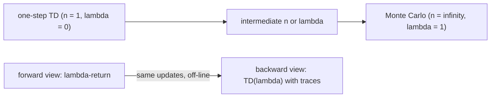

# n-step TD and TD(λ) (Sutton & Barto, Chapter 7 part a)

> [!abstract] TL;DR
> Updating a state's value toward a target made of n real rewards plus an estimate, or toward a weighted average of such targets (the λ-return), gives a family of temporal-difference (TD) methods between one-step TD and Monte Carlo, and intermediate settings often work best. Eligibility traces compute that average with a cheap causal per-step update: the forward view says what is computed, the backward view how, and they agree exactly off-line and closely on-line.

This is part a of two. Part b, [[07b Eligibility-trace control and off-policy]], extends traces to action values and control and to off-policy learning. One-step TD (called TD(0) below) is defined in [[06 Temporal-difference learning]]; constant-$\alpha$ Monte Carlo and the backup diagram are in [[05a Monte Carlo prediction and control]]; returns and the terminal-state convention are in [[03a MDP setting and returns]]. This note covers prediction only: estimating $v_\pi$ for a fixed policy $\pi$.

## Problem

- **Two extremes of target**: Monte Carlo updates a state toward the whole observed return, so it must wait for the episode to end and has high variance. One-step TD updates toward the next reward plus the estimated value of the next state, so it learns at once but credit for a reward reaches earlier states only one step per visit.
- **What lies between**: a method may use more than one but fewer than all of the rewards until termination, and the best amount may be neither extreme.
- **Mechanism for credit**: a good method should assign credit or blame for each TD error to the states that led to it, without storing and revisiting the whole history of the episode.
- **Causality**: an averaged target defined by looking forward at later rewards cannot be run as written, so a causal, incremental method that reproduces it is needed.

## Examples in the chapter

| Example | Setting / decision | What it demonstrates |
|---------|--------------------|----------------------|
| Random walk, first episode (5 states) | states A to E from center C, one episode that runs right to termination with return 1, all values start at 0.5 | how many states one episode updates under one-step, two-step and longer n-step methods |
| 19-state random walk (running experiment) | 19 states, outcome $-1$ on the left end, 1 on the right end, all values start at 0; error is the root-mean-square (RMS) error against the true values over the 19 states at the end of an episode | on-line versus off-line updating, and intermediate $n$ or $\lambda$ beating both extremes; reused for every $\lambda$-based method |

## Conceptual framework

- **Backup and target**: a backup moves the estimate of a state's value toward a target; the target is the return for Monte Carlo and $R_{t+1} + \gamma V_t(S_{t+1})$ for one-step TD. Here $V_t$ is the estimate of $v_\pi$ at time $t$.
- **$n$-step TD method**: a TD method whose temporal difference spans $n$ steps; it still changes an earlier estimate based on how it differs from a later one.
- **$n$-step return**: the first $n$ rewards, discounted, plus a correction in place of the missing rest (normally the estimated value of the state $n$ steps later).
  - One-step TD is $n = 1$, Monte Carlo is $n = \infty$.
  - **Horizon** $h = t + n$ is the time up to which real rewards are used.
  - If the episode ends before the horizon, the return is the complete return; the last $n$ returns of an episode are therefore complete returns.
- **Error reduction property**: the expected $n$-step return is a better estimate of $v_\pi$ than the current estimate, in the worst-state sense, which is why $n$-step methods converge.
- **On-line versus off-line updating**: on-line applies each increment as soon as it is computed; off-line collects increments and applies their sum when the episode ends, so values do not change mid-episode.
- **Complex backup and $\lambda$-return**: a backup toward a weighted average of simpler returns (weights positive, summing to 1) is a complex backup, and the $\lambda$-return is the geometric-weighted average of all $n$-step returns.
- **Forward view**: for each visited state, look ahead at future rewards and decide how to combine them; the lookahead is acausal, since it needs what happens many steps later.
- **Backward view**: at each step, look at the current TD error and send it back to previously visited states in proportion to their eligibility.
- **Eligibility trace**: an extra memory variable per state, $E_t(s)$, a temporary record of how recently and often the state was visited; it marks the state as eligible for learning changes when a TD error occurs.
- **Trace-decay parameter** $\lambda \in [0,1]$: sets how fast traces fade (by $\gamma\lambda$ per step) and in the forward view how the $n$-step returns are weighted.
- **Credit**: the share of a TD error that a state receives, set by its trace; older states receive less.

## Approach

1. **$n$-step TD prediction**: keep the tabular update, but replace the target by the $n$-step return computed from the rewards and states after time $t$.
   - At time $t+n$ the needed rewards and the state $S_{t+n}$ are known, so the update of $S_t$ is delayed by $n$ steps.
   - Larger $n$ spreads credit from one outcome to more earlier states in one episode (the five-state example: one-step changes only the last state before termination, two-step the last two, any $n \ge 3$ all three visited states by the same amount).
   - $n$-step methods are rarely used directly because waiting $n$ steps is inconvenient, especially in control with large $n$; their value is for theory and for justifying traces.
2. **$\lambda$-return algorithm (forward view)**: back up toward the $\lambda$-return, so every $n$-step return contributes with weight proportional to $\lambda^{n-1}$.
   - One-step return gets the largest weight and each extra step multiplies it by $\lambda$.
   - Weight that would fall after termination is gathered on the complete return.
   - $\lambda = 0$ gives one-step TD (TD(0)) and $\lambda = 1$ gives constant-$\alpha$ Monte Carlo, so $\lambda$ is a continuous dial between them.
   - Each state is updated once, from a lookahead at its future, and never revisited; later states are looked at again from every earlier vantage point.
3. **TD($\lambda$) (backward view)**: on every step compute the one-step TD error and add it to all states in proportion to their traces.
   - Traces of all other states decay by $\gamma\lambda$ each step; the visited state's trace is also increased.
   - The method is causal and incremental, uses only current quantities and costs one trace per state.
   - At $\lambda = 0$ only the current state has a nonzero trace, so it is exactly TD(0).
   - $\lambda = 1$: credit falls only by $\gamma$ per step, which is the right discounting to behave like Monte Carlo; it is also called TD(1).
   - TD(1) works for discounted continuing tasks, not only episodic ones, and updates within the episode, unlike Monte Carlo; a very poor action is penalized before the episode ends.
4. **Three kinds of trace** differ only in how the visited state's trace is incremented; the decay of other states is identical.
   - **Accumulating**: add 1 on each visit, so revisits before full decay push the trace above 1.
   - **Replacing**: reset to 1 on a revisit; at $\lambda = 1$ it is closely related to first-visit Monte Carlo.
   - **Dutch**: in between, depending on $\alpha$; $\alpha \to 0$ gives accumulating, $\alpha = 1$ gives replacing.
5. **How well backward approximates forward**: the question is whether the cheap causal algorithm gives the same values as the ideal forward one.
   - **Off-line, accumulating traces**: the two give identical overall updates at the end of every episode, at every $\lambda$; since off-line values do not change mid-episode, they also agree step by step.
   - **On-line, accumulating traces**: at $\lambda = 0$ the two are the identical algorithm for every $\alpha$; for small $\alpha$ they are close by the end of each episode.
   - **On-line, both large** (for example $\lambda > 0.9$ and $\alpha > 0.5$): the $\lambda$-return algorithm gets a little worse while TD($\lambda$) with accumulating traces tends to be unstable. These values are higher than one would use anyway, but the weakness is real.
   - **Replacing and dutch traces** make performance more robust to the parameters; dutch traces come closest to the goal of an on-line causal algorithm that approximates the $\lambda$-return.
   - **Exact on-line equivalence**: a real-time version of the $\lambda$-return is exactly equivalent to true online TD($\lambda$), a backward algorithm built on the dutch trace and a modified update.
   - The chapter defers the real-time $\lambda$-return to the treatment of function approximation; only the backward algorithm is given here (it is not developed in the draft's function-approximation chapter either; see [[09a Function approximation and linear methods]] for linear function approximation).
   - At $\lambda = 1$ true online TD($\lambda$) matches constant-$\alpha$ Monte Carlo by the end of the episode while updating on-line in real time; none of the other methods does.
6. **Evidence on the 19-state random walk** (RMS error over the 19 states, averaged over the first 10 episodes and 100 repetitions with the same walks for all methods, plotted against $\alpha$):
   - On-line methods generally beat off-line ones, with lower error over a wider range of $\alpha$; the off-line methods were unstable for $\alpha$ much above 0.3.
   - Intermediate $n$ and intermediate $\lambda$ both give the best error, better than either extreme, and the $\lambda$-return algorithms perform comparably to the $n$-step ones.
   - True online TD($\lambda$) looks slightly better than the on-line $\lambda$-return, but not clearly better than TD($\lambda$) with dutch traces; most of the gain seems to come from the dutch trace, in this one example.

## Math

**Notation** (symbols as in earlier notes).

| Symbol | Meaning |
|--------|---------|
| $S_t$, $R_{t+1}$ | state at time $t$ and the reward received after it |
| $n$, $h$ | number of steps of an $n$-step return; its horizon $h = t + n$ |
| $\mathcal{S}$ | the set of states |
| $v$ | any value function, used in the error reduction property |
| $T$ | last time step of an episode; the terminal state is entered at $T$ |
| $\gamma$ | discount rate |
| $\pi$, $v_\pi$ | the fixed policy and its true state values |
| $V_t(s)$ | estimate of $v_\pi(s)$ at time $t$; $V$ without subscript when it does not change |
| $\alpha$ | step-size parameter (positive) |
| $\lambda$ | trace-decay parameter in $[0, 1]$ |
| $G_t$ | complete return from time $t$ |
| $G_t^{h}(c)$ | return truncated at horizon $h$ with scalar correction $c$; $G_t^{t+n}(V_t(S_{t+n}))$ is the $n$-step return |
| $L_t$ | the $\lambda$-return of time $t$ (the chapter's symbol; not used in earlier notes) |
| $\Delta_t(s)$ | increment to $V(s)$ produced at time $t$ (zero for all but one state in the $n$-step and $\lambda$-return forms) |
| $\delta_t$ | one-step TD error |
| $E_t(s)$ | eligibility trace of state $s$ at time $t$, a non-negative number |
| $I_{xy}$ | identity indicator, 1 if $x = y$ and 0 otherwise |

**General $n$-step return:**

$$
G_t^{t+n}(c) = R_{t+1} + \gamma R_{t+2} + \cdots + \gamma^{n-1} R_{t+n} + \gamma^n c
$$

- $n$ discounted real rewards plus the correction $\gamma^n c$ in place of the rest.
- With $c = V_t(S_{t+n})$ it is the usual $n$-step return.

**$n$-step backup increment:**

$$
\Delta_t(S_t) = \alpha \Big[ G_t^{t+n}\big(V_t(S_{t+n})\big) - V_t(S_t) \Big]
$$

- Moves the visited state toward the $n$-step return; all other states get $\Delta_t(s) = 0$.

**On-line update** (apply at once) and **off-line update** (apply the sum at the end of the episode):

$$
V_{t+1}(s) = V_t(s) + \Delta_t(s), \qquad \forall s \in \mathcal{S}
$$

$$
V_{t+1}(s) = V_t(s) \;\; (t < T), \qquad V_T(s) = V_{T-1}(s) + \sum_{t=0}^{T-1} \Delta_t(s)
$$

**Error reduction property:**

$$
\max_s \Big| \mathbb{E}_\pi\big[ G_t^{t+n}(v(S_{t+n})) \mid S_t = s \big] - v_\pi(s) \Big| \le \gamma^n \max_s \big| v(s) - v_\pi(s) \big|
$$

- For any $n \ge 1$ and any value function $v$, the worst-state error of the expected $n$-step return is at most $\gamma^n$ times that of $v$.
- Averages of returns with positive weights summing to 1 keep this property, so the $\lambda$-return also gives convergent methods.

**$\lambda$-return** (with the post-termination terms separated):

$$
L_t = (1 - \lambda) \sum_{n=1}^{\infty} \lambda^{n-1} G_t^{t+n}\big(V_t(S_{t+n})\big)
= (1 - \lambda) \sum_{n=1}^{T-t-1} \lambda^{n-1} G_t^{t+n}\big(V_t(S_{t+n})\big) + \lambda^{T-t-1} G_t
$$

- The factor $1 - \lambda$ makes the weights sum to 1; the $n$-step return has weight $(1-\lambda)\lambda^{n-1}$, and the complete return gets all the weight left after termination, $\lambda^{T-t-1}$.
- At $\lambda = 1$ the sum vanishes and $L_t = G_t$; at $\lambda = 0$ only the one-step return remains.

**$\lambda$-return increment (forward view):**

$$
\Delta_t(S_t) = \alpha \big[ L_t - V_t(S_t) \big]
$$

**TD error:**

$$
\delta_t = R_{t+1} + \gamma V_t(S_{t+1}) - V_t(S_t)
$$

**Trace decay for non-visited states, and accumulating trace for the visited one:**

$$
E_t(s) = \gamma\lambda E_{t-1}(s), \;\; \forall s \neq S_t; \qquad E_t(S_t) = \gamma\lambda E_{t-1}(S_t) + 1
$$

**TD($\lambda$) update (backward view):**

$$
\Delta V_t(s) = \alpha \, \delta_t \, E_t(s), \qquad \text{for all } s \in \mathcal{S}
$$

- Applied on each step it is on-line; summed over the episode it is off-line.

**Replacing and dutch traces** (the visited state's trace only; decay of other states is unchanged):

$$
E_t(S_t) = 1 \;\; \text{(replacing)}, \qquad E_t(S_t) = (1 - \alpha)\gamma\lambda E_{t-1}(S_t) + 1 \;\; \text{(dutch)}
$$

**True online TD($\lambda$) value update** (uses the dutch trace and the decay above):

$$
V_{t+1}(s) = V_t(s) + \alpha \big[ \delta_t + V_t(S_t) - V_{t-1}(S_t) \big] E_t(s) - \alpha I_{s S_t} \big[ V_t(S_t) - V_{t-1}(S_t) \big], \quad \forall s \in \mathcal{S}
$$

- Differs from plain TD($\lambda$) by the two correction terms involving the change of the visited state's own value in the previous step; these terms are what make it match the real-time $\lambda$-return.

**On-line tabular TD($\lambda$)** (the algorithm):

1. Initialize $V(s)$ arbitrarily, 0 at terminal states.
2. For each episode, set $E(s) = 0$ for all $s$ and initialize $S$.
3. For each step: take the action $A$ given by $\pi$ for $S$; observe $R$ and $S'$; set $\delta \leftarrow R + \gamma V(S') - V(S)$.
4. Increment $E(S)$ by one of the three rules: $E(S) \leftarrow E(S) + 1$ (accumulating), $E(S) \leftarrow (1-\alpha)E(S) + 1$ (dutch) or $E(S) \leftarrow 1$ (replacing).
5. For all $s$: $V(s) \leftarrow V(s) + \alpha\delta E(s)$ and $E(s) \leftarrow \gamma\lambda E(s)$; then $S \leftarrow S'$, until $S$ is terminal.

- It estimates $v_\pi$; traces are reset each episode, and the decay in step 5 comes after the update, so the next step increments an already-decayed trace.

> [!example] Worked intuition
> Formalized here, with illustrative numbers. Take $\lambda = 0.5$ and an episode where the terminal state is $T - t = 3$ steps after time $t$. The weights are $(1-\lambda) = 0.5$ on the one-step return, $0.5 \cdot 0.5 = 0.25$ on the two-step return, and $\lambda^{T-t-1} = 0.25$ on the complete return; $0.5 + 0.25 + 0.25 = 1$. With $\lambda = 0$ the whole weight sits on the one-step return, and with $\lambda = 1$ on the complete return.

## Dataset example

One row per time step of one episode of TD($\lambda$) with accumulating traces on the five-state random walk from the first example (start at C, move right to D, E, then terminate with reward 1); illustrative rows with $\gamma = 1$, $\lambda = 0.8$, $\alpha = 0.1$ and all $V = 0.5$ at the start (terminal value 0).

| $t$ | $S_t$ | $R_{t+1}$ | $S_{t+1}$ | $V_t(S_t)$ | $V_t(S_{t+1})$ | $\delta_t$ | $E_t(S_t)$ after increment | change applied |
|-----|-------|-----------|-----------|------------|----------------|-----------|----------------------------|----------------|
| 0 | C | 0 | D | 0.5 | 0.5 | 0 | 1 | none |
| 1 | D | 0 | E | 0.5 | 0.5 | 0 | 1 | none |
| 2 | E | 1 | terminal | 0.5 | 0 | 0.5 | 1 | $V$(E) $+0.05$, $V$(D) $+0.04$, $V$(C) $+0.032$ |

- **Column to symbol**: $\delta_t = R_{t+1} + \gamma V_t(S_{t+1}) - V_t(S_t)$; the final change column is $\alpha\,\delta_t\,E_t(s)$, where the traces at $t = 2$ of E, D and C are 1, 0.8 and 0.64 (each older visit decayed by $\gamma\lambda = 0.8$ per step).
- **What is derived**: after the episode $V(\text{E}) = 0.55$, $V(\text{D}) = 0.54$, $V(\text{C}) = 0.532$; one-step TD would only have moved E, a two-step method E and D, and $\lambda = 1$ with $\gamma = 1$ would move all three by the same $0.05$.
- **Absent**: the other states of the walk, never visited; actions (omitted, as the policy is fixed).

## Where it matters in practice

### Signs a problem fits

- Rewards are delayed by many steps, so one-step TD propagates credit slowly and Monte Carlo is too noisy or must wait for episodes to end.
- Learning must happen while an episode runs, for example when a bad behavior should be discouraged immediately.
- The task is continuing and discounted, where plain Monte Carlo does not apply but TD(1) does.

### What you need to use it

- **Experience under a fixed policy**: states, rewards and the discount $\gamma$, enough to compute the TD error each step.
- **One extra number per state** (the trace); no model of the environment.
- **Parameters to tune**: $\alpha$ and $\lambda$; an intermediate $\lambda$ was best in the random-walk tests.

### When not to trust it

- Accumulating traces with both $\alpha$ and $\lambda$ large (about $\alpha > 0.5$, $\lambda > 0.9$ in the random walk): prefer replacing or dutch traces.
- Off-line updating with $\alpha$ much above 0.3 in that test: unstable.

## Assumptions & limitations

- **Prediction only**: a fixed policy and tabular values; control and off-policy use are in [[07b Eligibility-trace control and off-policy]].
- **One empirical task**: the comparisons of $n$, $\lambda$ and trace types come from the 19-state random walk; the benefit of exact equivalence may differ on other problems.
- **Convergence conditions are not stated**: $n$-step methods are said to converge under technical conditions that are not spelled out.
