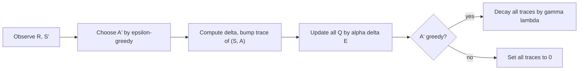

# Eligibility-trace control and off-policy (Sutton & Barto, Chapter 7 part b)

> [!abstract] TL;DR
> Eligibility traces extend from prediction to control by learning action values: Sarsa($\lambda$) applies temporal-difference (TD) learning with traces to state-action pairs on-policy, and Watkins's Q($\lambda$) does the same for off-policy Q-learning by cutting every trace each time an exploratory action is taken. The cut throws away much of the speedup and ties bootstrapping to off-policy deviation; the chapter concludes that an intermediate $\lambda$ is best, and that traces pay off mainly when data are scarce.

Part a, [[07a n-step TD and TD(λ)]], defines the $\lambda$-return, the three trace types and TD($\lambda$); this note applies them to control. Control methods here build on [[06 Temporal-difference learning]] (Sarsa, Q-learning).

## Problem

- **Control with traces**: TD($\lambda$) as defined in part a only predicts state values for a fixed policy; here the same credit-spreading must serve learning a better policy.
- **Off-policy learning and traces conflict**: Q-learning learns about the greedy policy while acting with exploratory moves, and keeping the benefit of long traces under that mismatch is the difficulty the chapter works through.
- **Cost**: traces add per-step work on every state, and the chapter asks when the extra computation is worth it.

## Examples in the chapter

| Example | Setting / decision | What it demonstrates |
|---------|--------------------|----------------------|
| Traces in gridworld | one episode of a gridworld agent that ends at a rewarded cell; all values start at 0 and only that cell pays | after one episode one-step Sarsa strengthens only the last action, whereas Sarsa($\lambda$) strengthens many earlier actions with strength decaying along the path |

## Conceptual framework

- **Eligibility trace, $\lambda$-return, TD error**: as defined in [[07a n-step TD and TD(λ)]]; the trace marks how recently a quantity was visited and the TD error $\delta_t$ is spread over marked quantities.
- **State-action trace**: control needs one trace per pair $(s, a)$ instead of per state, triggered when that pair is visited.
  - **Accumulating**: add 1 to the visited pair on top of its decayed value.
  - **Dutch**: every trace decays by an extra factor $(1-\alpha)$, then the visited pair is incremented by 1.
  - **Replacing**: reset the visited pair to 1.
- **Identity indicator** $I_{xy}$: equals 1 if $x = y$ and 0 otherwise, so $I_{sS_t} I_{aA_t}$ picks out the pair just visited.
- **On-policy versus off-policy**: an on-policy method estimates the values of the policy it follows; an off-policy method learns about a target policy different from the behavior policy that generates the data (importance sampling for this is in [[05b Off-policy Monte Carlo]]).
- **Exploratory (nongreedy) action**: an action that is suboptimal according to the current $Q$, taken occasionally to keep exploring.
- **Backup**: the book's word for an update of a value toward a target built from later experience; the backup diagrams show which later quantities enter the target.
- **Bootstrapping**: building an estimate from other estimates, as TD and dynamic programming do; Monte Carlo (MC) methods do not. In TD($\lambda$) and Sarsa($\lambda$), $\lambda$ sets how much bootstrapping there is, and $\lambda = 1$ means none, which turns the method into MC.
- **Non-Markov task**: a task where the observed state does not summarize the relevant history, so bootstrapped estimates can be misleading.

## Approach

### Sarsa($\lambda$): on-policy control

1. **Idea**: apply TD($\lambda$) to state-action pairs, replacing $V_t(s)$ by $Q_t(s, a)$ and $E_t(s)$ by $E_t(s, a)$.
2. **Forward view**: the first backup looks one step ahead to the next pair, the second two steps, and so on up to the complete return.
   - Weights are as in the $\lambda$-return: $(1-\lambda)\lambda^{n-1}$ on the $n$-step return, and $\lambda^{T-t-1}$ on the complete return.
3. **What it estimates**: $q_\pi$ of the current policy $\pi$, then the policy is improved gradually; the simplest improvement is the $\varepsilon$-greedy policy with respect to the current $Q$ (see [[05a Monte Carlo prediction and control]]).
4. **Per step**: choose $A'$ in $S'$ from the $\varepsilon$-greedy policy, compute $\delta$ from the pair $(S', A')$, bump the trace of $(S, A)$ by the chosen trace type, update **every** pair by $\alpha \delta E$, then decay every trace by $\gamma \lambda$.
5. **Name**: the original method of the previous chapter is called one-step Sarsa.

### Watkins's Q($\lambda$): off-policy control

1. **Problem it solves**: Q-learning's target is the greedy policy, so a return is valid only while the agent acts greedily.
   - Suppose the agent acts greedily at $t+1$ and $t+2$ and explores at $t+3$: the one- and two-step returns from $(S_t, A_t)$ are usable, the three-step return and all longer ones are not.
2. **Forward view**: lookahead stops at the first exploratory action, or at the episode's end if there is none.
   - Both Q-learning and Q($\lambda$) look one action past the exploration, using the action values: if $A_{t+1}$ is exploratory, the update of $Q_t(S_t, A_t)$ still moves toward $R_{t+1} + \gamma \max_a Q_t(S_{t+1}, a)$.
   - In general, if $A_{t+n}$ is the first exploratory action, the longest backup targets the $n$-step return ending in $\gamma^n \max_a Q_t(S_{t+n}, a)$ (off-line updating assumed: increments are collected during the episode and applied at its end, as in part a).
3. **Backward view**: traces work as in Sarsa($\lambda$), except that all traces are set to 0 whenever an exploratory action is taken.
   - Think of two steps: first decay every trace by $\gamma \lambda$ (or zero it after an exploratory action), then add 1 for the current pair.
   - Dutch or replacing traces can be used analogously.
4. **Tie rule in the algorithm**: $A^*$ is a greedy action in $S'$; if the chosen $A'$ ties for the maximum, $A^* = A'$, so a tie counts as greedy.
5. **Weakness**: cutting at every exploratory action loses much of the benefit of traces.
   - Exploration is frequent early in learning, so backups longer than one or two steps are rare and learning may be little faster than one-step Q-learning.

### Off-policy traces with importance sampling

The chapter only motivates this direction; it gives no algorithm. Q($\lambda$)'s cut is crude in two ways.

- **It treats off-policy as binary**: the target policy is either followed (traces continue) or abandoned (traces cut), with nothing in between.
  - Target and behavior policy can take actions with different positive probabilities, so following or deviating is a matter of degree.
  - The ratio of the two action probabilities, and the product of ratios along a sequence, assign credit more precisely (from [[05b Off-policy Monte Carlo]]).
- **It confounds bootstrapping with off-policy deviation**: after any deviation Q($\lambda$) cuts the trace and uses its own estimate, so it bootstraps even when $\lambda = 1$.
  - The stated goal is to decouple them: $\lambda$ sets the degree of bootstrapping, and importance sampling independently corrects for off-policy deviation.

### Implementation

- **Naive cost**: updating the value and trace of every state (or pair) at every step looks expensive on a serial computer, though not on parallel hardware or in plausible neural implementations.
- **Sparse-trace trick**: for typical $\lambda$ and $\gamma$, almost all traces are nearly zero, so keep and update only the recently visited pairs; the cost is then a few times that of a one-step method, depending on $\lambda$, $\gamma$ and the other computations.
  - A further technique reduces the cost to a constant independent of $\lambda$ and $\gamma$.
- **Tabular is the worst case**: with function approximation the relative overhead shrinks; with a neural network trained by backpropagation, traces roughly double the memory and computation per step.

### Variable $\lambda$

- **Idea**: let $\lambda_t$ differ from step to step, for example as a function of state, $\lambda_t = \lambda(S_t)$.
- **Confident state**: its value estimate is trusted, so use it fully and ignore later rewards; this is cutting all traces there, with $\lambda$ zero or very small.
- **Uncertain state**: give it $\lambda$ near 1, so its estimate has little effect on any update and it is skipped over until a better-known state appears.
- **Status**: the added generality has not been used in practical applications; it is of theoretical interest and might prove useful.
- **Link to Q($\lambda$)**: cutting the backup sequence at a nongreedy action can be implemented by temporarily setting $\lambda$ to 0.

### Conclusions drawn

- **What traces do**: with TD errors they give an efficient, incremental way to move between MC and TD methods, from partial experience with little memory and little meaningless variation in predictions.
  - Traces without TD errors have a similar effect, but only awkwardly.
- **Non-Markov tasks**: MC methods can win there because they do not bootstrap; traces make TD more MC-like and so help too. Traces are the first line of defense against both long-delayed rewards and non-Markov tasks.
- **Choosing $\lambda$**: there is no theory yet, but empirically an intermediate mixture is best.
  - On tasks with many steps per episode, or many steps within the half-life of discounting (the time discounting takes to halve a reward's weight), traces are significantly better than none.
  - Traces so long that the method is pure MC, or nearly so, degrade performance sharply.
  - Whether variable $\lambda$ can tune the TD-MC trade-off more finely is unclear.

## Math

**Notation.** Symbols follow earlier notes; $\lambda$ and the trace $E$ are defined in [[07a n-step TD and TD(λ)]].

| Symbol | Meaning |
|--------|---------|
| $S_t, A_t, R_{t+1}$ | state, action and next reward at time $t$ |
| $S, A, R, S', A'$ | current and next state, action and reward in the algorithm boxes |
| $Q_t(s, a)$ | current estimate of the action value; approximates $q_\pi(s, a)$ under Sarsa($\lambda$) |
| $E_t(s, a)$ | eligibility trace of the pair $(s, a)$; $E_t(s)$ is the per-state trace |
| $\delta_t$ | TD error at time $t$ |
| $\pi$, $q_\pi$ | policy being followed and its action values |
| $\alpha, \gamma, \lambda$ | step size, discount, trace decay; $\lambda_t$ is $\lambda$ at time $t$ |
| $I_{xy}$ | identity indicator, 1 if $x = y$, else 0 |
| $A^*$ | a greedy action in $S'$ ($A'$ itself if it ties) |
| $G_t$ | complete return |
| $G_t^{(n)}$ | $n$-step return from time $t$ |
| $G_t^\lambda$ | $\lambda$-return |
| $T$ | final time step of the episode |

**Sarsa($\lambda$) traces** (accumulating, dutch, replacing), for all $s, a$:

$$
\begin{aligned}
E_t(s, a) &= \gamma \lambda E_{t-1}(s, a) + I_{sS_t} I_{aA_t} && \text{(accumulating)} \\
E_t(s, a) &= (1-\alpha) \gamma \lambda E_{t-1}(s, a) + I_{sS_t} I_{aA_t} && \text{(dutch)} \\
E_t(s, a) &= (1 - I_{sS_t} I_{aA_t}) \gamma \lambda E_{t-1}(s, a) + I_{sS_t} I_{aA_t} && \text{(replacing)}
\end{aligned}
$$

- Every pair decays by $\gamma\lambda$ (accumulating, replacing) or by $(1-\alpha)\gamma\lambda$ (dutch, as the equation reads); the visited pair is incremented by 1 (accumulating, dutch) or reset to 1 (replacing). The printed algorithm box applies the factor $(1-\alpha)$ only to the visited pair, which differs from the equation.

**Sarsa($\lambda$) update and TD error:**

$$
Q_{t+1}(s, a) = Q_t(s, a) + \alpha \delta_t E_t(s, a) \;\; \text{for all } s, a, \qquad \delta_t = R_{t+1} + \gamma Q_t(S_{t+1}, A_{t+1}) - Q_t(S_t, A_t)
$$

- The TD error uses the next pair actually chosen, so the method is on-policy and estimates $q_\pi$.

**Watkins's Q($\lambda$) trace:**

$$
E_t(s, a) =
\begin{cases}
\gamma \lambda E_{t-1}(s, a) + I_{sS_t} \cdot I_{aA_t} & \text{if } Q_{t-1}(S_t, A_t) = \max_a Q_{t-1}(S_t, a) \\
I_{sS_t} \cdot I_{aA_t} & \text{otherwise}
\end{cases}
$$

- Traces continue to decay normally while the action taken was greedy and restart from the current pair alone after an exploratory one.

**Watkins's Q($\lambda$) update and TD error:**

$$
Q_{t+1}(s, a) = Q_t(s, a) + \alpha \delta_t E_t(s, a) \;\; \forall s, a, \qquad \delta_t = R_{t+1} + \gamma \max_{a'} Q_t(S_{t+1}, a') - Q_t(S_t, A_t)
$$

- The target uses the greedy next action, so the method estimates the greedy policy's values whatever action is taken.

**Variable-$\lambda$ trace (backward view):**

$$
E_t(s) =
\begin{cases}
\gamma \lambda_t E_{t-1}(s) & \text{if } s \ne S_t \\
\gamma \lambda_t E_{t-1}(s) + 1 & \text{if } s = S_t
\end{cases}
$$

**Variable-$\lambda$ return (forward view):**

$$
G_t^\lambda = \sum_{n=1}^{\infty} G_t^{(n)} (1 - \lambda_{t+n}) \prod_{i=t+1}^{t+n-1} \lambda_i
= \sum_{k=t+1}^{T-1} G_t^{(k-t)} (1 - \lambda_k) \prod_{i=t+1}^{k-1} \lambda_i + G_t \prod_{i=t+1}^{T-1} \lambda_i
$$

- The weight on the $n$-step return is $(1-\lambda_{t+n})$ times the product of the $\lambda_i$ passed on the way; the second form folds all weight beyond the episode's end onto the complete return.
- With constant $\lambda$ the weights become $(1-\lambda)\lambda^{n-1}$, the ordinary $\lambda$-return (checked here).

> [!example] Worked intuition
> Formalized here; the chapter only says the fall-off is 0.9 per step. Take $\gamma\lambda = 0.9$ (accumulating traces), all rewards zero except the last step, and $Q$ at 0, so the only nonzero TD error is $\delta$ at the rewarded step. At that step the pair taken $k$ steps earlier has trace $0.9^k$ and its $Q$ rises by $\alpha \cdot 0.9^k \cdot \delta$: the last pair gets the full $\alpha\delta$ and the pair three steps back gets $0.729\,\alpha\delta$. One-step Sarsa updates only the last pair. For Watkins's Q($\lambda$) the same chain would be cut to zero at the first exploratory action on the path.

## Dataset example

One row per time step of one episode of a control agent with $\gamma = 1$, $\lambda = 0.5$ and accumulating traces; illustrative rows (the chapter prints no data). Last two columns give the nonzero traces after the increment at that step, before the decay.

| $t$ | $S_t$ | $A_t$ | $R_{t+1}$ | $S_{t+1}$ | $A_{t+1}$ | $A_{t+1}$ greedy? | $E$ under Sarsa($\lambda$) | $E$ under Watkins's Q($\lambda$) |
|-----|-------|-------|-----------|-----------|-----------|-------------------|----------------------------|----------------------------------|
| 0 | s1 | right | 0 | s2 | right | yes | (s1,right)=1 | (s1,right)=1 |
| 1 | s2 | right | 0 | s3 | up | no (exploratory) | (s2,right)=1, (s1,right)=0.5 | (s2,right)=1, (s1,right)=0.5 |
| 2 | s3 | up | 0 | s4 | right | yes | (s3,up)=1, (s2,right)=0.5, (s1,right)=0.25 | (s3,up)=1 |
| 3 | s4 | right | 1 | terminal | none | not applicable | (s4,right)=1, (s3,up)=0.5, (s2,right)=0.25, (s1,right)=0.125 | (s4,right)=1, (s3,up)=0.5 |

- **Column to symbol**: $S_t, A_t, R_{t+1}, S_{t+1}, A_{t+1}$ as in Math; the trace columns are $E_t(s,a)$ right after the increment, and each pair's trace halves per step because $\gamma\lambda = 0.5$ (hand-checked; the cut at the exploratory $A_2 = $ up leaves Watkins's traces with only the current pair at $t = 2$).
- **What is derived**: at $t = 3$ the reward's TD error is shared across all four pairs under Sarsa($\lambda$) but only across two under Watkins's Q($\lambda$); the earlier pairs get no credit for the reward.
- **Absent**: the $Q$ values and the numeric $\delta_t$, which depend on the initial $Q$ and on $\alpha$.

## Where it matters in practice

### Signs a problem fits

- **Long episodes or delayed reward**: faster learning when rewards arrive many steps after the actions that earned them.
- **Partly non-Markov state**: the observed state does not fully summarize the history.
- **Scarce data**: traces cost more computation per step but learn faster, which suits on-line use where data cannot be reprocessed.

### What you need to use it

- **A TD control setting**: action values $Q(s, a)$ with a TD error available at each step, and a behavior policy such as $\varepsilon$-greedy.
- **Memory and compute for traces**: one trace per pair, in practice stored only for recently visited pairs.
- **A $\lambda$ chosen empirically**: intermediate values, tuned per task.

### When not to trust it

- **Cheap, plentiful data** (for example inexpensive simulation): the goal becomes processing as much data as fast as possible, the per-datum speedup does not repay the extra computation, and one-step methods are favored.

## Assumptions & limitations

- **Convergence**: still not proved for any control method with $0 < \lambda < 1$.
- **Open direction**: the importance-sampling decoupling of bootstrapping from off-policy correction is a stated goal with no algorithm.
- **Replacing traces**: the draft omits a refinement that clears the traces of actions not taken in the visited state, and recommends dutch traces because they generalize better to function approximation.
